# Run e1a334bf — dry\_run — completed

| | |
|---|---|
| Run ID | `e1a334bf-0e8d-4628-bab3-6b0777f33bd9` |
| Requested by | github:itsDevsArun |
| Started | 2026-11-11 08:07:07 UTC |
| Finished | 2026-11-11 08:10:51 UTC |
| Finish reason | queue\_exhausted |
| GitHub Actions | https://github.com/itsDevsArun/aeo-geo/actions/runs/42957802608 |

CSV for this run: [runs/2026-11-11_dry_run_e1a334bf.csv](2026-11-11_dry_run_e1a334bf.csv)

## Attempts (27)

### helixmechanical.com — dry\_run\_failed (dry run)

| | |
|---|---|
| Attempt ID | `cbc7c6e9-dcba-4d27-9a7a-ce1459d20cb6` |
| Form URL | https://helixmechanical.com/contact/ |
| Final URL | https://helixmechanical.com/contact/ |
| Reserved | 2026-11-11 08:07:07 UTC |
| Submit attempted | — |
| Template | standard v2 |
| Confirmation text | none observed |
| Result / error | Mapped field "First Name \*" not found uniquely |

Exact message:

~~~text
Subject: Helping customers find your business in AI search (AEO + GEO)

Hi there,

I'm Arun from Devs Arun. More and more customers now ask ChatGPT, Gemini, Perplexity or Google's AI Overviews questions like "who should I hire for this in my area?" before they call anyone. These tools answer from websites they can clearly understand, and they tend to recommend businesses whose pages answer real customer questions.

That is what AEO + GEO (Answer Engine and Generative Engine Optimization) is for. I improve your existing service pages so they clearly answer the questions your customers ask, add structured data that matches the page, and make the call, quote or enquiry step obvious. The benefit: your business gets a better chance of being mentioned or linked in AI answers, and visitors who arrive find it easy to contact you.

The AEO + GEO Starter is a one-time $199 (about ₹16,999, negotiable) for one website: a basic audit, 10 customer questions, improvements to two existing pages, relevant structured data and an action plan, with one revision round.

You can read the full details, send an enquiry or book online here:
https://devsarun.io/aeo-geo/

If this isn't relevant, just reply and I won't contact you again.

Best,
Arun
Devs Arun
itschool408@gmail.com · +91 7654534323
~~~

Submitted field values:

- \#forminator-field-name-1\_6ae7ff023fd3c: Arun
- \#forminator-field-email-1\_6ae7ff023fd3c: itschool408@gmail.com
- \#forminator-field-phone-1\_6ae7ff023fd3c: +91 7654534323
- \#forminator-field-textarea-1\_6ae7ff023fd3c: Hi there, I'm Arun from Devs Arun. More and more customers now ask ChatGPT, Gemini, Perplexity or Google's AI Overviews 

**Inspected page** — `run-e1a334bf_attempt-cbc7c6e9_inspection_2026-11-11T08-07-09-523Z.jpg`

### eurola.com.au — dry\_run\_failed (dry run)

| | |
|---|---|
| Attempt ID | `32cc42d0-a27e-45a6-99e9-31817587e419` |
| Form URL | https://www.eurola.com.au/contact/ |
| Final URL | https://www.eurola.com.au/contact/ |
| Reserved | 2026-11-11 08:07:14 UTC |
| Submit attempted | — |
| Template | standard v2 |
| Confirmation text | none observed |
| Result / error | Mapped field "field2" not found uniquely |

Exact message:

~~~text
Subject: Helping customers find your business in AI search (AEO + GEO)

Hi there,

I'm Arun from Devs Arun. More and more customers now ask ChatGPT, Gemini, Perplexity or Google's AI Overviews questions like "who should I hire for this in my area?" before they call anyone. These tools answer from websites they can clearly understand, and they tend to recommend businesses whose pages answer real customer questions.

That is what AEO + GEO (Answer Engine and Generative Engine Optimization) is for. I improve your existing service pages so they clearly answer the questions your customers ask, add structured data that matches the page, and make the call, quote or enquiry step obvious. The benefit: your business gets a better chance of being mentioned or linked in AI answers, and visitors who arrive find it easy to contact you.

The AEO + GEO Starter is a one-time $199 (about ₹16,999, negotiable) for one website: a basic audit, 10 customer questions, improvements to two existing pages, relevant structured data and an action plan, with one revision round.

You can read the full details, send an enquiry or book online here:
https://devsarun.io/aeo-geo/

If this isn't relevant, just reply and I won't contact you again.

Best,
Arun
Devs Arun
itschool408@gmail.com · +91 7654534323
~~~

Submitted field values:

- input\[name="field7\[\]"\]: Arun
- div \> div \> div:nth-of-type(2) \> form \> div \> div \> div:nth-of-type(2) \> div \> div \> div \> div \> input: itschool408@gmail.com
- div \> div \> div:nth-of-type(2) \> form \> div \> div \> div:nth-of-type(3) \> div \> div \> div \> div \> input: +91 7654534323
- div \> div \> div:nth-of-type(2) \> form \> div \> div \> div:nth-of-type(5) \> div \> div \> div \> div \> textarea: Hi there, I'm Arun from Devs Arun. More and more customers now ask ChatGPT, Gemini, Perplexity or Google's AI Overviews 

**Inspected page** — `run-e1a334bf_attempt-32cc42d0_inspection_2026-11-11T08-07-21-200Z.jpg`

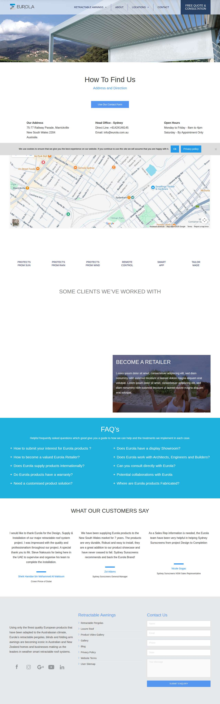

### knoxvilleelectrician.com — dry\_run\_failed (dry run)

| | |
|---|---|
| Attempt ID | `a4a3183d-2dec-48d3-8dd9-cb3f10251fe8` |
| Form URL | https://knoxvilleelectrician.com/contact-us/ |
| Final URL | https://knoxvilleelectrician.com/contact-us/ |
| Reserved | 2026-11-11 08:07:26 UTC |
| Submit attempted | — |
| Template | standard v2 |
| Confirmation text | none observed |
| Result / error | Mapped field "Name" not found uniquely |

Exact message:

~~~text
Subject: Helping customers find your business in AI search (AEO + GEO)

Hi there,

I'm Arun from Devs Arun. More and more customers now ask ChatGPT, Gemini, Perplexity or Google's AI Overviews questions like "who should I hire for this in my area?" before they call anyone. These tools answer from websites they can clearly understand, and they tend to recommend businesses whose pages answer real customer questions.

That is what AEO + GEO (Answer Engine and Generative Engine Optimization) is for. I improve your existing service pages so they clearly answer the questions your customers ask, add structured data that matches the page, and make the call, quote or enquiry step obvious. The benefit: your business gets a better chance of being mentioned or linked in AI answers, and visitors who arrive find it easy to contact you.

The AEO + GEO Starter is a one-time $199 (about ₹16,999, negotiable) for one website: a basic audit, 10 customer questions, improvements to two existing pages, relevant structured data and an action plan, with one revision round.

You can read the full details, send an enquiry or book online here:
https://devsarun.io/aeo-geo/

If this isn't relevant, just reply and I won't contact you again.

Best,
Arun
Devs Arun
itschool408@gmail.com · +91 7654534323
~~~

Submitted field values:

- \#form-field-1b7221: itschool408@gmail.com
- \#form-field-2fa3ac: +91 7654534323
- \#form-field-96f51f: Arun
- \#form-field-fed9d8: Hi there, I'm Arun from Devs Arun. More and more customers now ask ChatGPT, Gemini, Perplexity or Google's AI Overviews 

**Inspected page** — `run-e1a334bf_attempt-a4a3183d_inspection_2026-11-11T08-07-28-502Z.jpg`

### sblawpartners.com.au — dry\_run\_failed (dry run)

| | |
|---|---|
| Attempt ID | `5211bfdc-476b-49a8-8529-c31dddea1140` |
| Form URL | https://sblawpartners.com.au/contact-us/ |
| Final URL | https://sblawpartners.com.au/contact-us/ |
| Reserved | 2026-11-11 08:07:33 UTC |
| Submit attempted | — |
| Template | standard v2 |
| Confirmation text | none observed |
| Result / error | Mapped field "Name \*" not found uniquely |

Exact message:

~~~text
Subject: Helping customers find your business in AI search (AEO + GEO)

Hi there,

I'm Arun from Devs Arun. More and more customers now ask ChatGPT, Gemini, Perplexity or Google's AI Overviews questions like "who should I hire for this in my area?" before they call anyone. These tools answer from websites they can clearly understand, and they tend to recommend businesses whose pages answer real customer questions.

That is what AEO + GEO (Answer Engine and Generative Engine Optimization) is for. I improve your existing service pages so they clearly answer the questions your customers ask, add structured data that matches the page, and make the call, quote or enquiry step obvious. The benefit: your business gets a better chance of being mentioned or linked in AI answers, and visitors who arrive find it easy to contact you.

The AEO + GEO Starter is a one-time $199 (about ₹16,999, negotiable) for one website: a basic audit, 10 customer questions, improvements to two existing pages, relevant structured data and an action plan, with one revision round.

You can read the full details, send an enquiry or book online here:
https://devsarun.io/aeo-geo/

If this isn't relevant, just reply and I won't contact you again.

Best,
Arun
Devs Arun
itschool408@gmail.com · +91 7654534323
~~~

Submitted field values:

- \#forminator-field-name-1\_6af14060364ef: Arun
- \#forminator-field-email-1\_6af14060364ef: itschool408@gmail.com
- \#forminator-field-phone-1\_6af14060364ef: +91 7654534323
- \#forminator-field-textarea-1\_6af14060364ef: Hi there, I'm Arun from Devs Arun. More and more customers now ask ChatGPT, Gemini, Perplexity or Google's AI Overviews 

**Inspected page** — `run-e1a334bf_attempt-5211bfdc_inspection_2026-11-11T08-07-36-526Z.jpg`

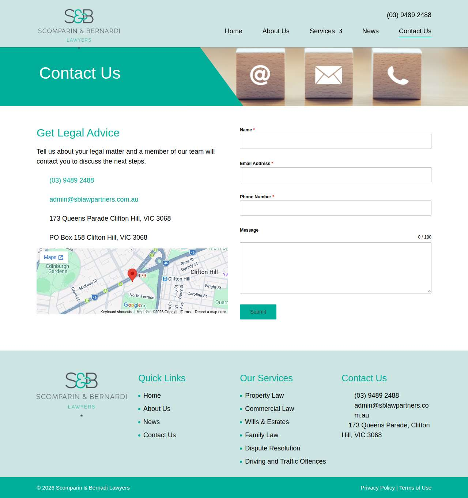

### mspc.cpa — dry\_run\_failed (dry run)

| | |
|---|---|
| Attempt ID | `11926ca6-f79c-46ea-85f6-debb4c2f4bcd` |
| Form URL | https://www.mspc.cpa/contact/ |
| Final URL | https://www.mspc.cpa/contact/ |
| Reserved | 2026-11-11 08:07:41 UTC |
| Submit attempted | — |
| Template | standard v2 |
| Confirmation text | none observed |
| Result / error | Mapped field "Full Name \*" not found uniquely |

Exact message:

~~~text
Subject: Helping customers find your business in AI search (AEO + GEO)

Hi there,

I'm Arun from Devs Arun. More and more customers now ask ChatGPT, Gemini, Perplexity or Google's AI Overviews questions like "who should I hire for this in my area?" before they call anyone. These tools answer from websites they can clearly understand, and they tend to recommend businesses whose pages answer real customer questions.

That is what AEO + GEO (Answer Engine and Generative Engine Optimization) is for. I improve your existing service pages so they clearly answer the questions your customers ask, add structured data that matches the page, and make the call, quote or enquiry step obvious. The benefit: your business gets a better chance of being mentioned or linked in AI answers, and visitors who arrive find it easy to contact you.

The AEO + GEO Starter is a one-time $199 (about ₹16,999, negotiable) for one website: a basic audit, 10 customer questions, improvements to two existing pages, relevant structured data and an action plan, with one revision round.

You can read the full details, send an enquiry or book online here:
https://devsarun.io/aeo-geo/

If this isn't relevant, just reply and I won't contact you again.

Best,
Arun
Devs Arun
itschool408@gmail.com · +91 7654534323
~~~

Submitted field values:

- \#forminator-field-name-1\_6aeaca2579f24: Arun
- \#forminator-field-text-1\_6aeaca2579f24: Devs Arun
- \#forminator-field-email-1\_6aeaca2579f24: itschool408@gmail.com
- \#forminator-field-phone-1\_6aeaca2579f24: +91 7654534323
- \#forminator-field-textarea-1\_6aeaca2579f24: Hi there, I'm Arun from Devs Arun. More and more customers now ask ChatGPT, Gemini, Perplexity or Google's AI Overviews 

**Inspected page** — `run-e1a334bf_attempt-11926ca6_inspection_2026-11-11T08-07-46-472Z.jpg`

### juicerealestate.com.au — dry\_run\_failed (dry run)

| | |
|---|---|
| Attempt ID | `01f1b08e-7e44-41c6-94f0-aeed1339b711` |
| Form URL | https://juicerealestate.com.au/contact-us/ |
| Final URL | https://juicerealestate.com.au/contact-us/ |
| Reserved | 2026-11-11 08:07:51 UTC |
| Submit attempted | — |
| Template | standard v2 |
| Confirmation text | none observed |
| Result / error | CAPTCHA/anti-bot now present (recaptcha) |

Exact message:

~~~text
Subject: Helping customers find your business in AI search (AEO + GEO)

Hi there,

I'm Arun from Devs Arun. More and more customers now ask ChatGPT, Gemini, Perplexity or Google's AI Overviews questions like "who should I hire for this in my area?" before they call anyone. These tools answer from websites they can clearly understand, and they tend to recommend businesses whose pages answer real customer questions.

That is what AEO + GEO (Answer Engine and Generative Engine Optimization) is for. I improve your existing service pages so they clearly answer the questions your customers ask, add structured data that matches the page, and make the call, quote or enquiry step obvious. The benefit: your business gets a better chance of being mentioned or linked in AI answers, and visitors who arrive find it easy to contact you.

The AEO + GEO Starter is a one-time $199 (about ₹16,999, negotiable) for one website: a basic audit, 10 customer questions, improvements to two existing pages, relevant structured data and an action plan, with one revision round.

You can read the full details, send an enquiry or book online here:
https://devsarun.io/aeo-geo/

If this isn't relevant, just reply and I won't contact you again.

Best,
Arun
Devs Arun
itschool408@gmail.com · +91 7654534323
~~~

Submitted field values:

- \#ff\_1\_email: itschool408@gmail.com
- \#ff\_1\_phone: +91 7654534323
- \#ff\_1\_message: Hi there, I'm Arun from Devs Arun. More and more customers now ask ChatGPT, Gemini, Perplexity or Google's AI Overviews 
- \#ff\_1\_names\_first\_name\_: Arun

**Inspected page** — `run-e1a334bf_attempt-01f1b08e_inspection_2026-11-11T08-07-54-854Z.jpg`

### onyxdd.com.au — dry\_run\_ok (dry run)

| | |
|---|---|
| Attempt ID | `776cf802-66d0-4642-93f1-b44c04c79226` |
| Form URL | https://onyxdd.com.au/contact-us/ |
| Final URL | https://onyxdd.com.au/contact-us/ |
| Reserved | 2026-11-11 08:07:59 UTC |
| Submit attempted | — |
| Template | standard v2 |
| Confirmation text | none observed |
| Result / error | Selectors verified; fields not typed (domain not in dry-run fill list); not submitted |

Exact message:

~~~text
Subject: Helping customers find your business in AI search (AEO + GEO)

Hi there,

I'm Arun from Devs Arun. More and more customers now ask ChatGPT, Gemini, Perplexity or Google's AI Overviews questions like "who should I hire for this in my area?" before they call anyone. These tools answer from websites they can clearly understand, and they tend to recommend businesses whose pages answer real customer questions.

That is what AEO + GEO (Answer Engine and Generative Engine Optimization) is for. I improve your existing service pages so they clearly answer the questions your customers ask, add structured data that matches the page, and make the call, quote or enquiry step obvious. The benefit: your business gets a better chance of being mentioned or linked in AI answers, and visitors who arrive find it easy to contact you.

The AEO + GEO Starter is a one-time $199 (about ₹16,999, negotiable) for one website: a basic audit, 10 customer questions, improvements to two existing pages, relevant structured data and an action plan, with one revision round.

You can read the full details, send an enquiry or book online here:
https://devsarun.io/aeo-geo/

If this isn't relevant, just reply and I won't contact you again.

Best,
Arun
Devs Arun
itschool408@gmail.com · +91 7654534323
~~~

Submitted field values:

- \#input\_1\_1: Arun
- \#input\_1\_2: itschool408@gmail.com
- \#input\_1\_3: +91 7654534323
- \#input\_1\_4: Hi there, I'm Arun from Devs Arun. More and more customers now ask ChatGPT, Gemini, Perplexity or Google's AI Overviews 

**Inspected page** — `run-e1a334bf_attempt-776cf802_inspection_2026-11-11T08-08-06-850Z.jpg`

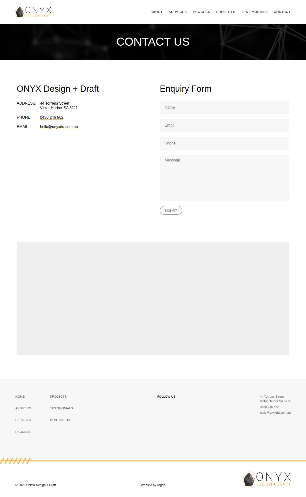

### 8la.com.au — dry\_run\_ok (dry run)

| | |
|---|---|
| Attempt ID | `4d491272-6a61-458d-bc2d-94d5cea5c527` |
| Form URL | https://8la.com.au/contact/ |
| Final URL | https://8la.com.au/contact/ |
| Reserved | 2026-11-11 08:08:11 UTC |
| Submit attempted | — |
| Template | standard v2 |
| Confirmation text | none observed |
| Result / error | Selectors verified; fields not typed (domain not in dry-run fill list); not submitted |

Exact message:

~~~text
Subject: Helping customers find your business in AI search (AEO + GEO)

Hi there,

I'm Arun from Devs Arun. More and more customers now ask ChatGPT, Gemini, Perplexity or Google's AI Overviews questions like "who should I hire for this in my area?" before they call anyone. These tools answer from websites they can clearly understand, and they tend to recommend businesses whose pages answer real customer questions.

That is what AEO + GEO (Answer Engine and Generative Engine Optimization) is for. I improve your existing service pages so they clearly answer the questions your customers ask, add structured data that matches the page, and make the call, quote or enquiry step obvious. The benefit: your business gets a better chance of being mentioned or linked in AI answers, and visitors who arrive find it easy to contact you.

The AEO + GEO Starter is a one-time $199 (about ₹16,999, negotiable) for one website: a basic audit, 10 customer questions, improvements to two existing pages, relevant structured data and an action plan, with one revision round.

You can read the full details, send an enquiry or book online here:
https://devsarun.io/aeo-geo/

If this isn't relevant, just reply and I won't contact you again.

Best,
Arun
Devs Arun
itschool408@gmail.com · +91 7654534323
~~~

Submitted field values:

- \#g11-name: Arun
- \#g11-email: itschool408@gmail.com
- \#g11-phone: +91 7654534323
- \#contact-form-comment-g11-whatcanwehelpyouwith: Hi there, I'm Arun from Devs Arun. More and more customers now ask ChatGPT, Gemini, Perplexity or Google's AI Overviews 

**Inspected page** — `run-e1a334bf_attempt-4d491272_inspection_2026-11-11T08-08-14-035Z.jpg`

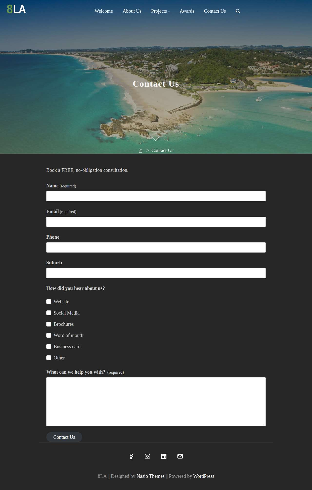

### thepensionprofessionals.com.au — dry\_run\_ok (dry run)

| | |
|---|---|
| Attempt ID | `c7378010-f2ec-42f1-a0a4-e9b8b3237a3b` |
| Form URL | https://www.thepensionprofessionals.com.au/contact.html\#enquiry |
| Final URL | https://www.thepensionprofessionals.com.au/contact.html\#enquiry |
| Reserved | 2026-11-11 08:08:19 UTC |
| Submit attempted | — |
| Template | standard v2 |
| Confirmation text | none observed |
| Result / error | Selectors verified; fields not typed (domain not in dry-run fill list); not submitted |

Exact message:

~~~text
Subject: Helping customers find your business in AI search (AEO + GEO)

Hi there,

I'm Arun from Devs Arun. More and more customers now ask ChatGPT, Gemini, Perplexity or Google's AI Overviews questions like "who should I hire for this in my area?" before they call anyone. These tools answer from websites they can clearly understand, and they tend to recommend businesses whose pages answer real customer questions.

That is what AEO + GEO (Answer Engine and Generative Engine Optimization) is for. I improve your existing service pages so they clearly answer the questions your customers ask, add structured data that matches the page, and make the call, quote or enquiry step obvious. The benefit: your business gets a better chance of being mentioned or linked in AI answers, and visitors who arrive find it easy to contact you.

The AEO + GEO Starter is a one-time $199 (about ₹16,999, negotiable) for one website: a basic audit, 10 customer questions, improvements to two existing pages, relevant structured data and an action plan, with one revision round.

You can read the full details, send an enquiry or book online here:
https://devsarun.io/aeo-geo/

If this isn't relevant, just reply and I won't contact you again.

Best,
Arun
Devs Arun
itschool408@gmail.com · +91 7654534323
~~~

Submitted field values:

- input\[name="a\_Name"\]: Arun
- input\[name="b\_Phone"\]: +91 7654534323
- input\[name="c\_Email"\]: itschool408@gmail.com
- textarea\[name="ZZ\_Comments"\]: Hi there, I'm Arun from Devs Arun. More and more customers now ask ChatGPT, Gemini, Perplexity or Google's AI Overviews 

**Inspected page** — `run-e1a334bf_attempt-c7378010_inspection_2026-11-11T08-08-21-683Z.jpg`

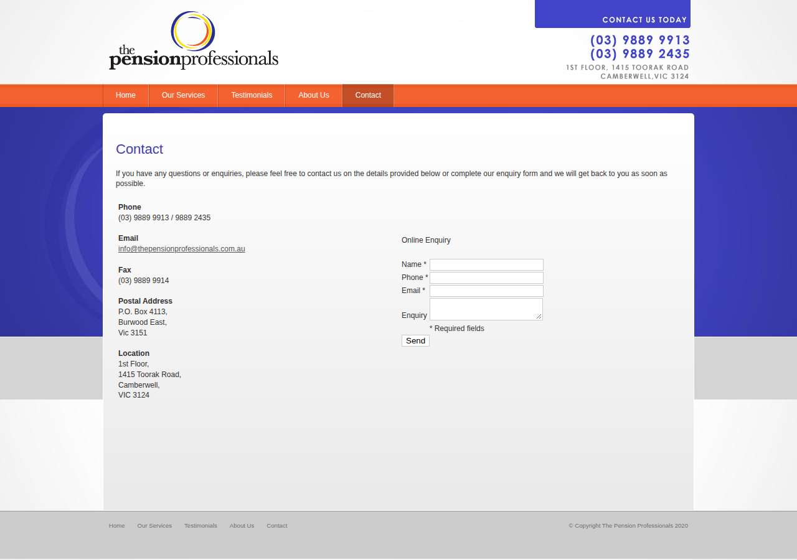

### investwisely.co — dry\_run\_ok (dry run)

| | |
|---|---|
| Attempt ID | `fe3d0f7a-178e-42e8-a1c8-ed96e624f4d2` |
| Form URL | https://www.investwisely.au/contact |
| Final URL | https://www.investwisely.au/contact |
| Reserved | 2026-11-11 08:08:26 UTC |
| Submit attempted | — |
| Template | standard v2 |
| Confirmation text | none observed |
| Result / error | Selectors verified; fields not typed (domain not in dry-run fill list); not submitted |

Exact message:

~~~text
Subject: Helping customers find your business in AI search (AEO + GEO)

Hi there,

I'm Arun from Devs Arun. More and more customers now ask ChatGPT, Gemini, Perplexity or Google's AI Overviews questions like "who should I hire for this in my area?" before they call anyone. These tools answer from websites they can clearly understand, and they tend to recommend businesses whose pages answer real customer questions.

That is what AEO + GEO (Answer Engine and Generative Engine Optimization) is for. I improve your existing service pages so they clearly answer the questions your customers ask, add structured data that matches the page, and make the call, quote or enquiry step obvious. The benefit: your business gets a better chance of being mentioned or linked in AI answers, and visitors who arrive find it easy to contact you.

The AEO + GEO Starter is a one-time $199 (about ₹16,999, negotiable) for one website: a basic audit, 10 customer questions, improvements to two existing pages, relevant structured data and an action plan, with one revision round.

You can read the full details, send an enquiry or book online here:
https://devsarun.io/aeo-geo/

If this isn't relevant, just reply and I won't contact you again.

Best,
Arun
Devs Arun
itschool408@gmail.com · +91 7654534323
~~~

Submitted field values:

- \#input\_comp-m6vof42y: +91 7654534323
- \#input\_comp-m6vof42m1: Arun
- \#input\_comp-m6vof42u1: itschool408@gmail.com
- \#textarea\_comp-m6vof4311: Hi there, I'm Arun from Devs Arun. More and more customers now ask ChatGPT, Gemini, Perplexity or Google's AI Overviews 

**Inspected page** — `run-e1a334bf_attempt-fe3d0f7a_inspection_2026-11-11T08-08-29-164Z.jpg`

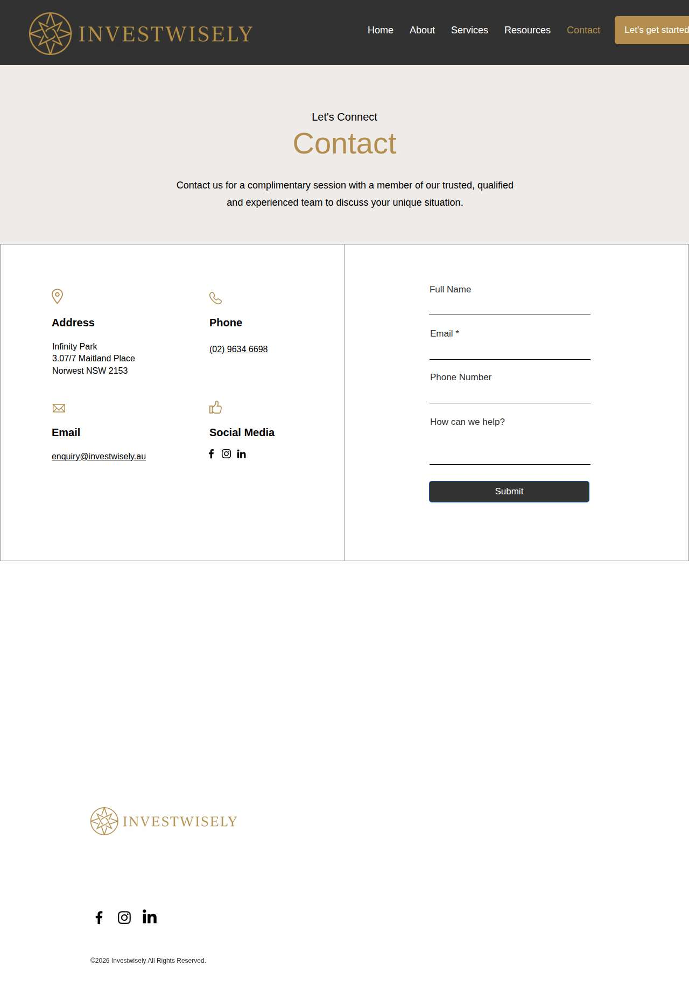

### smithmccarthywilson.com.au — dry\_run\_ok (dry run)

| | |
|---|---|
| Attempt ID | `ac68182e-e4b7-4d96-a0ef-a7925b600adb` |
| Form URL | https://smithmccarthywilson.com.au/ |
| Final URL | https://smithmccarthywilson.com.au/ |
| Reserved | 2026-11-11 08:08:34 UTC |
| Submit attempted | — |
| Template | standard v2 |
| Confirmation text | none observed |
| Result / error | Selectors verified; fields not typed (domain not in dry-run fill list); not submitted |

Exact message:

~~~text
Subject: Helping customers find your business in AI search (AEO + GEO)

Hi there,

I'm Arun from Devs Arun. More and more customers now ask ChatGPT, Gemini, Perplexity or Google's AI Overviews questions like "who should I hire for this in my area?" before they call anyone. These tools answer from websites they can clearly understand, and they tend to recommend businesses whose pages answer real customer questions.

That is what AEO + GEO (Answer Engine and Generative Engine Optimization) is for. I improve your existing service pages so they clearly answer the questions your customers ask, add structured data that matches the page, and make the call, quote or enquiry step obvious. The benefit: your business gets a better chance of being mentioned or linked in AI answers, and visitors who arrive find it easy to contact you.

The AEO + GEO Starter is a one-time $199 (about ₹16,999, negotiable) for one website: a basic audit, 10 customer questions, improvements to two existing pages, relevant structured data and an action plan, with one revision round.

You can read the full details, send an enquiry or book online here:
https://devsarun.io/aeo-geo/

If this isn't relevant, just reply and I won't contact you again.

Best,
Arun
Devs Arun
itschool408@gmail.com · +91 7654534323
~~~

Submitted field values:

- \#form-field-name: Arun
- \#form-field-email: itschool408@gmail.com
- \#form-field-message: Hi there, I'm Arun from Devs Arun. More and more customers now ask ChatGPT, Gemini, Perplexity or Google's AI Overviews 
- \#form-field-field\_5d45d59: +91 7654534323

**Inspected page** — `run-e1a334bf_attempt-ac68182e_inspection_2026-11-11T08-08-39-700Z.jpg`

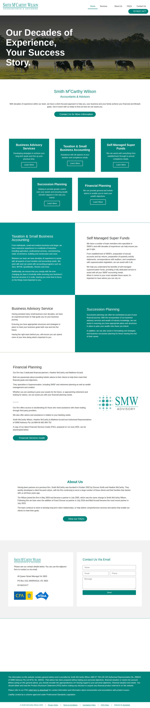

### revivefinancial.com.au — dry\_run\_ok (dry run)

| | |
|---|---|
| Attempt ID | `869ddb78-b40d-427e-bdb6-97fb1f91070e` |
| Form URL | https://revivefinancial.com.au/about-us/contact-us/ |
| Final URL | https://revivefinancial.com.au/about-us/contact-us/ |
| Reserved | 2026-11-11 08:08:44 UTC |
| Submit attempted | — |
| Template | standard v2 |
| Confirmation text | none observed |
| Result / error | Selectors verified; fields not typed (domain not in dry-run fill list); not submitted |

Exact message:

~~~text
Subject: Helping customers find your business in AI search (AEO + GEO)

Hi there,

I'm Arun from Devs Arun. More and more customers now ask ChatGPT, Gemini, Perplexity or Google's AI Overviews questions like "who should I hire for this in my area?" before they call anyone. These tools answer from websites they can clearly understand, and they tend to recommend businesses whose pages answer real customer questions.

That is what AEO + GEO (Answer Engine and Generative Engine Optimization) is for. I improve your existing service pages so they clearly answer the questions your customers ask, add structured data that matches the page, and make the call, quote or enquiry step obvious. The benefit: your business gets a better chance of being mentioned or linked in AI answers, and visitors who arrive find it easy to contact you.

The AEO + GEO Starter is a one-time $199 (about ₹16,999, negotiable) for one website: a basic audit, 10 customer questions, improvements to two existing pages, relevant structured data and an action plan, with one revision round.

You can read the full details, send an enquiry or book online here:
https://devsarun.io/aeo-geo/

If this isn't relevant, just reply and I won't contact you again.

Best,
Arun
Devs Arun
itschool408@gmail.com · +91 7654534323
~~~

Submitted field values:

- \#f\_321b80d6-d630-4b61-8c84-0286ca015d44: +91 7654534323
- \#f\_65fbe541-d24f-43b7-b9de-60fe3cb60e1e: Arun
- \#f\_7aa9853b-520f-4bbf-b2b1-ae4315ddf48a: itschool408@gmail.com
- \#f\_ed799570-f583-4f79-9def-cb7a6030ae69: Hi there, I'm Arun from Devs Arun. More and more customers now ask ChatGPT, Gemini, Perplexity or Google's AI Overviews 

**Inspected page** — `run-e1a334bf_attempt-869ddb78_inspection_2026-11-11T08-08-47-176Z.jpg`

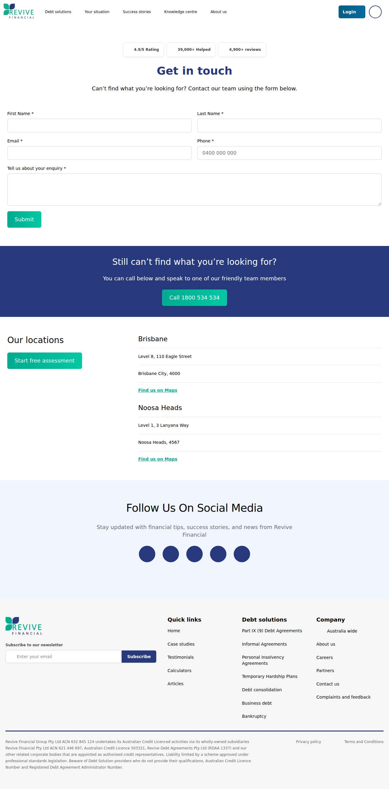

### nicholsonpartners.com.au — dry\_run\_ok (dry run)

| | |
|---|---|
| Attempt ID | `b53b8419-bc9b-465c-9ecc-10715d3acb89` |
| Form URL | https://nicholsonpartners.com.au/contact-us/ |
| Final URL | https://nicholsonpartners.com.au/contact-us/ |
| Reserved | 2026-11-11 08:08:52 UTC |
| Submit attempted | — |
| Template | standard v2 |
| Confirmation text | none observed |
| Result / error | Selectors verified; fields not typed (domain not in dry-run fill list); not submitted |

Exact message:

~~~text
Subject: Helping customers find your business in AI search (AEO + GEO)

Hi there,

I'm Arun from Devs Arun. More and more customers now ask ChatGPT, Gemini, Perplexity or Google's AI Overviews questions like "who should I hire for this in my area?" before they call anyone. These tools answer from websites they can clearly understand, and they tend to recommend businesses whose pages answer real customer questions.

That is what AEO + GEO (Answer Engine and Generative Engine Optimization) is for. I improve your existing service pages so they clearly answer the questions your customers ask, add structured data that matches the page, and make the call, quote or enquiry step obvious. The benefit: your business gets a better chance of being mentioned or linked in AI answers, and visitors who arrive find it easy to contact you.

The AEO + GEO Starter is a one-time $199 (about ₹16,999, negotiable) for one website: a basic audit, 10 customer questions, improvements to two existing pages, relevant structured data and an action plan, with one revision round.

You can read the full details, send an enquiry or book online here:
https://devsarun.io/aeo-geo/

If this isn't relevant, just reply and I won't contact you again.

Best,
Arun
Devs Arun
itschool408@gmail.com · +91 7654534323
~~~

Submitted field values:

- input\[name="phone"\]: +91 7654534323
- input\[name="yourname"\]: Arun
- select\[name="subject"\]: Other
- input\[name="youremail"\]: itschool408@gmail.com
- textarea\[name="message"\]: Hi there, I'm Arun from Devs Arun. More and more customers now ask ChatGPT, Gemini, Perplexity or Google's AI Overviews 

**Inspected page** — `run-e1a334bf_attempt-b53b8419_inspection_2026-11-11T08-08-53-816Z.jpg`

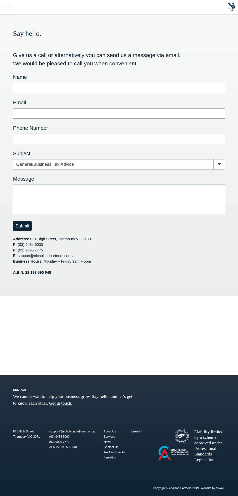

### financialcounselling.org.au — dry\_run\_ok (dry run)

| | |
|---|---|
| Attempt ID | `1b64a083-4d6a-4a84-ba08-bc6842d2a9cd` |
| Form URL | https://www.financialcounselling.org.au/contact |
| Final URL | https://www.financialcounselling.org.au/contact |
| Reserved | 2026-11-11 08:08:58 UTC |
| Submit attempted | — |
| Template | standard v2 |
| Confirmation text | none observed |
| Result / error | Selectors verified; fields not typed (domain not in dry-run fill list); not submitted |

Exact message:

~~~text
Subject: Helping customers find your business in AI search (AEO + GEO)

Hi there,

I'm Arun from Devs Arun. More and more customers now ask ChatGPT, Gemini, Perplexity or Google's AI Overviews questions like "who should I hire for this in my area?" before they call anyone. These tools answer from websites they can clearly understand, and they tend to recommend businesses whose pages answer real customer questions.

That is what AEO + GEO (Answer Engine and Generative Engine Optimization) is for. I improve your existing service pages so they clearly answer the questions your customers ask, add structured data that matches the page, and make the call, quote or enquiry step obvious. The benefit: your business gets a better chance of being mentioned or linked in AI answers, and visitors who arrive find it easy to contact you.

The AEO + GEO Starter is a one-time $199 (about ₹16,999, negotiable) for one website: a basic audit, 10 customer questions, improvements to two existing pages, relevant structured data and an action plan, with one revision round.

You can read the full details, send an enquiry or book online here:
https://devsarun.io/aeo-geo/

If this isn't relevant, just reply and I won't contact you again.

Best,
Arun
Devs Arun
itschool408@gmail.com · +91 7654534323
~~~

Submitted field values:

- \#input\_comp-lh7aj16s: itschool408@gmail.com
- \#input\_comp-lh7aj1711: Helping customers find your business in AI search (AEO + GEO)
- \#textarea\_comp-lh7aj174: Hi there, I'm Arun from Devs Arun. More and more customers now ask ChatGPT, Gemini, Perplexity or Google's AI Overviews 

**Inspected page** — `run-e1a334bf_attempt-1b64a083_inspection_2026-11-11T08-09-00-993Z.jpg`

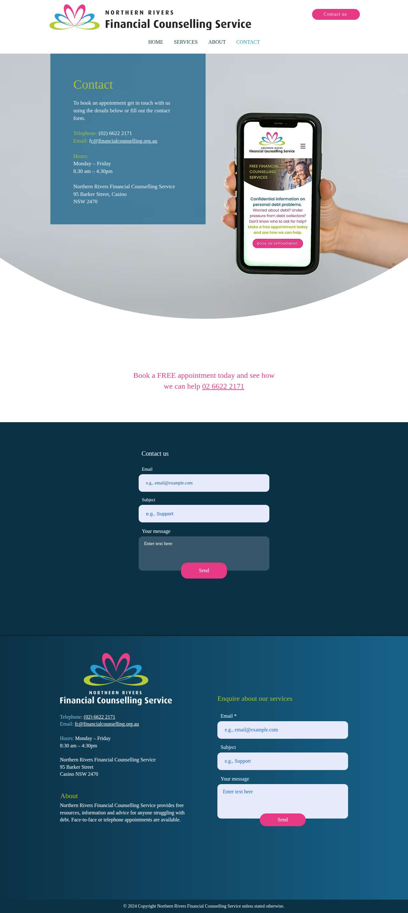

### fortitudewealth.com.au — dry\_run\_ok (dry run)

| | |
|---|---|
| Attempt ID | `08cddbcd-5ad1-4762-8fdc-0a31e1656644` |
| Form URL | https://fortitudewealth.com.au/contact/ |
| Final URL | https://fortitudewealth.com.au/contact/ |
| Reserved | 2026-11-11 08:09:06 UTC |
| Submit attempted | — |
| Template | standard v2 |
| Confirmation text | none observed |
| Result / error | Selectors verified; fields not typed (domain not in dry-run fill list); not submitted |

Exact message:

~~~text
Subject: Helping customers find your business in AI search (AEO + GEO)

Hi there,

I'm Arun from Devs Arun. More and more customers now ask ChatGPT, Gemini, Perplexity or Google's AI Overviews questions like "who should I hire for this in my area?" before they call anyone. These tools answer from websites they can clearly understand, and they tend to recommend businesses whose pages answer real customer questions.

That is what AEO + GEO (Answer Engine and Generative Engine Optimization) is for. I improve your existing service pages so they clearly answer the questions your customers ask, add structured data that matches the page, and make the call, quote or enquiry step obvious. The benefit: your business gets a better chance of being mentioned or linked in AI answers, and visitors who arrive find it easy to contact you.

The AEO + GEO Starter is a one-time $199 (about ₹16,999, negotiable) for one website: a basic audit, 10 customer questions, improvements to two existing pages, relevant structured data and an action plan, with one revision round.

You can read the full details, send an enquiry or book online here:
https://devsarun.io/aeo-geo/

If this isn't relevant, just reply and I won't contact you again.

Best,
Arun
Devs Arun
itschool408@gmail.com · +91 7654534323
~~~

Submitted field values:

- \#form-field-name: Arun
- \#form-field-email: itschool408@gmail.com
- \#form-field-phone: +91 7654534323
- \#form-field-message: Hi there, I'm Arun from Devs Arun. More and more customers now ask ChatGPT, Gemini, Perplexity or Google's AI Overviews 

**Inspected page** — `run-e1a334bf_attempt-08cddbcd_inspection_2026-11-11T08-09-09-893Z.jpg`

### dimensioniv.com.au — dry\_run\_ok (dry run)

| | |
|---|---|
| Attempt ID | `51c9918d-eaf4-4ad4-b0ad-2c9a50b74e80` |
| Form URL | https://www.dimensioniv.com.au/contact.php |
| Final URL | https://www.dimensioniv.com.au/contact.php |
| Reserved | 2026-11-11 08:09:14 UTC |
| Submit attempted | — |
| Template | standard v2 |
| Confirmation text | none observed |
| Result / error | Selectors verified; fields not typed (domain not in dry-run fill list); not submitted |

Exact message:

~~~text
Subject: Helping customers find your business in AI search (AEO + GEO)

Hi there,

I'm Arun from Devs Arun. More and more customers now ask ChatGPT, Gemini, Perplexity or Google's AI Overviews questions like "who should I hire for this in my area?" before they call anyone. These tools answer from websites they can clearly understand, and they tend to recommend businesses whose pages answer real customer questions.

That is what AEO + GEO (Answer Engine and Generative Engine Optimization) is for. I improve your existing service pages so they clearly answer the questions your customers ask, add structured data that matches the page, and make the call, quote or enquiry step obvious. The benefit: your business gets a better chance of being mentioned or linked in AI answers, and visitors who arrive find it easy to contact you.

The AEO + GEO Starter is a one-time $199 (about ₹16,999, negotiable) for one website: a basic audit, 10 customer questions, improvements to two existing pages, relevant structured data and an action plan, with one revision round.

You can read the full details, send an enquiry or book online here:
https://devsarun.io/aeo-geo/

If this isn't relevant, just reply and I won't contact you again.

Best,
Arun
Devs Arun
itschool408@gmail.com · +91 7654534323
~~~

Submitted field values:

- \#name: Arun
- \#email: itschool408@gmail.com
- \#phone: +91 7654534323
- textarea\[name="message"\]: Hi there, I'm Arun from Devs Arun. More and more customers now ask ChatGPT, Gemini, Perplexity or Google's AI Overviews 

**Inspected page** — `run-e1a334bf_attempt-51c9918d_inspection_2026-11-11T08-09-18-911Z.jpg`

### mjmaling.com.au — dry\_run\_ok (dry run)

| | |
|---|---|
| Attempt ID | `e4e88395-30de-4b5d-9391-5b7ca6324388` |
| Form URL | https://www.mjmaling.com.au/contact.htm |
| Final URL | https://www.mjmaling.com.au/contact.htm |
| Reserved | 2026-11-11 08:09:23 UTC |
| Submit attempted | — |
| Template | standard v2 |
| Confirmation text | none observed |
| Result / error | Selectors verified; fields not typed (domain not in dry-run fill list); not submitted |

Exact message:

~~~text
Subject: Helping customers find your business in AI search (AEO + GEO)

Hi there,

I'm Arun from Devs Arun. More and more customers now ask ChatGPT, Gemini, Perplexity or Google's AI Overviews questions like "who should I hire for this in my area?" before they call anyone. These tools answer from websites they can clearly understand, and they tend to recommend businesses whose pages answer real customer questions.

That is what AEO + GEO (Answer Engine and Generative Engine Optimization) is for. I improve your existing service pages so they clearly answer the questions your customers ask, add structured data that matches the page, and make the call, quote or enquiry step obvious. The benefit: your business gets a better chance of being mentioned or linked in AI answers, and visitors who arrive find it easy to contact you.

The AEO + GEO Starter is a one-time $199 (about ₹16,999, negotiable) for one website: a basic audit, 10 customer questions, improvements to two existing pages, relevant structured data and an action plan, with one revision round.

You can read the full details, send an enquiry or book online here:
https://devsarun.io/aeo-geo/

If this isn't relevant, just reply and I won't contact you again.

Best,
Arun
Devs Arun
itschool408@gmail.com · +91 7654534323
~~~

Submitted field values:

- \#Query: Hi there, I'm Arun from Devs Arun. More and more customers now ask ChatGPT, Gemini, Perplexity or Google's AI Overviews 
- input\[name="Name"\]: Arun
- input\[name="Email"\]: itschool408@gmail.com

**Inspected page** — `run-e1a334bf_attempt-e4e88395_inspection_2026-11-11T08-09-26-230Z.jpg`

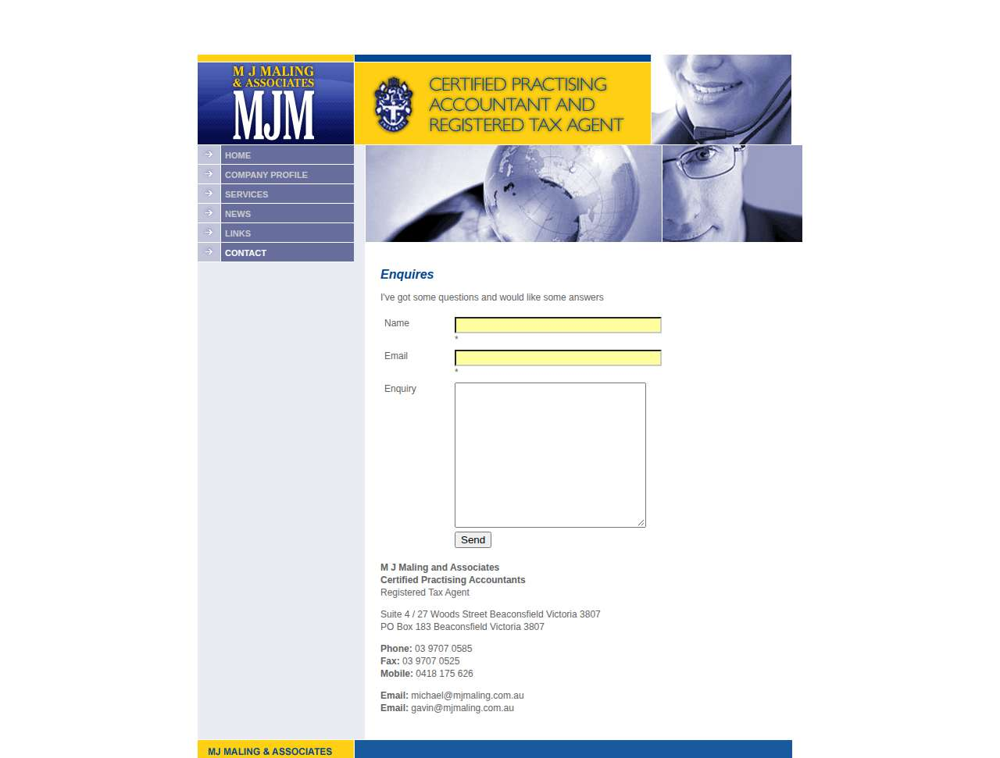

### executivefinancialcoach.com.au — dry\_run\_ok (dry run)

| | |
|---|---|
| Attempt ID | `3aeda6e3-edee-4226-85cd-c91503df8f0e` |
| Form URL | https://executivefinancialcoach.com.au/contact/ |
| Final URL | https://executivefinancialcoach.com.au/contact/ |
| Reserved | 2026-11-11 08:09:31 UTC |
| Submit attempted | — |
| Template | standard v2 |
| Confirmation text | none observed |
| Result / error | Selectors verified; fields not typed (domain not in dry-run fill list); not submitted |

Exact message:

~~~text
Subject: Helping customers find your business in AI search (AEO + GEO)

Hi there,

I'm Arun from Devs Arun. More and more customers now ask ChatGPT, Gemini, Perplexity or Google's AI Overviews questions like "who should I hire for this in my area?" before they call anyone. These tools answer from websites they can clearly understand, and they tend to recommend businesses whose pages answer real customer questions.

That is what AEO + GEO (Answer Engine and Generative Engine Optimization) is for. I improve your existing service pages so they clearly answer the questions your customers ask, add structured data that matches the page, and make the call, quote or enquiry step obvious. The benefit: your business gets a better chance of being mentioned or linked in AI answers, and visitors who arrive find it easy to contact you.

The AEO + GEO Starter is a one-time $199 (about ₹16,999, negotiable) for one website: a basic audit, 10 customer questions, improvements to two existing pages, relevant structured data and an action plan, with one revision round.

You can read the full details, send an enquiry or book online here:
https://devsarun.io/aeo-geo/

If this isn't relevant, just reply and I won't contact you again.

Best,
Arun
Devs Arun
itschool408@gmail.com · +91 7654534323
~~~

Submitted field values:

- \#input\_3\_1: Arun
- \#input\_3\_2: itschool408@gmail.com
- \#input\_3\_3: +91 7654534323
- \#input\_3\_4: Hi there, I'm Arun from Devs Arun. More and more customers now ask ChatGPT, Gemini, Perplexity or Google's AI Overviews 

**Inspected page** — `run-e1a334bf_attempt-3aeda6e3_inspection_2026-11-11T08-09-36-402Z.jpg`

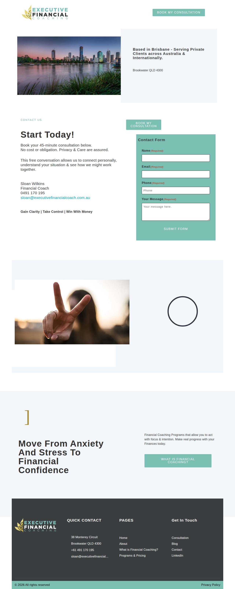

### rapidloan.com.au — dry\_run\_ok (dry run)

| | |
|---|---|
| Attempt ID | `f8f3980d-76b5-4a15-8a02-a15270bef408` |
| Form URL | https://rapidloan.com.au/inquiry.html |
| Final URL | https://rapidloan.com.au/inquiry.html |
| Reserved | 2026-11-11 08:09:41 UTC |
| Submit attempted | — |
| Template | standard v2 |
| Confirmation text | none observed |
| Result / error | Selectors verified; fields not typed (domain not in dry-run fill list); not submitted |

Exact message:

~~~text
Subject: Helping customers find your business in AI search (AEO + GEO)

Hi there,

I'm Arun from Devs Arun. More and more customers now ask ChatGPT, Gemini, Perplexity or Google's AI Overviews questions like "who should I hire for this in my area?" before they call anyone. These tools answer from websites they can clearly understand, and they tend to recommend businesses whose pages answer real customer questions.

That is what AEO + GEO (Answer Engine and Generative Engine Optimization) is for. I improve your existing service pages so they clearly answer the questions your customers ask, add structured data that matches the page, and make the call, quote or enquiry step obvious. The benefit: your business gets a better chance of being mentioned or linked in AI answers, and visitors who arrive find it easy to contact you.

The AEO + GEO Starter is a one-time $199 (about ₹16,999, negotiable) for one website: a basic audit, 10 customer questions, improvements to two existing pages, relevant structured data and an action plan, with one revision round.

You can read the full details, send an enquiry or book online here:
https://devsarun.io/aeo-geo/

If this isn't relevant, just reply and I won't contact you again.

Best,
Arun
Devs Arun
itschool408@gmail.com · +91 7654534323
~~~

Submitted field values:

- \#email: itschool408@gmail.com
- \#textarea: Hi there, I'm Arun from Devs Arun. More and more customers now ask ChatGPT, Gemini, Perplexity or Google's AI Overviews 
- input\[name="Phone"\]: +91 7654534323
- input\[name="Firstname"\]: Arun

**Inspected page** — `run-e1a334bf_attempt-f8f3980d_inspection_2026-11-11T08-09-43-071Z.jpg`

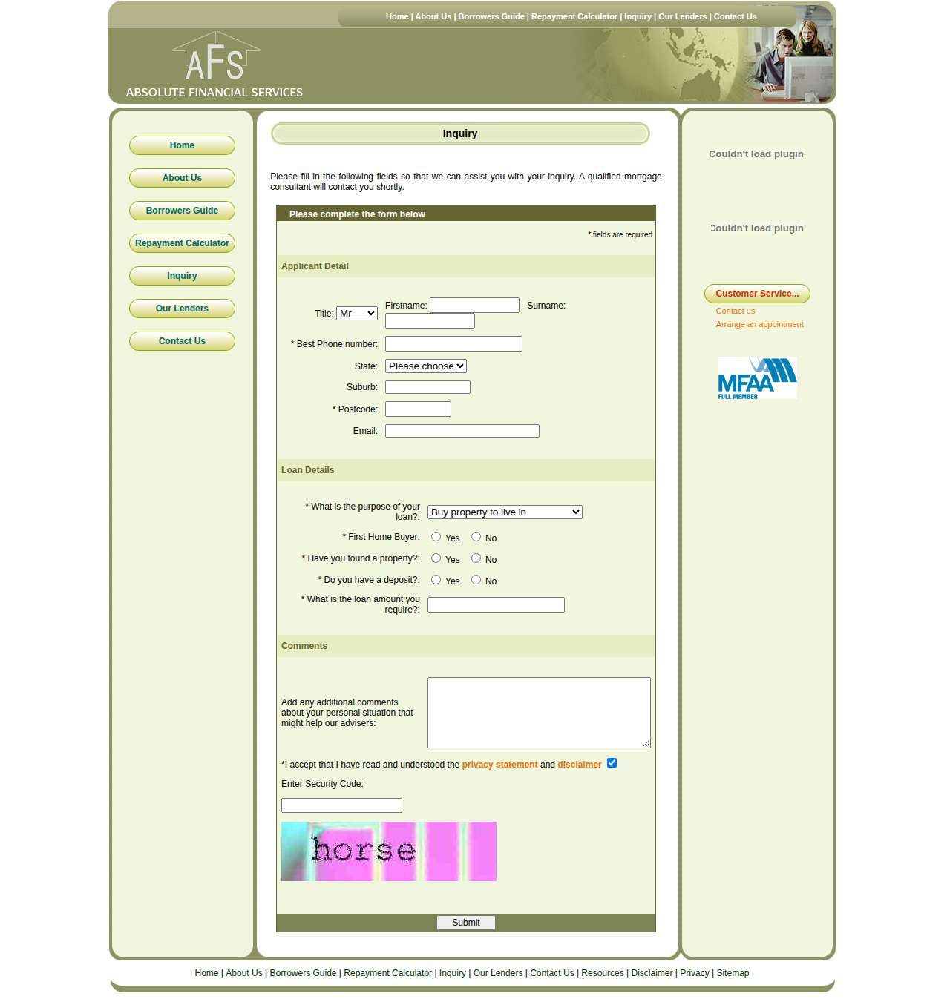

### freedomcorp.com.au — dry\_run\_ok (dry run)

| | |
|---|---|
| Attempt ID | `9633446b-02de-4b7f-912e-df3b80b24d0d` |
| Form URL | https://www.freedomcorp.com.au/contact-us/ |
| Final URL | https://www.freedomcorp.com.au/contact-us/ |
| Reserved | 2026-11-11 08:09:48 UTC |
| Submit attempted | — |
| Template | standard v2 |
| Confirmation text | none observed |
| Result / error | Selectors verified; fields not typed (domain not in dry-run fill list); not submitted |

Exact message:

~~~text
Subject: Helping customers find your business in AI search (AEO + GEO)

Hi there,

I'm Arun from Devs Arun. More and more customers now ask ChatGPT, Gemini, Perplexity or Google's AI Overviews questions like "who should I hire for this in my area?" before they call anyone. These tools answer from websites they can clearly understand, and they tend to recommend businesses whose pages answer real customer questions.

That is what AEO + GEO (Answer Engine and Generative Engine Optimization) is for. I improve your existing service pages so they clearly answer the questions your customers ask, add structured data that matches the page, and make the call, quote or enquiry step obvious. The benefit: your business gets a better chance of being mentioned or linked in AI answers, and visitors who arrive find it easy to contact you.

The AEO + GEO Starter is a one-time $199 (about ₹16,999, negotiable) for one website: a basic audit, 10 customer questions, improvements to two existing pages, relevant structured data and an action plan, with one revision round.

You can read the full details, send an enquiry or book online here:
https://devsarun.io/aeo-geo/

If this isn't relevant, just reply and I won't contact you again.

Best,
Arun
Devs Arun
itschool408@gmail.com · +91 7654534323
~~~

Submitted field values:

- \#fc-topic: Other
- \#form-field-name: Arun
- \#form-field-email: itschool408@gmail.com
- \#form-field-field\_1: +91 7654534323
- \#form-field-message: Hi there, I'm Arun from Devs Arun. More and more customers now ask ChatGPT, Gemini, Perplexity or Google's AI Overviews 

**Inspected page** — `run-e1a334bf_attempt-9633446b_inspection_2026-11-11T08-09-52-924Z.jpg`

### chiselconsulting.com.au — dry\_run\_ok (dry run)

| | |
|---|---|
| Attempt ID | `511a306d-b15a-4641-ac24-21f7a2dd3465` |
| Form URL | https://chiselconsulting.com.au/contact-us/ |
| Final URL | https://chiselconsulting.com.au/contact-us/ |
| Reserved | 2026-11-11 08:09:57 UTC |
| Submit attempted | — |
| Template | standard v2 |
| Confirmation text | none observed |
| Result / error | Selectors verified; fields not typed (domain not in dry-run fill list); not submitted |

Exact message:

~~~text
Subject: Helping customers find your business in AI search (AEO + GEO)

Hi there,

I'm Arun from Devs Arun. More and more customers now ask ChatGPT, Gemini, Perplexity or Google's AI Overviews questions like "who should I hire for this in my area?" before they call anyone. These tools answer from websites they can clearly understand, and they tend to recommend businesses whose pages answer real customer questions.

That is what AEO + GEO (Answer Engine and Generative Engine Optimization) is for. I improve your existing service pages so they clearly answer the questions your customers ask, add structured data that matches the page, and make the call, quote or enquiry step obvious. The benefit: your business gets a better chance of being mentioned or linked in AI answers, and visitors who arrive find it easy to contact you.

The AEO + GEO Starter is a one-time $199 (about ₹16,999, negotiable) for one website: a basic audit, 10 customer questions, improvements to two existing pages, relevant structured data and an action plan, with one revision round.

You can read the full details, send an enquiry or book online here:
https://devsarun.io/aeo-geo/

If this isn't relevant, just reply and I won't contact you again.

Best,
Arun
Devs Arun
itschool408@gmail.com · +91 7654534323
~~~

Submitted field values:

- \#input\_1\_1: Arun
- \#input\_1\_3: +91 7654534323
- \#input\_1\_4: itschool408@gmail.com
- \#input\_1\_5: Hi there, I'm Arun from Devs Arun. More and more customers now ask ChatGPT, Gemini, Perplexity or Google's AI Overviews 

**Inspected page** — `run-e1a334bf_attempt-511a306d_inspection_2026-11-11T08-10-00-595Z.jpg`

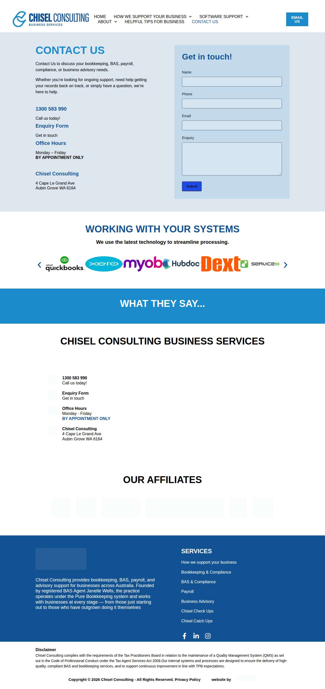

### umlautit.com.au — dry\_run\_ok (dry run)

| | |
|---|---|
| Attempt ID | `95446a55-9a36-467b-a793-b128eb035f36` |
| Form URL | https://umlautsolutions.com/contact/ |
| Final URL | https://umlautsolutions.com/contact/ |
| Reserved | 2026-11-11 08:10:05 UTC |
| Submit attempted | — |
| Template | standard v2 |
| Confirmation text | none observed |
| Result / error | Selectors verified; fields not typed (domain not in dry-run fill list); not submitted |

Exact message:

~~~text
Subject: Helping customers find your business in AI search (AEO + GEO)

Hi there,

I'm Arun from Devs Arun. More and more customers now ask ChatGPT, Gemini, Perplexity or Google's AI Overviews questions like "who should I hire for this in my area?" before they call anyone. These tools answer from websites they can clearly understand, and they tend to recommend businesses whose pages answer real customer questions.

That is what AEO + GEO (Answer Engine and Generative Engine Optimization) is for. I improve your existing service pages so they clearly answer the questions your customers ask, add structured data that matches the page, and make the call, quote or enquiry step obvious. The benefit: your business gets a better chance of being mentioned or linked in AI answers, and visitors who arrive find it easy to contact you.

The AEO + GEO Starter is a one-time $199 (about ₹16,999, negotiable) for one website: a basic audit, 10 customer questions, improvements to two existing pages, relevant structured data and an action plan, with one revision round.

You can read the full details, send an enquiry or book online here:
https://devsarun.io/aeo-geo/

If this isn't relevant, just reply and I won't contact you again.

Best,
Arun
Devs Arun
itschool408@gmail.com · +91 7654534323
~~~

Submitted field values:

- input\[name="name"\]: Arun
- input\[name="email"\]: itschool408@gmail.com
- textarea\[name="message"\]: Hi there, I'm Arun from Devs Arun. More and more customers now ask ChatGPT, Gemini, Perplexity or Google's AI Overviews 

**Inspected page** — `run-e1a334bf_attempt-95446a55_inspection_2026-11-11T08-10-09-270Z.jpg`

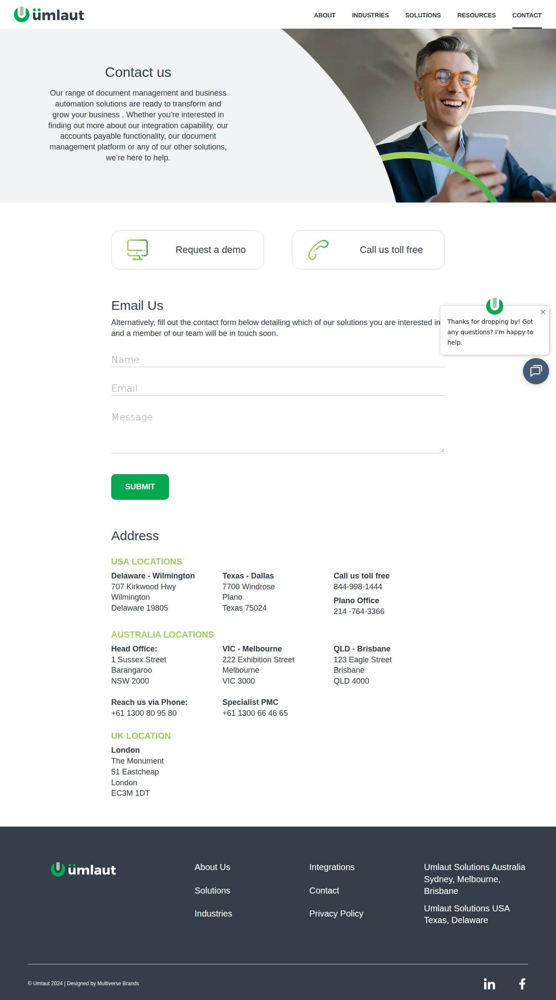

### techtonicit.com.au — dry\_run\_ok (dry run)

| | |
|---|---|
| Attempt ID | `2e1020ef-c77c-4270-b77a-8f3f76d301a7` |
| Form URL | https://techtonicit.com.au/contact |
| Final URL | https://techtonicit.com.au/contact |
| Reserved | 2026-11-11 08:10:14 UTC |
| Submit attempted | — |
| Template | standard v2 |
| Confirmation text | none observed |
| Result / error | Selectors verified; fields not typed (domain not in dry-run fill list); not submitted |

Exact message:

~~~text
Subject: Helping customers find your business in AI search (AEO + GEO)

Hi there,

I'm Arun from Devs Arun. More and more customers now ask ChatGPT, Gemini, Perplexity or Google's AI Overviews questions like "who should I hire for this in my area?" before they call anyone. These tools answer from websites they can clearly understand, and they tend to recommend businesses whose pages answer real customer questions.

That is what AEO + GEO (Answer Engine and Generative Engine Optimization) is for. I improve your existing service pages so they clearly answer the questions your customers ask, add structured data that matches the page, and make the call, quote or enquiry step obvious. The benefit: your business gets a better chance of being mentioned or linked in AI answers, and visitors who arrive find it easy to contact you.

The AEO + GEO Starter is a one-time $199 (about ₹16,999, negotiable) for one website: a basic audit, 10 customer questions, improvements to two existing pages, relevant structured data and an action plan, with one revision round.

You can read the full details, send an enquiry or book online here:
https://devsarun.io/aeo-geo/

If this isn't relevant, just reply and I won't contact you again.

Best,
Arun
Devs Arun
itschool408@gmail.com · +91 7654534323
~~~

Submitted field values:

- \#email: itschool408@gmail.com
- \#phone: +91 7654534323
- \#message: Hi there, I'm Arun from Devs Arun. More and more customers now ask ChatGPT, Gemini, Perplexity or Google's AI Overviews 
- \#firstName: Arun

**Inspected page** — `run-e1a334bf_attempt-2e1020ef_inspection_2026-11-11T08-10-16-159Z.jpg`

### onthenet.com.au — dry\_run\_ok (dry run)

| | |
|---|---|
| Attempt ID | `e00c55a9-0ad6-48b1-a5b2-2fb0a790725b` |
| Form URL | https://www.onthenet.com.au/about-us/contact-us/ |
| Final URL | https://www.onthenet.com.au/about-us/contact-us/ |
| Reserved | 2026-11-11 08:10:21 UTC |
| Submit attempted | — |
| Template | standard v2 |
| Confirmation text | none observed |
| Result / error | Selectors verified; fields not typed (domain not in dry-run fill list); not submitted |

Exact message:

~~~text
Subject: Helping customers find your business in AI search (AEO + GEO)

Hi there,

I'm Arun from Devs Arun. More and more customers now ask ChatGPT, Gemini, Perplexity or Google's AI Overviews questions like "who should I hire for this in my area?" before they call anyone. These tools answer from websites they can clearly understand, and they tend to recommend businesses whose pages answer real customer questions.

That is what AEO + GEO (Answer Engine and Generative Engine Optimization) is for. I improve your existing service pages so they clearly answer the questions your customers ask, add structured data that matches the page, and make the call, quote or enquiry step obvious. The benefit: your business gets a better chance of being mentioned or linked in AI answers, and visitors who arrive find it easy to contact you.

The AEO + GEO Starter is a one-time $199 (about ₹16,999, negotiable) for one website: a basic audit, 10 customer questions, improvements to two existing pages, relevant structured data and an action plan, with one revision round.

You can read the full details, send an enquiry or book online here:
https://devsarun.io/aeo-geo/

If this isn't relevant, just reply and I won't contact you again.

Best,
Arun
Devs Arun
itschool408@gmail.com · +91 7654534323
~~~

Submitted field values:

- \#nf-field-36: Arun
- \#nf-field-37: itschool408@gmail.com
- \#nf-field-38: Hi there, I'm Arun from Devs Arun. More and more customers now ask ChatGPT, Gemini, Perplexity or Google's AI Overviews 

**Inspected page** — `run-e1a334bf_attempt-e00c55a9_inspection_2026-11-11T08-10-25-132Z.jpg`

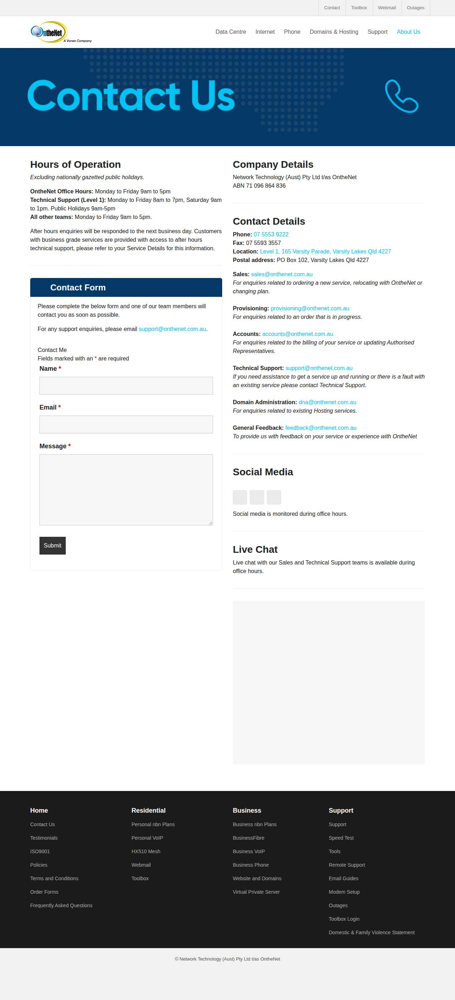

### dataone.com.au — dry\_run\_ok (dry run)

| | |
|---|---|
| Attempt ID | `6e95c7f7-bb07-49d0-8753-c36e60646416` |
| Form URL | http://www.dataone.com.au/Brisbane-IT-company.php |
| Final URL | http://www.dataone.com.au/Brisbane-IT-company.php |
| Reserved | 2026-11-11 08:10:30 UTC |
| Submit attempted | — |
| Template | standard v2 |
| Confirmation text | none observed |
| Result / error | Selectors verified; fields not typed (domain not in dry-run fill list); not submitted |

Exact message:

~~~text
Subject: Helping customers find your business in AI search (AEO + GEO)

Hi there,

I'm Arun from Devs Arun. More and more customers now ask ChatGPT, Gemini, Perplexity or Google's AI Overviews questions like "who should I hire for this in my area?" before they call anyone. These tools answer from websites they can clearly understand, and they tend to recommend businesses whose pages answer real customer questions.

That is what AEO + GEO (Answer Engine and Generative Engine Optimization) is for. I improve your existing service pages so they clearly answer the questions your customers ask, add structured data that matches the page, and make the call, quote or enquiry step obvious. The benefit: your business gets a better chance of being mentioned or linked in AI answers, and visitors who arrive find it easy to contact you.

The AEO + GEO Starter is a one-time $199 (about ₹16,999, negotiable) for one website: a basic audit, 10 customer questions, improvements to two existing pages, relevant structured data and an action plan, with one revision round.

You can read the full details, send an enquiry or book online here:
https://devsarun.io/aeo-geo/

If this isn't relevant, just reply and I won't contact you again.

Best,
Arun
Devs Arun
itschool408@gmail.com · +91 7654534323
~~~

Submitted field values:

- input\[name="name"\]: Arun
- input\[name="email"\]: itschool408@gmail.com
- input\[name="phone"\]: +91 7654534323
- textarea\[name="enquiry"\]: Hi there, I'm Arun from Devs Arun. More and more customers now ask ChatGPT, Gemini, Perplexity or Google's AI Overviews 
- input\[name="organisation"\]: Devs Arun

**Inspected page** — `run-e1a334bf_attempt-6e95c7f7_inspection_2026-11-11T08-10-32-279Z.jpg`

### smartmovetaxis.com — dry\_run\_ok (dry run)

| | |
|---|---|
| Attempt ID | `bc0b7e69-c645-4af1-a077-cbc3842ef31a` |
| Form URL | https://www.smartmovetaxis.com/contact-us/ |
| Final URL | https://www.smartmovetaxis.com/contact-us/ |
| Reserved | 2026-11-11 08:10:37 UTC |
| Submit attempted | — |
| Template | standard v2 |
| Confirmation text | none observed |
| Result / error | Selectors verified; fields not typed (domain not in dry-run fill list); not submitted |

Exact message:

~~~text
Subject: Helping customers find your business in AI search (AEO + GEO)

Hi there,

I'm Arun from Devs Arun. More and more customers now ask ChatGPT, Gemini, Perplexity or Google's AI Overviews questions like "who should I hire for this in my area?" before they call anyone. These tools answer from websites they can clearly understand, and they tend to recommend businesses whose pages answer real customer questions.

That is what AEO + GEO (Answer Engine and Generative Engine Optimization) is for. I improve your existing service pages so they clearly answer the questions your customers ask, add structured data that matches the page, and make the call, quote or enquiry step obvious. The benefit: your business gets a better chance of being mentioned or linked in AI answers, and visitors who arrive find it easy to contact you.

The AEO + GEO Starter is a one-time $199 (about ₹16,999, negotiable) for one website: a basic audit, 10 customer questions, improvements to two existing pages, relevant structured data and an action plan, with one revision round.

You can read the full details, send an enquiry or book online here:
https://devsarun.io/aeo-geo/

If this isn't relevant, just reply and I won't contact you again.

Best,
Arun
Devs Arun
itschool408@gmail.com · +91 7654534323
~~~

Submitted field values:

- input\[name="name"\]: Arun
- input\[name="email"\]: itschool408@gmail.com
- input\[name="phone"\]: +91 7654534323
- input\[name="company"\]: Devs Arun
- textarea\[name="message"\]: Hi there, I'm Arun from Devs Arun. More and more customers now ask ChatGPT, Gemini, Perplexity or Google's AI Overviews 

**Inspected page** — `run-e1a334bf_attempt-bc0b7e69_inspection_2026-11-11T08-10-40-249Z.jpg`

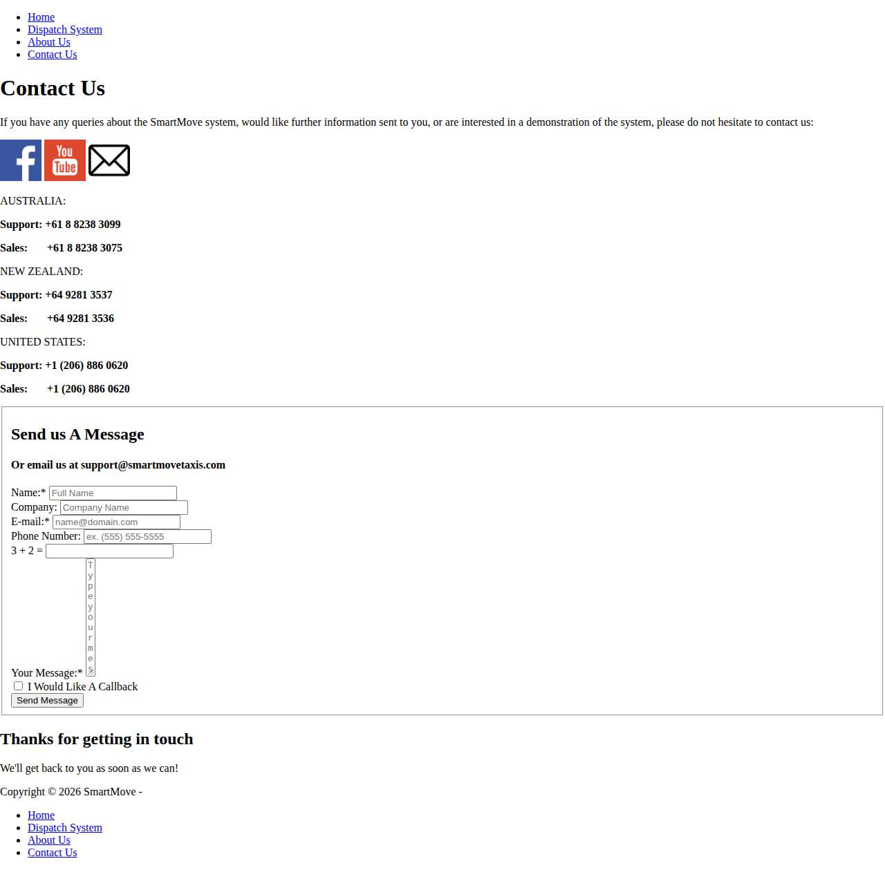

### rev.com.au — dry\_run\_ok (dry run)

| | |
|---|---|
| Attempt ID | `52a043fe-4a74-4839-8ce3-a0b58a77f278` |
| Form URL | https://www.rev.com.au/contact/ |
| Final URL | https://www.rev.com.au/contact/ |
| Reserved | 2026-11-11 08:10:45 UTC |
| Submit attempted | — |
| Template | standard v2 |
| Confirmation text | none observed |
| Result / error | Selectors verified; fields not typed (domain not in dry-run fill list); not submitted |

Exact message:

~~~text
Subject: Helping customers find your business in AI search (AEO + GEO)

Hi there,

I'm Arun from Devs Arun. More and more customers now ask ChatGPT, Gemini, Perplexity or Google's AI Overviews questions like "who should I hire for this in my area?" before they call anyone. These tools answer from websites they can clearly understand, and they tend to recommend businesses whose pages answer real customer questions.

That is what AEO + GEO (Answer Engine and Generative Engine Optimization) is for. I improve your existing service pages so they clearly answer the questions your customers ask, add structured data that matches the page, and make the call, quote or enquiry step obvious. The benefit: your business gets a better chance of being mentioned or linked in AI answers, and visitors who arrive find it easy to contact you.

The AEO + GEO Starter is a one-time $199 (about ₹16,999, negotiable) for one website: a basic audit, 10 customer questions, improvements to two existing pages, relevant structured data and an action plan, with one revision round.

You can read the full details, send an enquiry or book online here:
https://devsarun.io/aeo-geo/

If this isn't relevant, just reply and I won't contact you again.

Best,
Arun
Devs Arun
itschool408@gmail.com · +91 7654534323
~~~

Submitted field values:

- \#mui-1: Arun
- \#mui-3: itschool408@gmail.com
- \#mui-5: Hi there, I'm Arun from Devs Arun. More and more customers now ask ChatGPT, Gemini, Perplexity or Google's AI Overviews 

**Inspected page** — `run-e1a334bf_attempt-52a043fe_inspection_2026-11-11T08-10-46-806Z.jpg`

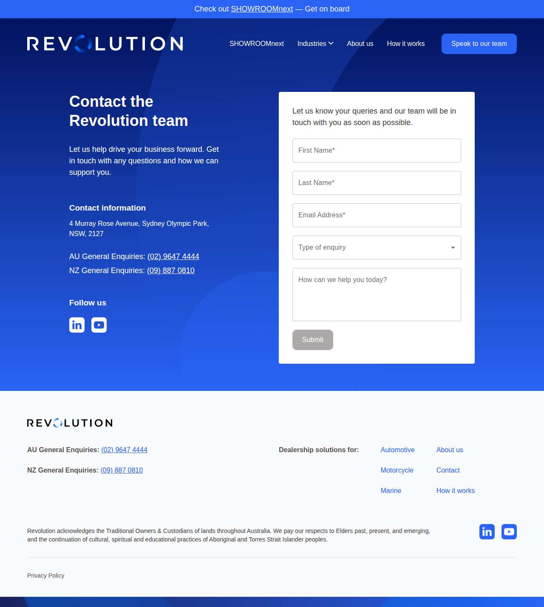

## Events (139)

| Time (UTC) | Event | Website | Details |
|---|---|---|---|
| 08:07:03 | run\_queued | — | dry\_run run requested by github:itsDevsArun |
| 08:07:03 | run\_dispatched | — | dispatch disabled (local test mode) |
| 08:07:07 | run\_started | — | Runner claimed dry\_run run |
| 08:07:07 | website\_selected | helixmechanical.com | Dry-run target helixmechanical.com |
| 08:07:07 | draft\_prepared | helixmechanical.com | Draft prepared with template standard v2 |
| 08:07:09 | page\_opened | helixmechanical.com | Opened form page |
| 08:07:09 | screenshot\_saved | helixmechanical.com | inspection screenshot saved (54 KB) |
| 08:07:09 | review\_required | helixmechanical.com | dry run failed: Mapped field "First Name \*" not found uniquely |
| 08:07:14 | website\_selected | eurola.com.au | Dry-run target eurola.com.au |
| 08:07:14 | draft\_prepared | eurola.com.au | Draft prepared with template standard v2 |
| 08:07:21 | page\_opened | eurola.com.au | Opened form page |
| 08:07:21 | screenshot\_saved | eurola.com.au | inspection screenshot saved (313 KB) |
| 08:07:21 | review\_required | eurola.com.au | dry run failed: Mapped field "field2" not found uniquely |
| 08:07:26 | website\_selected | knoxvilleelectrician.com | Dry-run target knoxvilleelectrician.com |
| 08:07:26 | draft\_prepared | knoxvilleelectrician.com | Draft prepared with template standard v2 |
| 08:07:28 | page\_opened | knoxvilleelectrician.com | Opened form page |
| 08:07:28 | screenshot\_saved | knoxvilleelectrician.com | inspection screenshot saved (137 KB) |
| 08:07:28 | review\_required | knoxvilleelectrician.com | dry run failed: Mapped field "Name" not found uniquely |
| 08:07:33 | website\_selected | sblawpartners.com.au | Dry-run target sblawpartners.com.au |
| 08:07:33 | draft\_prepared | sblawpartners.com.au | Draft prepared with template standard v2 |
| 08:07:36 | page\_opened | sblawpartners.com.au | Opened form page |
| 08:07:36 | screenshot\_saved | sblawpartners.com.au | inspection screenshot saved (95 KB) |
| 08:07:36 | review\_required | sblawpartners.com.au | dry run failed: Mapped field "Name \*" not found uniquely |
| 08:07:41 | website\_selected | mspc.cpa | Dry-run target mspc.cpa |
| 08:07:41 | draft\_prepared | mspc.cpa | Draft prepared with template standard v2 |
| 08:07:46 | page\_opened | mspc.cpa | Opened form page |
| 08:07:46 | screenshot\_saved | mspc.cpa | inspection screenshot saved (162 KB) |
| 08:07:46 | review\_required | mspc.cpa | dry run failed: Mapped field "Full Name \*" not found uniquely |
| 08:07:51 | website\_selected | juicerealestate.com.au | Dry-run target juicerealestate.com.au |
| 08:07:51 | draft\_prepared | juicerealestate.com.au | Draft prepared with template standard v2 |
| 08:07:54 | page\_opened | juicerealestate.com.au | Opened form page |
| 08:07:54 | screenshot\_saved | juicerealestate.com.au | inspection screenshot saved (59 KB) |
| 08:07:54 | review\_required | juicerealestate.com.au | dry run failed: CAPTCHA/anti-bot now present (recaptcha) |
| 08:07:59 | website\_selected | onyxdd.com.au | Dry-run target onyxdd.com.au |
| 08:07:59 | draft\_prepared | onyxdd.com.au | Draft prepared with template standard v2 |
| 08:08:06 | page\_opened | onyxdd.com.au | Opened form page |
| 08:08:06 | screenshot\_saved | onyxdd.com.au | inspection screenshot saved (64 KB) |
| 08:08:06 | dry\_run\_checked | onyxdd.com.au | dry run ok: Selectors verified; fields not typed (domain not in dry-run fill list); not submitted |
| 08:08:11 | website\_selected | 8la.com.au | Dry-run target 8la.com.au |
| 08:08:11 | draft\_prepared | 8la.com.au | Draft prepared with template standard v2 |
| 08:08:13 | page\_opened | 8la.com.au | Opened form page |
| 08:08:14 | screenshot\_saved | 8la.com.au | inspection screenshot saved (98 KB) |
| 08:08:14 | dry\_run\_checked | 8la.com.au | dry run ok: Selectors verified; fields not typed (domain not in dry-run fill list); not submitted |
| 08:08:19 | website\_selected | thepensionprofessionals.com.au | Dry-run target thepensionprofessionals.com.au |
| 08:08:19 | draft\_prepared | thepensionprofessionals.com.au | Draft prepared with template standard v2 |
| 08:08:21 | page\_opened | thepensionprofessionals.com.au | Opened form page |
| 08:08:21 | screenshot\_saved | thepensionprofessionals.com.au | inspection screenshot saved (49 KB) |
| 08:08:21 | dry\_run\_checked | thepensionprofessionals.com.au | dry run ok: Selectors verified; fields not typed (domain not in dry-run fill list); not submitted |
| 08:08:26 | website\_selected | investwisely.co | Dry-run target investwisely.co |
| 08:08:26 | draft\_prepared | investwisely.co | Draft prepared with template standard v2 |
| 08:08:29 | page\_opened | investwisely.co | Opened form page |
| 08:08:29 | screenshot\_saved | investwisely.co | inspection screenshot saved (60 KB) |
| 08:08:29 | dry\_run\_checked | investwisely.co | dry run ok: Selectors verified; fields not typed (domain not in dry-run fill list); not submitted |
| 08:08:34 | website\_selected | smithmccarthywilson.com.au | Dry-run target smithmccarthywilson.com.au |
| 08:08:34 | draft\_prepared | smithmccarthywilson.com.au | Draft prepared with template standard v2 |
| 08:08:39 | page\_opened | smithmccarthywilson.com.au | Opened form page |
| 08:08:39 | screenshot\_saved | smithmccarthywilson.com.au | inspection screenshot saved (454 KB) |
| 08:08:39 | dry\_run\_checked | smithmccarthywilson.com.au | dry run ok: Selectors verified; fields not typed (domain not in dry-run fill list); not submitted |
| 08:08:44 | website\_selected | revivefinancial.com.au | Dry-run target revivefinancial.com.au |
| 08:08:44 | draft\_prepared | revivefinancial.com.au | Draft prepared with template standard v2 |
| 08:08:47 | page\_opened | revivefinancial.com.au | Opened form page |
| 08:08:47 | screenshot\_saved | revivefinancial.com.au | inspection screenshot saved (132 KB) |
| 08:08:47 | dry\_run\_checked | revivefinancial.com.au | dry run ok: Selectors verified; fields not typed (domain not in dry-run fill list); not submitted |
| 08:08:52 | website\_selected | nicholsonpartners.com.au | Dry-run target nicholsonpartners.com.au |
| 08:08:52 | draft\_prepared | nicholsonpartners.com.au | Draft prepared with template standard v2 |
| 08:08:53 | page\_opened | nicholsonpartners.com.au | Opened form page |
| 08:08:53 | screenshot\_saved | nicholsonpartners.com.au | inspection screenshot saved (114 KB) |
| 08:08:53 | dry\_run\_checked | nicholsonpartners.com.au | dry run ok: Selectors verified; fields not typed (domain not in dry-run fill list); not submitted |
| 08:08:58 | website\_selected | financialcounselling.org.au | Dry-run target financialcounselling.org.au |
| 08:08:58 | draft\_prepared | financialcounselling.org.au | Draft prepared with template standard v2 |
| 08:09:00 | page\_opened | financialcounselling.org.au | Opened form page |
| 08:09:00 | screenshot\_saved | financialcounselling.org.au | inspection screenshot saved (134 KB) |
| 08:09:00 | dry\_run\_checked | financialcounselling.org.au | dry run ok: Selectors verified; fields not typed (domain not in dry-run fill list); not submitted |
| 08:09:06 | website\_selected | fortitudewealth.com.au | Dry-run target fortitudewealth.com.au |
| 08:09:06 | draft\_prepared | fortitudewealth.com.au | Draft prepared with template standard v2 |
| 08:09:09 | page\_opened | fortitudewealth.com.au | Opened form page |
| 08:09:09 | screenshot\_saved | fortitudewealth.com.au | inspection screenshot saved (85 KB) |
| 08:09:09 | dry\_run\_checked | fortitudewealth.com.au | dry run ok: Selectors verified; fields not typed (domain not in dry-run fill list); not submitted |
| 08:09:14 | website\_selected | dimensioniv.com.au | Dry-run target dimensioniv.com.au |
| 08:09:14 | draft\_prepared | dimensioniv.com.au | Draft prepared with template standard v2 |
| 08:09:18 | page\_opened | dimensioniv.com.au | Opened form page |
| 08:09:18 | screenshot\_saved | dimensioniv.com.au | inspection screenshot saved (125 KB) |
| 08:09:18 | dry\_run\_checked | dimensioniv.com.au | dry run ok: Selectors verified; fields not typed (domain not in dry-run fill list); not submitted |
| 08:09:23 | website\_selected | mjmaling.com.au | Dry-run target mjmaling.com.au |
| 08:09:23 | draft\_prepared | mjmaling.com.au | Draft prepared with template standard v2 |
| 08:09:26 | page\_opened | mjmaling.com.au | Opened form page |
| 08:09:26 | screenshot\_saved | mjmaling.com.au | inspection screenshot saved (55 KB) |
| 08:09:26 | dry\_run\_checked | mjmaling.com.au | dry run ok: Selectors verified; fields not typed (domain not in dry-run fill list); not submitted |
| 08:09:31 | website\_selected | executivefinancialcoach.com.au | Dry-run target executivefinancialcoach.com.au |
| 08:09:31 | draft\_prepared | executivefinancialcoach.com.au | Draft prepared with template standard v2 |
| 08:09:36 | page\_opened | executivefinancialcoach.com.au | Opened form page |
| 08:09:36 | screenshot\_saved | executivefinancialcoach.com.au | inspection screenshot saved (157 KB) |
| 08:09:36 | dry\_run\_checked | executivefinancialcoach.com.au | dry run ok: Selectors verified; fields not typed (domain not in dry-run fill list); not submitted |
| 08:09:41 | website\_selected | rapidloan.com.au | Dry-run target rapidloan.com.au |
| 08:09:41 | draft\_prepared | rapidloan.com.au | Draft prepared with template standard v2 |
| 08:09:42 | page\_opened | rapidloan.com.au | Opened form page |
| 08:09:43 | screenshot\_saved | rapidloan.com.au | inspection screenshot saved (95 KB) |
| 08:09:43 | dry\_run\_checked | rapidloan.com.au | dry run ok: Selectors verified; fields not typed (domain not in dry-run fill list); not submitted |
| 08:09:48 | website\_selected | freedomcorp.com.au | Dry-run target freedomcorp.com.au |
| 08:09:48 | draft\_prepared | freedomcorp.com.au | Draft prepared with template standard v2 |
| 08:09:52 | page\_opened | freedomcorp.com.au | Opened form page |
| 08:09:52 | screenshot\_saved | freedomcorp.com.au | inspection screenshot saved (174 KB) |
| 08:09:52 | dry\_run\_checked | freedomcorp.com.au | dry run ok: Selectors verified; fields not typed (domain not in dry-run fill list); not submitted |
| 08:09:57 | website\_selected | chiselconsulting.com.au | Dry-run target chiselconsulting.com.au |
| 08:09:57 | draft\_prepared | chiselconsulting.com.au | Draft prepared with template standard v2 |
| 08:10:00 | page\_opened | chiselconsulting.com.au | Opened form page |
| 08:10:00 | screenshot\_saved | chiselconsulting.com.au | inspection screenshot saved (178 KB) |
| 08:10:00 | dry\_run\_checked | chiselconsulting.com.au | dry run ok: Selectors verified; fields not typed (domain not in dry-run fill list); not submitted |
| 08:10:05 | website\_selected | umlautit.com.au | Dry-run target umlautit.com.au |
| 08:10:05 | draft\_prepared | umlautit.com.au | Draft prepared with template standard v2 |
| 08:10:09 | page\_opened | umlautit.com.au | Opened form page |
| 08:10:09 | screenshot\_saved | umlautit.com.au | inspection screenshot saved (126 KB) |
| 08:10:09 | dry\_run\_checked | umlautit.com.au | dry run ok: Selectors verified; fields not typed (domain not in dry-run fill list); not submitted |
| 08:10:14 | website\_selected | techtonicit.com.au | Dry-run target techtonicit.com.au |
| 08:10:14 | draft\_prepared | techtonicit.com.au | Draft prepared with template standard v2 |
| 08:10:16 | page\_opened | techtonicit.com.au | Opened form page |
| 08:10:16 | screenshot\_saved | techtonicit.com.au | inspection screenshot saved (100 KB) |
| 08:10:16 | dry\_run\_checked | techtonicit.com.au | dry run ok: Selectors verified; fields not typed (domain not in dry-run fill list); not submitted |
| 08:10:21 | website\_selected | onthenet.com.au | Dry-run target onthenet.com.au |
| 08:10:21 | draft\_prepared | onthenet.com.au | Draft prepared with template standard v2 |
| 08:10:24 | page\_opened | onthenet.com.au | Opened form page |
| 08:10:25 | screenshot\_saved | onthenet.com.au | inspection screenshot saved (177 KB) |
| 08:10:25 | dry\_run\_checked | onthenet.com.au | dry run ok: Selectors verified; fields not typed (domain not in dry-run fill list); not submitted |
| 08:10:30 | website\_selected | dataone.com.au | Dry-run target dataone.com.au |
| 08:10:30 | draft\_prepared | dataone.com.au | Draft prepared with template standard v2 |
| 08:10:32 | page\_opened | dataone.com.au | Opened form page |
| 08:10:32 | screenshot\_saved | dataone.com.au | inspection screenshot saved (64 KB) |
| 08:10:32 | dry\_run\_checked | dataone.com.au | dry run ok: Selectors verified; fields not typed (domain not in dry-run fill list); not submitted |
| 08:10:37 | website\_selected | smartmovetaxis.com | Dry-run target smartmovetaxis.com |
| 08:10:37 | draft\_prepared | smartmovetaxis.com | Draft prepared with template standard v2 |
| 08:10:40 | page\_opened | smartmovetaxis.com | Opened form page |
| 08:10:40 | screenshot\_saved | smartmovetaxis.com | inspection screenshot saved (62 KB) |
| 08:10:40 | dry\_run\_checked | smartmovetaxis.com | dry run ok: Selectors verified; fields not typed (domain not in dry-run fill list); not submitted |
| 08:10:45 | website\_selected | rev.com.au | Dry-run target rev.com.au |
| 08:10:45 | draft\_prepared | rev.com.au | Draft prepared with template standard v2 |
| 08:10:46 | page\_opened | rev.com.au | Opened form page |
| 08:10:46 | screenshot\_saved | rev.com.au | inspection screenshot saved (90 KB) |
| 08:10:46 | dry\_run\_checked | rev.com.au | dry run ok: Selectors verified; fields not typed (domain not in dry-run fill list); not submitted |
| 08:10:51 | run\_completed | — | Run completed (queue\_exhausted) |
