# Run 0659a415 — dry\_run — completed

| | |
|---|---|
| Run ID | `0659a415-ae1d-4ece-94c6-c6451123925b` |
| Requested by | github:itsDevsArun |
| Started | 2026-11-13 07:13:05 UTC |
| Finished | 2026-11-13 07:16:22 UTC |
| Finish reason | queue\_exhausted |
| GitHub Actions | https://github.com/itsDevsArun/aeo-geo/actions/runs/43360910641 |

CSV for this run: [runs/2026-11-13_dry_run_0659a415.csv](2026-11-13_dry_run_0659a415.csv)

## Attempts (25)

### helixmechanical.com — dry\_run\_failed (dry run)

| | |
|---|---|
| Attempt ID | `7532cb42-b6d6-4a19-9b54-9ebc563abb6a` |
| Form URL | https://helixmechanical.com/contact/ |
| Final URL | https://helixmechanical.com/contact/ |
| Reserved | 2026-11-13 07:13:05 UTC |
| Submit attempted | — |
| Template | standard v2 |
| Confirmation text | none observed |
| Result / error | Mapped field "First Name \*" not found uniquely |

Exact message:

~~~text
Subject: Helping customers find your business in AI search (AEO + GEO)

Hi there,

I'm Arun from Devs Arun. More and more customers now ask ChatGPT, Gemini, Perplexity or Google's AI Overviews questions like "who should I hire for this in my area?" before they call anyone. These tools answer from websites they can clearly understand, and they tend to recommend businesses whose pages answer real customer questions.

That is what AEO + GEO (Answer Engine and Generative Engine Optimization) is for. I improve your existing service pages so they clearly answer the questions your customers ask, add structured data that matches the page, and make the call, quote or enquiry step obvious. The benefit: your business gets a better chance of being mentioned or linked in AI answers, and visitors who arrive find it easy to contact you.

The AEO + GEO Starter is a one-time $199 (about ₹16,999, negotiable) for one website: a basic audit, 10 customer questions, improvements to two existing pages, relevant structured data and an action plan, with one revision round.

You can read the full details, send an enquiry or book online here:
https://devsarun.io/aeo-geo/

If this isn't relevant, just reply and I won't contact you again.

Best,
Arun
Devs Arun
itschool408@gmail.com · +91 7654534323
~~~

Submitted field values:

- \#forminator-field-name-1\_6ae7ff023fd3c: Arun
- \#forminator-field-email-1\_6ae7ff023fd3c: itschool408@gmail.com
- \#forminator-field-phone-1\_6ae7ff023fd3c: +91 7654534323
- \#forminator-field-textarea-1\_6ae7ff023fd3c: Hi there, I'm Arun from Devs Arun. More and more customers now ask ChatGPT, Gemini, Perplexity or Google's AI Overviews 

**Inspected page** — `run-0659a415_attempt-7532cb42_inspection_2026-11-13T07-13-07-135Z.jpg`

### eurola.com.au — dry\_run\_failed (dry run)

| | |
|---|---|
| Attempt ID | `1644c314-ce03-4098-a1fc-438cd75520ce` |
| Form URL | https://www.eurola.com.au/contact/ |
| Final URL | https://www.eurola.com.au/contact/ |
| Reserved | 2026-11-13 07:13:12 UTC |
| Submit attempted | — |
| Template | standard v2 |
| Confirmation text | none observed |
| Result / error | Mapped field "field2" not found uniquely |

Exact message:

~~~text
Subject: Helping customers find your business in AI search (AEO + GEO)

Hi there,

I'm Arun from Devs Arun. More and more customers now ask ChatGPT, Gemini, Perplexity or Google's AI Overviews questions like "who should I hire for this in my area?" before they call anyone. These tools answer from websites they can clearly understand, and they tend to recommend businesses whose pages answer real customer questions.

That is what AEO + GEO (Answer Engine and Generative Engine Optimization) is for. I improve your existing service pages so they clearly answer the questions your customers ask, add structured data that matches the page, and make the call, quote or enquiry step obvious. The benefit: your business gets a better chance of being mentioned or linked in AI answers, and visitors who arrive find it easy to contact you.

The AEO + GEO Starter is a one-time $199 (about ₹16,999, negotiable) for one website: a basic audit, 10 customer questions, improvements to two existing pages, relevant structured data and an action plan, with one revision round.

You can read the full details, send an enquiry or book online here:
https://devsarun.io/aeo-geo/

If this isn't relevant, just reply and I won't contact you again.

Best,
Arun
Devs Arun
itschool408@gmail.com · +91 7654534323
~~~

Submitted field values:

- input\[name="field7\[\]"\]: Arun
- div \> div \> div:nth-of-type(2) \> form \> div \> div \> div:nth-of-type(2) \> div \> div \> div \> div \> input: itschool408@gmail.com
- div \> div \> div:nth-of-type(2) \> form \> div \> div \> div:nth-of-type(3) \> div \> div \> div \> div \> input: +91 7654534323
- div \> div \> div:nth-of-type(2) \> form \> div \> div \> div:nth-of-type(5) \> div \> div \> div \> div \> textarea: Hi there, I'm Arun from Devs Arun. More and more customers now ask ChatGPT, Gemini, Perplexity or Google's AI Overviews 

**Inspected page** — `run-0659a415_attempt-1644c314_inspection_2026-11-13T07-13-17-680Z.jpg`

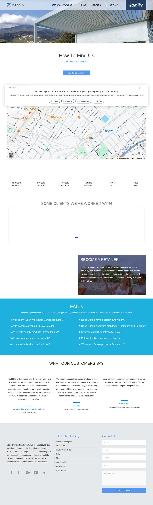

### knoxvilleelectrician.com — dry\_run\_failed (dry run)

| | |
|---|---|
| Attempt ID | `1764c18b-6fce-4d58-ac8c-3da4594b2901` |
| Form URL | https://knoxvilleelectrician.com/contact-us/ |
| Final URL | https://knoxvilleelectrician.com/contact-us/ |
| Reserved | 2026-11-13 07:13:22 UTC |
| Submit attempted | — |
| Template | standard v2 |
| Confirmation text | none observed |
| Result / error | Mapped field "Name" not found uniquely |

Exact message:

~~~text
Subject: Helping customers find your business in AI search (AEO + GEO)

Hi there,

I'm Arun from Devs Arun. More and more customers now ask ChatGPT, Gemini, Perplexity or Google's AI Overviews questions like "who should I hire for this in my area?" before they call anyone. These tools answer from websites they can clearly understand, and they tend to recommend businesses whose pages answer real customer questions.

That is what AEO + GEO (Answer Engine and Generative Engine Optimization) is for. I improve your existing service pages so they clearly answer the questions your customers ask, add structured data that matches the page, and make the call, quote or enquiry step obvious. The benefit: your business gets a better chance of being mentioned or linked in AI answers, and visitors who arrive find it easy to contact you.

The AEO + GEO Starter is a one-time $199 (about ₹16,999, negotiable) for one website: a basic audit, 10 customer questions, improvements to two existing pages, relevant structured data and an action plan, with one revision round.

You can read the full details, send an enquiry or book online here:
https://devsarun.io/aeo-geo/

If this isn't relevant, just reply and I won't contact you again.

Best,
Arun
Devs Arun
itschool408@gmail.com · +91 7654534323
~~~

Submitted field values:

- \#form-field-1b7221: itschool408@gmail.com
- \#form-field-2fa3ac: +91 7654534323
- \#form-field-96f51f: Arun
- \#form-field-fed9d8: Hi there, I'm Arun from Devs Arun. More and more customers now ask ChatGPT, Gemini, Perplexity or Google's AI Overviews 

**Inspected page** — `run-0659a415_attempt-1764c18b_inspection_2026-11-13T07-13-26-569Z.jpg`

### tricityfinishing.com — dry\_run\_failed (dry run)

| | |
|---|---|
| Attempt ID | `639e44fd-4689-4492-9149-97d33e54dca5` |
| Form URL | https://www.tricityfinishing.com/contact-us.html |
| Final URL | https://www.tricityfinishing.com/contact-us.html |
| Reserved | 2026-11-13 07:13:31 UTC |
| Submit attempted | — |
| Template | standard v2 |
| Confirmation text | none observed |
| Result / error | Reviewed form not found on page (site changed) |

Exact message:

~~~text
Subject: Helping customers find your business in AI search (AEO + GEO)

Hi there,

I'm Arun from Devs Arun. More and more customers now ask ChatGPT, Gemini, Perplexity or Google's AI Overviews questions like "who should I hire for this in my area?" before they call anyone. These tools answer from websites they can clearly understand, and they tend to recommend businesses whose pages answer real customer questions.

That is what AEO + GEO (Answer Engine and Generative Engine Optimization) is for. I improve your existing service pages so they clearly answer the questions your customers ask, add structured data that matches the page, and make the call, quote or enquiry step obvious. The benefit: your business gets a better chance of being mentioned or linked in AI answers, and visitors who arrive find it easy to contact you.

The AEO + GEO Starter is a one-time $199 (about ₹16,999, negotiable) for one website: a basic audit, 10 customer questions, improvements to two existing pages, relevant structured data and an action plan, with one revision round.

You can read the full details, send an enquiry or book online here:
https://devsarun.io/aeo-geo/

If this isn't relevant, just reply and I won't contact you again.

Best,
Arun
Devs Arun
itschool408@gmail.com · +91 7654534323
~~~

Submitted field values:

- \#name-1794547025425: Arun
- \#email-1794547025425: itschool408@gmail.com
- \#phone-1794547025426: +91 7654534323
- \#comments-1794547025426: Hi there, I'm Arun from Devs Arun. More and more customers now ask ChatGPT, Gemini, Perplexity or Google's AI Overviews 

**Inspected page** — `run-0659a415_attempt-639e44fd_inspection_2026-11-13T07-13-33-001Z.jpg`

### sblawpartners.com.au — dry\_run\_failed (dry run)

| | |
|---|---|
| Attempt ID | `9bd4badc-8cc2-40f5-af73-880eb0b93533` |
| Form URL | https://sblawpartners.com.au/contact-us/ |
| Final URL | https://sblawpartners.com.au/contact-us/ |
| Reserved | 2026-11-13 07:13:38 UTC |
| Submit attempted | — |
| Template | standard v2 |
| Confirmation text | none observed |
| Result / error | Mapped field "Name \*" not found uniquely |

Exact message:

~~~text
Subject: Helping customers find your business in AI search (AEO + GEO)

Hi there,

I'm Arun from Devs Arun. More and more customers now ask ChatGPT, Gemini, Perplexity or Google's AI Overviews questions like "who should I hire for this in my area?" before they call anyone. These tools answer from websites they can clearly understand, and they tend to recommend businesses whose pages answer real customer questions.

That is what AEO + GEO (Answer Engine and Generative Engine Optimization) is for. I improve your existing service pages so they clearly answer the questions your customers ask, add structured data that matches the page, and make the call, quote or enquiry step obvious. The benefit: your business gets a better chance of being mentioned or linked in AI answers, and visitors who arrive find it easy to contact you.

The AEO + GEO Starter is a one-time $199 (about ₹16,999, negotiable) for one website: a basic audit, 10 customer questions, improvements to two existing pages, relevant structured data and an action plan, with one revision round.

You can read the full details, send an enquiry or book online here:
https://devsarun.io/aeo-geo/

If this isn't relevant, just reply and I won't contact you again.

Best,
Arun
Devs Arun
itschool408@gmail.com · +91 7654534323
~~~

Submitted field values:

- \#forminator-field-name-1\_6af14060364ef: Arun
- \#forminator-field-email-1\_6af14060364ef: itschool408@gmail.com
- \#forminator-field-phone-1\_6af14060364ef: +91 7654534323
- \#forminator-field-textarea-1\_6af14060364ef: Hi there, I'm Arun from Devs Arun. More and more customers now ask ChatGPT, Gemini, Perplexity or Google's AI Overviews 

**Inspected page** — `run-0659a415_attempt-9bd4badc_inspection_2026-11-13T07-13-43-240Z.jpg`

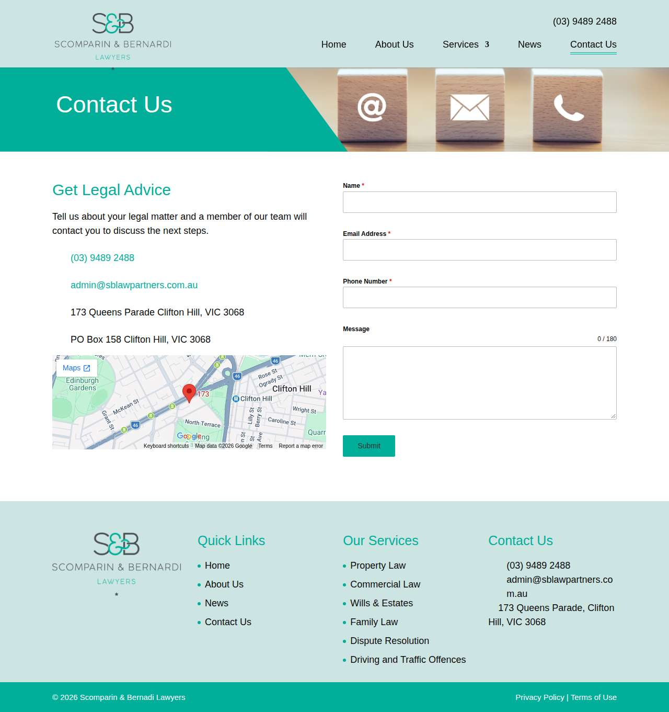

### disilvestro.com — dry\_run\_ok (dry run)

| | |
|---|---|
| Attempt ID | `9e71935f-7f6f-43f8-b5c4-0f2937b295ff` |
| Form URL | https://disilvestro.com/contact-us/ |
| Final URL | https://disilvestro.com/contact-us/ |
| Reserved | 2026-11-13 07:13:48 UTC |
| Submit attempted | — |
| Template | standard v2 |
| Confirmation text | none observed |
| Result / error | Selectors verified; fields not typed (domain not in dry-run fill list); not submitted |

Exact message:

~~~text
Subject: Helping customers find your business in AI search (AEO + GEO)

Hi there,

I'm Arun from Devs Arun. More and more customers now ask ChatGPT, Gemini, Perplexity or Google's AI Overviews questions like "who should I hire for this in my area?" before they call anyone. These tools answer from websites they can clearly understand, and they tend to recommend businesses whose pages answer real customer questions.

That is what AEO + GEO (Answer Engine and Generative Engine Optimization) is for. I improve your existing service pages so they clearly answer the questions your customers ask, add structured data that matches the page, and make the call, quote or enquiry step obvious. The benefit: your business gets a better chance of being mentioned or linked in AI answers, and visitors who arrive find it easy to contact you.

The AEO + GEO Starter is a one-time $199 (about ₹16,999, negotiable) for one website: a basic audit, 10 customer questions, improvements to two existing pages, relevant structured data and an action plan, with one revision round.

You can read the full details, send an enquiry or book online here:
https://devsarun.io/aeo-geo/

If this isn't relevant, just reply and I won't contact you again.

Best,
Arun
Devs Arun
itschool408@gmail.com · +91 7654534323
~~~

Submitted field values:

- input\[name="your-name"\]: Arun
- input\[name="your-email"\]: itschool408@gmail.com
- input\[name="your-subject"\]: Helping customers find your business in AI search (AEO + GEO)
- textarea\[name="your-message"\]: Hi there, I'm Arun from Devs Arun. More and more customers now ask ChatGPT, Gemini, Perplexity or Google's AI Overviews 

**Inspected page** — `run-0659a415_attempt-9e71935f_inspection_2026-11-13T07-13-50-166Z.jpg`

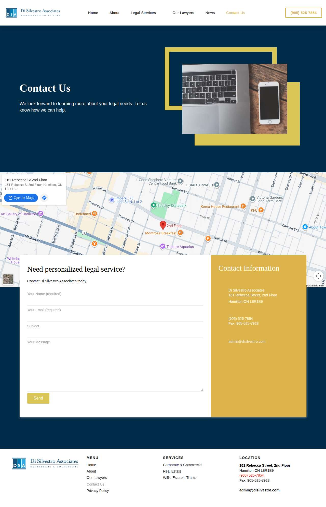

### lundrielaw.com — dry\_run\_ok (dry run)

| | |
|---|---|
| Attempt ID | `7b92ea64-0264-4605-b854-78f0d3970196` |
| Form URL | https://lundrielaw.com/ |
| Final URL | https://lundrielaw.com/ |
| Reserved | 2026-11-13 07:13:55 UTC |
| Submit attempted | — |
| Template | standard v2 |
| Confirmation text | none observed |
| Result / error | Selectors verified; fields not typed (domain not in dry-run fill list); not submitted |

Exact message:

~~~text
Subject: Helping customers find your business in AI search (AEO + GEO)

Hi there,

I'm Arun from Devs Arun. More and more customers now ask ChatGPT, Gemini, Perplexity or Google's AI Overviews questions like "who should I hire for this in my area?" before they call anyone. These tools answer from websites they can clearly understand, and they tend to recommend businesses whose pages answer real customer questions.

That is what AEO + GEO (Answer Engine and Generative Engine Optimization) is for. I improve your existing service pages so they clearly answer the questions your customers ask, add structured data that matches the page, and make the call, quote or enquiry step obvious. The benefit: your business gets a better chance of being mentioned or linked in AI answers, and visitors who arrive find it easy to contact you.

The AEO + GEO Starter is a one-time $199 (about ₹16,999, negotiable) for one website: a basic audit, 10 customer questions, improvements to two existing pages, relevant structured data and an action plan, with one revision round.

You can read the full details, send an enquiry or book online here:
https://devsarun.io/aeo-geo/

If this isn't relevant, just reply and I won't contact you again.

Best,
Arun
Devs Arun
itschool408@gmail.com · +91 7654534323
~~~

Submitted field values:

- \#et\_pb\_contact\_name\_0: Arun
- \#et\_pb\_contact\_email\_0: itschool408@gmail.com
- \#et\_pb\_contact\_message\_0: Hi there, I'm Arun from Devs Arun. More and more customers now ask ChatGPT, Gemini, Perplexity or Google's AI Overviews 

**Inspected page** — `run-0659a415_attempt-7b92ea64_inspection_2026-11-13T07-13-59-937Z.jpg`

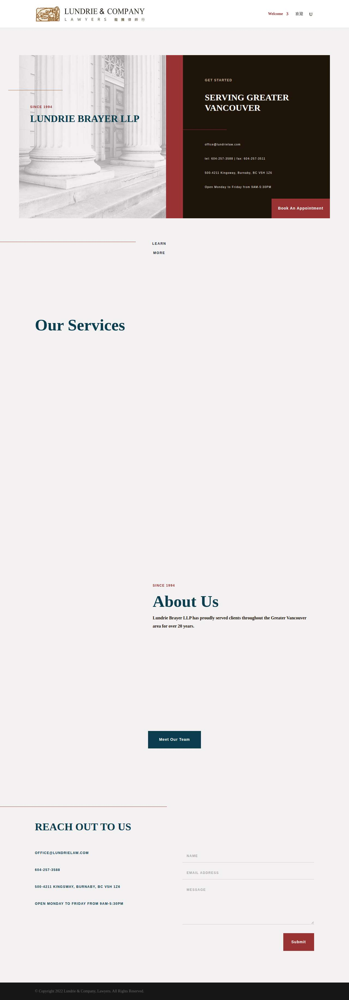

### sandhulawyers.com — dry\_run\_ok (dry run)

| | |
|---|---|
| Attempt ID | `6f2b7426-fd08-4dd8-84e8-c2bec760f659` |
| Form URL | https://www.sandhulawyers.com/contact-surrey-law-office/ |
| Final URL | https://www.sandhulawyers.com/contact-surrey-law-office/ |
| Reserved | 2026-11-13 07:14:04 UTC |
| Submit attempted | — |
| Template | standard v2 |
| Confirmation text | none observed |
| Result / error | Selectors verified; fields not typed (domain not in dry-run fill list); not submitted |

Exact message:

~~~text
Subject: Helping customers find your business in AI search (AEO + GEO)

Hi there,

I'm Arun from Devs Arun. More and more customers now ask ChatGPT, Gemini, Perplexity or Google's AI Overviews questions like "who should I hire for this in my area?" before they call anyone. These tools answer from websites they can clearly understand, and they tend to recommend businesses whose pages answer real customer questions.

That is what AEO + GEO (Answer Engine and Generative Engine Optimization) is for. I improve your existing service pages so they clearly answer the questions your customers ask, add structured data that matches the page, and make the call, quote or enquiry step obvious. The benefit: your business gets a better chance of being mentioned or linked in AI answers, and visitors who arrive find it easy to contact you.

The AEO + GEO Starter is a one-time $199 (about ₹16,999, negotiable) for one website: a basic audit, 10 customer questions, improvements to two existing pages, relevant structured data and an action plan, with one revision round.

You can read the full details, send an enquiry or book online here:
https://devsarun.io/aeo-geo/

If this isn't relevant, just reply and I won't contact you again.

Best,
Arun
Devs Arun
itschool408@gmail.com · +91 7654534323
~~~

Submitted field values:

- input\[name="your-name"\]: Arun
- input\[name="your-email"\]: itschool408@gmail.com
- textarea\[name="your-message"\]: Hi there, I'm Arun from Devs Arun. More and more customers now ask ChatGPT, Gemini, Perplexity or Google's AI Overviews 

**Inspected page** — `run-0659a415_attempt-6f2b7426_inspection_2026-11-13T07-14-09-623Z.jpg`

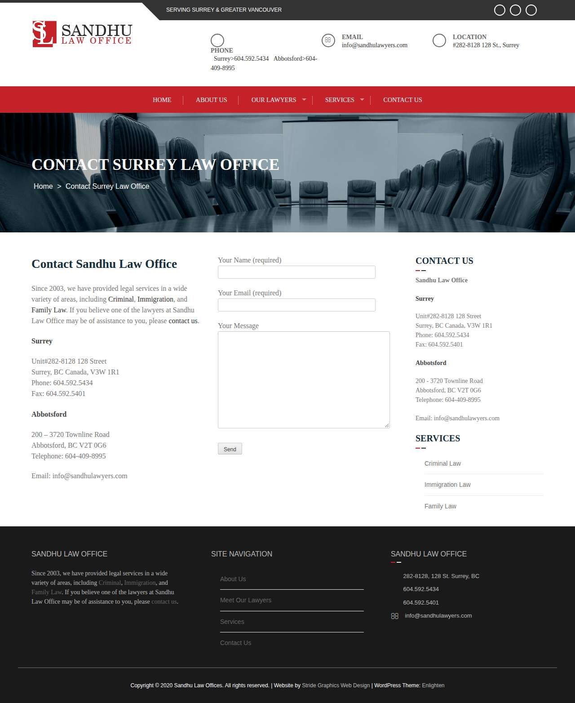

### srparalegal.com — dry\_run\_ok (dry run)

| | |
|---|---|
| Attempt ID | `63c7747b-af5d-4f38-aa28-c1be5b4a2dff` |
| Form URL | https://www.srparalegal.com/get-a-quote-1 |
| Final URL | https://www.srparalegal.com/get-a-quote-1 |
| Reserved | 2026-11-13 07:14:14 UTC |
| Submit attempted | — |
| Template | standard v2 |
| Confirmation text | none observed |
| Result / error | Selectors verified; fields not typed (domain not in dry-run fill list); not submitted |

Exact message:

~~~text
Subject: Helping customers find your business in AI search (AEO + GEO)

Hi there,

I'm Arun from Devs Arun. More and more customers now ask ChatGPT, Gemini, Perplexity or Google's AI Overviews questions like "who should I hire for this in my area?" before they call anyone. These tools answer from websites they can clearly understand, and they tend to recommend businesses whose pages answer real customer questions.

That is what AEO + GEO (Answer Engine and Generative Engine Optimization) is for. I improve your existing service pages so they clearly answer the questions your customers ask, add structured data that matches the page, and make the call, quote or enquiry step obvious. The benefit: your business gets a better chance of being mentioned or linked in AI answers, and visitors who arrive find it easy to contact you.

The AEO + GEO Starter is a one-time $199 (about ₹16,999, negotiable) for one website: a basic audit, 10 customer questions, improvements to two existing pages, relevant structured data and an action plan, with one revision round.

You can read the full details, send an enquiry or book online here:
https://devsarun.io/aeo-geo/

If this isn't relevant, just reply and I won't contact you again.

Best,
Arun
Devs Arun
itschool408@gmail.com · +91 7654534323
~~~

Submitted field values:

- \#input\_comp-lcmwoakj: Arun
- \#input\_comp-lcmwoal4: +91 7654534323
- \#input\_comp-lcmwoal11: itschool408@gmail.com
- \#textarea\_comp-lcmwoal62: Hi there, I'm Arun from Devs Arun. More and more customers now ask ChatGPT, Gemini, Perplexity or Google's AI Overviews 

**Inspected page** — `run-0659a415_attempt-63c7747b_inspection_2026-11-13T07-14-17-481Z.jpg`

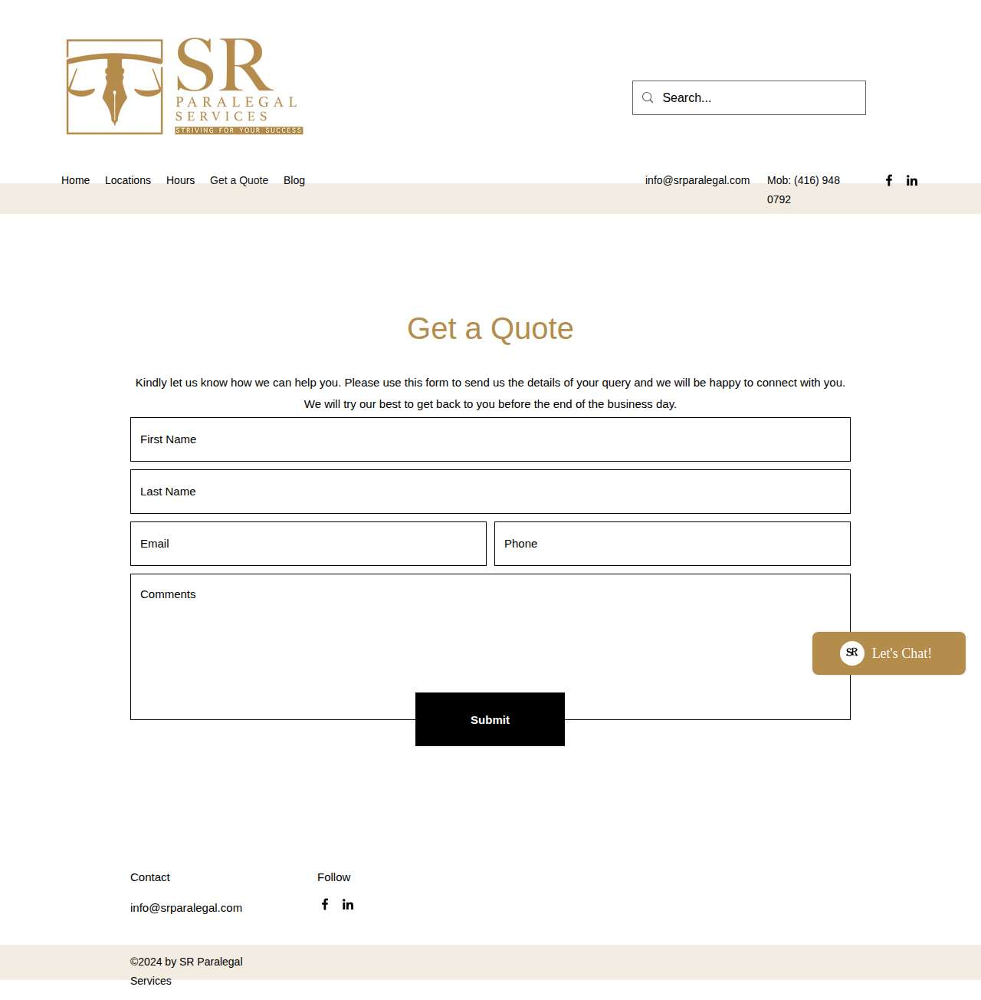

### murraylaw.ca — dry\_run\_ok (dry run)

| | |
|---|---|
| Attempt ID | `f3915127-6dd3-4cc2-b296-adbd7bd0330b` |
| Form URL | https://www.murraylaw.ca/contact-us |
| Final URL | https://www.murraylaw.ca/contact-us |
| Reserved | 2026-11-13 07:14:22 UTC |
| Submit attempted | — |
| Template | standard v2 |
| Confirmation text | none observed |
| Result / error | Selectors verified; fields not typed (domain not in dry-run fill list); not submitted |

Exact message:

~~~text
Subject: Helping customers find your business in AI search (AEO + GEO)

Hi there,

I'm Arun from Devs Arun. More and more customers now ask ChatGPT, Gemini, Perplexity or Google's AI Overviews questions like "who should I hire for this in my area?" before they call anyone. These tools answer from websites they can clearly understand, and they tend to recommend businesses whose pages answer real customer questions.

That is what AEO + GEO (Answer Engine and Generative Engine Optimization) is for. I improve your existing service pages so they clearly answer the questions your customers ask, add structured data that matches the page, and make the call, quote or enquiry step obvious. The benefit: your business gets a better chance of being mentioned or linked in AI answers, and visitors who arrive find it easy to contact you.

The AEO + GEO Starter is a one-time $199 (about ₹16,999, negotiable) for one website: a basic audit, 10 customer questions, improvements to two existing pages, relevant structured data and an action plan, with one revision round.

You can read the full details, send an enquiry or book online here:
https://devsarun.io/aeo-geo/

If this isn't relevant, just reply and I won't contact you again.

Best,
Arun
Devs Arun
itschool408@gmail.com · +91 7654534323
~~~

Submitted field values:

- \#input\_comp-l8fsyto1: Helping customers find your business in AI search (AEO + GEO)
- \#input\_comp-l8fszkjr: +91 7654534323
- \#input\_comp-l8fsytno1: Arun
- \#input\_comp-l8fsyto31: itschool408@gmail.com
- \#textarea\_comp-l8fsytoa: Hi there, I'm Arun from Devs Arun. More and more customers now ask ChatGPT, Gemini, Perplexity or Google's AI Overviews 

**Inspected page** — `run-0659a415_attempt-f3915127_inspection_2026-11-13T07-14-24-702Z.jpg`

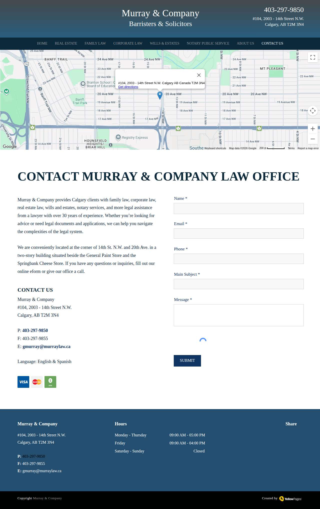

### gbclaw.ca — dry\_run\_ok (dry run)

| | |
|---|---|
| Attempt ID | `f40f7db0-c613-47c5-a8c5-c9cbb97c53fa` |
| Form URL | https://gbclaw.ca/connect/ |
| Final URL | https://gbclaw.ca/connect/ |
| Reserved | 2026-11-13 07:14:29 UTC |
| Submit attempted | — |
| Template | standard v2 |
| Confirmation text | none observed |
| Result / error | Selectors verified; fields not typed (domain not in dry-run fill list); not submitted |

Exact message:

~~~text
Subject: Helping customers find your business in AI search (AEO + GEO)

Hi there,

I'm Arun from Devs Arun. More and more customers now ask ChatGPT, Gemini, Perplexity or Google's AI Overviews questions like "who should I hire for this in my area?" before they call anyone. These tools answer from websites they can clearly understand, and they tend to recommend businesses whose pages answer real customer questions.

That is what AEO + GEO (Answer Engine and Generative Engine Optimization) is for. I improve your existing service pages so they clearly answer the questions your customers ask, add structured data that matches the page, and make the call, quote or enquiry step obvious. The benefit: your business gets a better chance of being mentioned or linked in AI answers, and visitors who arrive find it easy to contact you.

The AEO + GEO Starter is a one-time $199 (about ₹16,999, negotiable) for one website: a basic audit, 10 customer questions, improvements to two existing pages, relevant structured data and an action plan, with one revision round.

You can read the full details, send an enquiry or book online here:
https://devsarun.io/aeo-geo/

If this isn't relevant, just reply and I won't contact you again.

Best,
Arun
Devs Arun
itschool408@gmail.com · +91 7654534323
~~~

Submitted field values:

- \#gbc-name: Arun
- \#gbc-email: itschool408@gmail.com
- \#gbc-phone: +91 7654534323
- \#gbc-message: Hi there, I'm Arun from Devs Arun. More and more customers now ask ChatGPT, Gemini, Perplexity or Google's AI Overviews 

**Inspected page** — `run-0659a415_attempt-f40f7db0_inspection_2026-11-13T07-14-30-826Z.jpg`

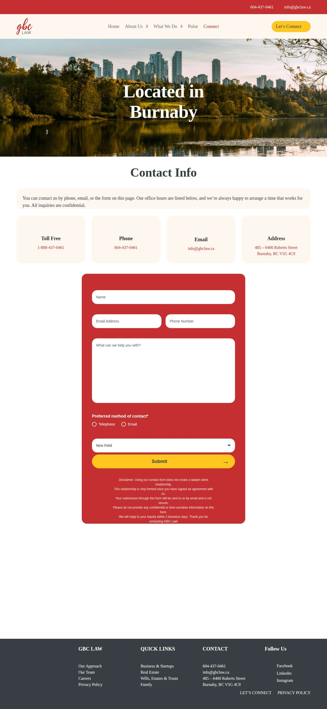

### gglawyers.ca — dry\_run\_ok (dry run)

| | |
|---|---|
| Attempt ID | `81110156-f564-4e40-9356-bb8c7459da7a` |
| Form URL | https://gglawyers.ca/contact-us/ |
| Final URL | https://gglawyers.ca/contact-us/ |
| Reserved | 2026-11-13 07:14:35 UTC |
| Submit attempted | — |
| Template | standard v2 |
| Confirmation text | none observed |
| Result / error | Selectors verified; fields not typed (domain not in dry-run fill list); not submitted |

Exact message:

~~~text
Subject: Helping customers find your business in AI search (AEO + GEO)

Hi there,

I'm Arun from Devs Arun. More and more customers now ask ChatGPT, Gemini, Perplexity or Google's AI Overviews questions like "who should I hire for this in my area?" before they call anyone. These tools answer from websites they can clearly understand, and they tend to recommend businesses whose pages answer real customer questions.

That is what AEO + GEO (Answer Engine and Generative Engine Optimization) is for. I improve your existing service pages so they clearly answer the questions your customers ask, add structured data that matches the page, and make the call, quote or enquiry step obvious. The benefit: your business gets a better chance of being mentioned or linked in AI answers, and visitors who arrive find it easy to contact you.

The AEO + GEO Starter is a one-time $199 (about ₹16,999, negotiable) for one website: a basic audit, 10 customer questions, improvements to two existing pages, relevant structured data and an action plan, with one revision round.

You can read the full details, send an enquiry or book online here:
https://devsarun.io/aeo-geo/

If this isn't relevant, just reply and I won't contact you again.

Best,
Arun
Devs Arun
itschool408@gmail.com · +91 7654534323
~~~

Submitted field values:

- \#name: Arun
- \#email: itschool408@gmail.com
- \#phone: +91 7654534323
- \#Inquiry: General Inquiry
- \#message: Hi there, I'm Arun from Devs Arun. More and more customers now ask ChatGPT, Gemini, Perplexity or Google's AI Overviews 

**Inspected page** — `run-0659a415_attempt-81110156_inspection_2026-11-13T07-14-39-115Z.jpg`

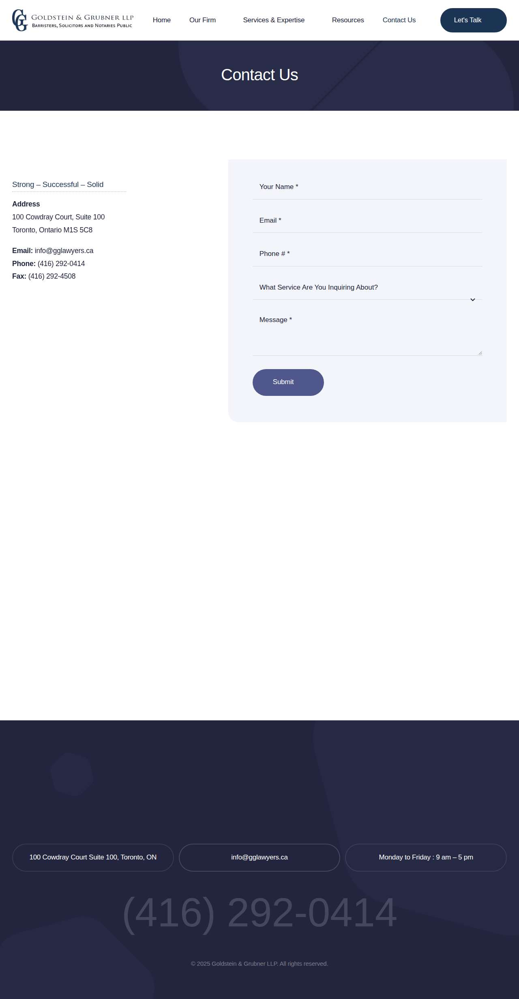

### thomaslegal.ca — dry\_run\_ok (dry run)

| | |
|---|---|
| Attempt ID | `83acc250-8a9b-4345-b0ef-dd4935dc8467` |
| Form URL | https://thomaslegal.ca/index.php/contact |
| Final URL | https://thomaslegal.ca/index.php/contact |
| Reserved | 2026-11-13 07:14:44 UTC |
| Submit attempted | — |
| Template | standard v2 |
| Confirmation text | none observed |
| Result / error | Selectors verified; fields not typed (domain not in dry-run fill list); not submitted |

Exact message:

~~~text
Subject: Helping customers find your business in AI search (AEO + GEO)

Hi there,

I'm Arun from Devs Arun. More and more customers now ask ChatGPT, Gemini, Perplexity or Google's AI Overviews questions like "who should I hire for this in my area?" before they call anyone. These tools answer from websites they can clearly understand, and they tend to recommend businesses whose pages answer real customer questions.

That is what AEO + GEO (Answer Engine and Generative Engine Optimization) is for. I improve your existing service pages so they clearly answer the questions your customers ask, add structured data that matches the page, and make the call, quote or enquiry step obvious. The benefit: your business gets a better chance of being mentioned or linked in AI answers, and visitors who arrive find it easy to contact you.

The AEO + GEO Starter is a one-time $199 (about ₹16,999, negotiable) for one website: a basic audit, 10 customer questions, improvements to two existing pages, relevant structured data and an action plan, with one revision round.

You can read the full details, send an enquiry or book online here:
https://devsarun.io/aeo-geo/

If this isn't relevant, just reply and I won't contact you again.

Best,
Arun
Devs Arun
itschool408@gmail.com · +91 7654534323
~~~

Submitted field values:

- \#form2\_name: Arun
- \#form2\_tel4: +91 7654534323
- \#form2\_email: itschool408@gmail.com
- \#form2\_textarea5: Hi there, I'm Arun from Devs Arun. More and more customers now ask ChatGPT, Gemini, Perplexity or Google's AI Overviews 

**Inspected page** — `run-0659a415_attempt-83acc250_inspection_2026-11-13T07-14-46-400Z.jpg`

### virklawyers.com — dry\_run\_ok (dry run)

| | |
|---|---|
| Attempt ID | `5517bb86-d70f-4bca-82d0-de663abdccf5` |
| Form URL | https://virklawyers.com/ |
| Final URL | https://virklawyers.com/ |
| Reserved | 2026-11-13 07:14:51 UTC |
| Submit attempted | — |
| Template | standard v2 |
| Confirmation text | none observed |
| Result / error | Selectors verified; fields not typed (domain not in dry-run fill list); not submitted |

Exact message:

~~~text
Subject: Helping customers find your business in AI search (AEO + GEO)

Hi there,

I'm Arun from Devs Arun. More and more customers now ask ChatGPT, Gemini, Perplexity or Google's AI Overviews questions like "who should I hire for this in my area?" before they call anyone. These tools answer from websites they can clearly understand, and they tend to recommend businesses whose pages answer real customer questions.

That is what AEO + GEO (Answer Engine and Generative Engine Optimization) is for. I improve your existing service pages so they clearly answer the questions your customers ask, add structured data that matches the page, and make the call, quote or enquiry step obvious. The benefit: your business gets a better chance of being mentioned or linked in AI answers, and visitors who arrive find it easy to contact you.

The AEO + GEO Starter is a one-time $199 (about ₹16,999, negotiable) for one website: a basic audit, 10 customer questions, improvements to two existing pages, relevant structured data and an action plan, with one revision round.

You can read the full details, send an enquiry or book online here:
https://devsarun.io/aeo-geo/

If this isn't relevant, just reply and I won't contact you again.

Best,
Arun
Devs Arun
itschool408@gmail.com · +91 7654534323
~~~

Submitted field values:

- \#form-field-name: Arun
- \#form-field-message: Hi there, I'm Arun from Devs Arun. More and more customers now ask ChatGPT, Gemini, Perplexity or Google's AI Overviews 
- \#form-field-field\_5b8c191: +91 7654534323
- div \> div \> div:nth-of-type(2) \> div \> div \> div:nth-of-type(2) \> div \> div \> form \> div \> div:nth-of-type(2) \> input: itschool408@gmail.com

**Inspected page** — `run-0659a415_attempt-5517bb86_inspection_2026-11-13T07-14-53-665Z.jpg`

### eralaw.ca — dry\_run\_ok (dry run)

| | |
|---|---|
| Attempt ID | `51c20eb8-1b5e-4ed5-9070-fa75a2077e1d` |
| Form URL | https://eralaw.ca/contact/ |
| Final URL | https://eralaw.ca/contact/ |
| Reserved | 2026-11-13 07:14:58 UTC |
| Submit attempted | — |
| Template | standard v2 |
| Confirmation text | none observed |
| Result / error | Selectors verified; fields not typed (domain not in dry-run fill list); not submitted |

Exact message:

~~~text
Subject: Helping customers find your business in AI search (AEO + GEO)

Hi there,

I'm Arun from Devs Arun. More and more customers now ask ChatGPT, Gemini, Perplexity or Google's AI Overviews questions like "who should I hire for this in my area?" before they call anyone. These tools answer from websites they can clearly understand, and they tend to recommend businesses whose pages answer real customer questions.

That is what AEO + GEO (Answer Engine and Generative Engine Optimization) is for. I improve your existing service pages so they clearly answer the questions your customers ask, add structured data that matches the page, and make the call, quote or enquiry step obvious. The benefit: your business gets a better chance of being mentioned or linked in AI answers, and visitors who arrive find it easy to contact you.

The AEO + GEO Starter is a one-time $199 (about ₹16,999, negotiable) for one website: a basic audit, 10 customer questions, improvements to two existing pages, relevant structured data and an action plan, with one revision round.

You can read the full details, send an enquiry or book online here:
https://devsarun.io/aeo-geo/

If this isn't relevant, just reply and I won't contact you again.

Best,
Arun
Devs Arun
itschool408@gmail.com · +91 7654534323
~~~

Submitted field values:

- input\[name="your-name"\]: Arun
- input\[name="your-email"\]: itschool408@gmail.com
- input\[name="your-subject"\]: Helping customers find your business in AI search (AEO + GEO)
- textarea\[name="your-message"\]: Hi there, I'm Arun from Devs Arun. More and more customers now ask ChatGPT, Gemini, Perplexity or Google's AI Overviews 

**Inspected page** — `run-0659a415_attempt-51c20eb8_inspection_2026-11-13T07-15-01-832Z.jpg`

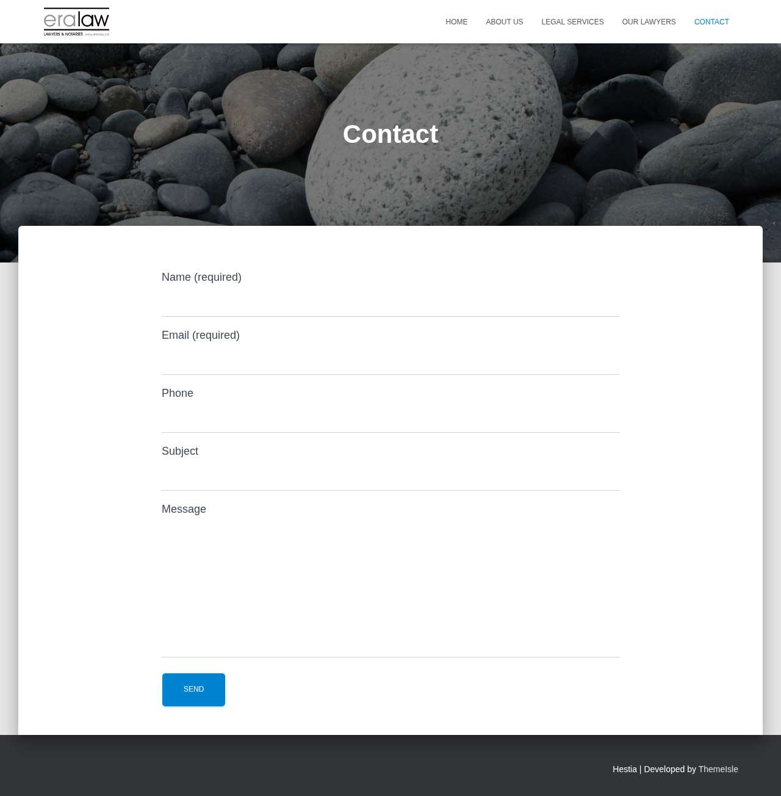

### gwsllp.ca — dry\_run\_ok (dry run)

| | |
|---|---|
| Attempt ID | `e0021f66-d6df-4be1-bc69-f62727f88462` |
| Form URL | https://gwsllp.ca/contact-us/ |
| Final URL | https://gwsllp.ca/contact-us/ |
| Reserved | 2026-11-13 07:15:06 UTC |
| Submit attempted | — |
| Template | standard v2 |
| Confirmation text | none observed |
| Result / error | Selectors verified; fields not typed (domain not in dry-run fill list); not submitted |

Exact message:

~~~text
Subject: Helping customers find your business in AI search (AEO + GEO)

Hi there,

I'm Arun from Devs Arun. More and more customers now ask ChatGPT, Gemini, Perplexity or Google's AI Overviews questions like "who should I hire for this in my area?" before they call anyone. These tools answer from websites they can clearly understand, and they tend to recommend businesses whose pages answer real customer questions.

That is what AEO + GEO (Answer Engine and Generative Engine Optimization) is for. I improve your existing service pages so they clearly answer the questions your customers ask, add structured data that matches the page, and make the call, quote or enquiry step obvious. The benefit: your business gets a better chance of being mentioned or linked in AI answers, and visitors who arrive find it easy to contact you.

The AEO + GEO Starter is a one-time $199 (about ₹16,999, negotiable) for one website: a basic audit, 10 customer questions, improvements to two existing pages, relevant structured data and an action plan, with one revision round.

You can read the full details, send an enquiry or book online here:
https://devsarun.io/aeo-geo/

If this isn't relevant, just reply and I won't contact you again.

Best,
Arun
Devs Arun
itschool408@gmail.com · +91 7654534323
~~~

Submitted field values:

- \#name: Arun
- \#email: itschool408@gmail.com
- \#message: Hi there, I'm Arun from Devs Arun. More and more customers now ask ChatGPT, Gemini, Perplexity or Google's AI Overviews 
- \#subject: Helping customers find your business in AI search (AEO + GEO)

**Inspected page** — `run-0659a415_attempt-e0021f66_inspection_2026-11-13T07-15-09-237Z.jpg`

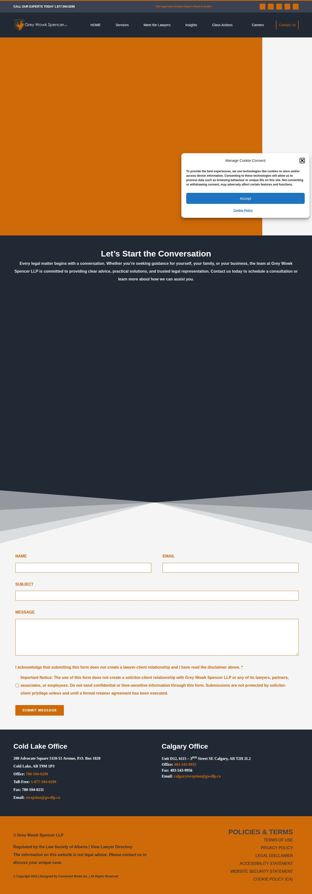

### bclawfirm.com — dry\_run\_ok (dry run)

| | |
|---|---|
| Attempt ID | `d2a0882c-fb55-40eb-be86-05292ed91572` |
| Form URL | https://www.bclawfirm.com/ |
| Final URL | https://www.bclawfirm.com/ |
| Reserved | 2026-11-13 07:15:14 UTC |
| Submit attempted | — |
| Template | standard v2 |
| Confirmation text | none observed |
| Result / error | Selectors verified; fields not typed (domain not in dry-run fill list); not submitted |

Exact message:

~~~text
Subject: Helping customers find your business in AI search (AEO + GEO)

Hi there,

I'm Arun from Devs Arun. More and more customers now ask ChatGPT, Gemini, Perplexity or Google's AI Overviews questions like "who should I hire for this in my area?" before they call anyone. These tools answer from websites they can clearly understand, and they tend to recommend businesses whose pages answer real customer questions.

That is what AEO + GEO (Answer Engine and Generative Engine Optimization) is for. I improve your existing service pages so they clearly answer the questions your customers ask, add structured data that matches the page, and make the call, quote or enquiry step obvious. The benefit: your business gets a better chance of being mentioned or linked in AI answers, and visitors who arrive find it easy to contact you.

The AEO + GEO Starter is a one-time $199 (about ₹16,999, negotiable) for one website: a basic audit, 10 customer questions, improvements to two existing pages, relevant structured data and an action plan, with one revision round.

You can read the full details, send an enquiry or book online here:
https://devsarun.io/aeo-geo/

If this isn't relevant, just reply and I won't contact you again.

Best,
Arun
Devs Arun
itschool408@gmail.com · +91 7654534323
~~~

Submitted field values:

- \#input\_comp-kg4sas96: Arun
- \#input\_comp-kg4sas9h: itschool408@gmail.com
- \#input\_comp-kg4sas9r: Helping customers find your business in AI search (AEO + GEO)
- \#textarea\_comp-kg4sasa0: Hi there, I'm Arun from Devs Arun. More and more customers now ask ChatGPT, Gemini, Perplexity or Google's AI Overviews 

**Inspected page** — `run-0659a415_attempt-d2a0882c_inspection_2026-11-13T07-15-16-738Z.jpg`

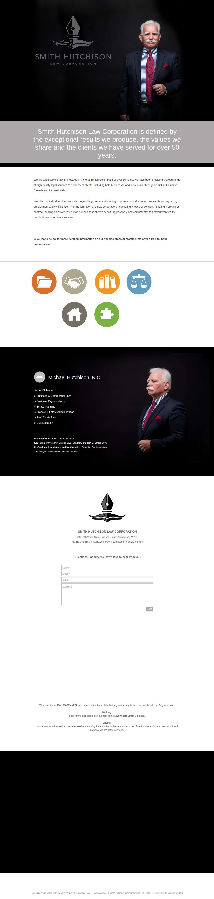

### conradmargolislawcorp.ca — dry\_run\_ok (dry run)

| | |
|---|---|
| Attempt ID | `ccc7a200-c4e1-430a-9da0-6110ddbb1ab6` |
| Form URL | https://www.conradmargolislawcorp.ca/contact-us |
| Final URL | https://www.conradmargolislawcorp.ca/contact-us |
| Reserved | 2026-11-13 07:15:21 UTC |
| Submit attempted | — |
| Template | standard v2 |
| Confirmation text | none observed |
| Result / error | Selectors verified; fields not typed (domain not in dry-run fill list); not submitted |

Exact message:

~~~text
Subject: Helping customers find your business in AI search (AEO + GEO)

Hi there,

I'm Arun from Devs Arun. More and more customers now ask ChatGPT, Gemini, Perplexity or Google's AI Overviews questions like "who should I hire for this in my area?" before they call anyone. These tools answer from websites they can clearly understand, and they tend to recommend businesses whose pages answer real customer questions.

That is what AEO + GEO (Answer Engine and Generative Engine Optimization) is for. I improve your existing service pages so they clearly answer the questions your customers ask, add structured data that matches the page, and make the call, quote or enquiry step obvious. The benefit: your business gets a better chance of being mentioned or linked in AI answers, and visitors who arrive find it easy to contact you.

The AEO + GEO Starter is a one-time $199 (about ₹16,999, negotiable) for one website: a basic audit, 10 customer questions, improvements to two existing pages, relevant structured data and an action plan, with one revision round.

You can read the full details, send an enquiry or book online here:
https://devsarun.io/aeo-geo/

If this isn't relevant, just reply and I won't contact you again.

Best,
Arun
Devs Arun
itschool408@gmail.com · +91 7654534323
~~~

Submitted field values:

- \#input\_comp-l8bg24xe: Arun
- \#input\_comp-l8bg8xjq: itschool408@gmail.com
- \#input\_comp-l8bg8yri: +91 7654534323
- \#textarea\_comp-l8bg93uk: Hi there, I'm Arun from Devs Arun. More and more customers now ask ChatGPT, Gemini, Perplexity or Google's AI Overviews 

**Inspected page** — `run-0659a415_attempt-ccc7a200_inspection_2026-11-13T07-15-23-739Z.jpg`

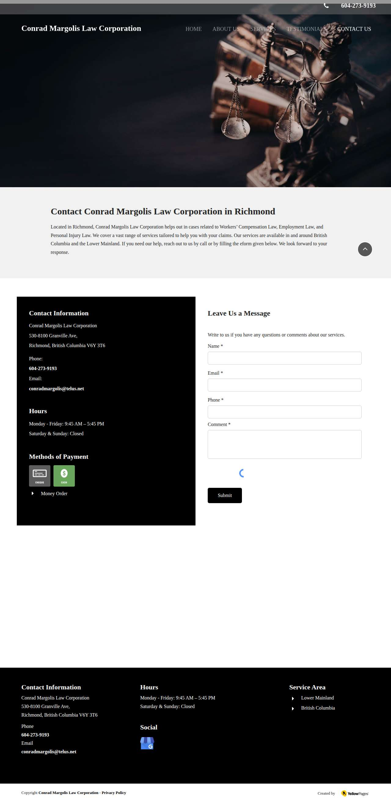

### estofa.ca — dry\_run\_ok (dry run)

| | |
|---|---|
| Attempt ID | `54249aa4-b463-46d8-928d-a7954ed44aed` |
| Form URL | https://estofa.ca/contact-us/ |
| Final URL | https://estofa.ca/contact-us/ |
| Reserved | 2026-11-13 07:15:28 UTC |
| Submit attempted | — |
| Template | standard v2 |
| Confirmation text | none observed |
| Result / error | Selectors verified; fields not typed (domain not in dry-run fill list); not submitted |

Exact message:

~~~text
Subject: Helping customers find your business in AI search (AEO + GEO)

Hi there,

I'm Arun from Devs Arun. More and more customers now ask ChatGPT, Gemini, Perplexity or Google's AI Overviews questions like "who should I hire for this in my area?" before they call anyone. These tools answer from websites they can clearly understand, and they tend to recommend businesses whose pages answer real customer questions.

That is what AEO + GEO (Answer Engine and Generative Engine Optimization) is for. I improve your existing service pages so they clearly answer the questions your customers ask, add structured data that matches the page, and make the call, quote or enquiry step obvious. The benefit: your business gets a better chance of being mentioned or linked in AI answers, and visitors who arrive find it easy to contact you.

The AEO + GEO Starter is a one-time $199 (about ₹16,999, negotiable) for one website: a basic audit, 10 customer questions, improvements to two existing pages, relevant structured data and an action plan, with one revision round.

You can read the full details, send an enquiry or book online here:
https://devsarun.io/aeo-geo/

If this isn't relevant, just reply and I won't contact you again.

Best,
Arun
Devs Arun
itschool408@gmail.com · +91 7654534323
~~~

Submitted field values:

- \#post-283 \> div \> div \> div:nth-of-type(2) \> div \> div:nth-of-type(1) \> div \> div \> form \> div:nth-of-type(1) \> input: Arun
- \#post-283 \> div \> div \> div:nth-of-type(2) \> div \> div:nth-of-type(1) \> div \> div \> form \> div:nth-of-type(3) \> select: Other
- \#post-283 \> div \> div \> div:nth-of-type(2) \> div \> div:nth-of-type(1) \> div \> div \> form \> div:nth-of-type(4) \> textarea: Hi there, I'm Arun from Devs Arun. More and more customers now ask ChatGPT, Gemini, Perplexity or Google's AI Overviews 
- div:nth-of-type(2) \> div \> div:nth-of-type(1) \> div \> div \> form \> div:nth-of-type(2) \> div \> div:nth-of-type(1) \> div \> div \> input: itschool408@gmail.com
- div:nth-of-type(2) \> div \> div:nth-of-type(1) \> div \> div \> form \> div:nth-of-type(2) \> div \> div:nth-of-type(2) \> div \> div \> input: +91 7654534323

**Inspected page** — `run-0659a415_attempt-54249aa4_inspection_2026-11-13T07-15-30-123Z.jpg`

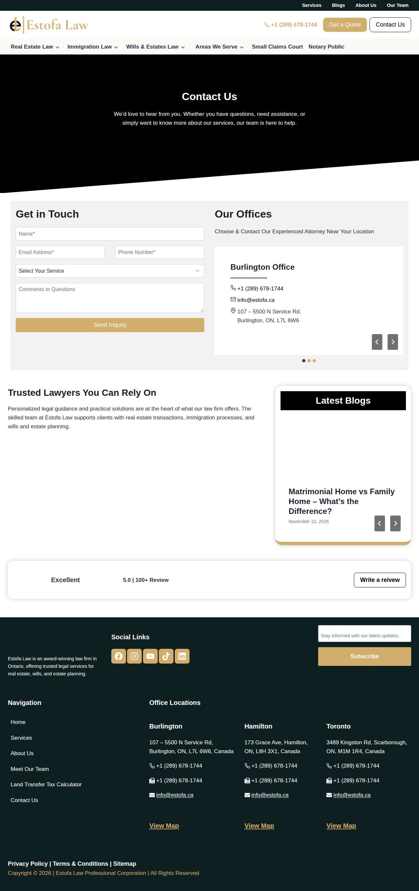

### immigrationway.com — dry\_run\_ok (dry run)

| | |
|---|---|
| Attempt ID | `b5c0b5af-269a-4ea4-bc60-d62c4d029564` |
| Form URL | https://www.immigrationway.com/contact-us/ |
| Final URL | https://www.immigrationway.com/contact-us/ |
| Reserved | 2026-11-13 07:15:35 UTC |
| Submit attempted | — |
| Template | standard v2 |
| Confirmation text | none observed |
| Result / error | Selectors verified; fields not typed (domain not in dry-run fill list); not submitted |

Exact message:

~~~text
Subject: Helping customers find your business in AI search (AEO + GEO)

Hi there,

I'm Arun from Devs Arun. More and more customers now ask ChatGPT, Gemini, Perplexity or Google's AI Overviews questions like "who should I hire for this in my area?" before they call anyone. These tools answer from websites they can clearly understand, and they tend to recommend businesses whose pages answer real customer questions.

That is what AEO + GEO (Answer Engine and Generative Engine Optimization) is for. I improve your existing service pages so they clearly answer the questions your customers ask, add structured data that matches the page, and make the call, quote or enquiry step obvious. The benefit: your business gets a better chance of being mentioned or linked in AI answers, and visitors who arrive find it easy to contact you.

The AEO + GEO Starter is a one-time $199 (about ₹16,999, negotiable) for one website: a basic audit, 10 customer questions, improvements to two existing pages, relevant structured data and an action plan, with one revision round.

You can read the full details, send an enquiry or book online here:
https://devsarun.io/aeo-geo/

If this isn't relevant, just reply and I won't contact you again.

Best,
Arun
Devs Arun
itschool408@gmail.com · +91 7654534323
~~~

Submitted field values:

- \#input\_2\_2: itschool408@gmail.com
- \#input\_2\_3: +91 7654534323
- \#input\_2\_5: Hi there, I'm Arun from Devs Arun. More and more customers now ask ChatGPT, Gemini, Perplexity or Google's AI Overviews 
- \#input\_2\_1\_3: Arun

**Inspected page** — `run-0659a415_attempt-b5c0b5af_inspection_2026-11-13T07-15-38-456Z.jpg`

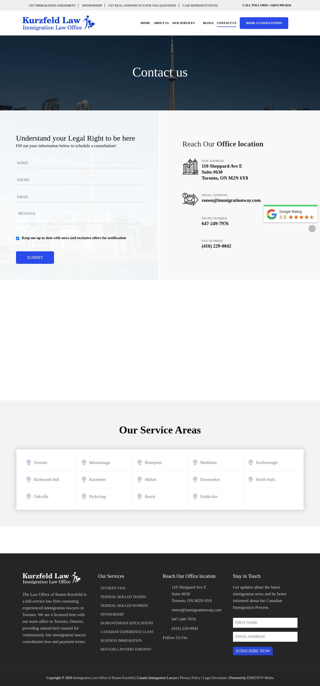

### murraymckercher.ca — dry\_run\_ok (dry run)

| | |
|---|---|
| Attempt ID | `df8a4de0-4f92-4d5f-abe5-d4b9bb9749da` |
| Form URL | https://www.murraymckercher.ca/contact |
| Final URL | https://www.murraymckercher.ca/contact |
| Reserved | 2026-11-13 07:15:43 UTC |
| Submit attempted | — |
| Template | standard v2 |
| Confirmation text | none observed |
| Result / error | Selectors verified; fields not typed (domain not in dry-run fill list); not submitted |

Exact message:

~~~text
Subject: Helping customers find your business in AI search (AEO + GEO)

Hi there,

I'm Arun from Devs Arun. More and more customers now ask ChatGPT, Gemini, Perplexity or Google's AI Overviews questions like "who should I hire for this in my area?" before they call anyone. These tools answer from websites they can clearly understand, and they tend to recommend businesses whose pages answer real customer questions.

That is what AEO + GEO (Answer Engine and Generative Engine Optimization) is for. I improve your existing service pages so they clearly answer the questions your customers ask, add structured data that matches the page, and make the call, quote or enquiry step obvious. The benefit: your business gets a better chance of being mentioned or linked in AI answers, and visitors who arrive find it easy to contact you.

The AEO + GEO Starter is a one-time $199 (about ₹16,999, negotiable) for one website: a basic audit, 10 customer questions, improvements to two existing pages, relevant structured data and an action plan, with one revision round.

You can read the full details, send an enquiry or book online here:
https://devsarun.io/aeo-geo/

If this isn't relevant, just reply and I won't contact you again.

Best,
Arun
Devs Arun
itschool408@gmail.com · +91 7654534323
~~~

Submitted field values:

- \#input\_comp-jxbwjum9: Arun
- \#input\_comp-jxbwjumg: itschool408@gmail.com
- \#input\_comp-jxbwjumm: +91 7654534323
- \#textarea\_comp-jxbwjumt: Hi there, I'm Arun from Devs Arun. More and more customers now ask ChatGPT, Gemini, Perplexity or Google's AI Overviews 

**Inspected page** — `run-0659a415_attempt-df8a4de0_inspection_2026-11-13T07-15-45-676Z.jpg`

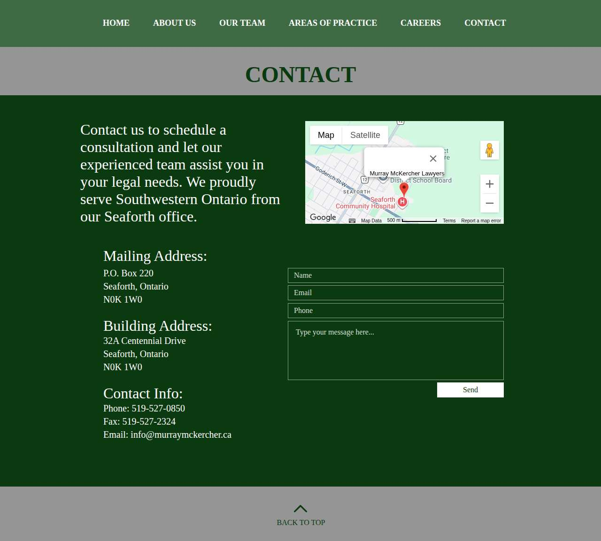

### mllawcorp.ca — dry\_run\_ok (dry run)

| | |
|---|---|
| Attempt ID | `6f32186b-f23a-4fe0-acf3-5b1a7483af0a` |
| Form URL | https://mllawcorp.ca/contact/ |
| Final URL | https://mllawcorp.ca/contact/ |
| Reserved | 2026-11-13 07:15:50 UTC |
| Submit attempted | — |
| Template | standard v2 |
| Confirmation text | none observed |
| Result / error | Selectors verified; fields not typed (domain not in dry-run fill list); not submitted |

Exact message:

~~~text
Subject: Helping customers find your business in AI search (AEO + GEO)

Hi there,

I'm Arun from Devs Arun. More and more customers now ask ChatGPT, Gemini, Perplexity or Google's AI Overviews questions like "who should I hire for this in my area?" before they call anyone. These tools answer from websites they can clearly understand, and they tend to recommend businesses whose pages answer real customer questions.

That is what AEO + GEO (Answer Engine and Generative Engine Optimization) is for. I improve your existing service pages so they clearly answer the questions your customers ask, add structured data that matches the page, and make the call, quote or enquiry step obvious. The benefit: your business gets a better chance of being mentioned or linked in AI answers, and visitors who arrive find it easy to contact you.

The AEO + GEO Starter is a one-time $199 (about ₹16,999, negotiable) for one website: a basic audit, 10 customer questions, improvements to two existing pages, relevant structured data and an action plan, with one revision round.

You can read the full details, send an enquiry or book online here:
https://devsarun.io/aeo-geo/

If this isn't relevant, just reply and I won't contact you again.

Best,
Arun
Devs Arun
itschool408@gmail.com · +91 7654534323
~~~

Submitted field values:

- \#nf-field-6: Arun
- \#nf-field-7: itschool408@gmail.com
- \#nf-field-8: Hi there, I'm Arun from Devs Arun. More and more customers now ask ChatGPT, Gemini, Perplexity or Google's AI Overviews 
- \#nf-field-10: +91 7654534323
- \#nf-field-11-0: check

**Inspected page** — `run-0659a415_attempt-6f32186b_inspection_2026-11-13T07-15-52-883Z.jpg`

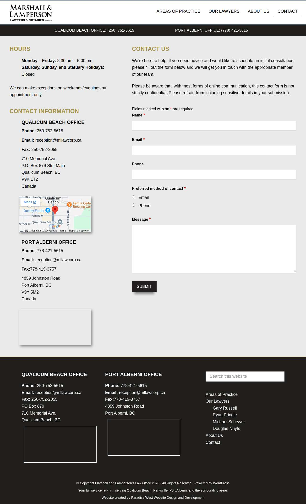

### mspc.cpa — dry\_run\_failed (dry run)

| | |
|---|---|
| Attempt ID | `83b6587a-507d-46a7-b283-3db6aca58d91` |
| Form URL | https://www.mspc.cpa/contact/ |
| Final URL | https://www.mspc.cpa/contact/ |
| Reserved | 2026-11-13 07:15:57 UTC |
| Submit attempted | — |
| Template | standard v2 |
| Confirmation text | none observed |
| Result / error | Mapped field "Full Name \*" not found uniquely |

Exact message:

~~~text
Subject: Helping customers find your business in AI search (AEO + GEO)

Hi there,

I'm Arun from Devs Arun. More and more customers now ask ChatGPT, Gemini, Perplexity or Google's AI Overviews questions like "who should I hire for this in my area?" before they call anyone. These tools answer from websites they can clearly understand, and they tend to recommend businesses whose pages answer real customer questions.

That is what AEO + GEO (Answer Engine and Generative Engine Optimization) is for. I improve your existing service pages so they clearly answer the questions your customers ask, add structured data that matches the page, and make the call, quote or enquiry step obvious. The benefit: your business gets a better chance of being mentioned or linked in AI answers, and visitors who arrive find it easy to contact you.

The AEO + GEO Starter is a one-time $199 (about ₹16,999, negotiable) for one website: a basic audit, 10 customer questions, improvements to two existing pages, relevant structured data and an action plan, with one revision round.

You can read the full details, send an enquiry or book online here:
https://devsarun.io/aeo-geo/

If this isn't relevant, just reply and I won't contact you again.

Best,
Arun
Devs Arun
itschool408@gmail.com · +91 7654534323
~~~

Submitted field values:

- \#forminator-field-name-1\_6aeaca2579f24: Arun
- \#forminator-field-text-1\_6aeaca2579f24: Devs Arun
- \#forminator-field-email-1\_6aeaca2579f24: itschool408@gmail.com
- \#forminator-field-phone-1\_6aeaca2579f24: +91 7654534323
- \#forminator-field-textarea-1\_6aeaca2579f24: Hi there, I'm Arun from Devs Arun. More and more customers now ask ChatGPT, Gemini, Perplexity or Google's AI Overviews 

**Inspected page** — `run-0659a415_attempt-83b6587a_inspection_2026-11-13T07-16-01-029Z.jpg`

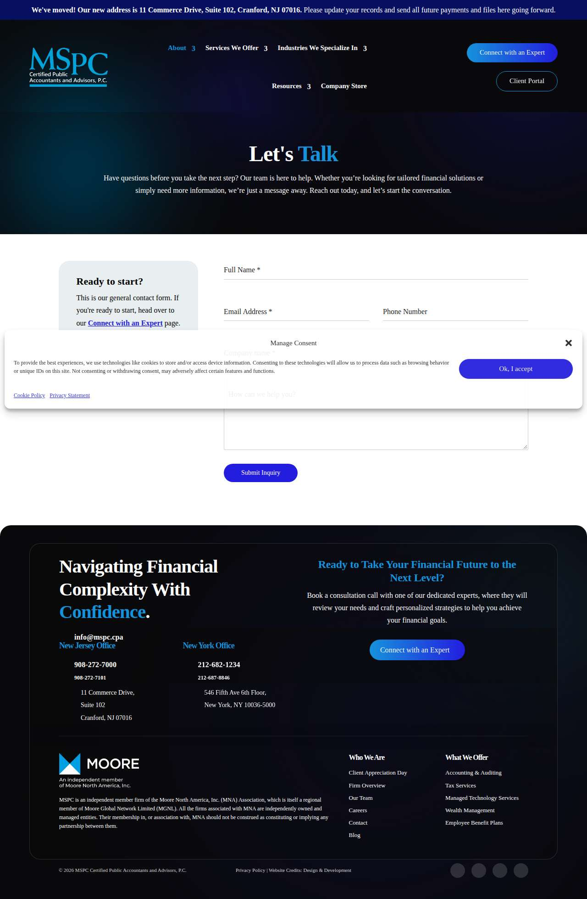

### juicerealestate.com.au — dry\_run\_failed (dry run)

| | |
|---|---|
| Attempt ID | `e4d5b57f-9509-4eb5-8d94-51162ac3377d` |
| Form URL | https://juicerealestate.com.au/contact-us/ |
| Final URL | https://juicerealestate.com.au/contact-us/ |
| Reserved | 2026-11-13 07:16:06 UTC |
| Submit attempted | — |
| Template | standard v2 |
| Confirmation text | none observed |
| Result / error | CAPTCHA/anti-bot now present (recaptcha) |

Exact message:

~~~text
Subject: Helping customers find your business in AI search (AEO + GEO)

Hi there,

I'm Arun from Devs Arun. More and more customers now ask ChatGPT, Gemini, Perplexity or Google's AI Overviews questions like "who should I hire for this in my area?" before they call anyone. These tools answer from websites they can clearly understand, and they tend to recommend businesses whose pages answer real customer questions.

That is what AEO + GEO (Answer Engine and Generative Engine Optimization) is for. I improve your existing service pages so they clearly answer the questions your customers ask, add structured data that matches the page, and make the call, quote or enquiry step obvious. The benefit: your business gets a better chance of being mentioned or linked in AI answers, and visitors who arrive find it easy to contact you.

The AEO + GEO Starter is a one-time $199 (about ₹16,999, negotiable) for one website: a basic audit, 10 customer questions, improvements to two existing pages, relevant structured data and an action plan, with one revision round.

You can read the full details, send an enquiry or book online here:
https://devsarun.io/aeo-geo/

If this isn't relevant, just reply and I won't contact you again.

Best,
Arun
Devs Arun
itschool408@gmail.com · +91 7654534323
~~~

Submitted field values:

- \#ff\_1\_email: itschool408@gmail.com
- \#ff\_1\_phone: +91 7654534323
- \#ff\_1\_message: Hi there, I'm Arun from Devs Arun. More and more customers now ask ChatGPT, Gemini, Perplexity or Google's AI Overviews 
- \#ff\_1\_names\_first\_name\_: Arun

**Inspected page** — `run-0659a415_attempt-e4d5b57f_inspection_2026-11-13T07-16-10-290Z.jpg`

### involvedigital.com — dry\_run\_failed (dry run)

| | |
|---|---|
| Attempt ID | `feaf6785-71af-4470-9c55-4d5b65450a44` |
| Form URL | https://www.involvedigital.com/talk |
| Final URL | https://www.involvedigital.com/talk |
| Reserved | 2026-11-13 07:16:15 UTC |
| Submit attempted | — |
| Template | standard v2 |
| Confirmation text | none observed |
| Result / error | Form is multi-step |

Exact message:

~~~text
Subject: Helping customers find your business in AI search (AEO + GEO)

Hi there,

I'm Arun from Devs Arun. More and more customers now ask ChatGPT, Gemini, Perplexity or Google's AI Overviews questions like "who should I hire for this in my area?" before they call anyone. These tools answer from websites they can clearly understand, and they tend to recommend businesses whose pages answer real customer questions.

That is what AEO + GEO (Answer Engine and Generative Engine Optimization) is for. I improve your existing service pages so they clearly answer the questions your customers ask, add structured data that matches the page, and make the call, quote or enquiry step obvious. The benefit: your business gets a better chance of being mentioned or linked in AI answers, and visitors who arrive find it easy to contact you.

The AEO + GEO Starter is a one-time $199 (about ₹16,999, negotiable) for one website: a basic audit, 10 customer questions, improvements to two existing pages, relevant structured data and an action plan, with one revision round.

You can read the full details, send an enquiry or book online here:
https://devsarun.io/aeo-geo/

If this isn't relevant, just reply and I won't contact you again.

Best,
Arun
Devs Arun
itschool408@gmail.com · +91 7654534323
~~~

Submitted field values:

- \#capture-name: Arun
- \#capture-email: itschool408@gmail.com
- \#capture-phone: +91 7654534323
- \#capture-message: Hi there, I'm Arun from Devs Arun. More and more customers now ask ChatGPT, Gemini, Perplexity or Google's AI Overviews 
- \#capture-business: Devs Arun

**Inspected page** — `run-0659a415_attempt-feaf6785_inspection_2026-11-13T07-16-17-141Z.jpg`

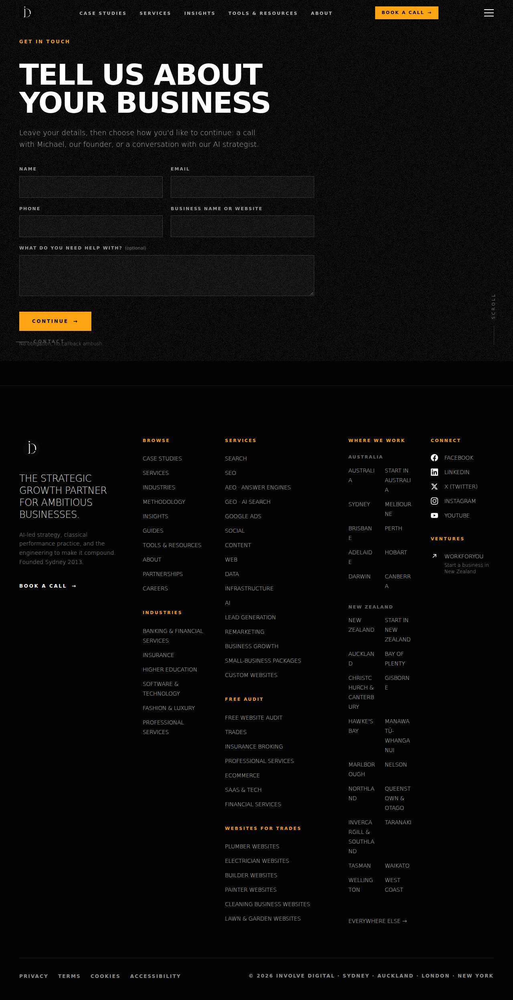

## Events (129)

| Time (UTC) | Event | Website | Details |
|---|---|---|---|
| 07:12:59 | run\_queued | — | dry\_run run requested by github:itsDevsArun |
| 07:12:59 | run\_dispatched | — | dispatch disabled (local test mode) |
| 07:13:05 | run\_started | — | Runner claimed dry\_run run |
| 07:13:05 | website\_selected | helixmechanical.com | Dry-run target helixmechanical.com |
| 07:13:05 | draft\_prepared | helixmechanical.com | Draft prepared with template standard v2 |
| 07:13:07 | page\_opened | helixmechanical.com | Opened form page |
| 07:13:07 | screenshot\_saved | helixmechanical.com | inspection screenshot saved (54 KB) |
| 07:13:07 | review\_required | helixmechanical.com | dry run failed: Mapped field "First Name \*" not found uniquely |
| 07:13:12 | website\_selected | eurola.com.au | Dry-run target eurola.com.au |
| 07:13:12 | draft\_prepared | eurola.com.au | Draft prepared with template standard v2 |
| 07:13:17 | page\_opened | eurola.com.au | Opened form page |
| 07:13:17 | screenshot\_saved | eurola.com.au | inspection screenshot saved (318 KB) |
| 07:13:17 | review\_required | eurola.com.au | dry run failed: Mapped field "field2" not found uniquely |
| 07:13:22 | website\_selected | knoxvilleelectrician.com | Dry-run target knoxvilleelectrician.com |
| 07:13:22 | draft\_prepared | knoxvilleelectrician.com | Draft prepared with template standard v2 |
| 07:13:26 | page\_opened | knoxvilleelectrician.com | Opened form page |
| 07:13:26 | screenshot\_saved | knoxvilleelectrician.com | inspection screenshot saved (137 KB) |
| 07:13:26 | review\_required | knoxvilleelectrician.com | dry run failed: Mapped field "Name" not found uniquely |
| 07:13:31 | website\_selected | tricityfinishing.com | Dry-run target tricityfinishing.com |
| 07:13:31 | draft\_prepared | tricityfinishing.com | Draft prepared with template standard v2 |
| 07:13:32 | page\_opened | tricityfinishing.com | Opened form page |
| 07:13:33 | screenshot\_saved | tricityfinishing.com | inspection screenshot saved (188 KB) |
| 07:13:33 | review\_required | tricityfinishing.com | dry run failed: Reviewed form not found on page (site changed) |
| 07:13:38 | website\_selected | sblawpartners.com.au | Dry-run target sblawpartners.com.au |
| 07:13:38 | draft\_prepared | sblawpartners.com.au | Draft prepared with template standard v2 |
| 07:13:43 | page\_opened | sblawpartners.com.au | Opened form page |
| 07:13:43 | screenshot\_saved | sblawpartners.com.au | inspection screenshot saved (95 KB) |
| 07:13:43 | review\_required | sblawpartners.com.au | dry run failed: Mapped field "Name \*" not found uniquely |
| 07:13:48 | website\_selected | disilvestro.com | Dry-run target disilvestro.com |
| 07:13:48 | draft\_prepared | disilvestro.com | Draft prepared with template standard v2 |
| 07:13:49 | page\_opened | disilvestro.com | Opened form page |
| 07:13:50 | screenshot\_saved | disilvestro.com | inspection screenshot saved (136 KB) |
| 07:13:50 | dry\_run\_checked | disilvestro.com | dry run ok: Selectors verified; fields not typed (domain not in dry-run fill list); not submitted |
| 07:13:55 | website\_selected | lundrielaw.com | Dry-run target lundrielaw.com |
| 07:13:55 | draft\_prepared | lundrielaw.com | Draft prepared with template standard v2 |
| 07:13:59 | page\_opened | lundrielaw.com | Opened form page |
| 07:13:59 | screenshot\_saved | lundrielaw.com | inspection screenshot saved (108 KB) |
| 07:13:59 | dry\_run\_checked | lundrielaw.com | dry run ok: Selectors verified; fields not typed (domain not in dry-run fill list); not submitted |
| 07:14:04 | website\_selected | sandhulawyers.com | Dry-run target sandhulawyers.com |
| 07:14:04 | draft\_prepared | sandhulawyers.com | Draft prepared with template standard v2 |
| 07:14:09 | page\_opened | sandhulawyers.com | Opened form page |
| 07:14:09 | screenshot\_saved | sandhulawyers.com | inspection screenshot saved (117 KB) |
| 07:14:09 | dry\_run\_checked | sandhulawyers.com | dry run ok: Selectors verified; fields not typed (domain not in dry-run fill list); not submitted |
| 07:14:14 | website\_selected | srparalegal.com | Dry-run target srparalegal.com |
| 07:14:14 | draft\_prepared | srparalegal.com | Draft prepared with template standard v2 |
| 07:14:17 | page\_opened | srparalegal.com | Opened form page |
| 07:14:17 | screenshot\_saved | srparalegal.com | inspection screenshot saved (54 KB) |
| 07:14:17 | dry\_run\_checked | srparalegal.com | dry run ok: Selectors verified; fields not typed (domain not in dry-run fill list); not submitted |
| 07:14:22 | website\_selected | murraylaw.ca | Dry-run target murraylaw.ca |
| 07:14:22 | draft\_prepared | murraylaw.ca | Draft prepared with template standard v2 |
| 07:14:24 | page\_opened | murraylaw.ca | Opened form page |
| 07:14:24 | screenshot\_saved | murraylaw.ca | inspection screenshot saved (174 KB) |
| 07:14:24 | dry\_run\_checked | murraylaw.ca | dry run ok: Selectors verified; fields not typed (domain not in dry-run fill list); not submitted |
| 07:14:29 | website\_selected | gbclaw.ca | Dry-run target gbclaw.ca |
| 07:14:29 | draft\_prepared | gbclaw.ca | Draft prepared with template standard v2 |
| 07:14:30 | page\_opened | gbclaw.ca | Opened form page |
| 07:14:30 | screenshot\_saved | gbclaw.ca | inspection screenshot saved (180 KB) |
| 07:14:30 | dry\_run\_checked | gbclaw.ca | dry run ok: Selectors verified; fields not typed (domain not in dry-run fill list); not submitted |
| 07:14:35 | website\_selected | gglawyers.ca | Dry-run target gglawyers.ca |
| 07:14:35 | draft\_prepared | gglawyers.ca | Draft prepared with template standard v2 |
| 07:14:38 | page\_opened | gglawyers.ca | Opened form page |
| 07:14:39 | screenshot\_saved | gglawyers.ca | inspection screenshot saved (64 KB) |
| 07:14:39 | dry\_run\_checked | gglawyers.ca | dry run ok: Selectors verified; fields not typed (domain not in dry-run fill list); not submitted |
| 07:14:44 | website\_selected | thomaslegal.ca | Dry-run target thomaslegal.ca |
| 07:14:44 | draft\_prepared | thomaslegal.ca | Draft prepared with template standard v2 |
| 07:14:46 | page\_opened | thomaslegal.ca | Opened form page |
| 07:14:46 | screenshot\_saved | thomaslegal.ca | inspection screenshot saved (80 KB) |
| 07:14:46 | dry\_run\_checked | thomaslegal.ca | dry run ok: Selectors verified; fields not typed (domain not in dry-run fill list); not submitted |
| 07:14:51 | website\_selected | virklawyers.com | Dry-run target virklawyers.com |
| 07:14:51 | draft\_prepared | virklawyers.com | Draft prepared with template standard v2 |
| 07:14:53 | page\_opened | virklawyers.com | Opened form page |
| 07:14:53 | screenshot\_saved | virklawyers.com | inspection screenshot saved (86 KB) |
| 07:14:53 | dry\_run\_checked | virklawyers.com | dry run ok: Selectors verified; fields not typed (domain not in dry-run fill list); not submitted |
| 07:14:58 | website\_selected | eralaw.ca | Dry-run target eralaw.ca |
| 07:14:58 | draft\_prepared | eralaw.ca | Draft prepared with template standard v2 |
| 07:15:01 | page\_opened | eralaw.ca | Opened form page |
| 07:15:01 | screenshot\_saved | eralaw.ca | inspection screenshot saved (62 KB) |
| 07:15:01 | dry\_run\_checked | eralaw.ca | dry run ok: Selectors verified; fields not typed (domain not in dry-run fill list); not submitted |
| 07:15:06 | website\_selected | gwsllp.ca | Dry-run target gwsllp.ca |
| 07:15:06 | draft\_prepared | gwsllp.ca | Draft prepared with template standard v2 |
| 07:15:08 | page\_opened | gwsllp.ca | Opened form page |
| 07:15:09 | screenshot\_saved | gwsllp.ca | inspection screenshot saved (167 KB) |
| 07:15:09 | dry\_run\_checked | gwsllp.ca | dry run ok: Selectors verified; fields not typed (domain not in dry-run fill list); not submitted |
| 07:15:14 | website\_selected | bclawfirm.com | Dry-run target bclawfirm.com |
| 07:15:14 | draft\_prepared | bclawfirm.com | Draft prepared with template standard v2 |
| 07:15:16 | page\_opened | bclawfirm.com | Opened form page |
| 07:15:16 | screenshot\_saved | bclawfirm.com | inspection screenshot saved (211 KB) |
| 07:15:16 | dry\_run\_checked | bclawfirm.com | dry run ok: Selectors verified; fields not typed (domain not in dry-run fill list); not submitted |
| 07:15:21 | website\_selected | conradmargolislawcorp.ca | Dry-run target conradmargolislawcorp.ca |
| 07:15:21 | draft\_prepared | conradmargolislawcorp.ca | Draft prepared with template standard v2 |
| 07:15:23 | page\_opened | conradmargolislawcorp.ca | Opened form page |
| 07:15:23 | screenshot\_saved | conradmargolislawcorp.ca | inspection screenshot saved (139 KB) |
| 07:15:23 | dry\_run\_checked | conradmargolislawcorp.ca | dry run ok: Selectors verified; fields not typed (domain not in dry-run fill list); not submitted |
| 07:15:28 | website\_selected | estofa.ca | Dry-run target estofa.ca |
| 07:15:28 | draft\_prepared | estofa.ca | Draft prepared with template standard v2 |
| 07:15:29 | page\_opened | estofa.ca | Opened form page |
| 07:15:30 | screenshot\_saved | estofa.ca | inspection screenshot saved (159 KB) |
| 07:15:30 | dry\_run\_checked | estofa.ca | dry run ok: Selectors verified; fields not typed (domain not in dry-run fill list); not submitted |
| 07:15:35 | website\_selected | immigrationway.com | Dry-run target immigrationway.com |
| 07:15:35 | draft\_prepared | immigrationway.com | Draft prepared with template standard v2 |
| 07:15:38 | page\_opened | immigrationway.com | Opened form page |
| 07:15:38 | screenshot\_saved | immigrationway.com | inspection screenshot saved (148 KB) |
| 07:15:38 | dry\_run\_checked | immigrationway.com | dry run ok: Selectors verified; fields not typed (domain not in dry-run fill list); not submitted |
| 07:15:43 | website\_selected | murraymckercher.ca | Dry-run target murraymckercher.ca |
| 07:15:43 | draft\_prepared | murraymckercher.ca | Draft prepared with template standard v2 |
| 07:15:45 | page\_opened | murraymckercher.ca | Opened form page |
| 07:15:45 | screenshot\_saved | murraymckercher.ca | inspection screenshot saved (78 KB) |
| 07:15:45 | dry\_run\_checked | murraymckercher.ca | dry run ok: Selectors verified; fields not typed (domain not in dry-run fill list); not submitted |
| 07:15:50 | website\_selected | mllawcorp.ca | Dry-run target mllawcorp.ca |
| 07:15:50 | draft\_prepared | mllawcorp.ca | Draft prepared with template standard v2 |
| 07:15:52 | page\_opened | mllawcorp.ca | Opened form page |
| 07:15:52 | screenshot\_saved | mllawcorp.ca | inspection screenshot saved (155 KB) |
| 07:15:52 | dry\_run\_checked | mllawcorp.ca | dry run ok: Selectors verified; fields not typed (domain not in dry-run fill list); not submitted |
| 07:15:57 | website\_selected | mspc.cpa | Dry-run target mspc.cpa |
| 07:15:57 | draft\_prepared | mspc.cpa | Draft prepared with template standard v2 |
| 07:16:00 | page\_opened | mspc.cpa | Opened form page |
| 07:16:01 | screenshot\_saved | mspc.cpa | inspection screenshot saved (140 KB) |
| 07:16:01 | review\_required | mspc.cpa | dry run failed: Mapped field "Full Name \*" not found uniquely |
| 07:16:06 | website\_selected | juicerealestate.com.au | Dry-run target juicerealestate.com.au |
| 07:16:06 | draft\_prepared | juicerealestate.com.au | Draft prepared with template standard v2 |
| 07:16:10 | page\_opened | juicerealestate.com.au | Opened form page |
| 07:16:10 | screenshot\_saved | juicerealestate.com.au | inspection screenshot saved (59 KB) |
| 07:16:10 | review\_required | juicerealestate.com.au | dry run failed: CAPTCHA/anti-bot now present (recaptcha) |
| 07:16:15 | website\_selected | involvedigital.com | Dry-run target involvedigital.com |
| 07:16:15 | draft\_prepared | involvedigital.com | Draft prepared with template standard v2 |
| 07:16:16 | page\_opened | involvedigital.com | Opened form page |
| 07:16:17 | screenshot\_saved | involvedigital.com | inspection screenshot saved (204 KB) |
| 07:16:17 | review\_required | involvedigital.com | dry run failed: Form is multi-step |
| 07:16:22 | run\_completed | — | Run completed (queue\_exhausted) |
