# Run 643c83e9 — dry\_run — completed

| | |
|---|---|
| Run ID | `643c83e9-5190-4e6e-a617-5af6f05a7e32` |
| Requested by | github:itsDevsArun |
| Started | 2026-11-13 07:44:33 UTC |
| Finished | 2026-11-13 07:48:03 UTC |
| Finish reason | queue\_exhausted |
| GitHub Actions | https://github.com/itsDevsArun/aeo-geo/actions/runs/43360910641 |

CSV for this run: [runs/2026-11-13_dry_run_643c83e9.csv](2026-11-13_dry_run_643c83e9.csv)

## Attempts (26)

### helixmechanical.com — dry\_run\_failed (dry run)

| | |
|---|---|
| Attempt ID | `a6d1c31b-03d8-4b32-8075-d7e453468e2a` |
| Form URL | https://helixmechanical.com/contact/ |
| Final URL | https://helixmechanical.com/contact/ |
| Reserved | 2026-11-13 07:44:33 UTC |
| Submit attempted | — |
| Template | standard v2 |
| Confirmation text | none observed |
| Result / error | Mapped field "First Name \*" not found uniquely |

Exact message:

~~~text
Subject: Helping customers find your business in AI search (AEO + GEO)

Hi there,

I'm Arun from Devs Arun. More and more customers now ask ChatGPT, Gemini, Perplexity or Google's AI Overviews questions like "who should I hire for this in my area?" before they call anyone. These tools answer from websites they can clearly understand, and they tend to recommend businesses whose pages answer real customer questions.

That is what AEO + GEO (Answer Engine and Generative Engine Optimization) is for. I improve your existing service pages so they clearly answer the questions your customers ask, add structured data that matches the page, and make the call, quote or enquiry step obvious. The benefit: your business gets a better chance of being mentioned or linked in AI answers, and visitors who arrive find it easy to contact you.

The AEO + GEO Starter is a one-time $199 (about ₹16,999, negotiable) for one website: a basic audit, 10 customer questions, improvements to two existing pages, relevant structured data and an action plan, with one revision round.

You can read the full details, send an enquiry or book online here:
https://devsarun.io/aeo-geo/

If this isn't relevant, just reply and I won't contact you again.

Best,
Arun
Devs Arun
itschool408@gmail.com · +91 7654534323
~~~

Submitted field values:

- \#forminator-field-name-1\_6ae7ff023fd3c: Arun
- \#forminator-field-email-1\_6ae7ff023fd3c: itschool408@gmail.com
- \#forminator-field-phone-1\_6ae7ff023fd3c: +91 7654534323
- \#forminator-field-textarea-1\_6ae7ff023fd3c: Hi there, I'm Arun from Devs Arun. More and more customers now ask ChatGPT, Gemini, Perplexity or Google's AI Overviews 

**Inspected page** — `run-643c83e9_attempt-a6d1c31b_inspection_2026-11-13T07-44-36-126Z.jpg`

### eurola.com.au — dry\_run\_failed (dry run)

| | |
|---|---|
| Attempt ID | `69cdb734-dca0-48eb-899c-8de0bd7792c1` |
| Form URL | https://www.eurola.com.au/contact/ |
| Final URL | https://www.eurola.com.au/contact/ |
| Reserved | 2026-11-13 07:44:41 UTC |
| Submit attempted | — |
| Template | standard v2 |
| Confirmation text | none observed |
| Result / error | Mapped field "field2" not found uniquely |

Exact message:

~~~text
Subject: Helping customers find your business in AI search (AEO + GEO)

Hi there,

I'm Arun from Devs Arun. More and more customers now ask ChatGPT, Gemini, Perplexity or Google's AI Overviews questions like "who should I hire for this in my area?" before they call anyone. These tools answer from websites they can clearly understand, and they tend to recommend businesses whose pages answer real customer questions.

That is what AEO + GEO (Answer Engine and Generative Engine Optimization) is for. I improve your existing service pages so they clearly answer the questions your customers ask, add structured data that matches the page, and make the call, quote or enquiry step obvious. The benefit: your business gets a better chance of being mentioned or linked in AI answers, and visitors who arrive find it easy to contact you.

The AEO + GEO Starter is a one-time $199 (about ₹16,999, negotiable) for one website: a basic audit, 10 customer questions, improvements to two existing pages, relevant structured data and an action plan, with one revision round.

You can read the full details, send an enquiry or book online here:
https://devsarun.io/aeo-geo/

If this isn't relevant, just reply and I won't contact you again.

Best,
Arun
Devs Arun
itschool408@gmail.com · +91 7654534323
~~~

Submitted field values:

- input\[name="field7\[\]"\]: Arun
- div \> div \> div:nth-of-type(2) \> form \> div \> div \> div:nth-of-type(2) \> div \> div \> div \> div \> input: itschool408@gmail.com
- div \> div \> div:nth-of-type(2) \> form \> div \> div \> div:nth-of-type(3) \> div \> div \> div \> div \> input: +91 7654534323
- div \> div \> div:nth-of-type(2) \> form \> div \> div \> div:nth-of-type(5) \> div \> div \> div \> div \> textarea: Hi there, I'm Arun from Devs Arun. More and more customers now ask ChatGPT, Gemini, Perplexity or Google's AI Overviews 

**Inspected page** — `run-643c83e9_attempt-69cdb734_inspection_2026-11-13T07-44-46-855Z.jpg`

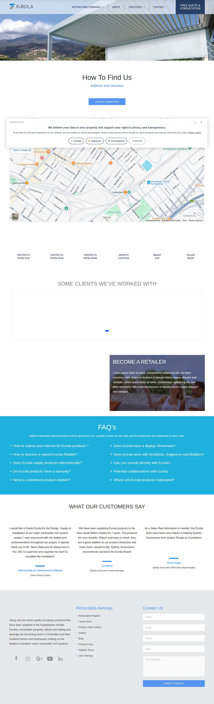

### knoxvilleelectrician.com — dry\_run\_failed (dry run)

| | |
|---|---|
| Attempt ID | `eb8dbb4e-1891-46fd-b9a2-8c563fee2217` |
| Form URL | https://knoxvilleelectrician.com/contact-us/ |
| Final URL | https://knoxvilleelectrician.com/contact-us/ |
| Reserved | 2026-11-13 07:44:51 UTC |
| Submit attempted | — |
| Template | standard v2 |
| Confirmation text | none observed |
| Result / error | Mapped field "Name" not found uniquely |

Exact message:

~~~text
Subject: Helping customers find your business in AI search (AEO + GEO)

Hi there,

I'm Arun from Devs Arun. More and more customers now ask ChatGPT, Gemini, Perplexity or Google's AI Overviews questions like "who should I hire for this in my area?" before they call anyone. These tools answer from websites they can clearly understand, and they tend to recommend businesses whose pages answer real customer questions.

That is what AEO + GEO (Answer Engine and Generative Engine Optimization) is for. I improve your existing service pages so they clearly answer the questions your customers ask, add structured data that matches the page, and make the call, quote or enquiry step obvious. The benefit: your business gets a better chance of being mentioned or linked in AI answers, and visitors who arrive find it easy to contact you.

The AEO + GEO Starter is a one-time $199 (about ₹16,999, negotiable) for one website: a basic audit, 10 customer questions, improvements to two existing pages, relevant structured data and an action plan, with one revision round.

You can read the full details, send an enquiry or book online here:
https://devsarun.io/aeo-geo/

If this isn't relevant, just reply and I won't contact you again.

Best,
Arun
Devs Arun
itschool408@gmail.com · +91 7654534323
~~~

Submitted field values:

- \#form-field-1b7221: itschool408@gmail.com
- \#form-field-2fa3ac: +91 7654534323
- \#form-field-96f51f: Arun
- \#form-field-fed9d8: Hi there, I'm Arun from Devs Arun. More and more customers now ask ChatGPT, Gemini, Perplexity or Google's AI Overviews 

**Inspected page** — `run-643c83e9_attempt-eb8dbb4e_inspection_2026-11-13T07-44-54-774Z.jpg`

### tricityfinishing.com — dry\_run\_failed (dry run)

| | |
|---|---|
| Attempt ID | `e01cfdc4-9b3d-433b-8a03-1ff7fc743ecd` |
| Form URL | https://www.tricityfinishing.com/contact-us.html |
| Final URL | https://www.tricityfinishing.com/contact-us.html |
| Reserved | 2026-11-13 07:44:59 UTC |
| Submit attempted | — |
| Template | standard v2 |
| Confirmation text | none observed |
| Result / error | Reviewed form not found on page (site changed) |

Exact message:

~~~text
Subject: Helping customers find your business in AI search (AEO + GEO)

Hi there,

I'm Arun from Devs Arun. More and more customers now ask ChatGPT, Gemini, Perplexity or Google's AI Overviews questions like "who should I hire for this in my area?" before they call anyone. These tools answer from websites they can clearly understand, and they tend to recommend businesses whose pages answer real customer questions.

That is what AEO + GEO (Answer Engine and Generative Engine Optimization) is for. I improve your existing service pages so they clearly answer the questions your customers ask, add structured data that matches the page, and make the call, quote or enquiry step obvious. The benefit: your business gets a better chance of being mentioned or linked in AI answers, and visitors who arrive find it easy to contact you.

The AEO + GEO Starter is a one-time $199 (about ₹16,999, negotiable) for one website: a basic audit, 10 customer questions, improvements to two existing pages, relevant structured data and an action plan, with one revision round.

You can read the full details, send an enquiry or book online here:
https://devsarun.io/aeo-geo/

If this isn't relevant, just reply and I won't contact you again.

Best,
Arun
Devs Arun
itschool408@gmail.com · +91 7654534323
~~~

Submitted field values:

- \#name-1794547025425: Arun
- \#email-1794547025425: itschool408@gmail.com
- \#phone-1794547025426: +91 7654534323
- \#comments-1794547025426: Hi there, I'm Arun from Devs Arun. More and more customers now ask ChatGPT, Gemini, Perplexity or Google's AI Overviews 

**Inspected page** — `run-643c83e9_attempt-e01cfdc4_inspection_2026-11-13T07-45-01-344Z.jpg`

### sblawpartners.com.au — dry\_run\_failed (dry run)

| | |
|---|---|
| Attempt ID | `0a012969-7ae7-4aa6-9e72-0bf384c07410` |
| Form URL | https://sblawpartners.com.au/contact-us/ |
| Final URL | https://sblawpartners.com.au/contact-us/ |
| Reserved | 2026-11-13 07:45:06 UTC |
| Submit attempted | — |
| Template | standard v2 |
| Confirmation text | none observed |
| Result / error | Mapped field "Name \*" not found uniquely |

Exact message:

~~~text
Subject: Helping customers find your business in AI search (AEO + GEO)

Hi there,

I'm Arun from Devs Arun. More and more customers now ask ChatGPT, Gemini, Perplexity or Google's AI Overviews questions like "who should I hire for this in my area?" before they call anyone. These tools answer from websites they can clearly understand, and they tend to recommend businesses whose pages answer real customer questions.

That is what AEO + GEO (Answer Engine and Generative Engine Optimization) is for. I improve your existing service pages so they clearly answer the questions your customers ask, add structured data that matches the page, and make the call, quote or enquiry step obvious. The benefit: your business gets a better chance of being mentioned or linked in AI answers, and visitors who arrive find it easy to contact you.

The AEO + GEO Starter is a one-time $199 (about ₹16,999, negotiable) for one website: a basic audit, 10 customer questions, improvements to two existing pages, relevant structured data and an action plan, with one revision round.

You can read the full details, send an enquiry or book online here:
https://devsarun.io/aeo-geo/

If this isn't relevant, just reply and I won't contact you again.

Best,
Arun
Devs Arun
itschool408@gmail.com · +91 7654534323
~~~

Submitted field values:

- \#forminator-field-name-1\_6af14060364ef: Arun
- \#forminator-field-email-1\_6af14060364ef: itschool408@gmail.com
- \#forminator-field-phone-1\_6af14060364ef: +91 7654534323
- \#forminator-field-textarea-1\_6af14060364ef: Hi there, I'm Arun from Devs Arun. More and more customers now ask ChatGPT, Gemini, Perplexity or Google's AI Overviews 

**Inspected page** — `run-643c83e9_attempt-0a012969_inspection_2026-11-13T07-45-11-580Z.jpg`

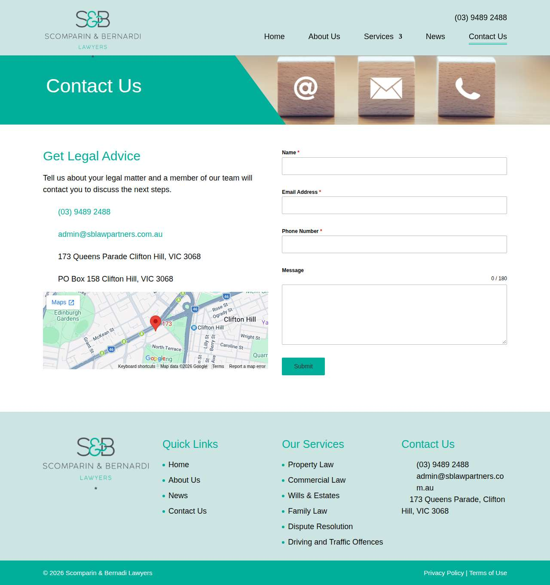

### mspc.cpa — dry\_run\_failed (dry run)

| | |
|---|---|
| Attempt ID | `93792fbb-cb22-4d06-a152-4ce03106b3d5` |
| Form URL | https://www.mspc.cpa/contact/ |
| Final URL | https://www.mspc.cpa/contact/ |
| Reserved | 2026-11-13 07:45:16 UTC |
| Submit attempted | — |
| Template | standard v2 |
| Confirmation text | none observed |
| Result / error | Mapped field "Full Name \*" not found uniquely |

Exact message:

~~~text
Subject: Helping customers find your business in AI search (AEO + GEO)

Hi there,

I'm Arun from Devs Arun. More and more customers now ask ChatGPT, Gemini, Perplexity or Google's AI Overviews questions like "who should I hire for this in my area?" before they call anyone. These tools answer from websites they can clearly understand, and they tend to recommend businesses whose pages answer real customer questions.

That is what AEO + GEO (Answer Engine and Generative Engine Optimization) is for. I improve your existing service pages so they clearly answer the questions your customers ask, add structured data that matches the page, and make the call, quote or enquiry step obvious. The benefit: your business gets a better chance of being mentioned or linked in AI answers, and visitors who arrive find it easy to contact you.

The AEO + GEO Starter is a one-time $199 (about ₹16,999, negotiable) for one website: a basic audit, 10 customer questions, improvements to two existing pages, relevant structured data and an action plan, with one revision round.

You can read the full details, send an enquiry or book online here:
https://devsarun.io/aeo-geo/

If this isn't relevant, just reply and I won't contact you again.

Best,
Arun
Devs Arun
itschool408@gmail.com · +91 7654534323
~~~

Submitted field values:

- \#forminator-field-name-1\_6aeaca2579f24: Arun
- \#forminator-field-text-1\_6aeaca2579f24: Devs Arun
- \#forminator-field-email-1\_6aeaca2579f24: itschool408@gmail.com
- \#forminator-field-phone-1\_6aeaca2579f24: +91 7654534323
- \#forminator-field-textarea-1\_6aeaca2579f24: Hi there, I'm Arun from Devs Arun. More and more customers now ask ChatGPT, Gemini, Perplexity or Google's AI Overviews 

**Inspected page** — `run-643c83e9_attempt-93792fbb_inspection_2026-11-13T07-45-19-045Z.jpg`

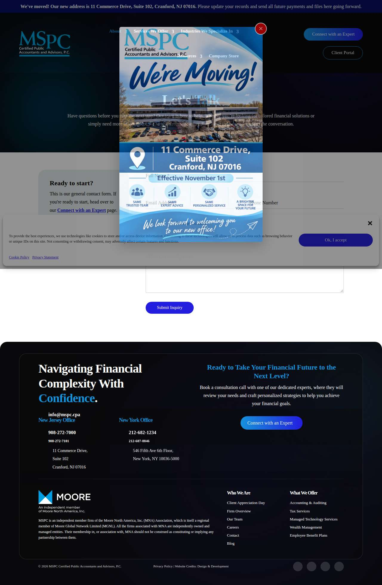

### mpccpa.ca — dry\_run\_ok (dry run)

| | |
|---|---|
| Attempt ID | `9b46ee15-3f41-48fc-b105-b3dcd4130802` |
| Form URL | https://mpccpa.ca/contact/ |
| Final URL | https://mpccpa.ca/contact/ |
| Reserved | 2026-11-13 07:45:24 UTC |
| Submit attempted | — |
| Template | standard v2 |
| Confirmation text | none observed |
| Result / error | Selectors verified; fields not typed (domain not in dry-run fill list); not submitted |

Exact message:

~~~text
Subject: Helping customers find your business in AI search (AEO + GEO)

Hi there,

I'm Arun from Devs Arun. More and more customers now ask ChatGPT, Gemini, Perplexity or Google's AI Overviews questions like "who should I hire for this in my area?" before they call anyone. These tools answer from websites they can clearly understand, and they tend to recommend businesses whose pages answer real customer questions.

That is what AEO + GEO (Answer Engine and Generative Engine Optimization) is for. I improve your existing service pages so they clearly answer the questions your customers ask, add structured data that matches the page, and make the call, quote or enquiry step obvious. The benefit: your business gets a better chance of being mentioned or linked in AI answers, and visitors who arrive find it easy to contact you.

The AEO + GEO Starter is a one-time $199 (about ₹16,999, negotiable) for one website: a basic audit, 10 customer questions, improvements to two existing pages, relevant structured data and an action plan, with one revision round.

You can read the full details, send an enquiry or book online here:
https://devsarun.io/aeo-geo/

If this isn't relevant, just reply and I won't contact you again.

Best,
Arun
Devs Arun
itschool408@gmail.com · +91 7654534323
~~~

Submitted field values:

- input\[name="email"\]: itschool408@gmail.com
- input\[name="phone"\]: +91 7654534323
- input\[name="your-name"\]: Arun
- textarea\[name="comment"\]: Hi there, I'm Arun from Devs Arun. More and more customers now ask ChatGPT, Gemini, Perplexity or Google's AI Overviews 

**Inspected page** — `run-643c83e9_attempt-9b46ee15_inspection_2026-11-13T07-45-28-954Z.jpg`

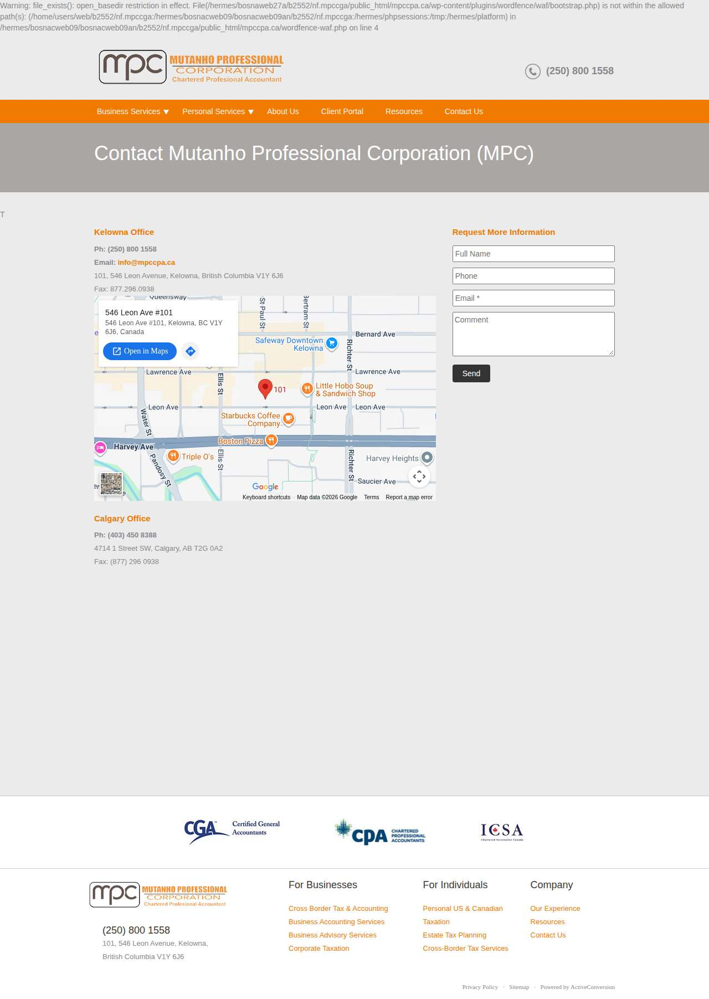

### chimickcpa.com — dry\_run\_ok (dry run)

| | |
|---|---|
| Attempt ID | `012984c6-1949-4da0-9669-5242e772ae62` |
| Form URL | http://chimickcpa.com/index.html\#contacts |
| Final URL | http://chimickcpa.com/index.html\#contacts |
| Reserved | 2026-11-13 07:45:33 UTC |
| Submit attempted | — |
| Template | standard v2 |
| Confirmation text | none observed |
| Result / error | Selectors verified; fields not typed (domain not in dry-run fill list); not submitted |

Exact message:

~~~text
Subject: Helping customers find your business in AI search (AEO + GEO)

Hi there,

I'm Arun from Devs Arun. More and more customers now ask ChatGPT, Gemini, Perplexity or Google's AI Overviews questions like "who should I hire for this in my area?" before they call anyone. These tools answer from websites they can clearly understand, and they tend to recommend businesses whose pages answer real customer questions.

That is what AEO + GEO (Answer Engine and Generative Engine Optimization) is for. I improve your existing service pages so they clearly answer the questions your customers ask, add structured data that matches the page, and make the call, quote or enquiry step obvious. The benefit: your business gets a better chance of being mentioned or linked in AI answers, and visitors who arrive find it easy to contact you.

The AEO + GEO Starter is a one-time $199 (about ₹16,999, negotiable) for one website: a basic audit, 10 customer questions, improvements to two existing pages, relevant structured data and an action plan, with one revision round.

You can read the full details, send an enquiry or book online here:
https://devsarun.io/aeo-geo/

If this isn't relevant, just reply and I won't contact you again.

Best,
Arun
Devs Arun
itschool408@gmail.com · +91 7654534323
~~~

Submitted field values:

- input\[name="1"\]: Arun
- input\[name="2"\]: itschool408@gmail.com
- textarea\[name="3"\]: Hi there, I'm Arun from Devs Arun. More and more customers now ask ChatGPT, Gemini, Perplexity or Google's AI Overviews 

**Inspected page** — `run-643c83e9_attempt-012984c6_inspection_2026-11-13T07-45-36-624Z.jpg`

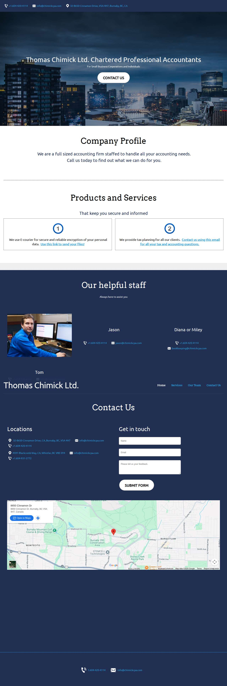

### stanleyaccounting.ca — dry\_run\_ok (dry run)

| | |
|---|---|
| Attempt ID | `32333a03-62cf-449e-8ebb-3cb240d2d517` |
| Form URL | https://www.stanleyaccounting.ca/contact |
| Final URL | https://www.stanleyaccounting.ca/contact |
| Reserved | 2026-11-13 07:45:41 UTC |
| Submit attempted | — |
| Template | standard v2 |
| Confirmation text | none observed |
| Result / error | Selectors verified; fields not typed (domain not in dry-run fill list); not submitted |

Exact message:

~~~text
Subject: Helping customers find your business in AI search (AEO + GEO)

Hi there,

I'm Arun from Devs Arun. More and more customers now ask ChatGPT, Gemini, Perplexity or Google's AI Overviews questions like "who should I hire for this in my area?" before they call anyone. These tools answer from websites they can clearly understand, and they tend to recommend businesses whose pages answer real customer questions.

That is what AEO + GEO (Answer Engine and Generative Engine Optimization) is for. I improve your existing service pages so they clearly answer the questions your customers ask, add structured data that matches the page, and make the call, quote or enquiry step obvious. The benefit: your business gets a better chance of being mentioned or linked in AI answers, and visitors who arrive find it easy to contact you.

The AEO + GEO Starter is a one-time $199 (about ₹16,999, negotiable) for one website: a basic audit, 10 customer questions, improvements to two existing pages, relevant structured data and an action plan, with one revision round.

You can read the full details, send an enquiry or book online here:
https://devsarun.io/aeo-geo/

If this isn't relevant, just reply and I won't contact you again.

Best,
Arun
Devs Arun
itschool408@gmail.com · +91 7654534323
~~~

Submitted field values:

- \#input\_comp-keuxbf4b: Arun
- \#input\_comp-keuxbf4p: itschool408@gmail.com
- \#input\_comp-keuxbf4y: Helping customers find your business in AI search (AEO + GEO)
- \#textarea\_comp-keuxbf52: Hi there, I'm Arun from Devs Arun. More and more customers now ask ChatGPT, Gemini, Perplexity or Google's AI Overviews 

**Inspected page** — `run-643c83e9_attempt-32333a03_inspection_2026-11-13T07-45-43-789Z.jpg`

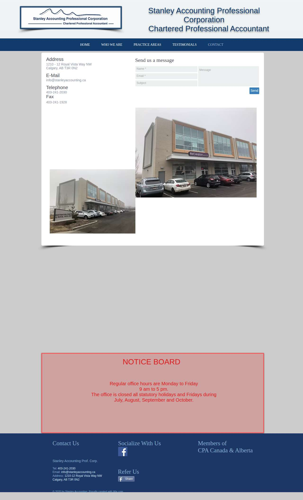

### sands-trustee.com — dry\_run\_ok (dry run)

| | |
|---|---|
| Attempt ID | `07538f69-4889-423a-a244-8da5afa792d6` |
| Form URL | https://www.sands-trustee.com/free-debt-consultation/preparing-for-your-first-meeting/ |
| Final URL | https://www.sands-trustee.com/free-debt-consultation/preparing-for-your-first-meeting/ |
| Reserved | 2026-11-13 07:45:48 UTC |
| Submit attempted | — |
| Template | standard v2 |
| Confirmation text | none observed |
| Result / error | Selectors verified; fields not typed (domain not in dry-run fill list); not submitted |

Exact message:

~~~text
Subject: Helping customers find your business in AI search (AEO + GEO)

Hi there,

I'm Arun from Devs Arun. More and more customers now ask ChatGPT, Gemini, Perplexity or Google's AI Overviews questions like "who should I hire for this in my area?" before they call anyone. These tools answer from websites they can clearly understand, and they tend to recommend businesses whose pages answer real customer questions.

That is what AEO + GEO (Answer Engine and Generative Engine Optimization) is for. I improve your existing service pages so they clearly answer the questions your customers ask, add structured data that matches the page, and make the call, quote or enquiry step obvious. The benefit: your business gets a better chance of being mentioned or linked in AI answers, and visitors who arrive find it easy to contact you.

The AEO + GEO Starter is a one-time $199 (about ₹16,999, negotiable) for one website: a basic audit, 10 customer questions, improvements to two existing pages, relevant structured data and an action plan, with one revision round.

You can read the full details, send an enquiry or book online here:
https://devsarun.io/aeo-geo/

If this isn't relevant, just reply and I won't contact you again.

Best,
Arun
Devs Arun
itschool408@gmail.com · +91 7654534323
~~~

Submitted field values:

- \#input\_3\_1: Arun
- \#input\_3\_2: itschool408@gmail.com
- \#input\_3\_3: +91 7654534323
- \#input\_3\_5: Hi there, I'm Arun from Devs Arun. More and more customers now ask ChatGPT, Gemini, Perplexity or Google's AI Overviews 

**Inspected page** — `run-643c83e9_attempt-07538f69_inspection_2026-11-13T07-45-51-630Z.jpg`

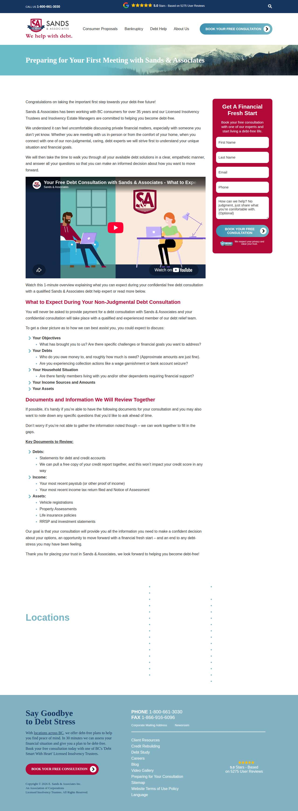

### valuecorp.ca — dry\_run\_ok (dry run)

| | |
|---|---|
| Attempt ID | `caa61fb6-8982-486c-9ead-641b390ad2ea` |
| Form URL | https://valuecorp.ca/contact/ |
| Final URL | https://valuecorp.ca/contact/ |
| Reserved | 2026-11-13 07:45:56 UTC |
| Submit attempted | — |
| Template | standard v2 |
| Confirmation text | none observed |
| Result / error | Selectors verified; fields not typed (domain not in dry-run fill list); not submitted |

Exact message:

~~~text
Subject: Helping customers find your business in AI search (AEO + GEO)

Hi there,

I'm Arun from Devs Arun. More and more customers now ask ChatGPT, Gemini, Perplexity or Google's AI Overviews questions like "who should I hire for this in my area?" before they call anyone. These tools answer from websites they can clearly understand, and they tend to recommend businesses whose pages answer real customer questions.

That is what AEO + GEO (Answer Engine and Generative Engine Optimization) is for. I improve your existing service pages so they clearly answer the questions your customers ask, add structured data that matches the page, and make the call, quote or enquiry step obvious. The benefit: your business gets a better chance of being mentioned or linked in AI answers, and visitors who arrive find it easy to contact you.

The AEO + GEO Starter is a one-time $199 (about ₹16,999, negotiable) for one website: a basic audit, 10 customer questions, improvements to two existing pages, relevant structured data and an action plan, with one revision round.

You can read the full details, send an enquiry or book online here:
https://devsarun.io/aeo-geo/

If this isn't relevant, just reply and I won't contact you again.

Best,
Arun
Devs Arun
itschool408@gmail.com · +91 7654534323
~~~

Submitted field values:

- \#wpcf7-f41-p767-o1 \> form \> div:nth-of-type(2) \> div:nth-of-type(1) \> p \> span \> input: Arun
- \#wpcf7-f41-p767-o1 \> form \> div:nth-of-type(2) \> div:nth-of-type(2) \> p \> span \> input: itschool408@gmail.com
- \#wpcf7-f41-p767-o1 \> form \> div:nth-of-type(2) \> div:nth-of-type(3) \> p \> span \> input: Helping customers find your business in AI search (AEO + GEO)
- \#wpcf7-f41-p767-o1 \> form \> div:nth-of-type(2) \> div:nth-of-type(4) \> p \> span \> textarea: Hi there, I'm Arun from Devs Arun. More and more customers now ask ChatGPT, Gemini, Perplexity or Google's AI Overviews 

**Inspected page** — `run-643c83e9_attempt-caa61fb6_inspection_2026-11-13T07-45-59-507Z.jpg`

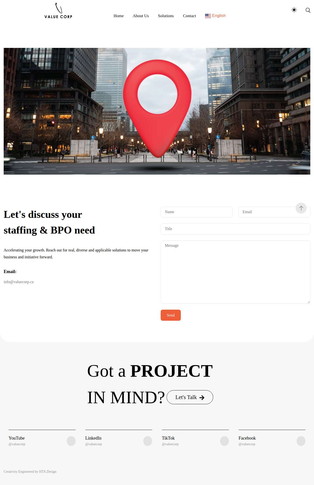

### carontrepanier.com — dry\_run\_ok (dry run)

| | |
|---|---|
| Attempt ID | `35ab809d-d29e-4961-a240-1f2fbcee9c74` |
| Form URL | https://ctacomptable.ca/contact/ |
| Final URL | https://ctacomptable.ca/contact/ |
| Reserved | 2026-11-13 07:46:04 UTC |
| Submit attempted | — |
| Template | standard v2 |
| Confirmation text | none observed |
| Result / error | Selectors verified; fields not typed (domain not in dry-run fill list); not submitted |

Exact message:

~~~text
Subject: Helping customers find your business in AI search (AEO + GEO)

Hi there,

I'm Arun from Devs Arun. More and more customers now ask ChatGPT, Gemini, Perplexity or Google's AI Overviews questions like "who should I hire for this in my area?" before they call anyone. These tools answer from websites they can clearly understand, and they tend to recommend businesses whose pages answer real customer questions.

That is what AEO + GEO (Answer Engine and Generative Engine Optimization) is for. I improve your existing service pages so they clearly answer the questions your customers ask, add structured data that matches the page, and make the call, quote or enquiry step obvious. The benefit: your business gets a better chance of being mentioned or linked in AI answers, and visitors who arrive find it easy to contact you.

The AEO + GEO Starter is a one-time $199 (about ₹16,999, negotiable) for one website: a basic audit, 10 customer questions, improvements to two existing pages, relevant structured data and an action plan, with one revision round.

You can read the full details, send an enquiry or book online here:
https://devsarun.io/aeo-geo/

If this isn't relevant, just reply and I won't contact you again.

Best,
Arun
Devs Arun
itschool408@gmail.com · +91 7654534323
~~~

Submitted field values:

- \#ft\_5b7f171d6e5d6: itschool408@gmail.com
- \#ft\_5b7f17c134a8e: Hi there, I'm Arun from Devs Arun. More and more customers now ask ChatGPT, Gemini, Perplexity or Google's AI Overviews 

**Inspected page** — `run-643c83e9_attempt-35ab809d_inspection_2026-11-13T07-46-06-433Z.jpg`

### kbacpa.ca — dry\_run\_ok (dry run)

| | |
|---|---|
| Attempt ID | `9cf86d1a-4dfc-47aa-9df7-983d4cd93d1f` |
| Form URL | https://www.kbacpa.ca/contact |
| Final URL | https://www.kbacpa.ca/contact |
| Reserved | 2026-11-13 07:46:11 UTC |
| Submit attempted | — |
| Template | standard v2 |
| Confirmation text | none observed |
| Result / error | Selectors verified; fields not typed (domain not in dry-run fill list); not submitted |

Exact message:

~~~text
Subject: Helping customers find your business in AI search (AEO + GEO)

Hi there,

I'm Arun from Devs Arun. More and more customers now ask ChatGPT, Gemini, Perplexity or Google's AI Overviews questions like "who should I hire for this in my area?" before they call anyone. These tools answer from websites they can clearly understand, and they tend to recommend businesses whose pages answer real customer questions.

That is what AEO + GEO (Answer Engine and Generative Engine Optimization) is for. I improve your existing service pages so they clearly answer the questions your customers ask, add structured data that matches the page, and make the call, quote or enquiry step obvious. The benefit: your business gets a better chance of being mentioned or linked in AI answers, and visitors who arrive find it easy to contact you.

The AEO + GEO Starter is a one-time $199 (about ₹16,999, negotiable) for one website: a basic audit, 10 customer questions, improvements to two existing pages, relevant structured data and an action plan, with one revision round.

You can read the full details, send an enquiry or book online here:
https://devsarun.io/aeo-geo/

If this isn't relevant, just reply and I won't contact you again.

Best,
Arun
Devs Arun
itschool408@gmail.com · +91 7654534323
~~~

Submitted field values:

- input\[name="name"\]: Arun
- input\[name="email"\]: itschool408@gmail.com
- input\[name="phone"\]: +91 7654534323
- input\[name="subject"\]: Helping customers find your business in AI search (AEO + GEO)
- textarea\[name="message"\]: Hi there, I'm Arun from Devs Arun. More and more customers now ask ChatGPT, Gemini, Perplexity or Google's AI Overviews 

**Inspected page** — `run-643c83e9_attempt-9cf86d1a_inspection_2026-11-13T07-46-13-398Z.jpg`

### loewenkruse.com — dry\_run\_ok (dry run)

| | |
|---|---|
| Attempt ID | `e5973bb8-7e3a-499d-9477-8a98712aff79` |
| Form URL | https://loewenkruse.com/contact/ |
| Final URL | https://loewenkruse.com/contact/ |
| Reserved | 2026-11-13 07:46:18 UTC |
| Submit attempted | — |
| Template | standard v2 |
| Confirmation text | none observed |
| Result / error | Selectors verified; fields not typed (domain not in dry-run fill list); not submitted |

Exact message:

~~~text
Subject: Helping customers find your business in AI search (AEO + GEO)

Hi there,

I'm Arun from Devs Arun. More and more customers now ask ChatGPT, Gemini, Perplexity or Google's AI Overviews questions like "who should I hire for this in my area?" before they call anyone. These tools answer from websites they can clearly understand, and they tend to recommend businesses whose pages answer real customer questions.

That is what AEO + GEO (Answer Engine and Generative Engine Optimization) is for. I improve your existing service pages so they clearly answer the questions your customers ask, add structured data that matches the page, and make the call, quote or enquiry step obvious. The benefit: your business gets a better chance of being mentioned or linked in AI answers, and visitors who arrive find it easy to contact you.

The AEO + GEO Starter is a one-time $199 (about ₹16,999, negotiable) for one website: a basic audit, 10 customer questions, improvements to two existing pages, relevant structured data and an action plan, with one revision round.

You can read the full details, send an enquiry or book online here:
https://devsarun.io/aeo-geo/

If this isn't relevant, just reply and I won't contact you again.

Best,
Arun
Devs Arun
itschool408@gmail.com · +91 7654534323
~~~

Submitted field values:

- \#et\_pb\_contact\_name\_0: Arun
- \#et\_pb\_contact\_email\_0: itschool408@gmail.com
- \#et\_pb\_contact\_phone\_0: +91 7654534323
- \#et\_pb\_contact\_company\_0: Devs Arun
- \#et\_pb\_contact\_message\_0: Hi there, I'm Arun from Devs Arun. More and more customers now ask ChatGPT, Gemini, Perplexity or Google's AI Overviews 
- \#et\_pb\_contact\_subject\_0: Helping customers find your business in AI search (AEO + GEO)

**Inspected page** — `run-643c83e9_attempt-e5973bb8_inspection_2026-11-13T07-46-22-968Z.jpg`

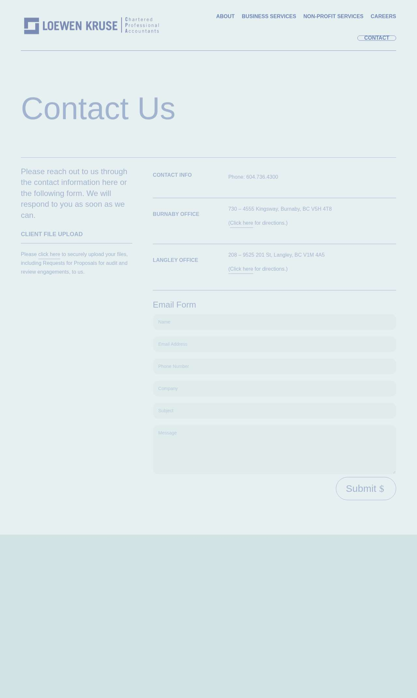

### martincoutureinc.com — dry\_run\_ok (dry run)

| | |
|---|---|
| Attempt ID | `b4c4e89d-8961-485a-b435-d3a4b76cafaf` |
| Form URL | https://martincoutureinc.com/contactez-nous/ |
| Final URL | https://martincoutureinc.com/contactez-nous/ |
| Reserved | 2026-11-13 07:46:27 UTC |
| Submit attempted | — |
| Template | standard v2 |
| Confirmation text | none observed |
| Result / error | Selectors verified; fields not typed (domain not in dry-run fill list); not submitted |

Exact message:

~~~text
Subject: Helping customers find your business in AI search (AEO + GEO)

Hi there,

I'm Arun from Devs Arun. More and more customers now ask ChatGPT, Gemini, Perplexity or Google's AI Overviews questions like "who should I hire for this in my area?" before they call anyone. These tools answer from websites they can clearly understand, and they tend to recommend businesses whose pages answer real customer questions.

That is what AEO + GEO (Answer Engine and Generative Engine Optimization) is for. I improve your existing service pages so they clearly answer the questions your customers ask, add structured data that matches the page, and make the call, quote or enquiry step obvious. The benefit: your business gets a better chance of being mentioned or linked in AI answers, and visitors who arrive find it easy to contact you.

The AEO + GEO Starter is a one-time $199 (about ₹16,999, negotiable) for one website: a basic audit, 10 customer questions, improvements to two existing pages, relevant structured data and an action plan, with one revision round.

You can read the full details, send an enquiry or book online here:
https://devsarun.io/aeo-geo/

If this isn't relevant, just reply and I won't contact you again.

Best,
Arun
Devs Arun
itschool408@gmail.com · +91 7654534323
~~~

Submitted field values:

- input\[name="your-name"\]: Arun
- input\[name="your-email"\]: itschool408@gmail.com
- input\[name="your-subject"\]: Helping customers find your business in AI search (AEO + GEO)
- textarea\[name="your-message"\]: Hi there, I'm Arun from Devs Arun. More and more customers now ask ChatGPT, Gemini, Perplexity or Google's AI Overviews 

**Inspected page** — `run-643c83e9_attempt-b4c4e89d_inspection_2026-11-13T07-46-32-989Z.jpg`

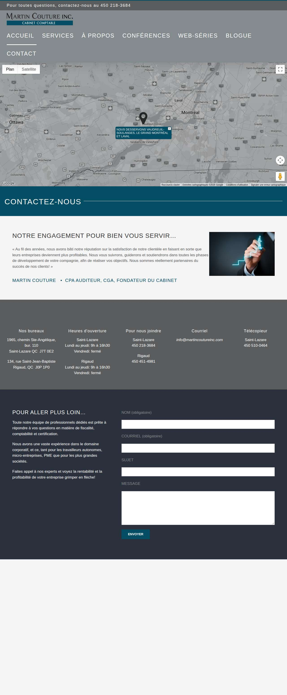

### dedicatedsolutions.ca — dry\_run\_ok (dry run)

| | |
|---|---|
| Attempt ID | `7fe49a64-3e6a-4b00-90ac-6c8547ba0bef` |
| Form URL | https://dedicatedsolutions.ca/ |
| Final URL | https://dedicatedsolutions.ca/ |
| Reserved | 2026-11-13 07:46:38 UTC |
| Submit attempted | — |
| Template | standard v2 |
| Confirmation text | none observed |
| Result / error | Selectors verified; fields not typed (domain not in dry-run fill list); not submitted |

Exact message:

~~~text
Subject: Helping customers find your business in AI search (AEO + GEO)

Hi there,

I'm Arun from Devs Arun. More and more customers now ask ChatGPT, Gemini, Perplexity or Google's AI Overviews questions like "who should I hire for this in my area?" before they call anyone. These tools answer from websites they can clearly understand, and they tend to recommend businesses whose pages answer real customer questions.

That is what AEO + GEO (Answer Engine and Generative Engine Optimization) is for. I improve your existing service pages so they clearly answer the questions your customers ask, add structured data that matches the page, and make the call, quote or enquiry step obvious. The benefit: your business gets a better chance of being mentioned or linked in AI answers, and visitors who arrive find it easy to contact you.

The AEO + GEO Starter is a one-time $199 (about ₹16,999, negotiable) for one website: a basic audit, 10 customer questions, improvements to two existing pages, relevant structured data and an action plan, with one revision round.

You can read the full details, send an enquiry or book online here:
https://devsarun.io/aeo-geo/

If this isn't relevant, just reply and I won't contact you again.

Best,
Arun
Devs Arun
itschool408@gmail.com · +91 7654534323
~~~

Submitted field values:

- \#nf-field-1: Arun
- \#nf-field-2: itschool408@gmail.com
- \#nf-field-3: Hi there, I'm Arun from Devs Arun. More and more customers now ask ChatGPT, Gemini, Perplexity or Google's AI Overviews 

**Inspected page** — `run-643c83e9_attempt-7fe49a64_inspection_2026-11-13T07-46-41-867Z.jpg`

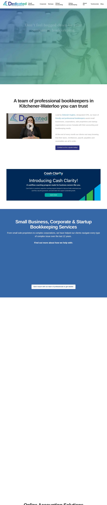

### debitscredits.com — dry\_run\_ok (dry run)

| | |
|---|---|
| Attempt ID | `c001181d-8dca-4bf2-b58d-c41a06fdbcc6` |
| Form URL | https://www.debitscredits.com/free-consult/ |
| Final URL | https://www.debitscredits.com/free-consult/ |
| Reserved | 2026-11-13 07:46:46 UTC |
| Submit attempted | — |
| Template | standard v2 |
| Confirmation text | none observed |
| Result / error | Selectors verified; fields not typed (domain not in dry-run fill list); not submitted |

Exact message:

~~~text
Subject: Helping customers find your business in AI search (AEO + GEO)

Hi there,

I'm Arun from Devs Arun. More and more customers now ask ChatGPT, Gemini, Perplexity or Google's AI Overviews questions like "who should I hire for this in my area?" before they call anyone. These tools answer from websites they can clearly understand, and they tend to recommend businesses whose pages answer real customer questions.

That is what AEO + GEO (Answer Engine and Generative Engine Optimization) is for. I improve your existing service pages so they clearly answer the questions your customers ask, add structured data that matches the page, and make the call, quote or enquiry step obvious. The benefit: your business gets a better chance of being mentioned or linked in AI answers, and visitors who arrive find it easy to contact you.

The AEO + GEO Starter is a one-time $199 (about ₹16,999, negotiable) for one website: a basic audit, 10 customer questions, improvements to two existing pages, relevant structured data and an action plan, with one revision round.

You can read the full details, send an enquiry or book online here:
https://devsarun.io/aeo-geo/

If this isn't relevant, just reply and I won't contact you again.

Best,
Arun
Devs Arun
itschool408@gmail.com · +91 7654534323
~~~

Submitted field values:

- \#kb\_field\_\_019c54-2b\_0: Arun
- \#kb\_field\_\_019c54-2b\_1: itschool408@gmail.com
- \#kb\_field\_\_019c54-2b\_2: +91 7654534323
- \#kb\_field\_\_019c54-2b\_3: Devs Arun
- \#kb\_field\_\_019c54-2b\_4: Hi there, I'm Arun from Devs Arun. More and more customers now ask ChatGPT, Gemini, Perplexity or Google's AI Overviews 

**Inspected page** — `run-643c83e9_attempt-c001181d_inspection_2026-11-13T07-46-49-390Z.jpg`

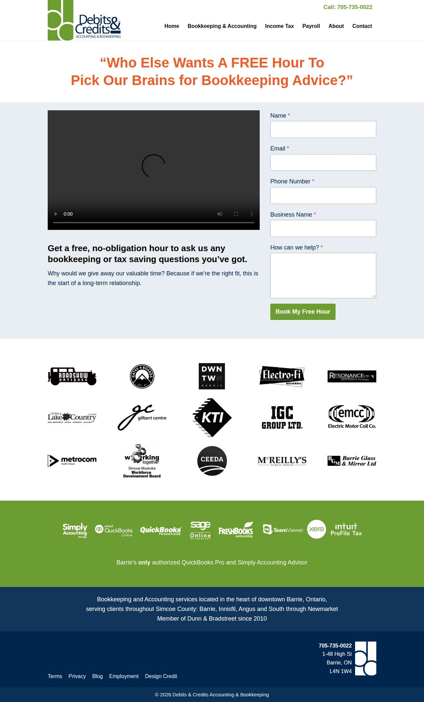

### servicesdecomptabilitemd.ca — dry\_run\_ok (dry run)

| | |
|---|---|
| Attempt ID | `ab58206b-fdd2-4f1e-90cc-44230e8c89db` |
| Form URL | https://www.servicesdecomptabilitemd.ca/contact |
| Final URL | https://www.servicesdecomptabilitemd.ca/contact |
| Reserved | 2026-11-13 07:46:54 UTC |
| Submit attempted | — |
| Template | standard v2 |
| Confirmation text | none observed |
| Result / error | Selectors verified; fields not typed (domain not in dry-run fill list); not submitted |

Exact message:

~~~text
Subject: Helping customers find your business in AI search (AEO + GEO)

Hi there,

I'm Arun from Devs Arun. More and more customers now ask ChatGPT, Gemini, Perplexity or Google's AI Overviews questions like "who should I hire for this in my area?" before they call anyone. These tools answer from websites they can clearly understand, and they tend to recommend businesses whose pages answer real customer questions.

That is what AEO + GEO (Answer Engine and Generative Engine Optimization) is for. I improve your existing service pages so they clearly answer the questions your customers ask, add structured data that matches the page, and make the call, quote or enquiry step obvious. The benefit: your business gets a better chance of being mentioned or linked in AI answers, and visitors who arrive find it easy to contact you.

The AEO + GEO Starter is a one-time $199 (about ₹16,999, negotiable) for one website: a basic audit, 10 customer questions, improvements to two existing pages, relevant structured data and an action plan, with one revision round.

You can read the full details, send an enquiry or book online here:
https://devsarun.io/aeo-geo/

If this isn't relevant, just reply and I won't contact you again.

Best,
Arun
Devs Arun
itschool408@gmail.com · +91 7654534323
~~~

Submitted field values:

- \#\\31 219393795: Hi there, I'm Arun from Devs Arun. More and more customers now ask ChatGPT, Gemini, Perplexity or Google's AI Overviews 
- \#\\31 260584106: itschool408@gmail.com
- \#\\31 304531982: +91 7654534323

**Inspected page** — `run-643c83e9_attempt-ab58206b_inspection_2026-11-13T07-46-55-817Z.jpg`

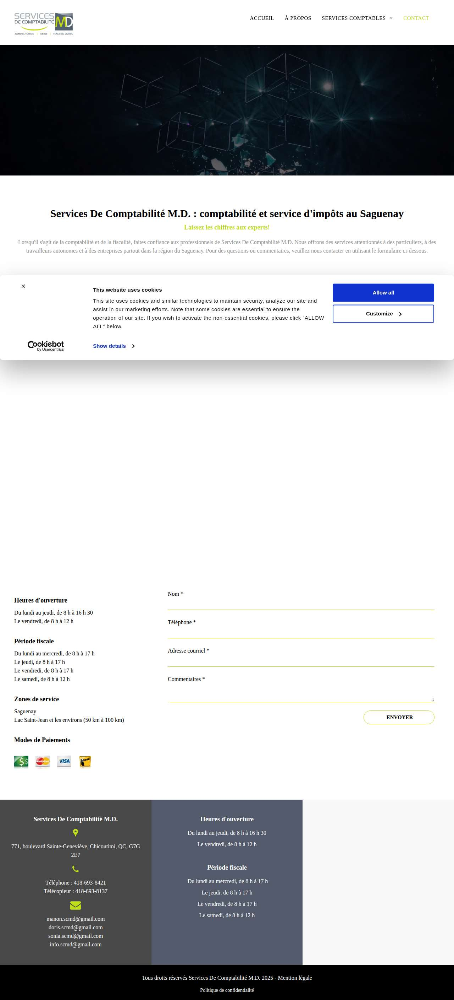

### hkicpa.ca — dry\_run\_ok (dry run)

| | |
|---|---|
| Attempt ID | `2ede6c99-721f-4600-b93e-c6e97e0460c3` |
| Form URL | https://www.hkicpa.ca/contact |
| Final URL | https://www.hkicpa.ca/contact |
| Reserved | 2026-11-13 07:47:00 UTC |
| Submit attempted | — |
| Template | standard v2 |
| Confirmation text | none observed |
| Result / error | Selectors verified; fields not typed (domain not in dry-run fill list); not submitted |

Exact message:

~~~text
Subject: Helping customers find your business in AI search (AEO + GEO)

Hi there,

I'm Arun from Devs Arun. More and more customers now ask ChatGPT, Gemini, Perplexity or Google's AI Overviews questions like "who should I hire for this in my area?" before they call anyone. These tools answer from websites they can clearly understand, and they tend to recommend businesses whose pages answer real customer questions.

That is what AEO + GEO (Answer Engine and Generative Engine Optimization) is for. I improve your existing service pages so they clearly answer the questions your customers ask, add structured data that matches the page, and make the call, quote or enquiry step obvious. The benefit: your business gets a better chance of being mentioned or linked in AI answers, and visitors who arrive find it easy to contact you.

The AEO + GEO Starter is a one-time $199 (about ₹16,999, negotiable) for one website: a basic audit, 10 customer questions, improvements to two existing pages, relevant structured data and an action plan, with one revision round.

You can read the full details, send an enquiry or book online here:
https://devsarun.io/aeo-geo/

If this isn't relevant, just reply and I won't contact you again.

Best,
Arun
Devs Arun
itschool408@gmail.com · +91 7654534323
~~~

Submitted field values:

- \#input\_comp-kkc4ef6k: Arun
- \#input\_comp-kkc4ef6s: itschool408@gmail.com
- \#input\_comp-kkc4ef6y: +91 7654534323
- \#input\_comp-kkc4ef71: Helping customers find your business in AI search (AEO + GEO)
- \#textarea\_comp-kkc4ef74: Hi there, I'm Arun from Devs Arun. More and more customers now ask ChatGPT, Gemini, Perplexity or Google's AI Overviews 

**Inspected page** — `run-643c83e9_attempt-2ede6c99_inspection_2026-11-13T07-47-03-179Z.jpg`

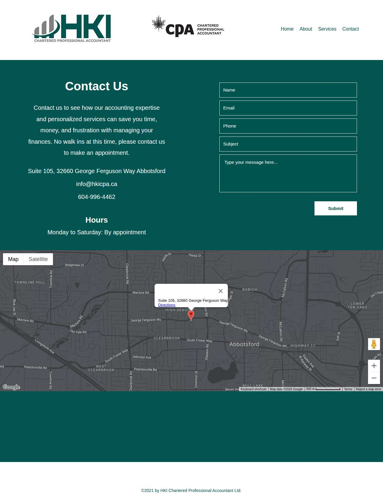

### pivotadvantage.com — dry\_run\_ok (dry run)

| | |
|---|---|
| Attempt ID | `36770d6f-4f1b-4716-a848-7b2ba16f27d4` |
| Form URL | https://pivotadvantage.com/contact/ |
| Final URL | https://pivotadvantage.com/contact/ |
| Reserved | 2026-11-13 07:47:08 UTC |
| Submit attempted | — |
| Template | standard v2 |
| Confirmation text | none observed |
| Result / error | Selectors verified; fields not typed (domain not in dry-run fill list); not submitted |

Exact message:

~~~text
Subject: Helping customers find your business in AI search (AEO + GEO)

Hi there,

I'm Arun from Devs Arun. More and more customers now ask ChatGPT, Gemini, Perplexity or Google's AI Overviews questions like "who should I hire for this in my area?" before they call anyone. These tools answer from websites they can clearly understand, and they tend to recommend businesses whose pages answer real customer questions.

That is what AEO + GEO (Answer Engine and Generative Engine Optimization) is for. I improve your existing service pages so they clearly answer the questions your customers ask, add structured data that matches the page, and make the call, quote or enquiry step obvious. The benefit: your business gets a better chance of being mentioned or linked in AI answers, and visitors who arrive find it easy to contact you.

The AEO + GEO Starter is a one-time $199 (about ₹16,999, negotiable) for one website: a basic audit, 10 customer questions, improvements to two existing pages, relevant structured data and an action plan, with one revision round.

You can read the full details, send an enquiry or book online here:
https://devsarun.io/aeo-geo/

If this isn't relevant, just reply and I won't contact you again.

Best,
Arun
Devs Arun
itschool408@gmail.com · +91 7654534323
~~~

Submitted field values:

- \#form-field-name: Arun
- \#form-field-email: itschool408@gmail.com
- \#form-field-phone: +91 7654534323
- \#form-field-message: Hi there, I'm Arun from Devs Arun. More and more customers now ask ChatGPT, Gemini, Perplexity or Google's AI Overviews 
- \#form-field-servicename: Online Payroll Services

**Inspected page** — `run-643c83e9_attempt-36770d6f_inspection_2026-11-13T07-47-10-415Z.jpg`

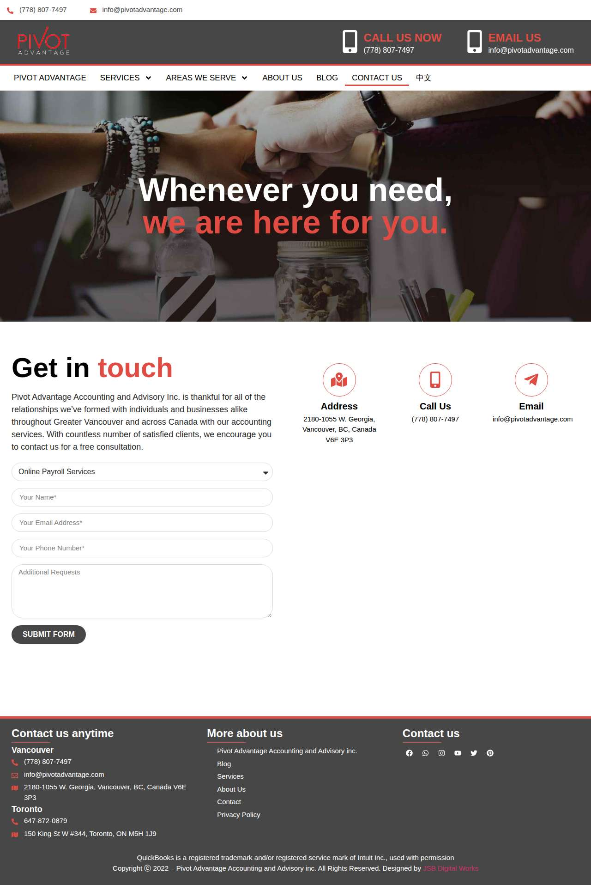

### desaiassociates.ca — dry\_run\_ok (dry run)

| | |
|---|---|
| Attempt ID | `323f9a67-df69-4365-88db-96dfd74a151c` |
| Form URL | https://desaiassociates.ca/contact/ |
| Final URL | https://desaiassociates.ca/contact/ |
| Reserved | 2026-11-13 07:47:15 UTC |
| Submit attempted | — |
| Template | standard v2 |
| Confirmation text | none observed |
| Result / error | Selectors verified; fields not typed (domain not in dry-run fill list); not submitted |

Exact message:

~~~text
Subject: Helping customers find your business in AI search (AEO + GEO)

Hi there,

I'm Arun from Devs Arun. More and more customers now ask ChatGPT, Gemini, Perplexity or Google's AI Overviews questions like "who should I hire for this in my area?" before they call anyone. These tools answer from websites they can clearly understand, and they tend to recommend businesses whose pages answer real customer questions.

That is what AEO + GEO (Answer Engine and Generative Engine Optimization) is for. I improve your existing service pages so they clearly answer the questions your customers ask, add structured data that matches the page, and make the call, quote or enquiry step obvious. The benefit: your business gets a better chance of being mentioned or linked in AI answers, and visitors who arrive find it easy to contact you.

The AEO + GEO Starter is a one-time $199 (about ₹16,999, negotiable) for one website: a basic audit, 10 customer questions, improvements to two existing pages, relevant structured data and an action plan, with one revision round.

You can read the full details, send an enquiry or book online here:
https://devsarun.io/aeo-geo/

If this isn't relevant, just reply and I won't contact you again.

Best,
Arun
Devs Arun
itschool408@gmail.com · +91 7654534323
~~~

Submitted field values:

- input\[name="name"\]: Arun
- input\[name="email"\]: itschool408@gmail.com
- input\[name="number"\]: +91 7654534323
- input\[name="subject"\]: itschool408@gmail.com
- textarea\[name="message"\]: Hi there, I'm Arun from Devs Arun. More and more customers now ask ChatGPT, Gemini, Perplexity or Google's AI Overviews 

**Inspected page** — `run-643c83e9_attempt-323f9a67_inspection_2026-11-13T07-47-19-562Z.jpg`

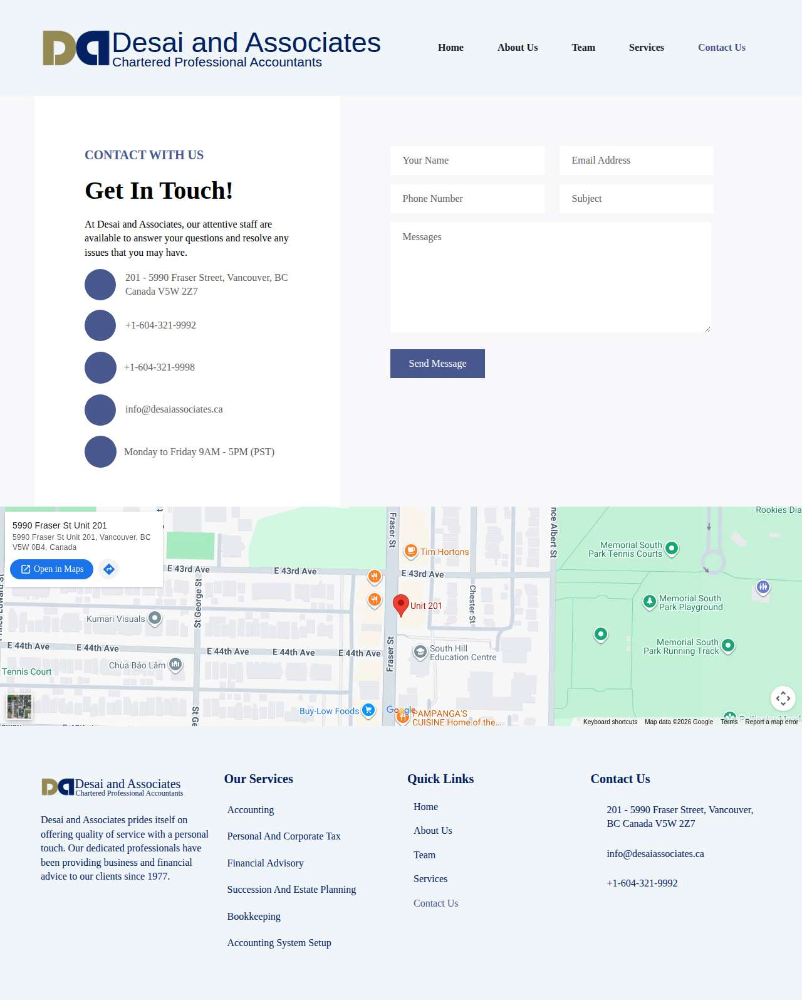

### nrcpa.ca — dry\_run\_ok (dry run)

| | |
|---|---|
| Attempt ID | `cc1b9d81-d47f-41a4-864e-327fb909c955` |
| Form URL | https://nrcpa.ca/ |
| Final URL | https://nrcpa.ca/ |
| Reserved | 2026-11-13 07:47:24 UTC |
| Submit attempted | — |
| Template | standard v2 |
| Confirmation text | none observed |
| Result / error | Selectors verified; fields not typed (domain not in dry-run fill list); not submitted |

Exact message:

~~~text
Subject: Helping customers find your business in AI search (AEO + GEO)

Hi there,

I'm Arun from Devs Arun. More and more customers now ask ChatGPT, Gemini, Perplexity or Google's AI Overviews questions like "who should I hire for this in my area?" before they call anyone. These tools answer from websites they can clearly understand, and they tend to recommend businesses whose pages answer real customer questions.

That is what AEO + GEO (Answer Engine and Generative Engine Optimization) is for. I improve your existing service pages so they clearly answer the questions your customers ask, add structured data that matches the page, and make the call, quote or enquiry step obvious. The benefit: your business gets a better chance of being mentioned or linked in AI answers, and visitors who arrive find it easy to contact you.

The AEO + GEO Starter is a one-time $199 (about ₹16,999, negotiable) for one website: a basic audit, 10 customer questions, improvements to two existing pages, relevant structured data and an action plan, with one revision round.

You can read the full details, send an enquiry or book online here:
https://devsarun.io/aeo-geo/

If this isn't relevant, just reply and I won't contact you again.

Best,
Arun
Devs Arun
itschool408@gmail.com · +91 7654534323
~~~

Submitted field values:

- \#form-field-name: +91 7654534323
- \#form-field-email: itschool408@gmail.com
- \#form-field-message: Hi there, I'm Arun from Devs Arun. More and more customers now ask ChatGPT, Gemini, Perplexity or Google's AI Overviews 
- \#form-field-field\_0b7068e: Arun

**Inspected page** — `run-643c83e9_attempt-cc1b9d81_inspection_2026-11-13T07-47-28-026Z.jpg`

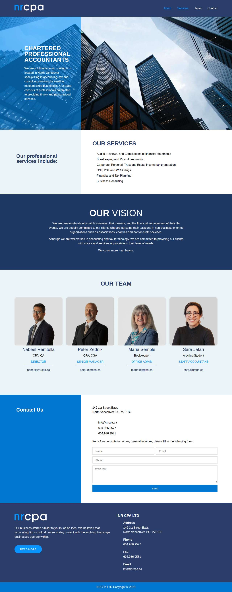

### theaccountingagency.ca — dry\_run\_ok (dry run)

| | |
|---|---|
| Attempt ID | `ea8353c4-29ba-4a88-bbad-aaa2f0c28c18` |
| Form URL | https://theaccountingagency.ca/contact/ |
| Final URL | https://theaccountingagency.ca/contact/ |
| Reserved | 2026-11-13 07:47:33 UTC |
| Submit attempted | — |
| Template | standard v2 |
| Confirmation text | none observed |
| Result / error | Selectors verified; fields not typed (domain not in dry-run fill list); not submitted |

Exact message:

~~~text
Subject: Helping customers find your business in AI search (AEO + GEO)

Hi there,

I'm Arun from Devs Arun. More and more customers now ask ChatGPT, Gemini, Perplexity or Google's AI Overviews questions like "who should I hire for this in my area?" before they call anyone. These tools answer from websites they can clearly understand, and they tend to recommend businesses whose pages answer real customer questions.

That is what AEO + GEO (Answer Engine and Generative Engine Optimization) is for. I improve your existing service pages so they clearly answer the questions your customers ask, add structured data that matches the page, and make the call, quote or enquiry step obvious. The benefit: your business gets a better chance of being mentioned or linked in AI answers, and visitors who arrive find it easy to contact you.

The AEO + GEO Starter is a one-time $199 (about ₹16,999, negotiable) for one website: a basic audit, 10 customer questions, improvements to two existing pages, relevant structured data and an action plan, with one revision round.

You can read the full details, send an enquiry or book online here:
https://devsarun.io/aeo-geo/

If this isn't relevant, just reply and I won't contact you again.

Best,
Arun
Devs Arun
itschool408@gmail.com · +91 7654534323
~~~

Submitted field values:

- \#forminator-field-name-1\_6af6bf655477f: Arun
- \#forminator-field-name-2\_6af6bf655477f: Arun
- \#forminator-field-email-1\_6af6bf655477f: itschool408@gmail.com
- \#forminator-field-phone-1\_6af6bf655477f: +91 7654534323
- \#forminator-field-textarea-1\_6af6bf655477f: Hi there, I'm Arun from Devs Arun. More and more customers now ask ChatGPT, Gemini, Perplexity or Google's AI Overviews 

**Inspected page** — `run-643c83e9_attempt-ea8353c4_inspection_2026-11-13T07-47-35-464Z.jpg`

### mnwcga.com — dry\_run\_ok (dry run)

| | |
|---|---|
| Attempt ID | `e4441b1b-7b69-49c0-8cd3-9fc70c067ba3` |
| Form URL | https://www.mnwcga.com/contact |
| Final URL | https://www.mnwcga.com/contact |
| Reserved | 2026-11-13 07:47:40 UTC |
| Submit attempted | — |
| Template | standard v2 |
| Confirmation text | none observed |
| Result / error | Selectors verified; fields not typed (domain not in dry-run fill list); not submitted |

Exact message:

~~~text
Subject: Helping customers find your business in AI search (AEO + GEO)

Hi there,

I'm Arun from Devs Arun. More and more customers now ask ChatGPT, Gemini, Perplexity or Google's AI Overviews questions like "who should I hire for this in my area?" before they call anyone. These tools answer from websites they can clearly understand, and they tend to recommend businesses whose pages answer real customer questions.

That is what AEO + GEO (Answer Engine and Generative Engine Optimization) is for. I improve your existing service pages so they clearly answer the questions your customers ask, add structured data that matches the page, and make the call, quote or enquiry step obvious. The benefit: your business gets a better chance of being mentioned or linked in AI answers, and visitors who arrive find it easy to contact you.

The AEO + GEO Starter is a one-time $199 (about ₹16,999, negotiable) for one website: a basic audit, 10 customer questions, improvements to two existing pages, relevant structured data and an action plan, with one revision round.

You can read the full details, send an enquiry or book online here:
https://devsarun.io/aeo-geo/

If this isn't relevant, just reply and I won't contact you again.

Best,
Arun
Devs Arun
itschool408@gmail.com · +91 7654534323
~~~

Submitted field values:

- \#page-section-601360931f3d6b11e6a50ff4 \> div \> div:nth-of-type(1) \> div:nth-of-type(2) \> div \> div \> div:nth-of-type(2) \> form \> div:nth-of-type(2) \> div:nth-of-type(1) \> input: Arun
- \#page-section-601360931f3d6b11e6a50ff4 \> div \> div:nth-of-type(1) \> div:nth-of-type(2) \> div \> div \> div:nth-of-type(2) \> form \> div:nth-of-type(2) \> div:nth-of-type(2) \> input: itschool408@gmail.com
- \#page-section-601360931f3d6b11e6a50ff4 \> div \> div:nth-of-type(1) \> div:nth-of-type(2) \> div \> div \> div:nth-of-type(2) \> form \> div:nth-of-type(2) \> div:nth-of-type(3) \> input: Hi there, I'm Arun from Devs Arun. More and more customers now ask ChatGPT, Gemini, Perplexity or Google's AI Overviews 

**Inspected page** — `run-643c83e9_attempt-e4441b1b_inspection_2026-11-13T07-47-42-256Z.jpg`

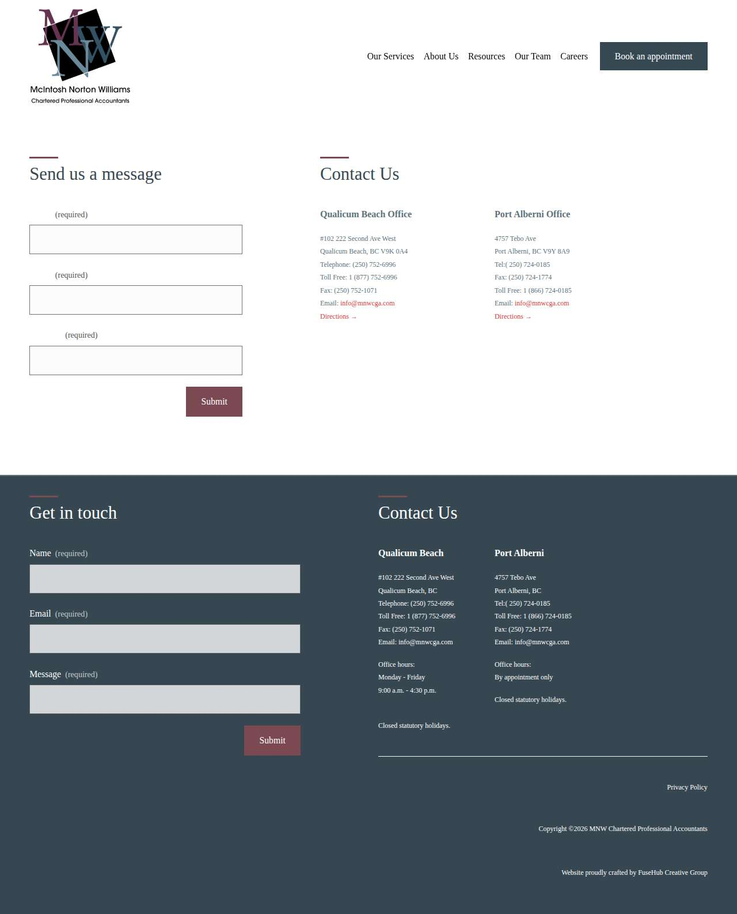

### juicerealestate.com.au — dry\_run\_failed (dry run)

| | |
|---|---|
| Attempt ID | `57f94bc2-0e2c-4f56-8968-1a44535cd201` |
| Form URL | https://juicerealestate.com.au/contact-us/ |
| Final URL | https://juicerealestate.com.au/contact-us/ |
| Reserved | 2026-11-13 07:47:47 UTC |
| Submit attempted | — |
| Template | standard v2 |
| Confirmation text | none observed |
| Result / error | CAPTCHA/anti-bot now present (recaptcha) |

Exact message:

~~~text
Subject: Helping customers find your business in AI search (AEO + GEO)

Hi there,

I'm Arun from Devs Arun. More and more customers now ask ChatGPT, Gemini, Perplexity or Google's AI Overviews questions like "who should I hire for this in my area?" before they call anyone. These tools answer from websites they can clearly understand, and they tend to recommend businesses whose pages answer real customer questions.

That is what AEO + GEO (Answer Engine and Generative Engine Optimization) is for. I improve your existing service pages so they clearly answer the questions your customers ask, add structured data that matches the page, and make the call, quote or enquiry step obvious. The benefit: your business gets a better chance of being mentioned or linked in AI answers, and visitors who arrive find it easy to contact you.

The AEO + GEO Starter is a one-time $199 (about ₹16,999, negotiable) for one website: a basic audit, 10 customer questions, improvements to two existing pages, relevant structured data and an action plan, with one revision round.

You can read the full details, send an enquiry or book online here:
https://devsarun.io/aeo-geo/

If this isn't relevant, just reply and I won't contact you again.

Best,
Arun
Devs Arun
itschool408@gmail.com · +91 7654534323
~~~

Submitted field values:

- \#ff\_1\_email: itschool408@gmail.com
- \#ff\_1\_phone: +91 7654534323
- \#ff\_1\_message: Hi there, I'm Arun from Devs Arun. More and more customers now ask ChatGPT, Gemini, Perplexity or Google's AI Overviews 
- \#ff\_1\_names\_first\_name\_: Arun

**Inspected page** — `run-643c83e9_attempt-57f94bc2_inspection_2026-11-13T07-47-50-648Z.jpg`

### involvedigital.com — dry\_run\_failed (dry run)

| | |
|---|---|
| Attempt ID | `257af9f4-ef80-49dc-b82a-171d80b4c571` |
| Form URL | https://www.involvedigital.com/talk |
| Final URL | https://www.involvedigital.com/talk |
| Reserved | 2026-11-13 07:47:55 UTC |
| Submit attempted | — |
| Template | standard v2 |
| Confirmation text | none observed |
| Result / error | Form is multi-step |

Exact message:

~~~text
Subject: Helping customers find your business in AI search (AEO + GEO)

Hi there,

I'm Arun from Devs Arun. More and more customers now ask ChatGPT, Gemini, Perplexity or Google's AI Overviews questions like "who should I hire for this in my area?" before they call anyone. These tools answer from websites they can clearly understand, and they tend to recommend businesses whose pages answer real customer questions.

That is what AEO + GEO (Answer Engine and Generative Engine Optimization) is for. I improve your existing service pages so they clearly answer the questions your customers ask, add structured data that matches the page, and make the call, quote or enquiry step obvious. The benefit: your business gets a better chance of being mentioned or linked in AI answers, and visitors who arrive find it easy to contact you.

The AEO + GEO Starter is a one-time $199 (about ₹16,999, negotiable) for one website: a basic audit, 10 customer questions, improvements to two existing pages, relevant structured data and an action plan, with one revision round.

You can read the full details, send an enquiry or book online here:
https://devsarun.io/aeo-geo/

If this isn't relevant, just reply and I won't contact you again.

Best,
Arun
Devs Arun
itschool408@gmail.com · +91 7654534323
~~~

Submitted field values:

- \#capture-name: Arun
- \#capture-email: itschool408@gmail.com
- \#capture-phone: +91 7654534323
- \#capture-message: Hi there, I'm Arun from Devs Arun. More and more customers now ask ChatGPT, Gemini, Perplexity or Google's AI Overviews 
- \#capture-business: Devs Arun

**Inspected page** — `run-643c83e9_attempt-257af9f4_inspection_2026-11-13T07-47-57-969Z.jpg`

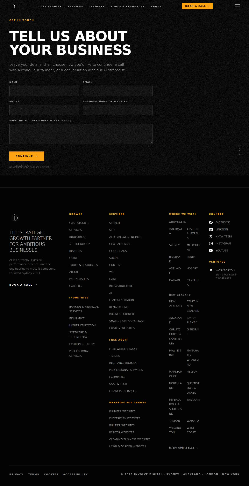

## Events (134)

| Time (UTC) | Event | Website | Details |
|---|---|---|---|
| 07:44:28 | run\_queued | — | dry\_run run requested by github:itsDevsArun |
| 07:44:28 | run\_dispatched | — | dispatch disabled (local test mode) |
| 07:44:33 | run\_started | — | Runner claimed dry\_run run |
| 07:44:33 | website\_selected | helixmechanical.com | Dry-run target helixmechanical.com |
| 07:44:33 | draft\_prepared | helixmechanical.com | Draft prepared with template standard v2 |
| 07:44:35 | page\_opened | helixmechanical.com | Opened form page |
| 07:44:36 | screenshot\_saved | helixmechanical.com | inspection screenshot saved (54 KB) |
| 07:44:36 | review\_required | helixmechanical.com | dry run failed: Mapped field "First Name \*" not found uniquely |
| 07:44:41 | website\_selected | eurola.com.au | Dry-run target eurola.com.au |
| 07:44:41 | draft\_prepared | eurola.com.au | Draft prepared with template standard v2 |
| 07:44:46 | page\_opened | eurola.com.au | Opened form page |
| 07:44:46 | screenshot\_saved | eurola.com.au | inspection screenshot saved (318 KB) |
| 07:44:46 | review\_required | eurola.com.au | dry run failed: Mapped field "field2" not found uniquely |
| 07:44:51 | website\_selected | knoxvilleelectrician.com | Dry-run target knoxvilleelectrician.com |
| 07:44:51 | draft\_prepared | knoxvilleelectrician.com | Draft prepared with template standard v2 |
| 07:44:54 | page\_opened | knoxvilleelectrician.com | Opened form page |
| 07:44:54 | screenshot\_saved | knoxvilleelectrician.com | inspection screenshot saved (137 KB) |
| 07:44:54 | review\_required | knoxvilleelectrician.com | dry run failed: Mapped field "Name" not found uniquely |
| 07:44:59 | website\_selected | tricityfinishing.com | Dry-run target tricityfinishing.com |
| 07:44:59 | draft\_prepared | tricityfinishing.com | Draft prepared with template standard v2 |
| 07:45:01 | page\_opened | tricityfinishing.com | Opened form page |
| 07:45:01 | screenshot\_saved | tricityfinishing.com | inspection screenshot saved (188 KB) |
| 07:45:01 | review\_required | tricityfinishing.com | dry run failed: Reviewed form not found on page (site changed) |
| 07:45:06 | website\_selected | sblawpartners.com.au | Dry-run target sblawpartners.com.au |
| 07:45:06 | draft\_prepared | sblawpartners.com.au | Draft prepared with template standard v2 |
| 07:45:11 | page\_opened | sblawpartners.com.au | Opened form page |
| 07:45:11 | screenshot\_saved | sblawpartners.com.au | inspection screenshot saved (95 KB) |
| 07:45:11 | review\_required | sblawpartners.com.au | dry run failed: Mapped field "Name \*" not found uniquely |
| 07:45:16 | website\_selected | mspc.cpa | Dry-run target mspc.cpa |
| 07:45:16 | draft\_prepared | mspc.cpa | Draft prepared with template standard v2 |
| 07:45:18 | page\_opened | mspc.cpa | Opened form page |
| 07:45:19 | screenshot\_saved | mspc.cpa | inspection screenshot saved (162 KB) |
| 07:45:19 | review\_required | mspc.cpa | dry run failed: Mapped field "Full Name \*" not found uniquely |
| 07:45:24 | website\_selected | mpccpa.ca | Dry-run target mpccpa.ca |
| 07:45:24 | draft\_prepared | mpccpa.ca | Draft prepared with template standard v2 |
| 07:45:28 | page\_opened | mpccpa.ca | Opened form page |
| 07:45:28 | screenshot\_saved | mpccpa.ca | inspection screenshot saved (111 KB) |
| 07:45:28 | dry\_run\_checked | mpccpa.ca | dry run ok: Selectors verified; fields not typed (domain not in dry-run fill list); not submitted |
| 07:45:33 | website\_selected | chimickcpa.com | Dry-run target chimickcpa.com |
| 07:45:33 | draft\_prepared | chimickcpa.com | Draft prepared with template standard v2 |
| 07:45:36 | page\_opened | chimickcpa.com | Opened form page |
| 07:45:36 | screenshot\_saved | chimickcpa.com | inspection screenshot saved (253 KB) |
| 07:45:36 | dry\_run\_checked | chimickcpa.com | dry run ok: Selectors verified; fields not typed (domain not in dry-run fill list); not submitted |
| 07:45:41 | website\_selected | stanleyaccounting.ca | Dry-run target stanleyaccounting.ca |
| 07:45:41 | draft\_prepared | stanleyaccounting.ca | Draft prepared with template standard v2 |
| 07:45:43 | page\_opened | stanleyaccounting.ca | Opened form page |
| 07:45:43 | screenshot\_saved | stanleyaccounting.ca | inspection screenshot saved (116 KB) |
| 07:45:43 | dry\_run\_checked | stanleyaccounting.ca | dry run ok: Selectors verified; fields not typed (domain not in dry-run fill list); not submitted |
| 07:45:48 | website\_selected | sands-trustee.com | Dry-run target sands-trustee.com |
| 07:45:48 | draft\_prepared | sands-trustee.com | Draft prepared with template standard v2 |
| 07:45:51 | page\_opened | sands-trustee.com | Opened form page |
| 07:45:51 | screenshot\_saved | sands-trustee.com | inspection screenshot saved (281 KB) |
| 07:45:51 | dry\_run\_checked | sands-trustee.com | dry run ok: Selectors verified; fields not typed (domain not in dry-run fill list); not submitted |
| 07:45:56 | website\_selected | valuecorp.ca | Dry-run target valuecorp.ca |
| 07:45:56 | draft\_prepared | valuecorp.ca | Draft prepared with template standard v2 |
| 07:45:59 | page\_opened | valuecorp.ca | Opened form page |
| 07:45:59 | screenshot\_saved | valuecorp.ca | inspection screenshot saved (132 KB) |
| 07:45:59 | dry\_run\_checked | valuecorp.ca | dry run ok: Selectors verified; fields not typed (domain not in dry-run fill list); not submitted |
| 07:46:04 | website\_selected | carontrepanier.com | Dry-run target carontrepanier.com |
| 07:46:04 | draft\_prepared | carontrepanier.com | Draft prepared with template standard v2 |
| 07:46:06 | page\_opened | carontrepanier.com | Opened form page |
| 07:46:06 | screenshot\_saved | carontrepanier.com | inspection screenshot saved (259 KB) |
| 07:46:06 | dry\_run\_checked | carontrepanier.com | dry run ok: Selectors verified; fields not typed (domain not in dry-run fill list); not submitted |
| 07:46:11 | website\_selected | kbacpa.ca | Dry-run target kbacpa.ca |
| 07:46:11 | draft\_prepared | kbacpa.ca | Draft prepared with template standard v2 |
| 07:46:13 | page\_opened | kbacpa.ca | Opened form page |
| 07:46:13 | screenshot\_saved | kbacpa.ca | inspection screenshot saved (59 KB) |
| 07:46:13 | dry\_run\_checked | kbacpa.ca | dry run ok: Selectors verified; fields not typed (domain not in dry-run fill list); not submitted |
| 07:46:18 | website\_selected | loewenkruse.com | Dry-run target loewenkruse.com |
| 07:46:18 | draft\_prepared | loewenkruse.com | Draft prepared with template standard v2 |
| 07:46:22 | page\_opened | loewenkruse.com | Opened form page |
| 07:46:22 | screenshot\_saved | loewenkruse.com | inspection screenshot saved (50 KB) |
| 07:46:22 | dry\_run\_checked | loewenkruse.com | dry run ok: Selectors verified; fields not typed (domain not in dry-run fill list); not submitted |
| 07:46:27 | website\_selected | martincoutureinc.com | Dry-run target martincoutureinc.com |
| 07:46:27 | draft\_prepared | martincoutureinc.com | Draft prepared with template standard v2 |
| 07:46:32 | page\_opened | martincoutureinc.com | Opened form page |
| 07:46:32 | screenshot\_saved | martincoutureinc.com | inspection screenshot saved (210 KB) |
| 07:46:32 | dry\_run\_checked | martincoutureinc.com | dry run ok: Selectors verified; fields not typed (domain not in dry-run fill list); not submitted |
| 07:46:38 | website\_selected | dedicatedsolutions.ca | Dry-run target dedicatedsolutions.ca |
| 07:46:38 | draft\_prepared | dedicatedsolutions.ca | Draft prepared with template standard v2 |
| 07:46:41 | page\_opened | dedicatedsolutions.ca | Opened form page |
| 07:46:41 | screenshot\_saved | dedicatedsolutions.ca | inspection screenshot saved (215 KB) |
| 07:46:41 | dry\_run\_checked | dedicatedsolutions.ca | dry run ok: Selectors verified; fields not typed (domain not in dry-run fill list); not submitted |
| 07:46:46 | website\_selected | debitscredits.com | Dry-run target debitscredits.com |
| 07:46:46 | draft\_prepared | debitscredits.com | Draft prepared with template standard v2 |
| 07:46:49 | page\_opened | debitscredits.com | Opened form page |
| 07:46:49 | screenshot\_saved | debitscredits.com | inspection screenshot saved (141 KB) |
| 07:46:49 | dry\_run\_checked | debitscredits.com | dry run ok: Selectors verified; fields not typed (domain not in dry-run fill list); not submitted |
| 07:46:54 | website\_selected | servicesdecomptabilitemd.ca | Dry-run target servicesdecomptabilitemd.ca |
| 07:46:54 | draft\_prepared | servicesdecomptabilitemd.ca | Draft prepared with template standard v2 |
| 07:46:55 | page\_opened | servicesdecomptabilitemd.ca | Opened form page |
| 07:46:55 | screenshot\_saved | servicesdecomptabilitemd.ca | inspection screenshot saved (139 KB) |
| 07:46:55 | dry\_run\_checked | servicesdecomptabilitemd.ca | dry run ok: Selectors verified; fields not typed (domain not in dry-run fill list); not submitted |
| 07:47:00 | website\_selected | hkicpa.ca | Dry-run target hkicpa.ca |
| 07:47:00 | draft\_prepared | hkicpa.ca | Draft prepared with template standard v2 |
| 07:47:03 | page\_opened | hkicpa.ca | Opened form page |
| 07:47:03 | screenshot\_saved | hkicpa.ca | inspection screenshot saved (114 KB) |
| 07:47:03 | dry\_run\_checked | hkicpa.ca | dry run ok: Selectors verified; fields not typed (domain not in dry-run fill list); not submitted |
| 07:47:08 | website\_selected | pivotadvantage.com | Dry-run target pivotadvantage.com |
| 07:47:08 | draft\_prepared | pivotadvantage.com | Draft prepared with template standard v2 |
| 07:47:10 | page\_opened | pivotadvantage.com | Opened form page |
| 07:47:10 | screenshot\_saved | pivotadvantage.com | inspection screenshot saved (144 KB) |
| 07:47:10 | dry\_run\_checked | pivotadvantage.com | dry run ok: Selectors verified; fields not typed (domain not in dry-run fill list); not submitted |
| 07:47:15 | website\_selected | desaiassociates.ca | Dry-run target desaiassociates.ca |
| 07:47:15 | draft\_prepared | desaiassociates.ca | Draft prepared with template standard v2 |
| 07:47:19 | page\_opened | desaiassociates.ca | Opened form page |
| 07:47:19 | screenshot\_saved | desaiassociates.ca | inspection screenshot saved (114 KB) |
| 07:47:19 | dry\_run\_checked | desaiassociates.ca | dry run ok: Selectors verified; fields not typed (domain not in dry-run fill list); not submitted |
| 07:47:24 | website\_selected | nrcpa.ca | Dry-run target nrcpa.ca |
| 07:47:24 | draft\_prepared | nrcpa.ca | Draft prepared with template standard v2 |
| 07:47:27 | page\_opened | nrcpa.ca | Opened form page |
| 07:47:28 | screenshot\_saved | nrcpa.ca | inspection screenshot saved (251 KB) |
| 07:47:28 | dry\_run\_checked | nrcpa.ca | dry run ok: Selectors verified; fields not typed (domain not in dry-run fill list); not submitted |
| 07:47:33 | website\_selected | theaccountingagency.ca | Dry-run target theaccountingagency.ca |
| 07:47:33 | draft\_prepared | theaccountingagency.ca | Draft prepared with template standard v2 |
| 07:47:35 | page\_opened | theaccountingagency.ca | Opened form page |
| 07:47:35 | screenshot\_saved | theaccountingagency.ca | inspection screenshot saved (106 KB) |
| 07:47:35 | dry\_run\_checked | theaccountingagency.ca | dry run ok: Selectors verified; fields not typed (domain not in dry-run fill list); not submitted |
| 07:47:40 | website\_selected | mnwcga.com | Dry-run target mnwcga.com |
| 07:47:40 | draft\_prepared | mnwcga.com | Draft prepared with template standard v2 |
| 07:47:42 | page\_opened | mnwcga.com | Opened form page |
| 07:47:42 | screenshot\_saved | mnwcga.com | inspection screenshot saved (68 KB) |
| 07:47:42 | dry\_run\_checked | mnwcga.com | dry run ok: Selectors verified; fields not typed (domain not in dry-run fill list); not submitted |
| 07:47:47 | website\_selected | juicerealestate.com.au | Dry-run target juicerealestate.com.au |
| 07:47:47 | draft\_prepared | juicerealestate.com.au | Draft prepared with template standard v2 |
| 07:47:50 | page\_opened | juicerealestate.com.au | Opened form page |
| 07:47:50 | screenshot\_saved | juicerealestate.com.au | inspection screenshot saved (59 KB) |
| 07:47:50 | review\_required | juicerealestate.com.au | dry run failed: CAPTCHA/anti-bot now present (recaptcha) |
| 07:47:55 | website\_selected | involvedigital.com | Dry-run target involvedigital.com |
| 07:47:55 | draft\_prepared | involvedigital.com | Draft prepared with template standard v2 |
| 07:47:57 | page\_opened | involvedigital.com | Opened form page |
| 07:47:57 | screenshot\_saved | involvedigital.com | inspection screenshot saved (204 KB) |
| 07:47:57 | review\_required | involvedigital.com | dry run failed: Form is multi-step |
| 07:48:03 | run\_completed | — | Run completed (queue\_exhausted) |
