# Run 9d7a968f — dry\_run — completed

| | |
|---|---|
| Run ID | `9d7a968f-2a65-4e0b-bb75-2c2e3b2d8289` |
| Requested by | github:itsDevsArun |
| Started | 2026-11-13 04:52:36 UTC |
| Finished | 2026-11-13 04:58:04 UTC |
| Finish reason | queue\_exhausted |
| GitHub Actions | https://github.com/itsDevsArun/aeo-geo/actions/runs/43360910641 |

CSV for this run: [runs/2026-11-13_dry_run_9d7a968f.csv](2026-11-13_dry_run_9d7a968f.csv)

## Attempts (40)

### helixmechanical.com — dry\_run\_failed (dry run)

| | |
|---|---|
| Attempt ID | `70c9d9d7-60de-473d-9f32-c45a29713bf2` |
| Form URL | https://helixmechanical.com/contact/ |
| Final URL | https://helixmechanical.com/contact/ |
| Reserved | 2026-11-13 04:52:36 UTC |
| Submit attempted | — |
| Template | standard v2 |
| Confirmation text | none observed |
| Result / error | Mapped field "First Name \*" not found uniquely |

Exact message:

~~~text
Subject: Helping customers find your business in AI search (AEO + GEO)

Hi there,

I'm Arun from Devs Arun. More and more customers now ask ChatGPT, Gemini, Perplexity or Google's AI Overviews questions like "who should I hire for this in my area?" before they call anyone. These tools answer from websites they can clearly understand, and they tend to recommend businesses whose pages answer real customer questions.

That is what AEO + GEO (Answer Engine and Generative Engine Optimization) is for. I improve your existing service pages so they clearly answer the questions your customers ask, add structured data that matches the page, and make the call, quote or enquiry step obvious. The benefit: your business gets a better chance of being mentioned or linked in AI answers, and visitors who arrive find it easy to contact you.

The AEO + GEO Starter is a one-time $199 (about ₹16,999, negotiable) for one website: a basic audit, 10 customer questions, improvements to two existing pages, relevant structured data and an action plan, with one revision round.

You can read the full details, send an enquiry or book online here:
https://devsarun.io/aeo-geo/

If this isn't relevant, just reply and I won't contact you again.

Best,
Arun
Devs Arun
itschool408@gmail.com · +91 7654534323
~~~

Submitted field values:

- \#forminator-field-name-1\_6ae7ff023fd3c: Arun
- \#forminator-field-email-1\_6ae7ff023fd3c: itschool408@gmail.com
- \#forminator-field-phone-1\_6ae7ff023fd3c: +91 7654534323
- \#forminator-field-textarea-1\_6ae7ff023fd3c: Hi there, I'm Arun from Devs Arun. More and more customers now ask ChatGPT, Gemini, Perplexity or Google's AI Overviews 

**Inspected page** — `run-9d7a968f_attempt-70c9d9d7_inspection_2026-11-13T04-52-38-572Z.jpg`

### environmentalplumbing.ca — dry\_run\_ok (dry run)

| | |
|---|---|
| Attempt ID | `bfcea612-137d-4d70-b514-c9bf596578db` |
| Form URL | https://environmentalplumbing.ca/contact-us/ |
| Final URL | https://environmentalplumbing.ca/contact-us/ |
| Reserved | 2026-11-13 04:52:43 UTC |
| Submit attempted | — |
| Template | standard v2 |
| Confirmation text | none observed |
| Result / error | Selectors verified; fields not typed (domain not in dry-run fill list); not submitted |

Exact message:

~~~text
Subject: Helping customers find your business in AI search (AEO + GEO)

Hi there,

I'm Arun from Devs Arun. More and more customers now ask ChatGPT, Gemini, Perplexity or Google's AI Overviews questions like "who should I hire for this in my area?" before they call anyone. These tools answer from websites they can clearly understand, and they tend to recommend businesses whose pages answer real customer questions.

That is what AEO + GEO (Answer Engine and Generative Engine Optimization) is for. I improve your existing service pages so they clearly answer the questions your customers ask, add structured data that matches the page, and make the call, quote or enquiry step obvious. The benefit: your business gets a better chance of being mentioned or linked in AI answers, and visitors who arrive find it easy to contact you.

The AEO + GEO Starter is a one-time $199 (about ₹16,999, negotiable) for one website: a basic audit, 10 customer questions, improvements to two existing pages, relevant structured data and an action plan, with one revision round.

You can read the full details, send an enquiry or book online here:
https://devsarun.io/aeo-geo/

If this isn't relevant, just reply and I won't contact you again.

Best,
Arun
Devs Arun
itschool408@gmail.com · +91 7654534323
~~~

Submitted field values:

- \#wpforms-379-field\_1: Arun
- \#wpforms-379-field\_2: itschool408@gmail.com
- \#wpforms-379-field\_3: +91 7654534323
- \#wpforms-379-field\_4: Hi there, I'm Arun from Devs Arun. More and more customers now ask ChatGPT, Gemini, Perplexity or Google's AI Overviews 

**Inspected page** — `run-9d7a968f_attempt-bfcea612_inspection_2026-11-13T04-52-50-143Z.jpg`

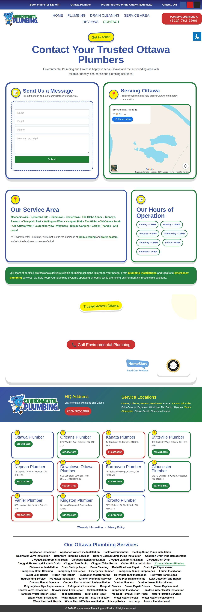

### townhouseplumbing.ca — dry\_run\_ok (dry run)

| | |
|---|---|
| Attempt ID | `8c9db36f-2706-40a5-9f4e-4efd1cab2945` |
| Form URL | https://townhouseplumbing.ca/contact-us/ |
| Final URL | https://townhouseplumbing.ca/contact-us/ |
| Reserved | 2026-11-13 04:52:55 UTC |
| Submit attempted | — |
| Template | standard v2 |
| Confirmation text | none observed |
| Result / error | Selectors verified; fields not typed (domain not in dry-run fill list); not submitted |

Exact message:

~~~text
Subject: Helping customers find your business in AI search (AEO + GEO)

Hi there,

I'm Arun from Devs Arun. More and more customers now ask ChatGPT, Gemini, Perplexity or Google's AI Overviews questions like "who should I hire for this in my area?" before they call anyone. These tools answer from websites they can clearly understand, and they tend to recommend businesses whose pages answer real customer questions.

That is what AEO + GEO (Answer Engine and Generative Engine Optimization) is for. I improve your existing service pages so they clearly answer the questions your customers ask, add structured data that matches the page, and make the call, quote or enquiry step obvious. The benefit: your business gets a better chance of being mentioned or linked in AI answers, and visitors who arrive find it easy to contact you.

The AEO + GEO Starter is a one-time $199 (about ₹16,999, negotiable) for one website: a basic audit, 10 customer questions, improvements to two existing pages, relevant structured data and an action plan, with one revision round.

You can read the full details, send an enquiry or book online here:
https://devsarun.io/aeo-geo/

If this isn't relevant, just reply and I won't contact you again.

Best,
Arun
Devs Arun
itschool408@gmail.com · +91 7654534323
~~~

Submitted field values:

- \#form-Name: Arun
- \#form-Email: itschool408@gmail.com
- \#form-Phone: +91 7654534323
- \#form-Message: Hi there, I'm Arun from Devs Arun. More and more customers now ask ChatGPT, Gemini, Perplexity or Google's AI Overviews 

**Inspected page** — `run-9d7a968f_attempt-8c9db36f_inspection_2026-11-13T04-52-56-819Z.jpg`

### homewiseplumbing.ca — dry\_run\_ok (dry run)

| | |
|---|---|
| Attempt ID | `757bbdee-bdc6-473a-a8a4-3f4e94a94ceb` |
| Form URL | https://www.homewiseplumbing.ca/contact/ |
| Final URL | https://www.homewiseplumbing.ca/contact/ |
| Reserved | 2026-11-13 04:53:01 UTC |
| Submit attempted | — |
| Template | standard v2 |
| Confirmation text | none observed |
| Result / error | Selectors verified; fields not typed (domain not in dry-run fill list); not submitted |

Exact message:

~~~text
Subject: Helping customers find your business in AI search (AEO + GEO)

Hi there,

I'm Arun from Devs Arun. More and more customers now ask ChatGPT, Gemini, Perplexity or Google's AI Overviews questions like "who should I hire for this in my area?" before they call anyone. These tools answer from websites they can clearly understand, and they tend to recommend businesses whose pages answer real customer questions.

That is what AEO + GEO (Answer Engine and Generative Engine Optimization) is for. I improve your existing service pages so they clearly answer the questions your customers ask, add structured data that matches the page, and make the call, quote or enquiry step obvious. The benefit: your business gets a better chance of being mentioned or linked in AI answers, and visitors who arrive find it easy to contact you.

The AEO + GEO Starter is a one-time $199 (about ₹16,999, negotiable) for one website: a basic audit, 10 customer questions, improvements to two existing pages, relevant structured data and an action plan, with one revision round.

You can read the full details, send an enquiry or book online here:
https://devsarun.io/aeo-geo/

If this isn't relevant, just reply and I won't contact you again.

Best,
Arun
Devs Arun
itschool408@gmail.com · +91 7654534323
~~~

Submitted field values:

- \#wpforms-744-field\_1: Arun
- \#wpforms-744-field\_2: itschool408@gmail.com
- \#wpforms-744-field\_4: +91 7654534323
- \#wpforms-744-field\_5: Hi there, I'm Arun from Devs Arun. More and more customers now ask ChatGPT, Gemini, Perplexity or Google's AI Overviews 

**Inspected page** — `run-9d7a968f_attempt-757bbdee_inspection_2026-11-13T04-53-09-009Z.jpg`

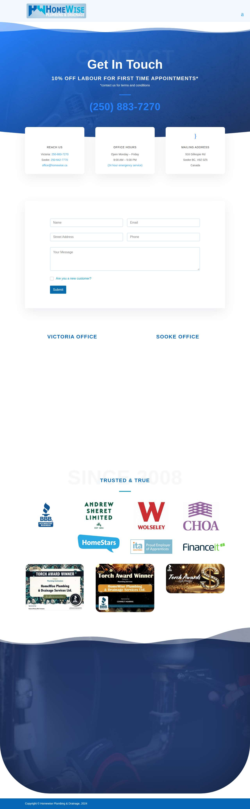

### westsideinc.ca — dry\_run\_ok (dry run)

| | |
|---|---|
| Attempt ID | `391d872e-6484-4908-b227-389d3d0c47a1` |
| Form URL | https://westsideinc.ca/contact/ |
| Final URL | https://westsideinc.ca/contact/ |
| Reserved | 2026-11-13 04:53:14 UTC |
| Submit attempted | — |
| Template | standard v2 |
| Confirmation text | none observed |
| Result / error | Selectors verified; fields not typed (domain not in dry-run fill list); not submitted |

Exact message:

~~~text
Subject: Helping customers find your business in AI search (AEO + GEO)

Hi there,

I'm Arun from Devs Arun. More and more customers now ask ChatGPT, Gemini, Perplexity or Google's AI Overviews questions like "who should I hire for this in my area?" before they call anyone. These tools answer from websites they can clearly understand, and they tend to recommend businesses whose pages answer real customer questions.

That is what AEO + GEO (Answer Engine and Generative Engine Optimization) is for. I improve your existing service pages so they clearly answer the questions your customers ask, add structured data that matches the page, and make the call, quote or enquiry step obvious. The benefit: your business gets a better chance of being mentioned or linked in AI answers, and visitors who arrive find it easy to contact you.

The AEO + GEO Starter is a one-time $199 (about ₹16,999, negotiable) for one website: a basic audit, 10 customer questions, improvements to two existing pages, relevant structured data and an action plan, with one revision round.

You can read the full details, send an enquiry or book online here:
https://devsarun.io/aeo-geo/

If this isn't relevant, just reply and I won't contact you again.

Best,
Arun
Devs Arun
itschool408@gmail.com · +91 7654534323
~~~

Submitted field values:

- \#input\_1\_1: Arun
- \#input\_1\_2: itschool408@gmail.com
- \#input\_1\_3: +91 7654534323
- \#input\_1\_4: Helping customers find your business in AI search (AEO + GEO)
- \#input\_1\_5: Hi there, I'm Arun from Devs Arun. More and more customers now ask ChatGPT, Gemini, Perplexity or Google's AI Overviews 

**Inspected page** — `run-9d7a968f_attempt-391d872e_inspection_2026-11-13T04-53-15-528Z.jpg`

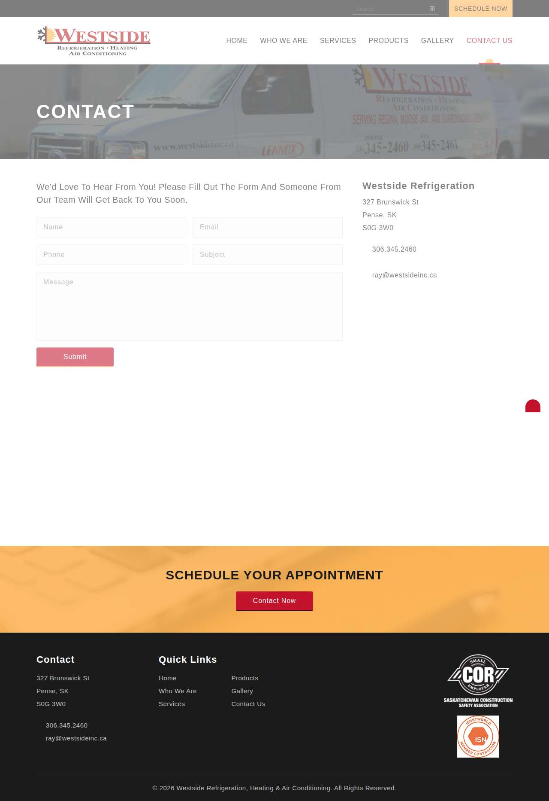

### m2mechanical.net — dry\_run\_ok (dry run)

| | |
|---|---|
| Attempt ID | `37ebbb86-51ae-4ad6-9c32-cf9f199dbc9e` |
| Form URL | https://m2mechanical.net/ |
| Final URL | https://m2mechanical.net/ |
| Reserved | 2026-11-13 04:53:20 UTC |
| Submit attempted | — |
| Template | standard v2 |
| Confirmation text | none observed |
| Result / error | Selectors verified; fields not typed (domain not in dry-run fill list); not submitted |

Exact message:

~~~text
Subject: Helping customers find your business in AI search (AEO + GEO)

Hi there,

I'm Arun from Devs Arun. More and more customers now ask ChatGPT, Gemini, Perplexity or Google's AI Overviews questions like "who should I hire for this in my area?" before they call anyone. These tools answer from websites they can clearly understand, and they tend to recommend businesses whose pages answer real customer questions.

That is what AEO + GEO (Answer Engine and Generative Engine Optimization) is for. I improve your existing service pages so they clearly answer the questions your customers ask, add structured data that matches the page, and make the call, quote or enquiry step obvious. The benefit: your business gets a better chance of being mentioned or linked in AI answers, and visitors who arrive find it easy to contact you.

The AEO + GEO Starter is a one-time $199 (about ₹16,999, negotiable) for one website: a basic audit, 10 customer questions, improvements to two existing pages, relevant structured data and an action plan, with one revision round.

You can read the full details, send an enquiry or book online here:
https://devsarun.io/aeo-geo/

If this isn't relevant, just reply and I won't contact you again.

Best,
Arun
Devs Arun
itschool408@gmail.com · +91 7654534323
~~~

Submitted field values:

- \#et\_pb\_contact\_name\_0: Arun
- \#et\_pb\_contact\_email\_0: itschool408@gmail.com
- \#et\_pb\_contact\_message\_0: Hi there, I'm Arun from Devs Arun. More and more customers now ask ChatGPT, Gemini, Perplexity or Google's AI Overviews 
- \#et\_pb\_contact\_subject\_0: Helping customers find your business in AI search (AEO + GEO)

**Inspected page** — `run-9d7a968f_attempt-37ebbb86_inspection_2026-11-13T04-53-23-050Z.jpg`

### eurola.com.au — dry\_run\_failed (dry run)

| | |
|---|---|
| Attempt ID | `647f96a7-41aa-4205-8375-1a14bbbc42e1` |
| Form URL | https://www.eurola.com.au/contact/ |
| Final URL | https://www.eurola.com.au/contact/ |
| Reserved | 2026-11-13 04:53:28 UTC |
| Submit attempted | — |
| Template | standard v2 |
| Confirmation text | none observed |
| Result / error | Mapped field "field2" not found uniquely |

Exact message:

~~~text
Subject: Helping customers find your business in AI search (AEO + GEO)

Hi there,

I'm Arun from Devs Arun. More and more customers now ask ChatGPT, Gemini, Perplexity or Google's AI Overviews questions like "who should I hire for this in my area?" before they call anyone. These tools answer from websites they can clearly understand, and they tend to recommend businesses whose pages answer real customer questions.

That is what AEO + GEO (Answer Engine and Generative Engine Optimization) is for. I improve your existing service pages so they clearly answer the questions your customers ask, add structured data that matches the page, and make the call, quote or enquiry step obvious. The benefit: your business gets a better chance of being mentioned or linked in AI answers, and visitors who arrive find it easy to contact you.

The AEO + GEO Starter is a one-time $199 (about ₹16,999, negotiable) for one website: a basic audit, 10 customer questions, improvements to two existing pages, relevant structured data and an action plan, with one revision round.

You can read the full details, send an enquiry or book online here:
https://devsarun.io/aeo-geo/

If this isn't relevant, just reply and I won't contact you again.

Best,
Arun
Devs Arun
itschool408@gmail.com · +91 7654534323
~~~

Submitted field values:

- input\[name="field7\[\]"\]: Arun
- div \> div \> div:nth-of-type(2) \> form \> div \> div \> div:nth-of-type(2) \> div \> div \> div \> div \> input: itschool408@gmail.com
- div \> div \> div:nth-of-type(2) \> form \> div \> div \> div:nth-of-type(3) \> div \> div \> div \> div \> input: +91 7654534323
- div \> div \> div:nth-of-type(2) \> form \> div \> div \> div:nth-of-type(5) \> div \> div \> div \> div \> textarea: Hi there, I'm Arun from Devs Arun. More and more customers now ask ChatGPT, Gemini, Perplexity or Google's AI Overviews 

**Inspected page** — `run-9d7a968f_attempt-647f96a7_inspection_2026-11-13T04-53-33-433Z.jpg`

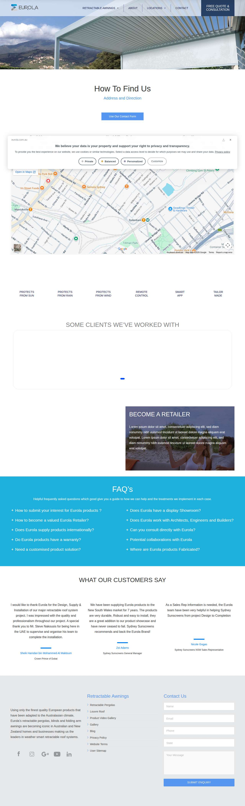

### harderroofing.com — dry\_run\_ok (dry run)

| | |
|---|---|
| Attempt ID | `4c6c9299-8d0e-453b-a7af-95873d18d5b8` |
| Form URL | https://www.harderroofing.com/ |
| Final URL | https://www.harderroofing.com/ |
| Reserved | 2026-11-13 04:53:38 UTC |
| Submit attempted | — |
| Template | standard v2 |
| Confirmation text | none observed |
| Result / error | Selectors verified; fields not typed (domain not in dry-run fill list); not submitted |

Exact message:

~~~text
Subject: Helping customers find your business in AI search (AEO + GEO)

Hi there,

I'm Arun from Devs Arun. More and more customers now ask ChatGPT, Gemini, Perplexity or Google's AI Overviews questions like "who should I hire for this in my area?" before they call anyone. These tools answer from websites they can clearly understand, and they tend to recommend businesses whose pages answer real customer questions.

That is what AEO + GEO (Answer Engine and Generative Engine Optimization) is for. I improve your existing service pages so they clearly answer the questions your customers ask, add structured data that matches the page, and make the call, quote or enquiry step obvious. The benefit: your business gets a better chance of being mentioned or linked in AI answers, and visitors who arrive find it easy to contact you.

The AEO + GEO Starter is a one-time $199 (about ₹16,999, negotiable) for one website: a basic audit, 10 customer questions, improvements to two existing pages, relevant structured data and an action plan, with one revision round.

You can read the full details, send an enquiry or book online here:
https://devsarun.io/aeo-geo/

If this isn't relevant, just reply and I won't contact you again.

Best,
Arun
Devs Arun
itschool408@gmail.com · +91 7654534323
~~~

Submitted field values:

- \#input\_comp-klwm5iq5: itschool408@gmail.com
- \#input\_comp-klwm5iqc: +91 7654534323
- \#input\_comp-klwm5ipw1: Arun
- \#textarea\_comp-klwm5iqs1: Hi there, I'm Arun from Devs Arun. More and more customers now ask ChatGPT, Gemini, Perplexity or Google's AI Overviews 

**Inspected page** — `run-9d7a968f_attempt-4c6c9299_inspection_2026-11-13T04-53-41-557Z.jpg`

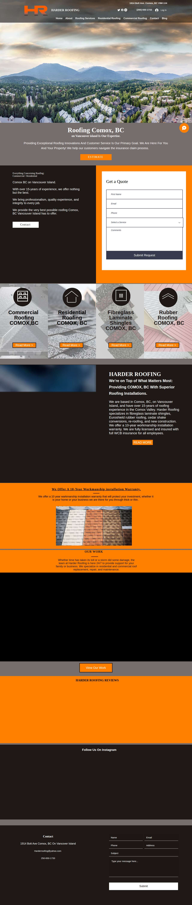

### eliteroofinghalifax.com — dry\_run\_ok (dry run)

| | |
|---|---|
| Attempt ID | `d7abaa45-0e41-4a38-a122-b401e2e10891` |
| Form URL | https://eliteroofinghalifax.com/contact-us/ |
| Final URL | https://eliteroofinghalifax.com/contact-us/ |
| Reserved | 2026-11-13 04:53:46 UTC |
| Submit attempted | — |
| Template | standard v2 |
| Confirmation text | none observed |
| Result / error | Selectors verified; fields not typed (domain not in dry-run fill list); not submitted |

Exact message:

~~~text
Subject: Helping customers find your business in AI search (AEO + GEO)

Hi there,

I'm Arun from Devs Arun. More and more customers now ask ChatGPT, Gemini, Perplexity or Google's AI Overviews questions like "who should I hire for this in my area?" before they call anyone. These tools answer from websites they can clearly understand, and they tend to recommend businesses whose pages answer real customer questions.

That is what AEO + GEO (Answer Engine and Generative Engine Optimization) is for. I improve your existing service pages so they clearly answer the questions your customers ask, add structured data that matches the page, and make the call, quote or enquiry step obvious. The benefit: your business gets a better chance of being mentioned or linked in AI answers, and visitors who arrive find it easy to contact you.

The AEO + GEO Starter is a one-time $199 (about ₹16,999, negotiable) for one website: a basic audit, 10 customer questions, improvements to two existing pages, relevant structured data and an action plan, with one revision round.

You can read the full details, send an enquiry or book online here:
https://devsarun.io/aeo-geo/

If this isn't relevant, just reply and I won't contact you again.

Best,
Arun
Devs Arun
itschool408@gmail.com · +91 7654534323
~~~

Submitted field values:

- \#et\_pb\_contact\_name\_0: Arun
- \#et\_pb\_contact\_email\_0: itschool408@gmail.com
- \#et\_pb\_contact\_field\_4\_0: +91 7654534323
- \#et\_pb\_contact\_message\_0: Hi there, I'm Arun from Devs Arun. More and more customers now ask ChatGPT, Gemini, Perplexity or Google's AI Overviews 

**Inspected page** — `run-9d7a968f_attempt-d7abaa45_inspection_2026-11-13T04-53-48-659Z.jpg`

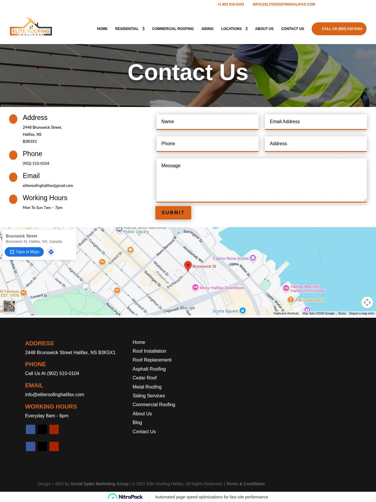

### customroofinginc.net — dry\_run\_ok (dry run)

| | |
|---|---|
| Attempt ID | `35f0ba36-b3d1-4544-8389-05bee2405c4e` |
| Form URL | https://customroofinginc.net/contact-us/ |
| Final URL | https://customroofinginc.net/contact-us/ |
| Reserved | 2026-11-13 04:53:53 UTC |
| Submit attempted | — |
| Template | standard v2 |
| Confirmation text | none observed |
| Result / error | Selectors verified; fields not typed (domain not in dry-run fill list); not submitted |

Exact message:

~~~text
Subject: Helping customers find your business in AI search (AEO + GEO)

Hi there,

I'm Arun from Devs Arun. More and more customers now ask ChatGPT, Gemini, Perplexity or Google's AI Overviews questions like "who should I hire for this in my area?" before they call anyone. These tools answer from websites they can clearly understand, and they tend to recommend businesses whose pages answer real customer questions.

That is what AEO + GEO (Answer Engine and Generative Engine Optimization) is for. I improve your existing service pages so they clearly answer the questions your customers ask, add structured data that matches the page, and make the call, quote or enquiry step obvious. The benefit: your business gets a better chance of being mentioned or linked in AI answers, and visitors who arrive find it easy to contact you.

The AEO + GEO Starter is a one-time $199 (about ₹16,999, negotiable) for one website: a basic audit, 10 customer questions, improvements to two existing pages, relevant structured data and an action plan, with one revision round.

You can read the full details, send an enquiry or book online here:
https://devsarun.io/aeo-geo/

If this isn't relevant, just reply and I won't contact you again.

Best,
Arun
Devs Arun
itschool408@gmail.com · +91 7654534323
~~~

Submitted field values:

- \#input\_1\_2: itschool408@gmail.com
- \#input\_1\_4: Hi there, I'm Arun from Devs Arun. More and more customers now ask ChatGPT, Gemini, Perplexity or Google's AI Overviews 
- \#input\_1\_5: +91 7654534323
- \#input\_1\_6: Arun

**Inspected page** — `run-9d7a968f_attempt-35f0ba36_inspection_2026-11-13T04-53-55-187Z.jpg`

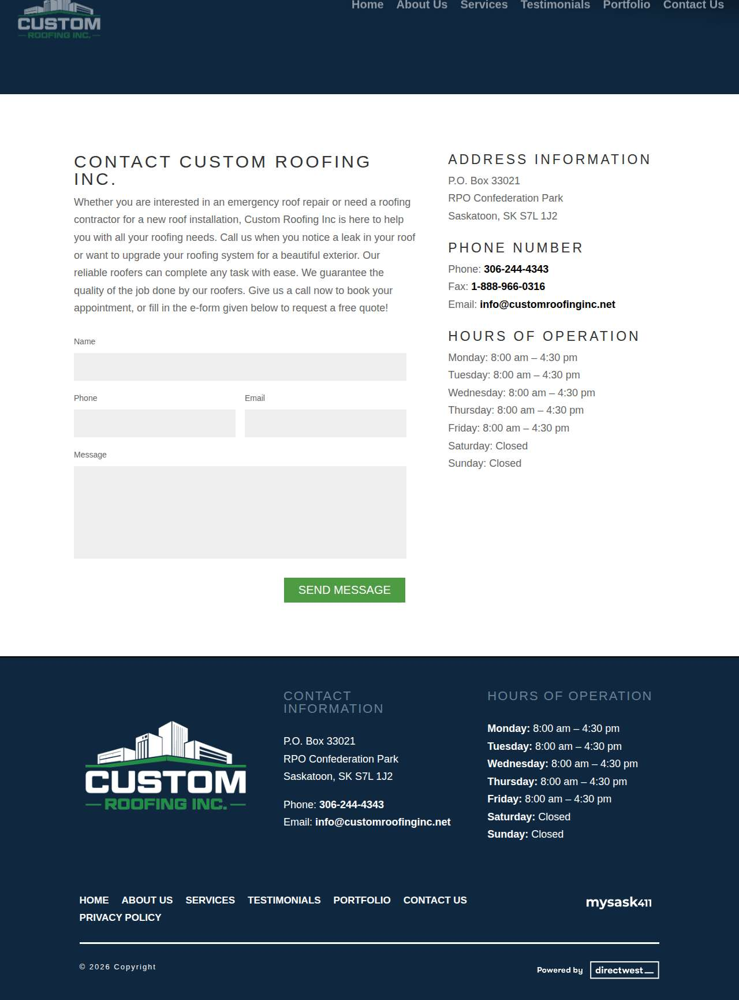

### professionalrooferstoronto.ca — dry\_run\_ok (dry run)

| | |
|---|---|
| Attempt ID | `2fb490c7-c0d3-4801-bac8-df340c19ff4d` |
| Form URL | https://trustedrooferstoronto.com/ |
| Final URL | https://trustedrooferstoronto.com/ |
| Reserved | 2026-11-13 04:54:00 UTC |
| Submit attempted | — |
| Template | standard v2 |
| Confirmation text | none observed |
| Result / error | Selectors verified; fields not typed (domain not in dry-run fill list); not submitted |

Exact message:

~~~text
Subject: Helping customers find your business in AI search (AEO + GEO)

Hi there,

I'm Arun from Devs Arun. More and more customers now ask ChatGPT, Gemini, Perplexity or Google's AI Overviews questions like "who should I hire for this in my area?" before they call anyone. These tools answer from websites they can clearly understand, and they tend to recommend businesses whose pages answer real customer questions.

That is what AEO + GEO (Answer Engine and Generative Engine Optimization) is for. I improve your existing service pages so they clearly answer the questions your customers ask, add structured data that matches the page, and make the call, quote or enquiry step obvious. The benefit: your business gets a better chance of being mentioned or linked in AI answers, and visitors who arrive find it easy to contact you.

The AEO + GEO Starter is a one-time $199 (about ₹16,999, negotiable) for one website: a basic audit, 10 customer questions, improvements to two existing pages, relevant structured data and an action plan, with one revision round.

You can read the full details, send an enquiry or book online here:
https://devsarun.io/aeo-geo/

If this isn't relevant, just reply and I won't contact you again.

Best,
Arun
Devs Arun
itschool408@gmail.com · +91 7654534323
~~~

Submitted field values:

- input\[name="your-city"\]: Bangalore
- input\[name="your-name"\]: Arun
- input\[name="your-email"\]: itschool408@gmail.com
- input\[name="your-phone"\]: +91 7654534323
- textarea\[name="your-message"\]: Hi there, I'm Arun from Devs Arun. More and more customers now ask ChatGPT, Gemini, Perplexity or Google's AI Overviews 

**Inspected page** — `run-9d7a968f_attempt-2fb490c7_inspection_2026-11-13T04-54-05-262Z.jpg`

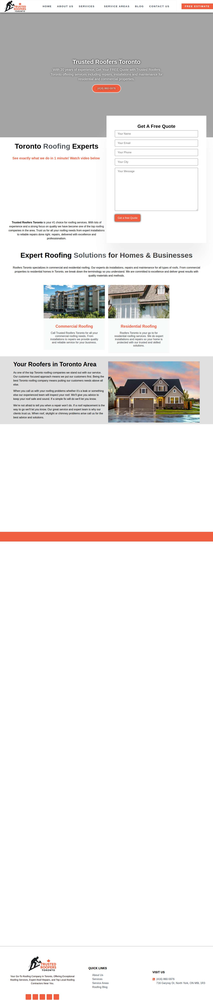

### principalroofing.ca — dry\_run\_ok (dry run)

| | |
|---|---|
| Attempt ID | `b3202670-768e-4c5d-b583-7ab75fc76700` |
| Form URL | https://principalroofing.ca/get-a-roofing-quote/ |
| Final URL | https://principalroofing.ca/get-a-roofing-quote/ |
| Reserved | 2026-11-13 04:54:10 UTC |
| Submit attempted | — |
| Template | standard v2 |
| Confirmation text | none observed |
| Result / error | Selectors verified; fields not typed (domain not in dry-run fill list); not submitted |

Exact message:

~~~text
Subject: Helping customers find your business in AI search (AEO + GEO)

Hi there,

I'm Arun from Devs Arun. More and more customers now ask ChatGPT, Gemini, Perplexity or Google's AI Overviews questions like "who should I hire for this in my area?" before they call anyone. These tools answer from websites they can clearly understand, and they tend to recommend businesses whose pages answer real customer questions.

That is what AEO + GEO (Answer Engine and Generative Engine Optimization) is for. I improve your existing service pages so they clearly answer the questions your customers ask, add structured data that matches the page, and make the call, quote or enquiry step obvious. The benefit: your business gets a better chance of being mentioned or linked in AI answers, and visitors who arrive find it easy to contact you.

The AEO + GEO Starter is a one-time $199 (about ₹16,999, negotiable) for one website: a basic audit, 10 customer questions, improvements to two existing pages, relevant structured data and an action plan, with one revision round.

You can read the full details, send an enquiry or book online here:
https://devsarun.io/aeo-geo/

If this isn't relevant, just reply and I won't contact you again.

Best,
Arun
Devs Arun
itschool408@gmail.com · +91 7654534323
~~~

Submitted field values:

- \#nf-field-24: Arun
- \#nf-field-25: itschool408@gmail.com
- \#nf-field-26: +91 7654534323
- \#nf-field-27: Hi there, I'm Arun from Devs Arun. More and more customers now ask ChatGPT, Gemini, Perplexity or Google's AI Overviews 

**Inspected page** — `run-9d7a968f_attempt-b3202670_inspection_2026-11-13T04-54-11-975Z.jpg`

### coverallroofing.ca — dry\_run\_ok (dry run)

| | |
|---|---|
| Attempt ID | `982d259d-4d4b-4c3d-a632-0ce0c84c555a` |
| Form URL | https://coverallroofing.ca/contact/ |
| Final URL | https://coverallroofing.ca/contact/ |
| Reserved | 2026-11-13 04:54:17 UTC |
| Submit attempted | — |
| Template | standard v2 |
| Confirmation text | none observed |
| Result / error | Selectors verified; fields not typed (domain not in dry-run fill list); not submitted |

Exact message:

~~~text
Subject: Helping customers find your business in AI search (AEO + GEO)

Hi there,

I'm Arun from Devs Arun. More and more customers now ask ChatGPT, Gemini, Perplexity or Google's AI Overviews questions like "who should I hire for this in my area?" before they call anyone. These tools answer from websites they can clearly understand, and they tend to recommend businesses whose pages answer real customer questions.

That is what AEO + GEO (Answer Engine and Generative Engine Optimization) is for. I improve your existing service pages so they clearly answer the questions your customers ask, add structured data that matches the page, and make the call, quote or enquiry step obvious. The benefit: your business gets a better chance of being mentioned or linked in AI answers, and visitors who arrive find it easy to contact you.

The AEO + GEO Starter is a one-time $199 (about ₹16,999, negotiable) for one website: a basic audit, 10 customer questions, improvements to two existing pages, relevant structured data and an action plan, with one revision round.

You can read the full details, send an enquiry or book online here:
https://devsarun.io/aeo-geo/

If this isn't relevant, just reply and I won't contact you again.

Best,
Arun
Devs Arun
itschool408@gmail.com · +91 7654534323
~~~

Submitted field values:

- \#forminator-field-text-1\_6af67de9279e4: Arun
- \#forminator-field-text-2\_6af67de9279e4: +91 7654534323
- \#forminator-field-email-1\_6af67de9279e4: itschool408@gmail.com
- \#forminator-field-textarea-1\_6af67de9279e4: Hi there, I'm Arun from Devs Arun. More and more customers now ask ChatGPT, Gemini, Perplexity or Google's AI Overviews 

**Inspected page** — `run-9d7a968f_attempt-982d259d_inspection_2026-11-13T04-54-19-935Z.jpg`

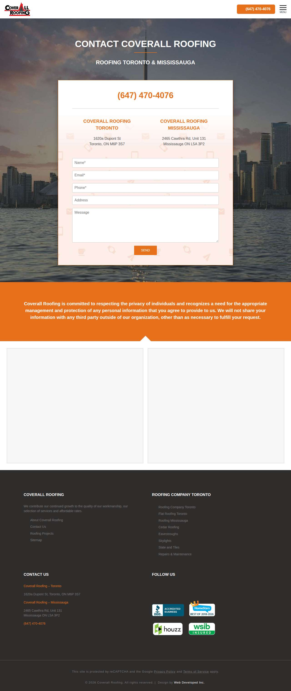

### srsroofing.ca — dry\_run\_ok (dry run)

| | |
|---|---|
| Attempt ID | `6df7a8c8-48fb-44ef-a534-e07476ee73d9` |
| Form URL | https://www.srsroofing.ca/contact-roofing-company/ |
| Final URL | https://www.srsroofing.ca/contact-roofing-company/ |
| Reserved | 2026-11-13 04:54:24 UTC |
| Submit attempted | — |
| Template | standard v2 |
| Confirmation text | none observed |
| Result / error | Selectors verified; fields not typed (domain not in dry-run fill list); not submitted |

Exact message:

~~~text
Subject: Helping customers find your business in AI search (AEO + GEO)

Hi there,

I'm Arun from Devs Arun. More and more customers now ask ChatGPT, Gemini, Perplexity or Google's AI Overviews questions like "who should I hire for this in my area?" before they call anyone. These tools answer from websites they can clearly understand, and they tend to recommend businesses whose pages answer real customer questions.

That is what AEO + GEO (Answer Engine and Generative Engine Optimization) is for. I improve your existing service pages so they clearly answer the questions your customers ask, add structured data that matches the page, and make the call, quote or enquiry step obvious. The benefit: your business gets a better chance of being mentioned or linked in AI answers, and visitors who arrive find it easy to contact you.

The AEO + GEO Starter is a one-time $199 (about ₹16,999, negotiable) for one website: a basic audit, 10 customer questions, improvements to two existing pages, relevant structured data and an action plan, with one revision round.

You can read the full details, send an enquiry or book online here:
https://devsarun.io/aeo-geo/

If this isn't relevant, just reply and I won't contact you again.

Best,
Arun
Devs Arun
itschool408@gmail.com · +91 7654534323
~~~

Submitted field values:

- \#form-field-name: Arun
- \#form-field-email: itschool408@gmail.com
- \#form-field-field\_2: +91 7654534323
- \#form-field-message: Hi there, I'm Arun from Devs Arun. More and more customers now ask ChatGPT, Gemini, Perplexity or Google's AI Overviews 

**Inspected page** — `run-9d7a968f_attempt-6df7a8c8_inspection_2026-11-13T04-54-26-991Z.jpg`

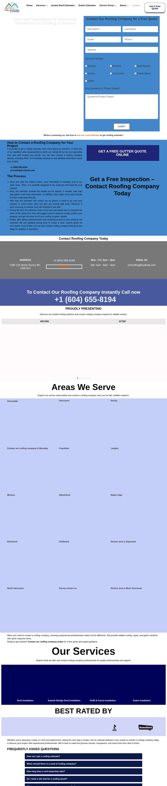

### technoref4.com — dry\_run\_ok (dry run)

| | |
|---|---|
| Attempt ID | `938034a5-a12d-48ec-ab96-8b25d9f38441` |
| Form URL | https://www.technoref4.com/contact-5 |
| Final URL | https://www.technoref4.com/contact-5 |
| Reserved | 2026-11-13 04:54:32 UTC |
| Submit attempted | — |
| Template | standard v2 |
| Confirmation text | none observed |
| Result / error | Selectors verified; fields not typed (domain not in dry-run fill list); not submitted |

Exact message:

~~~text
Subject: Helping customers find your business in AI search (AEO + GEO)

Hi there,

I'm Arun from Devs Arun. More and more customers now ask ChatGPT, Gemini, Perplexity or Google's AI Overviews questions like "who should I hire for this in my area?" before they call anyone. These tools answer from websites they can clearly understand, and they tend to recommend businesses whose pages answer real customer questions.

That is what AEO + GEO (Answer Engine and Generative Engine Optimization) is for. I improve your existing service pages so they clearly answer the questions your customers ask, add structured data that matches the page, and make the call, quote or enquiry step obvious. The benefit: your business gets a better chance of being mentioned or linked in AI answers, and visitors who arrive find it easy to contact you.

The AEO + GEO Starter is a one-time $199 (about ₹16,999, negotiable) for one website: a basic audit, 10 customer questions, improvements to two existing pages, relevant structured data and an action plan, with one revision round.

You can read the full details, send an enquiry or book online here:
https://devsarun.io/aeo-geo/

If this isn't relevant, just reply and I won't contact you again.

Best,
Arun
Devs Arun
itschool408@gmail.com · +91 7654534323
~~~

Submitted field values:

- \#input\_comp-lsjuh5yg: itschool408@gmail.com
- \#textarea\_comp-lsjuh5yk: Hi there, I'm Arun from Devs Arun. More and more customers now ask ChatGPT, Gemini, Perplexity or Google's AI Overviews 

**Inspected page** — `run-9d7a968f_attempt-938034a5_inspection_2026-11-13T04-54-34-135Z.jpg`

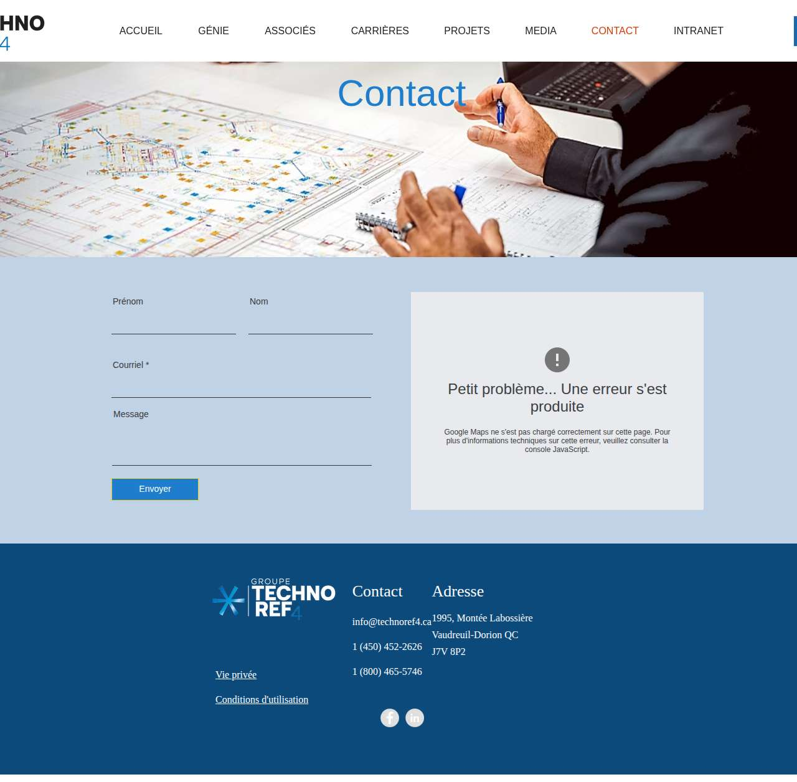

### whiskyjackhvac.com — dry\_run\_ok (dry run)

| | |
|---|---|
| Attempt ID | `490b744d-07a6-48e4-9436-475996e0c602` |
| Form URL | https://www.whiskyjackhvac.com/ |
| Final URL | https://www.whiskyjackhvac.com/ |
| Reserved | 2026-11-13 04:54:39 UTC |
| Submit attempted | — |
| Template | standard v2 |
| Confirmation text | none observed |
| Result / error | Selectors verified; fields not typed (domain not in dry-run fill list); not submitted |

Exact message:

~~~text
Subject: Helping customers find your business in AI search (AEO + GEO)

Hi there,

I'm Arun from Devs Arun. More and more customers now ask ChatGPT, Gemini, Perplexity or Google's AI Overviews questions like "who should I hire for this in my area?" before they call anyone. These tools answer from websites they can clearly understand, and they tend to recommend businesses whose pages answer real customer questions.

That is what AEO + GEO (Answer Engine and Generative Engine Optimization) is for. I improve your existing service pages so they clearly answer the questions your customers ask, add structured data that matches the page, and make the call, quote or enquiry step obvious. The benefit: your business gets a better chance of being mentioned or linked in AI answers, and visitors who arrive find it easy to contact you.

The AEO + GEO Starter is a one-time $199 (about ₹16,999, negotiable) for one website: a basic audit, 10 customer questions, improvements to two existing pages, relevant structured data and an action plan, with one revision round.

You can read the full details, send an enquiry or book online here:
https://devsarun.io/aeo-geo/

If this isn't relevant, just reply and I won't contact you again.

Best,
Arun
Devs Arun
itschool408@gmail.com · +91 7654534323
~~~

Submitted field values:

- \#input\_comp-jx4o6f6x: Arun
- \#input\_comp-jx4o6f7a: itschool408@gmail.com
- \#input\_comp-kgucp58x: +91 7654534323
- \#textarea\_comp-jx4o6f80: Hi there, I'm Arun from Devs Arun. More and more customers now ask ChatGPT, Gemini, Perplexity or Google's AI Overviews 

**Inspected page** — `run-9d7a968f_attempt-490b744d_inspection_2026-11-13T04-54-43-164Z.jpg`

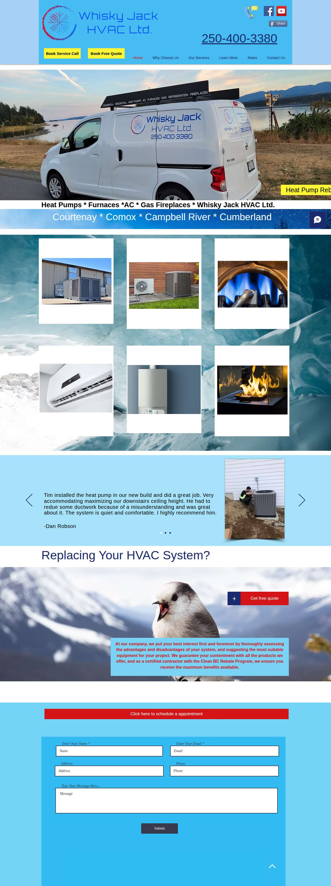

### thermocodistribution.ca — dry\_run\_ok (dry run)

| | |
|---|---|
| Attempt ID | `238ec62b-59eb-4388-9827-b14ccccac98f` |
| Form URL | https://thermocodistribution.ca/pages/contact |
| Final URL | https://thermocodistribution.ca/pages/contact |
| Reserved | 2026-11-13 04:54:48 UTC |
| Submit attempted | — |
| Template | standard v2 |
| Confirmation text | none observed |
| Result / error | Selectors verified; fields not typed (domain not in dry-run fill list); not submitted |

Exact message:

~~~text
Subject: Helping customers find your business in AI search (AEO + GEO)

Hi there,

I'm Arun from Devs Arun. More and more customers now ask ChatGPT, Gemini, Perplexity or Google's AI Overviews questions like "who should I hire for this in my area?" before they call anyone. These tools answer from websites they can clearly understand, and they tend to recommend businesses whose pages answer real customer questions.

That is what AEO + GEO (Answer Engine and Generative Engine Optimization) is for. I improve your existing service pages so they clearly answer the questions your customers ask, add structured data that matches the page, and make the call, quote or enquiry step obvious. The benefit: your business gets a better chance of being mentioned or linked in AI answers, and visitors who arrive find it easy to contact you.

The AEO + GEO Starter is a one-time $199 (about ₹16,999, negotiable) for one website: a basic audit, 10 customer questions, improvements to two existing pages, relevant structured data and an action plan, with one revision round.

You can read the full details, send an enquiry or book online here:
https://devsarun.io/aeo-geo/

If this isn't relevant, just reply and I won't contact you again.

Best,
Arun
Devs Arun
itschool408@gmail.com · +91 7654534323
~~~

Submitted field values:

- \#ContactFormName-template--15829576319111\_\_contact-form: Arun
- \#ContactFormEmail-template--15829576319111\_\_contact-form: itschool408@gmail.com
- \#ContactFormMessage-template--15829576319111\_\_contact-form: Hi there, I'm Arun from Devs Arun. More and more customers now ask ChatGPT, Gemini, Perplexity or Google's AI Overviews 
- \#ContactFormInput-template--15829576319111\_\_contact-form-custom\_field-1: +91 7654534323

**Inspected page** — `run-9d7a968f_attempt-238ec62b_inspection_2026-11-13T04-54-53-076Z.jpg`

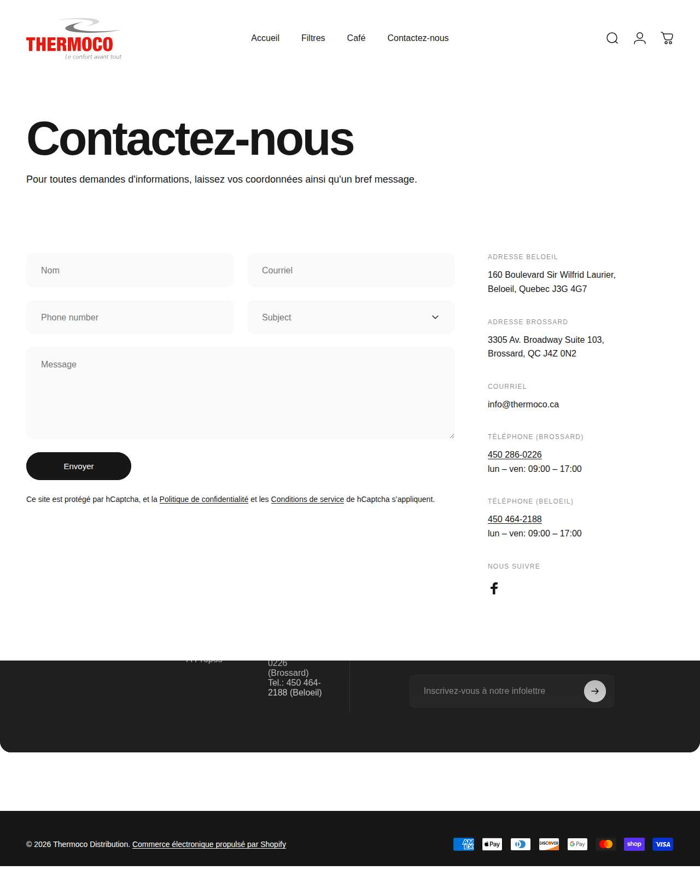

### hvac-group.com — dry\_run\_ok (dry run)

| | |
|---|---|
| Attempt ID | `4861821c-ad17-4bf2-8ae1-6f2c1d9f9684` |
| Form URL | https://hvac-group.com/contact/ |
| Final URL | https://hvac-group.com/contact/ |
| Reserved | 2026-11-13 04:54:58 UTC |
| Submit attempted | — |
| Template | standard v2 |
| Confirmation text | none observed |
| Result / error | Selectors verified; fields not typed (domain not in dry-run fill list); not submitted |

Exact message:

~~~text
Subject: Helping customers find your business in AI search (AEO + GEO)

Hi there,

I'm Arun from Devs Arun. More and more customers now ask ChatGPT, Gemini, Perplexity or Google's AI Overviews questions like "who should I hire for this in my area?" before they call anyone. These tools answer from websites they can clearly understand, and they tend to recommend businesses whose pages answer real customer questions.

That is what AEO + GEO (Answer Engine and Generative Engine Optimization) is for. I improve your existing service pages so they clearly answer the questions your customers ask, add structured data that matches the page, and make the call, quote or enquiry step obvious. The benefit: your business gets a better chance of being mentioned or linked in AI answers, and visitors who arrive find it easy to contact you.

The AEO + GEO Starter is a one-time $199 (about ₹16,999, negotiable) for one website: a basic audit, 10 customer questions, improvements to two existing pages, relevant structured data and an action plan, with one revision round.

You can read the full details, send an enquiry or book online here:
https://devsarun.io/aeo-geo/

If this isn't relevant, just reply and I won't contact you again.

Best,
Arun
Devs Arun
itschool408@gmail.com · +91 7654534323
~~~

Submitted field values:

- textarea\[name="your-message"\]: Hi there, I'm Arun from Devs Arun. More and more customers now ask ChatGPT, Gemini, Perplexity or Google's AI Overviews 
- \#wpcf7-f941-p936-o1 \> form \> div:nth-of-type(1) \> div:nth-of-type(1) \> div:nth-of-type(1) \> p \> span \> input: Arun
- \#wpcf7-f941-p936-o1 \> form \> div:nth-of-type(1) \> div:nth-of-type(1) \> div:nth-of-type(2) \> p \> span \> input: itschool408@gmail.com
- \#wpcf7-f941-p936-o1 \> form \> div:nth-of-type(1) \> div:nth-of-type(2) \> div:nth-of-type(1) \> p \> span \> input: +91 7654534323

**Inspected page** — `run-9d7a968f_attempt-4861821c_inspection_2026-11-13T04-55-04-642Z.jpg`

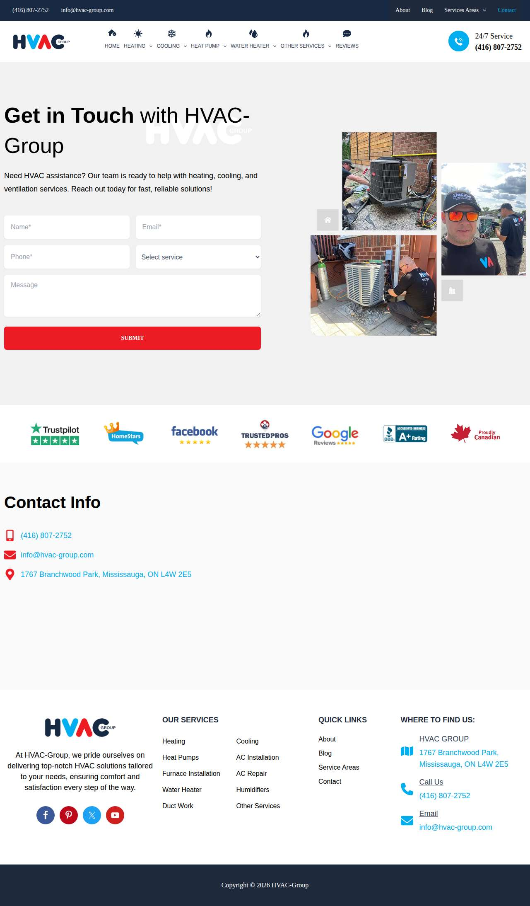

### southislandmechanical.ca — dry\_run\_ok (dry run)

| | |
|---|---|
| Attempt ID | `4448d958-019e-43ce-bb84-be057c19a076` |
| Form URL | https://southislandmechanical.ca/contact/ |
| Final URL | https://southislandmechanical.ca/contact/ |
| Reserved | 2026-11-13 04:55:09 UTC |
| Submit attempted | — |
| Template | standard v2 |
| Confirmation text | none observed |
| Result / error | Selectors verified; fields not typed (domain not in dry-run fill list); not submitted |

Exact message:

~~~text
Subject: Helping customers find your business in AI search (AEO + GEO)

Hi there,

I'm Arun from Devs Arun. More and more customers now ask ChatGPT, Gemini, Perplexity or Google's AI Overviews questions like "who should I hire for this in my area?" before they call anyone. These tools answer from websites they can clearly understand, and they tend to recommend businesses whose pages answer real customer questions.

That is what AEO + GEO (Answer Engine and Generative Engine Optimization) is for. I improve your existing service pages so they clearly answer the questions your customers ask, add structured data that matches the page, and make the call, quote or enquiry step obvious. The benefit: your business gets a better chance of being mentioned or linked in AI answers, and visitors who arrive find it easy to contact you.

The AEO + GEO Starter is a one-time $199 (about ₹16,999, negotiable) for one website: a basic audit, 10 customer questions, improvements to two existing pages, relevant structured data and an action plan, with one revision round.

You can read the full details, send an enquiry or book online here:
https://devsarun.io/aeo-geo/

If this isn't relevant, just reply and I won't contact you again.

Best,
Arun
Devs Arun
itschool408@gmail.com · +91 7654534323
~~~

Submitted field values:

- \#wsf-1-field-1: Arun
- \#wsf-1-field-3: itschool408@gmail.com
- \#wsf-1-field-4: +91 7654534323
- \#wsf-1-field-5: Hi there, I'm Arun from Devs Arun. More and more customers now ask ChatGPT, Gemini, Perplexity or Google's AI Overviews 
- \#wsf-1-field-9: Devs Arun

**Inspected page** — `run-9d7a968f_attempt-4448d958_inspection_2026-11-13T04-55-11-459Z.jpg`

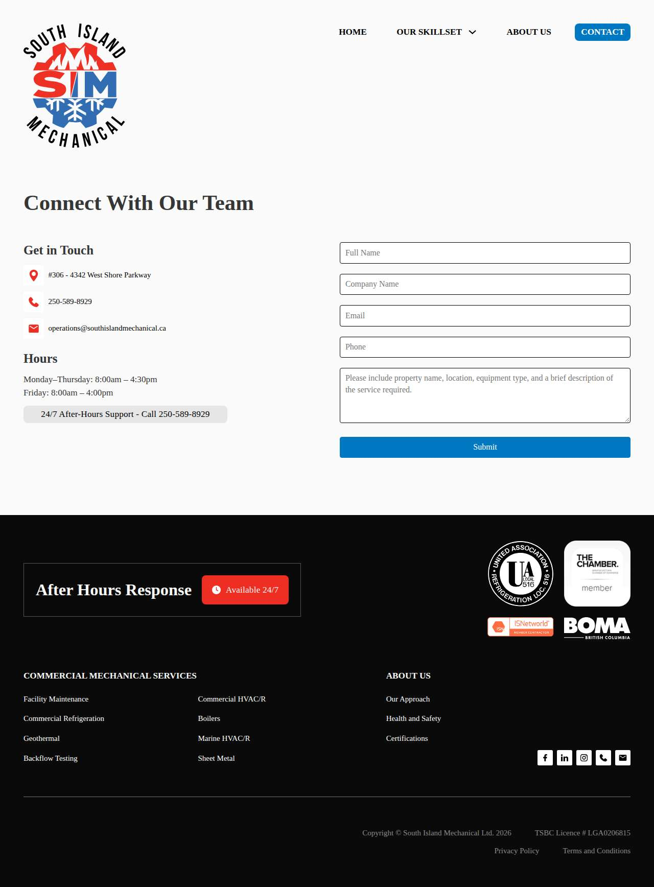

### kansasridgemechanical.com — dry\_run\_ok (dry run)

| | |
|---|---|
| Attempt ID | `b30de6f6-1a32-425a-b756-61405102502c` |
| Form URL | https://www.kansasridgemechanical.com/contact |
| Final URL | https://www.kansasridgemechanical.com/contact |
| Reserved | 2026-11-13 04:55:16 UTC |
| Submit attempted | — |
| Template | standard v2 |
| Confirmation text | none observed |
| Result / error | Selectors verified; fields not typed (domain not in dry-run fill list); not submitted |

Exact message:

~~~text
Subject: Helping customers find your business in AI search (AEO + GEO)

Hi there,

I'm Arun from Devs Arun. More and more customers now ask ChatGPT, Gemini, Perplexity or Google's AI Overviews questions like "who should I hire for this in my area?" before they call anyone. These tools answer from websites they can clearly understand, and they tend to recommend businesses whose pages answer real customer questions.

That is what AEO + GEO (Answer Engine and Generative Engine Optimization) is for. I improve your existing service pages so they clearly answer the questions your customers ask, add structured data that matches the page, and make the call, quote or enquiry step obvious. The benefit: your business gets a better chance of being mentioned or linked in AI answers, and visitors who arrive find it easy to contact you.

The AEO + GEO Starter is a one-time $199 (about ₹16,999, negotiable) for one website: a basic audit, 10 customer questions, improvements to two existing pages, relevant structured data and an action plan, with one revision round.

You can read the full details, send an enquiry or book online here:
https://devsarun.io/aeo-geo/

If this isn't relevant, just reply and I won't contact you again.

Best,
Arun
Devs Arun
itschool408@gmail.com · +91 7654534323
~~~

Submitted field values:

- \#input\_comp-kgaxo079: Arun
- \#input\_comp-kgaxo07n: itschool408@gmail.com
- \#textarea\_comp-kgaxo07r: Hi there, I'm Arun from Devs Arun. More and more customers now ask ChatGPT, Gemini, Perplexity or Google's AI Overviews 

**Inspected page** — `run-9d7a968f_attempt-b30de6f6_inspection_2026-11-13T04-55-18-474Z.jpg`

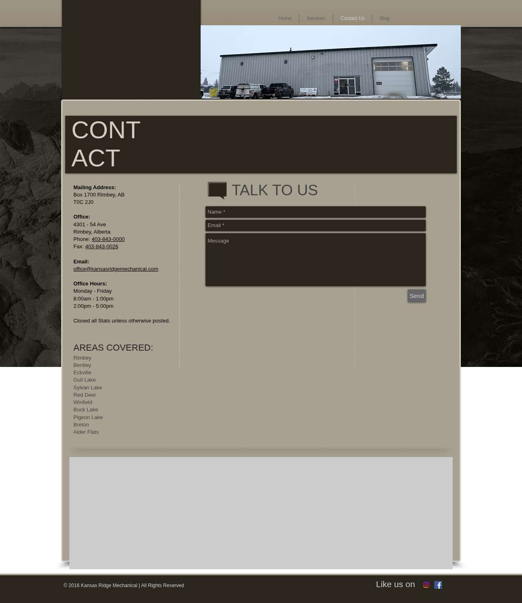

### designairltd.ca — dry\_run\_ok (dry run)

| | |
|---|---|
| Attempt ID | `58bb2df0-3ddb-42ac-8325-70f3431b3c75` |
| Form URL | https://www.designairltd.ca/contact.html |
| Final URL | https://www.designairltd.ca/contact.html |
| Reserved | 2026-11-13 04:55:23 UTC |
| Submit attempted | — |
| Template | standard v2 |
| Confirmation text | none observed |
| Result / error | Selectors verified; fields not typed (domain not in dry-run fill list); not submitted |

Exact message:

~~~text
Subject: Helping customers find your business in AI search (AEO + GEO)

Hi there,

I'm Arun from Devs Arun. More and more customers now ask ChatGPT, Gemini, Perplexity or Google's AI Overviews questions like "who should I hire for this in my area?" before they call anyone. These tools answer from websites they can clearly understand, and they tend to recommend businesses whose pages answer real customer questions.

That is what AEO + GEO (Answer Engine and Generative Engine Optimization) is for. I improve your existing service pages so they clearly answer the questions your customers ask, add structured data that matches the page, and make the call, quote or enquiry step obvious. The benefit: your business gets a better chance of being mentioned or linked in AI answers, and visitors who arrive find it easy to contact you.

The AEO + GEO Starter is a one-time $199 (about ₹16,999, negotiable) for one website: a basic audit, 10 customer questions, improvements to two existing pages, relevant structured data and an action plan, with one revision round.

You can read the full details, send an enquiry or book online here:
https://devsarun.io/aeo-geo/

If this isn't relevant, just reply and I won't contact you again.

Best,
Arun
Devs Arun
itschool408@gmail.com · +91 7654534323
~~~

Submitted field values:

- \#phoneNumber: +91 7654534323
- \#emailAddress: itschool408@gmail.com
- \#exampleTextarea: Hi there, I'm Arun from Devs Arun. More and more customers now ask ChatGPT, Gemini, Perplexity or Google's AI Overviews 
- \#exampleInputEmail1: itschool408@gmail.com

**Inspected page** — `run-9d7a968f_attempt-58bb2df0_inspection_2026-11-13T04-55-25-306Z.jpg`

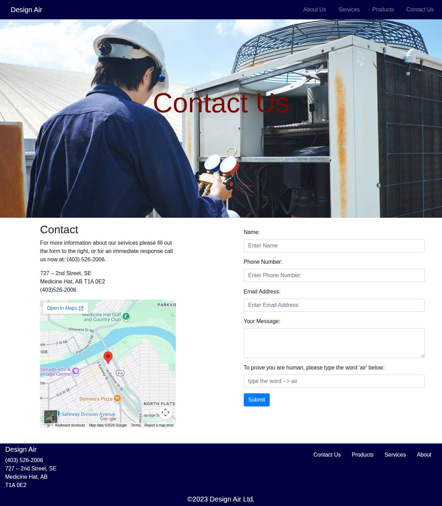

### myncs.ca — dry\_run\_ok (dry run)

| | |
|---|---|
| Attempt ID | `ad198c88-98e9-472b-b580-0a86e5b621b0` |
| Form URL | https://myncs.ca/contact/ |
| Final URL | https://myncs.ca/contact/ |
| Reserved | 2026-11-13 04:55:30 UTC |
| Submit attempted | — |
| Template | standard v2 |
| Confirmation text | none observed |
| Result / error | Selectors verified; fields not typed (domain not in dry-run fill list); not submitted |

Exact message:

~~~text
Subject: Helping customers find your business in AI search (AEO + GEO)

Hi there,

I'm Arun from Devs Arun. More and more customers now ask ChatGPT, Gemini, Perplexity or Google's AI Overviews questions like "who should I hire for this in my area?" before they call anyone. These tools answer from websites they can clearly understand, and they tend to recommend businesses whose pages answer real customer questions.

That is what AEO + GEO (Answer Engine and Generative Engine Optimization) is for. I improve your existing service pages so they clearly answer the questions your customers ask, add structured data that matches the page, and make the call, quote or enquiry step obvious. The benefit: your business gets a better chance of being mentioned or linked in AI answers, and visitors who arrive find it easy to contact you.

The AEO + GEO Starter is a one-time $199 (about ₹16,999, negotiable) for one website: a basic audit, 10 customer questions, improvements to two existing pages, relevant structured data and an action plan, with one revision round.

You can read the full details, send an enquiry or book online here:
https://devsarun.io/aeo-geo/

If this isn't relevant, just reply and I won't contact you again.

Best,
Arun
Devs Arun
itschool408@gmail.com · +91 7654534323
~~~

Submitted field values:

- \#nf-field-7: Arun
- \#nf-field-8: itschool408@gmail.com
- \#nf-field-9: +91 7654534323
- \#nf-field-10: Helping customers find your business in AI search (AEO + GEO)
- \#nf-field-11: Hi there, I'm Arun from Devs Arun. More and more customers now ask ChatGPT, Gemini, Perplexity or Google's AI Overviews 

**Inspected page** — `run-9d7a968f_attempt-ad198c88_inspection_2026-11-13T04-55-34-040Z.jpg`

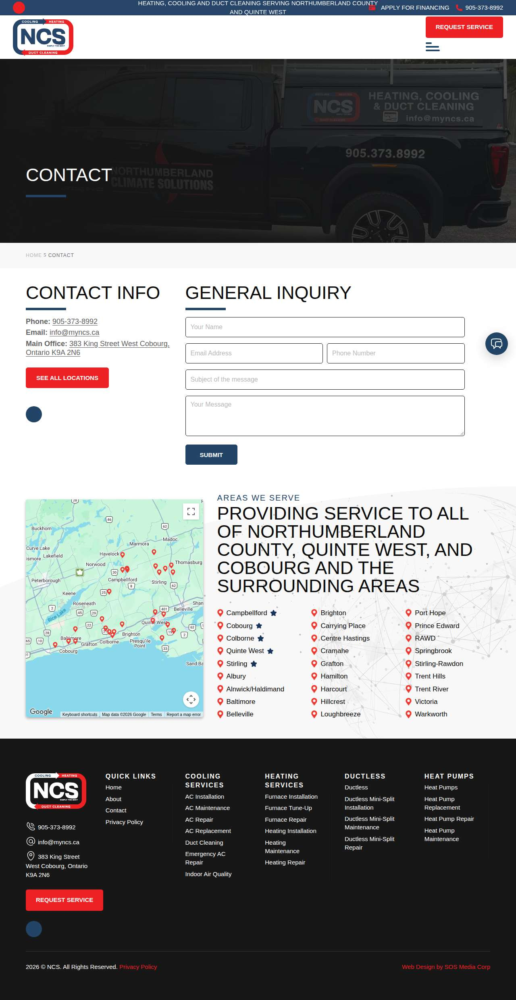

### coastalenergy.ca — dry\_run\_ok (dry run)

| | |
|---|---|
| Attempt ID | `40369863-feae-426e-8fa8-baa7969ac69f` |
| Form URL | https://coastalenergy.ca/contact-us/ |
| Final URL | https://coastalenergy.ca/contact-us/ |
| Reserved | 2026-11-13 04:55:39 UTC |
| Submit attempted | — |
| Template | standard v2 |
| Confirmation text | none observed |
| Result / error | Selectors verified; fields not typed (domain not in dry-run fill list); not submitted |

Exact message:

~~~text
Subject: Helping customers find your business in AI search (AEO + GEO)

Hi there,

I'm Arun from Devs Arun. More and more customers now ask ChatGPT, Gemini, Perplexity or Google's AI Overviews questions like "who should I hire for this in my area?" before they call anyone. These tools answer from websites they can clearly understand, and they tend to recommend businesses whose pages answer real customer questions.

That is what AEO + GEO (Answer Engine and Generative Engine Optimization) is for. I improve your existing service pages so they clearly answer the questions your customers ask, add structured data that matches the page, and make the call, quote or enquiry step obvious. The benefit: your business gets a better chance of being mentioned or linked in AI answers, and visitors who arrive find it easy to contact you.

The AEO + GEO Starter is a one-time $199 (about ₹16,999, negotiable) for one website: a basic audit, 10 customer questions, improvements to two existing pages, relevant structured data and an action plan, with one revision round.

You can read the full details, send an enquiry or book online here:
https://devsarun.io/aeo-geo/

If this isn't relevant, just reply and I won't contact you again.

Best,
Arun
Devs Arun
itschool408@gmail.com · +91 7654534323
~~~

Submitted field values:

- \#form-field-field\_3e0de62: Hi there, I'm Arun from Devs Arun. More and more customers now ask ChatGPT, Gemini, Perplexity or Google's AI Overviews 
- \#form-field-field\_f833885: +91 7654534323
- div \> div \> div \> div:nth-of-type(1) \> div \> div:nth-of-type(2) \> div \> div \> form \> div \> div:nth-of-type(1) \> input: Arun
- div \> div \> div \> div:nth-of-type(1) \> div \> div:nth-of-type(2) \> div \> div \> form \> div \> div:nth-of-type(2) \> input: itschool408@gmail.com

**Inspected page** — `run-9d7a968f_attempt-40369863_inspection_2026-11-13T04-55-42-684Z.jpg`

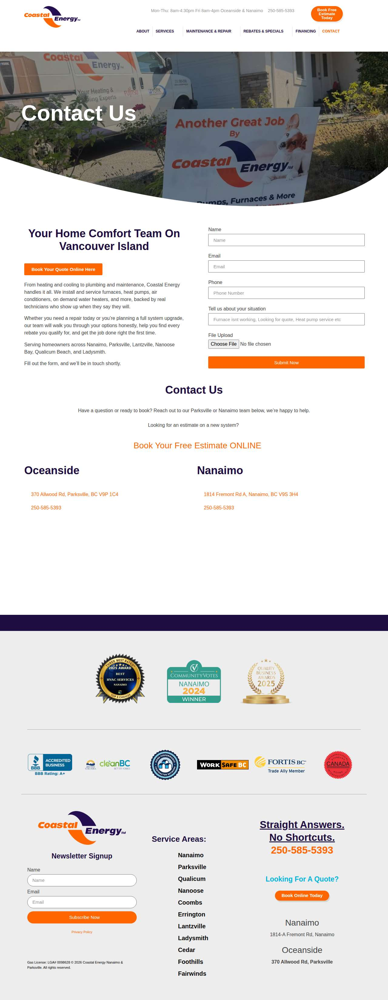

### callthegoat.ca — dry\_run\_ok (dry run)

| | |
|---|---|
| Attempt ID | `b0bfd223-1832-43a3-a117-de335a4fa0d7` |
| Form URL | https://www.callthegoat.ca/contact/ |
| Final URL | https://www.callthegoat.ca/contact/ |
| Reserved | 2026-11-13 04:55:47 UTC |
| Submit attempted | — |
| Template | standard v2 |
| Confirmation text | none observed |
| Result / error | Selectors verified; fields not typed (domain not in dry-run fill list); not submitted |

Exact message:

~~~text
Subject: Helping customers find your business in AI search (AEO + GEO)

Hi there,

I'm Arun from Devs Arun. More and more customers now ask ChatGPT, Gemini, Perplexity or Google's AI Overviews questions like "who should I hire for this in my area?" before they call anyone. These tools answer from websites they can clearly understand, and they tend to recommend businesses whose pages answer real customer questions.

That is what AEO + GEO (Answer Engine and Generative Engine Optimization) is for. I improve your existing service pages so they clearly answer the questions your customers ask, add structured data that matches the page, and make the call, quote or enquiry step obvious. The benefit: your business gets a better chance of being mentioned or linked in AI answers, and visitors who arrive find it easy to contact you.

The AEO + GEO Starter is a one-time $199 (about ₹16,999, negotiable) for one website: a basic audit, 10 customer questions, improvements to two existing pages, relevant structured data and an action plan, with one revision round.

You can read the full details, send an enquiry or book online here:
https://devsarun.io/aeo-geo/

If this isn't relevant, just reply and I won't contact you again.

Best,
Arun
Devs Arun
itschool408@gmail.com · +91 7654534323
~~~

Submitted field values:

- \#contact-page-form \> div \> form \> div:nth-of-type(1) \> div \> div:nth-of-type(2) \> div \> input: Arun
- \#contact-page-form \> div \> form \> div:nth-of-type(1) \> div \> div:nth-of-type(3) \> div \> input: itschool408@gmail.com
- \#contact-page-form \> div \> form \> div:nth-of-type(1) \> div \> div:nth-of-type(4) \> div \> input: +91 7654534323
- \#contact-page-form \> div \> form \> div:nth-of-type(1) \> div \> div:nth-of-type(5) \> div \> textarea: Hi there, I'm Arun from Devs Arun. More and more customers now ask ChatGPT, Gemini, Perplexity or Google's AI Overviews 

**Inspected page** — `run-9d7a968f_attempt-b0bfd223_inspection_2026-11-13T04-55-49-986Z.jpg`

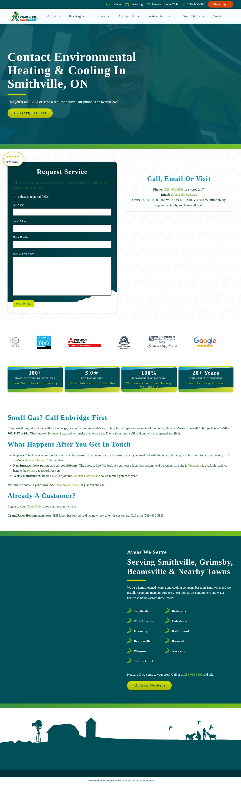

### knoxvilleelectrician.com — dry\_run\_failed (dry run)

| | |
|---|---|
| Attempt ID | `27413ac0-974f-46d3-b19b-a2b34af6a2fc` |
| Form URL | https://knoxvilleelectrician.com/contact-us/ |
| Final URL | https://knoxvilleelectrician.com/contact-us/ |
| Reserved | 2026-11-13 04:55:55 UTC |
| Submit attempted | — |
| Template | standard v2 |
| Confirmation text | none observed |
| Result / error | Mapped field "Name" not found uniquely |

Exact message:

~~~text
Subject: Helping customers find your business in AI search (AEO + GEO)

Hi there,

I'm Arun from Devs Arun. More and more customers now ask ChatGPT, Gemini, Perplexity or Google's AI Overviews questions like "who should I hire for this in my area?" before they call anyone. These tools answer from websites they can clearly understand, and they tend to recommend businesses whose pages answer real customer questions.

That is what AEO + GEO (Answer Engine and Generative Engine Optimization) is for. I improve your existing service pages so they clearly answer the questions your customers ask, add structured data that matches the page, and make the call, quote or enquiry step obvious. The benefit: your business gets a better chance of being mentioned or linked in AI answers, and visitors who arrive find it easy to contact you.

The AEO + GEO Starter is a one-time $199 (about ₹16,999, negotiable) for one website: a basic audit, 10 customer questions, improvements to two existing pages, relevant structured data and an action plan, with one revision round.

You can read the full details, send an enquiry or book online here:
https://devsarun.io/aeo-geo/

If this isn't relevant, just reply and I won't contact you again.

Best,
Arun
Devs Arun
itschool408@gmail.com · +91 7654534323
~~~

Submitted field values:

- \#form-field-1b7221: itschool408@gmail.com
- \#form-field-2fa3ac: +91 7654534323
- \#form-field-96f51f: Arun
- \#form-field-fed9d8: Hi there, I'm Arun from Devs Arun. More and more customers now ask ChatGPT, Gemini, Perplexity or Google's AI Overviews 

**Inspected page** — `run-9d7a968f_attempt-27413ac0_inspection_2026-11-13T04-55-58-912Z.jpg`

### commongroundpower.com — dry\_run\_ok (dry run)

| | |
|---|---|
| Attempt ID | `fbbf49dd-c02e-4d73-9868-a51bdc9be6fd` |
| Form URL | http://www.commongroundpower.com/Common-Ground-Electrical-ComoxValley-ContactUs.html |
| Final URL | http://www.commongroundpower.com/Common-Ground-Electrical-ComoxValley-ContactUs.html |
| Reserved | 2026-11-13 04:56:03 UTC |
| Submit attempted | — |
| Template | short v2 |
| Confirmation text | none observed |
| Result / error | Selectors verified; fields not typed (domain not in dry-run fill list); not submitted |

Exact message:

~~~text
Subject: Helping customers find your business in AI search (AEO + GEO)

Hi there,

I'm Arun from Devs Arun. Customers increasingly ask ChatGPT, Gemini and Google's AI Overviews who to hire before they call anyone. AEO + GEO makes your existing service pages clear answers these tools can understand and cite, with an easy way to call or enquire, so your business has a better chance of being recommended.

The AEO + GEO Starter is a one-time $199 (about ₹16,999, negotiable) for one website.

Full details, enquiries and online booking:
https://devsarun.io/aeo-geo/

If this isn't relevant, just reply and I won't contact you again.

Best,
Arun, Devs Arun
itschool408@gmail.com
~~~

Submitted field values:

- input\[name="email"\]: itschool408@gmail.com
- input\[name="telephone"\]: +91 7654534323
- input\[name="first\_name"\]: Arun
- textarea\[name="comments"\]: Hi there, I'm Arun from Devs Arun. Customers increasingly ask ChatGPT, Gemini and Google's AI Overviews who to hire befo

**Inspected page** — `run-9d7a968f_attempt-fbbf49dd_inspection_2026-11-13T04-56-04-784Z.jpg`

### cascadiaelectric.ca — dry\_run\_ok (dry run)

| | |
|---|---|
| Attempt ID | `75a1b777-50f7-443b-a8b2-84108087930f` |
| Form URL | https://www.cascadiaelectric.ca/contact-5 |
| Final URL | https://www.cascadiaelectric.ca/contact-5 |
| Reserved | 2026-11-13 04:56:09 UTC |
| Submit attempted | — |
| Template | standard v2 |
| Confirmation text | none observed |
| Result / error | Selectors verified; fields not typed (domain not in dry-run fill list); not submitted |

Exact message:

~~~text
Subject: Helping customers find your business in AI search (AEO + GEO)

Hi there,

I'm Arun from Devs Arun. More and more customers now ask ChatGPT, Gemini, Perplexity or Google's AI Overviews questions like "who should I hire for this in my area?" before they call anyone. These tools answer from websites they can clearly understand, and they tend to recommend businesses whose pages answer real customer questions.

That is what AEO + GEO (Answer Engine and Generative Engine Optimization) is for. I improve your existing service pages so they clearly answer the questions your customers ask, add structured data that matches the page, and make the call, quote or enquiry step obvious. The benefit: your business gets a better chance of being mentioned or linked in AI answers, and visitors who arrive find it easy to contact you.

The AEO + GEO Starter is a one-time $199 (about ₹16,999, negotiable) for one website: a basic audit, 10 customer questions, improvements to two existing pages, relevant structured data and an action plan, with one revision round.

You can read the full details, send an enquiry or book online here:
https://devsarun.io/aeo-geo/

If this isn't relevant, just reply and I won't contact you again.

Best,
Arun
Devs Arun
itschool408@gmail.com · +91 7654534323
~~~

Submitted field values:

- \#input\_comp-lux6y3w82: Arun
- \#input\_comp-lux6y3wc1: itschool408@gmail.com
- \#textarea\_comp-lux6y3wd2: Hi there, I'm Arun from Devs Arun. More and more customers now ask ChatGPT, Gemini, Perplexity or Google's AI Overviews 

**Inspected page** — `run-9d7a968f_attempt-75a1b777_inspection_2026-11-13T04-56-11-958Z.jpg`

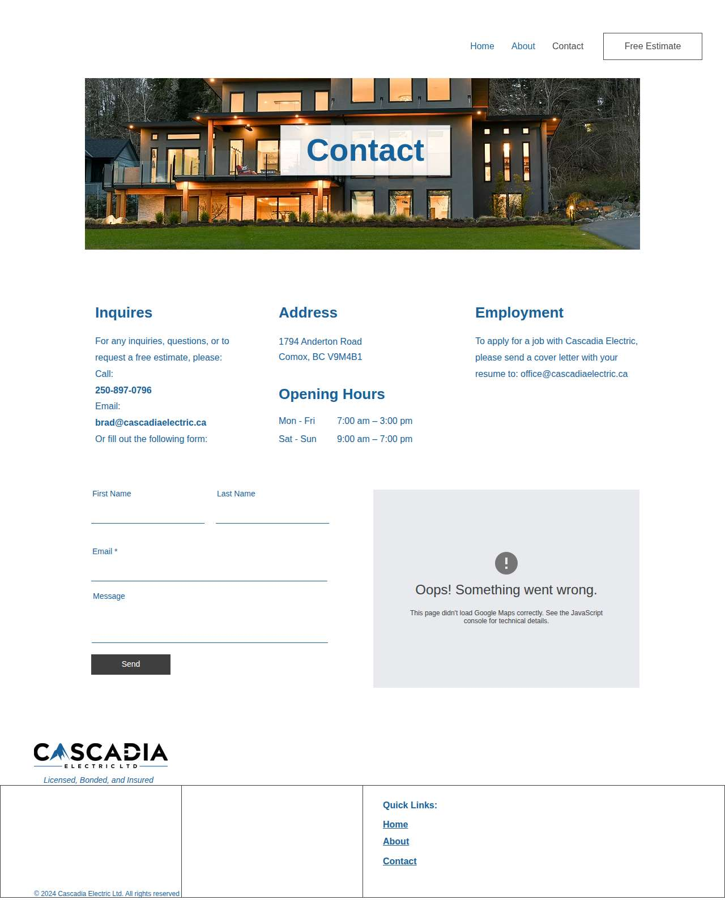

### electric1.ca — dry\_run\_ok (dry run)

| | |
|---|---|
| Attempt ID | `442c92ef-b8c7-433d-9e16-f931bb74cf99` |
| Form URL | https://electric1.ca/ |
| Final URL | https://electric1.ca/ |
| Reserved | 2026-11-13 04:56:16 UTC |
| Submit attempted | — |
| Template | standard v2 |
| Confirmation text | none observed |
| Result / error | Selectors verified; fields not typed (domain not in dry-run fill list); not submitted |

Exact message:

~~~text
Subject: Helping customers find your business in AI search (AEO + GEO)

Hi there,

I'm Arun from Devs Arun. More and more customers now ask ChatGPT, Gemini, Perplexity or Google's AI Overviews questions like "who should I hire for this in my area?" before they call anyone. These tools answer from websites they can clearly understand, and they tend to recommend businesses whose pages answer real customer questions.

That is what AEO + GEO (Answer Engine and Generative Engine Optimization) is for. I improve your existing service pages so they clearly answer the questions your customers ask, add structured data that matches the page, and make the call, quote or enquiry step obvious. The benefit: your business gets a better chance of being mentioned or linked in AI answers, and visitors who arrive find it easy to contact you.

The AEO + GEO Starter is a one-time $199 (about ₹16,999, negotiable) for one website: a basic audit, 10 customer questions, improvements to two existing pages, relevant structured data and an action plan, with one revision round.

You can read the full details, send an enquiry or book online here:
https://devsarun.io/aeo-geo/

If this isn't relevant, just reply and I won't contact you again.

Best,
Arun
Devs Arun
itschool408@gmail.com · +91 7654534323
~~~

Submitted field values:

- \#form-field-name: Arun
- \#form-field-email: itschool408@gmail.com
- \#form-field-message: Hi there, I'm Arun from Devs Arun. More and more customers now ask ChatGPT, Gemini, Perplexity or Google's AI Overviews 
- \#form-field-field\_1b88684: Hi there, I'm Arun from Devs Arun. More and more customers now ask ChatGPT, Gemini, Perplexity or Google's AI Overviews 
- \#form-field-field\_7ec16bc: +91 7654534323

**Inspected page** — `run-9d7a968f_attempt-442c92ef_inspection_2026-11-13T04-56-19-884Z.jpg`

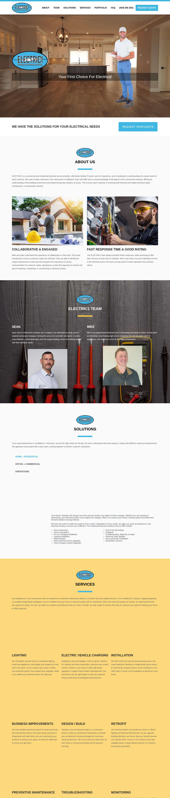

### bzzzt.ca — dry\_run\_ok (dry run)

| | |
|---|---|
| Attempt ID | `93ed9f2b-faef-49d2-8605-3ae5997b6b6a` |
| Form URL | https://bzzzt.ca/contact/ |
| Final URL | https://bzzzt.ca/contact/ |
| Reserved | 2026-11-13 04:56:24 UTC |
| Submit attempted | — |
| Template | standard v2 |
| Confirmation text | none observed |
| Result / error | Selectors verified; fields not typed (domain not in dry-run fill list); not submitted |

Exact message:

~~~text
Subject: Helping customers find your business in AI search (AEO + GEO)

Hi there,

I'm Arun from Devs Arun. More and more customers now ask ChatGPT, Gemini, Perplexity or Google's AI Overviews questions like "who should I hire for this in my area?" before they call anyone. These tools answer from websites they can clearly understand, and they tend to recommend businesses whose pages answer real customer questions.

That is what AEO + GEO (Answer Engine and Generative Engine Optimization) is for. I improve your existing service pages so they clearly answer the questions your customers ask, add structured data that matches the page, and make the call, quote or enquiry step obvious. The benefit: your business gets a better chance of being mentioned or linked in AI answers, and visitors who arrive find it easy to contact you.

The AEO + GEO Starter is a one-time $199 (about ₹16,999, negotiable) for one website: a basic audit, 10 customer questions, improvements to two existing pages, relevant structured data and an action plan, with one revision round.

You can read the full details, send an enquiry or book online here:
https://devsarun.io/aeo-geo/

If this isn't relevant, just reply and I won't contact you again.

Best,
Arun
Devs Arun
itschool408@gmail.com · +91 7654534323
~~~

Submitted field values:

- \#forminator-field-name-1\_6af1a788011e3: Arun
- \#forminator-field-email-1\_6af1a788011e3: itschool408@gmail.com
- \#forminator-field-phone-1\_6af1a788011e3: +91 7654534323
- \#forminator-field-textarea-1\_6af1a788011e3: Hi there, I'm Arun from Devs Arun. More and more customers now ask ChatGPT, Gemini, Perplexity or Google's AI Overviews 

**Inspected page** — `run-9d7a968f_attempt-93ed9f2b_inspection_2026-11-13T04-56-29-407Z.jpg`

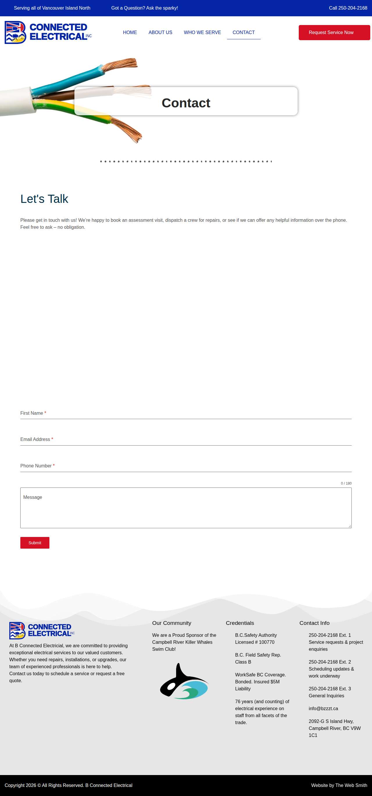

### harbourviewelectric.com — dry\_run\_ok (dry run)

| | |
|---|---|
| Attempt ID | `7bb0abd3-5a4d-42da-8566-e3ec693b5ca1` |
| Form URL | https://harbourviewelectric.com/contact/ |
| Final URL | https://harbourviewelectric.com/contact/ |
| Reserved | 2026-11-13 04:56:34 UTC |
| Submit attempted | — |
| Template | standard v2 |
| Confirmation text | none observed |
| Result / error | Selectors verified; fields not typed (domain not in dry-run fill list); not submitted |

Exact message:

~~~text
Subject: Helping customers find your business in AI search (AEO + GEO)

Hi there,

I'm Arun from Devs Arun. More and more customers now ask ChatGPT, Gemini, Perplexity or Google's AI Overviews questions like "who should I hire for this in my area?" before they call anyone. These tools answer from websites they can clearly understand, and they tend to recommend businesses whose pages answer real customer questions.

That is what AEO + GEO (Answer Engine and Generative Engine Optimization) is for. I improve your existing service pages so they clearly answer the questions your customers ask, add structured data that matches the page, and make the call, quote or enquiry step obvious. The benefit: your business gets a better chance of being mentioned or linked in AI answers, and visitors who arrive find it easy to contact you.

The AEO + GEO Starter is a one-time $199 (about ₹16,999, negotiable) for one website: a basic audit, 10 customer questions, improvements to two existing pages, relevant structured data and an action plan, with one revision round.

You can read the full details, send an enquiry or book online here:
https://devsarun.io/aeo-geo/

If this isn't relevant, just reply and I won't contact you again.

Best,
Arun
Devs Arun
itschool408@gmail.com · +91 7654534323
~~~

Submitted field values:

- \#tb\_nrvn401-contact-name: Arun
- \#tb\_nrvn401-contact-email: itschool408@gmail.com
- \#tb\_nrvn401-contact-message: Hi there, I'm Arun from Devs Arun. More and more customers now ask ChatGPT, Gemini, Perplexity or Google's AI Overviews 
- \#tb\_nrvn401-contact-subject: Helping customers find your business in AI search (AEO + GEO)

**Inspected page** — `run-9d7a968f_attempt-7bb0abd3_inspection_2026-11-13T04-56-39-560Z.jpg`

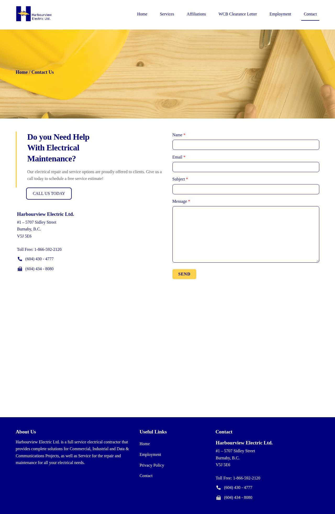

### rmelectric.com — dry\_run\_ok (dry run)

| | |
|---|---|
| Attempt ID | `41d4a319-8024-4462-818a-f17c5b73a9e4` |
| Form URL | https://www.rmelectric.com/contact/ |
| Final URL | https://www.rmelectric.com/contact/ |
| Reserved | 2026-11-13 04:56:44 UTC |
| Submit attempted | — |
| Template | standard v2 |
| Confirmation text | none observed |
| Result / error | Selectors verified; fields not typed (domain not in dry-run fill list); not submitted |

Exact message:

~~~text
Subject: Helping customers find your business in AI search (AEO + GEO)

Hi there,

I'm Arun from Devs Arun. More and more customers now ask ChatGPT, Gemini, Perplexity or Google's AI Overviews questions like "who should I hire for this in my area?" before they call anyone. These tools answer from websites they can clearly understand, and they tend to recommend businesses whose pages answer real customer questions.

That is what AEO + GEO (Answer Engine and Generative Engine Optimization) is for. I improve your existing service pages so they clearly answer the questions your customers ask, add structured data that matches the page, and make the call, quote or enquiry step obvious. The benefit: your business gets a better chance of being mentioned or linked in AI answers, and visitors who arrive find it easy to contact you.

The AEO + GEO Starter is a one-time $199 (about ₹16,999, negotiable) for one website: a basic audit, 10 customer questions, improvements to two existing pages, relevant structured data and an action plan, with one revision round.

You can read the full details, send an enquiry or book online here:
https://devsarun.io/aeo-geo/

If this isn't relevant, just reply and I won't contact you again.

Best,
Arun
Devs Arun
itschool408@gmail.com · +91 7654534323
~~~

Submitted field values:

- input\[name="your-name"\]: Arun
- input\[name="your-email"\]: itschool408@gmail.com
- input\[name="your-phone"\]: +91 7654534323
- input\[name="how-to-help"\]: Hi there, I'm Arun from Devs Arun. More and more customers now ask ChatGPT, Gemini, Perplexity or Google's AI Overviews 
- input\[name="your-company"\]: Devs Arun

**Inspected page** — `run-9d7a968f_attempt-41d4a319_inspection_2026-11-13T04-56-47-901Z.jpg`

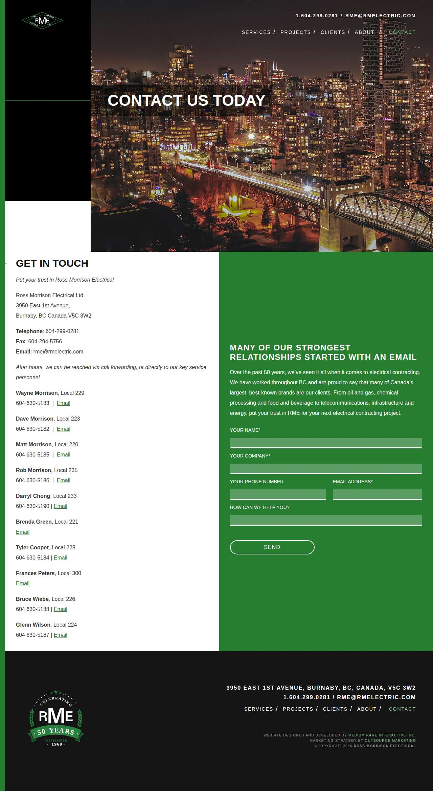

### rmselectricltd.com — dry\_run\_ok (dry run)

| | |
|---|---|
| Attempt ID | `7233c117-6729-462f-8c36-e84761941158` |
| Form URL | https://rmselectricltd.com/contactrms.html |
| Final URL | https://rmselectricltd.com/contactrms.html |
| Reserved | 2026-11-13 04:56:52 UTC |
| Submit attempted | — |
| Template | standard v2 |
| Confirmation text | none observed |
| Result / error | Selectors verified; fields not typed (domain not in dry-run fill list); not submitted |

Exact message:

~~~text
Subject: Helping customers find your business in AI search (AEO + GEO)

Hi there,

I'm Arun from Devs Arun. More and more customers now ask ChatGPT, Gemini, Perplexity or Google's AI Overviews questions like "who should I hire for this in my area?" before they call anyone. These tools answer from websites they can clearly understand, and they tend to recommend businesses whose pages answer real customer questions.

That is what AEO + GEO (Answer Engine and Generative Engine Optimization) is for. I improve your existing service pages so they clearly answer the questions your customers ask, add structured data that matches the page, and make the call, quote or enquiry step obvious. The benefit: your business gets a better chance of being mentioned or linked in AI answers, and visitors who arrive find it easy to contact you.

The AEO + GEO Starter is a one-time $199 (about ₹16,999, negotiable) for one website: a basic audit, 10 customer questions, improvements to two existing pages, relevant structured data and an action plan, with one revision round.

You can read the full details, send an enquiry or book online here:
https://devsarun.io/aeo-geo/

If this isn't relevant, just reply and I won't contact you again.

Best,
Arun
Devs Arun
itschool408@gmail.com · +91 7654534323
~~~

Submitted field values:

- \#name: Arun
- \#email: itschool408@gmail.com
- \#phone: +91 7654534323
- \#question: Hi there, I'm Arun from Devs Arun. More and more customers now ask ChatGPT, Gemini, Perplexity or Google's AI Overviews 

**Inspected page** — `run-9d7a968f_attempt-7233c117_inspection_2026-11-13T04-56-54-260Z.jpg`

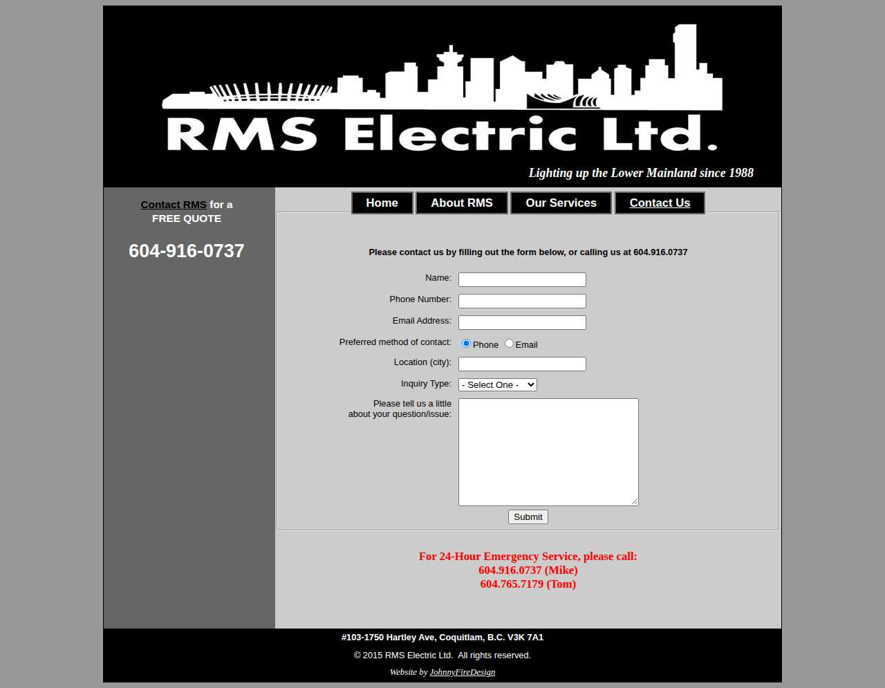

### lloydselectric.com — dry\_run\_ok (dry run)

| | |
|---|---|
| Attempt ID | `f5ec6564-6115-4d54-9099-385565024c6d` |
| Form URL | http://www.lloydselectric.com/ |
| Final URL | http://www.lloydselectric.com/ |
| Reserved | 2026-11-13 04:56:59 UTC |
| Submit attempted | — |
| Template | standard v2 |
| Confirmation text | none observed |
| Result / error | Selectors verified; fields not typed (domain not in dry-run fill list); not submitted |

Exact message:

~~~text
Subject: Helping customers find your business in AI search (AEO + GEO)

Hi there,

I'm Arun from Devs Arun. More and more customers now ask ChatGPT, Gemini, Perplexity or Google's AI Overviews questions like "who should I hire for this in my area?" before they call anyone. These tools answer from websites they can clearly understand, and they tend to recommend businesses whose pages answer real customer questions.

That is what AEO + GEO (Answer Engine and Generative Engine Optimization) is for. I improve your existing service pages so they clearly answer the questions your customers ask, add structured data that matches the page, and make the call, quote or enquiry step obvious. The benefit: your business gets a better chance of being mentioned or linked in AI answers, and visitors who arrive find it easy to contact you.

The AEO + GEO Starter is a one-time $199 (about ₹16,999, negotiable) for one website: a basic audit, 10 customer questions, improvements to two existing pages, relevant structured data and an action plan, with one revision round.

You can read the full details, send an enquiry or book online here:
https://devsarun.io/aeo-geo/

If this isn't relevant, just reply and I won't contact you again.

Best,
Arun
Devs Arun
itschool408@gmail.com · +91 7654534323
~~~

Submitted field values:

- input\[name="Name"\]: Arun
- input\[name="Email"\]: itschool408@gmail.com
- textarea\[name="Questions\_Comments"\]: Hi there, I'm Arun from Devs Arun. More and more customers now ask ChatGPT, Gemini, Perplexity or Google's AI Overviews 

**Inspected page** — `run-9d7a968f_attempt-f5ec6564_inspection_2026-11-13T04-57-00-505Z.jpg`

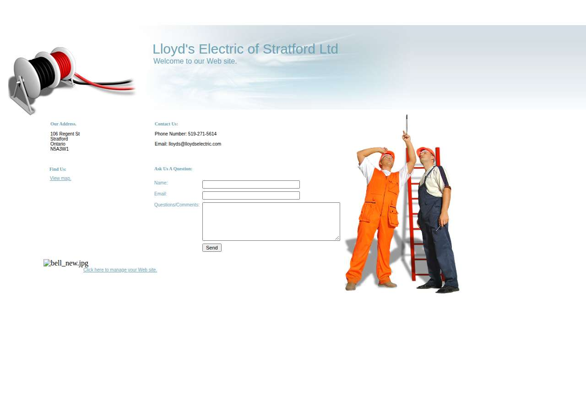

### iert.ca — dry\_run\_ok (dry run)

| | |
|---|---|
| Attempt ID | `2d05a83a-8f6a-4201-8e13-c48553e3111d` |
| Form URL | https://iert.ca/contact/ |
| Final URL | https://iert.ca/contact/ |
| Reserved | 2026-11-13 04:57:05 UTC |
| Submit attempted | — |
| Template | standard v2 |
| Confirmation text | none observed |
| Result / error | Selectors verified; fields not typed (domain not in dry-run fill list); not submitted |

Exact message:

~~~text
Subject: Helping customers find your business in AI search (AEO + GEO)

Hi there,

I'm Arun from Devs Arun. More and more customers now ask ChatGPT, Gemini, Perplexity or Google's AI Overviews questions like "who should I hire for this in my area?" before they call anyone. These tools answer from websites they can clearly understand, and they tend to recommend businesses whose pages answer real customer questions.

That is what AEO + GEO (Answer Engine and Generative Engine Optimization) is for. I improve your existing service pages so they clearly answer the questions your customers ask, add structured data that matches the page, and make the call, quote or enquiry step obvious. The benefit: your business gets a better chance of being mentioned or linked in AI answers, and visitors who arrive find it easy to contact you.

The AEO + GEO Starter is a one-time $199 (about ₹16,999, negotiable) for one website: a basic audit, 10 customer questions, improvements to two existing pages, relevant structured data and an action plan, with one revision round.

You can read the full details, send an enquiry or book online here:
https://devsarun.io/aeo-geo/

If this isn't relevant, just reply and I won't contact you again.

Best,
Arun
Devs Arun
itschool408@gmail.com · +91 7654534323
~~~

Submitted field values:

- \#ft\_5edfe054c0644: itschool408@gmail.com
- \#ft\_5edfe0a427906: +91 7654534323
- \#ft\_5edfe1117ffaf: Hi there, I'm Arun from Devs Arun. More and more customers now ask ChatGPT, Gemini, Perplexity or Google's AI Overviews 

**Inspected page** — `run-9d7a968f_attempt-2d05a83a_inspection_2026-11-13T04-57-07-524Z.jpg`

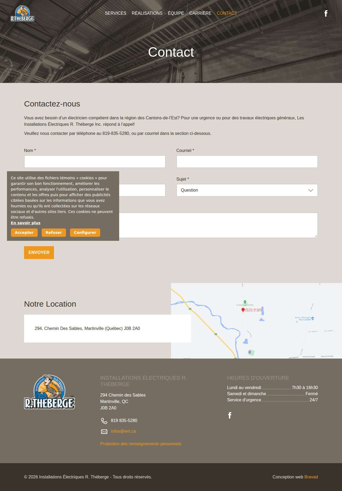

### dufaultelectrique.ca — dry\_run\_ok (dry run)

| | |
|---|---|
| Attempt ID | `33716332-3e4c-4436-ba61-d83f81c1e2d2` |
| Form URL | https://www.dufaultelectrique.ca/contactez-nous |
| Final URL | https://www.dufaultelectrique.ca/contactez-nous |
| Reserved | 2026-11-13 04:57:12 UTC |
| Submit attempted | — |
| Template | standard v2 |
| Confirmation text | none observed |
| Result / error | Selectors verified; fields not typed (domain not in dry-run fill list); not submitted |

Exact message:

~~~text
Subject: Helping customers find your business in AI search (AEO + GEO)

Hi there,

I'm Arun from Devs Arun. More and more customers now ask ChatGPT, Gemini, Perplexity or Google's AI Overviews questions like "who should I hire for this in my area?" before they call anyone. These tools answer from websites they can clearly understand, and they tend to recommend businesses whose pages answer real customer questions.

That is what AEO + GEO (Answer Engine and Generative Engine Optimization) is for. I improve your existing service pages so they clearly answer the questions your customers ask, add structured data that matches the page, and make the call, quote or enquiry step obvious. The benefit: your business gets a better chance of being mentioned or linked in AI answers, and visitors who arrive find it easy to contact you.

The AEO + GEO Starter is a one-time $199 (about ₹16,999, negotiable) for one website: a basic audit, 10 customer questions, improvements to two existing pages, relevant structured data and an action plan, with one revision round.

You can read the full details, send an enquiry or book online here:
https://devsarun.io/aeo-geo/

If this isn't relevant, just reply and I won't contact you again.

Best,
Arun
Devs Arun
itschool408@gmail.com · +91 7654534323
~~~

Submitted field values:

- \#\\31 414132064: Hi there, I'm Arun from Devs Arun. More and more customers now ask ChatGPT, Gemini, Perplexity or Google's AI Overviews 
- \#\\31 553499450: itschool408@gmail.com
- \#\\31 916042664: +91 7654534323

**Inspected page** — `run-9d7a968f_attempt-33716332_inspection_2026-11-13T04-57-14-260Z.jpg`

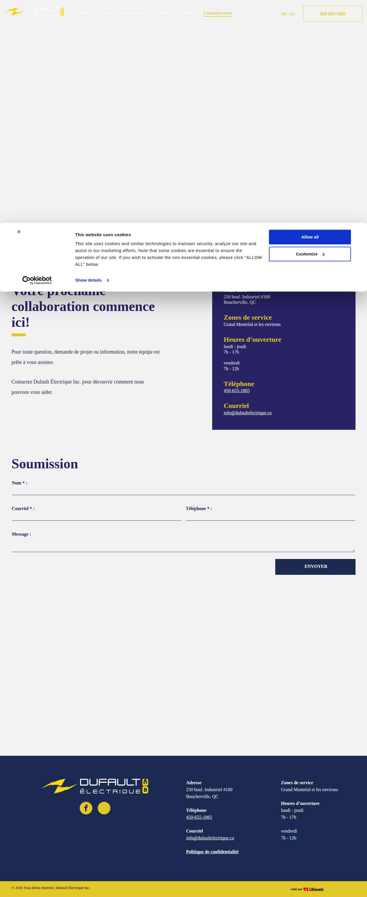

### sblawpartners.com.au — dry\_run\_failed (dry run)

| | |
|---|---|
| Attempt ID | `37cb303b-973a-48d0-976d-37a6d749d5cb` |
| Form URL | https://sblawpartners.com.au/contact-us/ |
| Final URL | https://sblawpartners.com.au/contact-us/ |
| Reserved | 2026-11-13 04:57:19 UTC |
| Submit attempted | — |
| Template | standard v2 |
| Confirmation text | none observed |
| Result / error | Mapped field "Name \*" not found uniquely |

Exact message:

~~~text
Subject: Helping customers find your business in AI search (AEO + GEO)

Hi there,

I'm Arun from Devs Arun. More and more customers now ask ChatGPT, Gemini, Perplexity or Google's AI Overviews questions like "who should I hire for this in my area?" before they call anyone. These tools answer from websites they can clearly understand, and they tend to recommend businesses whose pages answer real customer questions.

That is what AEO + GEO (Answer Engine and Generative Engine Optimization) is for. I improve your existing service pages so they clearly answer the questions your customers ask, add structured data that matches the page, and make the call, quote or enquiry step obvious. The benefit: your business gets a better chance of being mentioned or linked in AI answers, and visitors who arrive find it easy to contact you.

The AEO + GEO Starter is a one-time $199 (about ₹16,999, negotiable) for one website: a basic audit, 10 customer questions, improvements to two existing pages, relevant structured data and an action plan, with one revision round.

You can read the full details, send an enquiry or book online here:
https://devsarun.io/aeo-geo/

If this isn't relevant, just reply and I won't contact you again.

Best,
Arun
Devs Arun
itschool408@gmail.com · +91 7654534323
~~~

Submitted field values:

- \#forminator-field-name-1\_6af14060364ef: Arun
- \#forminator-field-email-1\_6af14060364ef: itschool408@gmail.com
- \#forminator-field-phone-1\_6af14060364ef: +91 7654534323
- \#forminator-field-textarea-1\_6af14060364ef: Hi there, I'm Arun from Devs Arun. More and more customers now ask ChatGPT, Gemini, Perplexity or Google's AI Overviews 

**Inspected page** — `run-9d7a968f_attempt-37cb303b_inspection_2026-11-13T04-57-24-719Z.jpg`

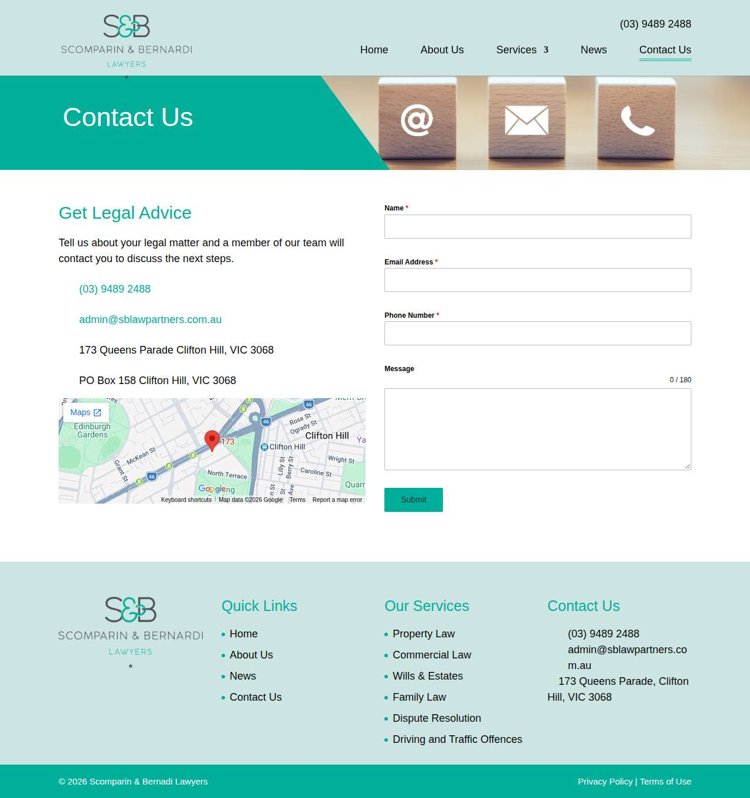

### mspc.cpa — dry\_run\_failed (dry run)

| | |
|---|---|
| Attempt ID | `f10af4c1-7786-479d-9225-792f601d753f` |
| Form URL | https://www.mspc.cpa/contact/ |
| Final URL | https://www.mspc.cpa/contact/ |
| Reserved | 2026-11-13 04:57:29 UTC |
| Submit attempted | — |
| Template | standard v2 |
| Confirmation text | none observed |
| Result / error | Mapped field "Full Name \*" not found uniquely |

Exact message:

~~~text
Subject: Helping customers find your business in AI search (AEO + GEO)

Hi there,

I'm Arun from Devs Arun. More and more customers now ask ChatGPT, Gemini, Perplexity or Google's AI Overviews questions like "who should I hire for this in my area?" before they call anyone. These tools answer from websites they can clearly understand, and they tend to recommend businesses whose pages answer real customer questions.

That is what AEO + GEO (Answer Engine and Generative Engine Optimization) is for. I improve your existing service pages so they clearly answer the questions your customers ask, add structured data that matches the page, and make the call, quote or enquiry step obvious. The benefit: your business gets a better chance of being mentioned or linked in AI answers, and visitors who arrive find it easy to contact you.

The AEO + GEO Starter is a one-time $199 (about ₹16,999, negotiable) for one website: a basic audit, 10 customer questions, improvements to two existing pages, relevant structured data and an action plan, with one revision round.

You can read the full details, send an enquiry or book online here:
https://devsarun.io/aeo-geo/

If this isn't relevant, just reply and I won't contact you again.

Best,
Arun
Devs Arun
itschool408@gmail.com · +91 7654534323
~~~

Submitted field values:

- \#forminator-field-name-1\_6aeaca2579f24: Arun
- \#forminator-field-text-1\_6aeaca2579f24: Devs Arun
- \#forminator-field-email-1\_6aeaca2579f24: itschool408@gmail.com
- \#forminator-field-phone-1\_6aeaca2579f24: +91 7654534323
- \#forminator-field-textarea-1\_6aeaca2579f24: Hi there, I'm Arun from Devs Arun. More and more customers now ask ChatGPT, Gemini, Perplexity or Google's AI Overviews 

**Inspected page** — `run-9d7a968f_attempt-f10af4c1_inspection_2026-11-13T04-57-32-198Z.jpg`

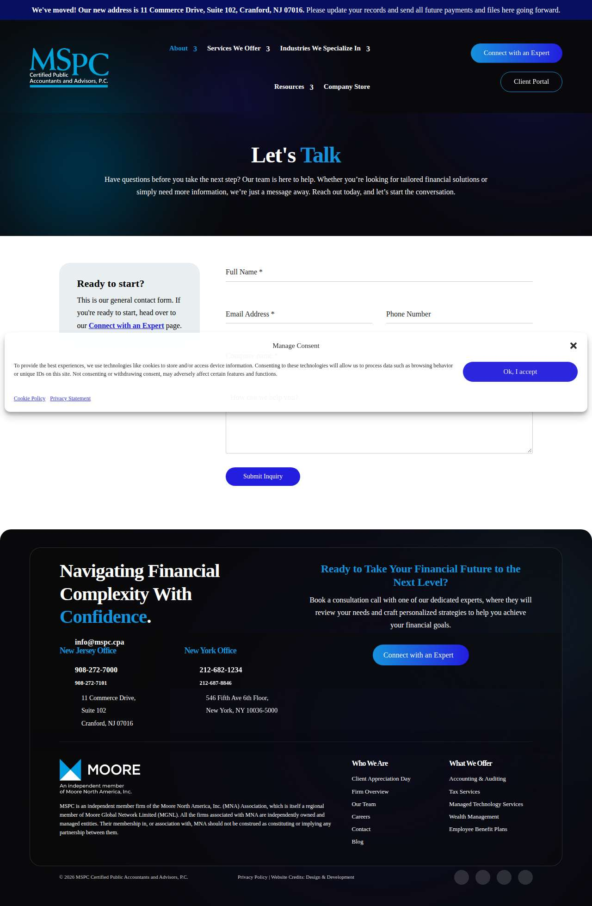

### juicerealestate.com.au — dry\_run\_failed (dry run)

| | |
|---|---|
| Attempt ID | `f1c6833a-45b6-40f1-b4f4-3e4e35dc3e64` |
| Form URL | https://juicerealestate.com.au/contact-us/ |
| Final URL | https://juicerealestate.com.au/contact-us/ |
| Reserved | 2026-11-13 04:57:37 UTC |
| Submit attempted | — |
| Template | standard v2 |
| Confirmation text | none observed |
| Result / error | CAPTCHA/anti-bot now present (recaptcha) |

Exact message:

~~~text
Subject: Helping customers find your business in AI search (AEO + GEO)

Hi there,

I'm Arun from Devs Arun. More and more customers now ask ChatGPT, Gemini, Perplexity or Google's AI Overviews questions like "who should I hire for this in my area?" before they call anyone. These tools answer from websites they can clearly understand, and they tend to recommend businesses whose pages answer real customer questions.

That is what AEO + GEO (Answer Engine and Generative Engine Optimization) is for. I improve your existing service pages so they clearly answer the questions your customers ask, add structured data that matches the page, and make the call, quote or enquiry step obvious. The benefit: your business gets a better chance of being mentioned or linked in AI answers, and visitors who arrive find it easy to contact you.

The AEO + GEO Starter is a one-time $199 (about ₹16,999, negotiable) for one website: a basic audit, 10 customer questions, improvements to two existing pages, relevant structured data and an action plan, with one revision round.

You can read the full details, send an enquiry or book online here:
https://devsarun.io/aeo-geo/

If this isn't relevant, just reply and I won't contact you again.

Best,
Arun
Devs Arun
itschool408@gmail.com · +91 7654534323
~~~

Submitted field values:

- \#ff\_1\_email: itschool408@gmail.com
- \#ff\_1\_phone: +91 7654534323
- \#ff\_1\_message: Hi there, I'm Arun from Devs Arun. More and more customers now ask ChatGPT, Gemini, Perplexity or Google's AI Overviews 
- \#ff\_1\_names\_first\_name\_: Arun

**Inspected page** — `run-9d7a968f_attempt-f1c6833a_inspection_2026-11-13T04-57-40-590Z.jpg`

### comworks.com.au — dry\_run\_ok (dry run)

| | |
|---|---|
| Attempt ID | `2b64f4e1-b11e-4197-9dc6-a3e9895b0205` |
| Form URL | https://comworks.com.au/web-design-development-agency-australia-comworks/get-in-touch/ |
| Final URL | https://comworks.com.au/web-design-development-agency-australia-comworks/get-in-touch/ |
| Reserved | 2026-11-13 04:57:45 UTC |
| Submit attempted | — |
| Template | standard v2 |
| Confirmation text | none observed |
| Result / error | Selectors verified; fields not typed (domain not in dry-run fill list); not submitted |

Exact message:

~~~text
Subject: Helping customers find your business in AI search (AEO + GEO)

Hi there,

I'm Arun from Devs Arun. More and more customers now ask ChatGPT, Gemini, Perplexity or Google's AI Overviews questions like "who should I hire for this in my area?" before they call anyone. These tools answer from websites they can clearly understand, and they tend to recommend businesses whose pages answer real customer questions.

That is what AEO + GEO (Answer Engine and Generative Engine Optimization) is for. I improve your existing service pages so they clearly answer the questions your customers ask, add structured data that matches the page, and make the call, quote or enquiry step obvious. The benefit: your business gets a better chance of being mentioned or linked in AI answers, and visitors who arrive find it easy to contact you.

The AEO + GEO Starter is a one-time $199 (about ₹16,999, negotiable) for one website: a basic audit, 10 customer questions, improvements to two existing pages, relevant structured data and an action plan, with one revision round.

You can read the full details, send an enquiry or book online here:
https://devsarun.io/aeo-geo/

If this isn't relevant, just reply and I won't contact you again.

Best,
Arun
Devs Arun
itschool408@gmail.com · +91 7654534323
~~~

Submitted field values:

- \#form-field-name: Arun
- \#form-field-email: itschool408@gmail.com
- \#form-field-phone: +91 7654534323
- \#form-field-message: Hi there, I'm Arun from Devs Arun. More and more customers now ask ChatGPT, Gemini, Perplexity or Google's AI Overviews 

**Inspected page** — `run-9d7a968f_attempt-2b64f4e1_inspection_2026-11-13T04-57-52-394Z.jpg`

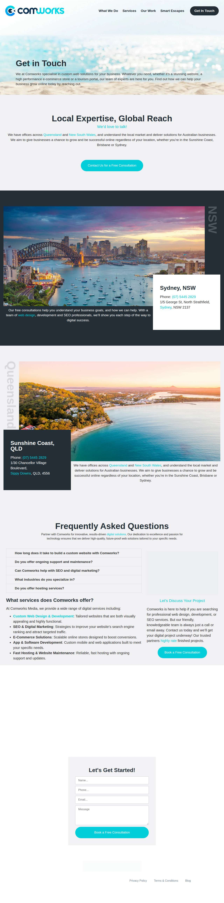

### involvedigital.com — dry\_run\_failed (dry run)

| | |
|---|---|
| Attempt ID | `fd702088-80b6-4acb-8d79-8092bb65bc5b` |
| Form URL | https://www.involvedigital.com/talk |
| Final URL | https://www.involvedigital.com/talk |
| Reserved | 2026-11-13 04:57:57 UTC |
| Submit attempted | — |
| Template | standard v2 |
| Confirmation text | none observed |
| Result / error | Form is multi-step |

Exact message:

~~~text
Subject: Helping customers find your business in AI search (AEO + GEO)

Hi there,

I'm Arun from Devs Arun. More and more customers now ask ChatGPT, Gemini, Perplexity or Google's AI Overviews questions like "who should I hire for this in my area?" before they call anyone. These tools answer from websites they can clearly understand, and they tend to recommend businesses whose pages answer real customer questions.

That is what AEO + GEO (Answer Engine and Generative Engine Optimization) is for. I improve your existing service pages so they clearly answer the questions your customers ask, add structured data that matches the page, and make the call, quote or enquiry step obvious. The benefit: your business gets a better chance of being mentioned or linked in AI answers, and visitors who arrive find it easy to contact you.

The AEO + GEO Starter is a one-time $199 (about ₹16,999, negotiable) for one website: a basic audit, 10 customer questions, improvements to two existing pages, relevant structured data and an action plan, with one revision round.

You can read the full details, send an enquiry or book online here:
https://devsarun.io/aeo-geo/

If this isn't relevant, just reply and I won't contact you again.

Best,
Arun
Devs Arun
itschool408@gmail.com · +91 7654534323
~~~

Submitted field values:

- \#capture-name: Arun
- \#capture-email: itschool408@gmail.com
- \#capture-phone: +91 7654534323
- \#capture-message: Hi there, I'm Arun from Devs Arun. More and more customers now ask ChatGPT, Gemini, Perplexity or Google's AI Overviews 
- \#capture-business: Devs Arun

**Inspected page** — `run-9d7a968f_attempt-fd702088_inspection_2026-11-13T04-57-59-223Z.jpg`

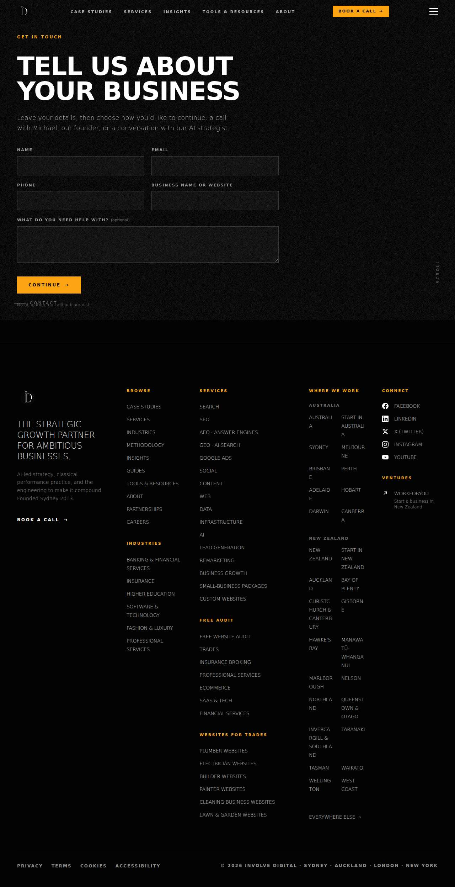

## Events (204)

| Time (UTC) | Event | Website | Details |
|---|---|---|---|
| 04:52:31 | run\_queued | — | dry\_run run requested by github:itsDevsArun |
| 04:52:31 | run\_dispatched | — | dispatch disabled (local test mode) |
| 04:52:36 | run\_started | — | Runner claimed dry\_run run |
| 04:52:36 | website\_selected | helixmechanical.com | Dry-run target helixmechanical.com |
| 04:52:36 | draft\_prepared | helixmechanical.com | Draft prepared with template standard v2 |
| 04:52:38 | page\_opened | helixmechanical.com | Opened form page |
| 04:52:38 | screenshot\_saved | helixmechanical.com | inspection screenshot saved (54 KB) |
| 04:52:38 | review\_required | helixmechanical.com | dry run failed: Mapped field "First Name \*" not found uniquely |
| 04:52:43 | website\_selected | environmentalplumbing.ca | Dry-run target environmentalplumbing.ca |
| 04:52:43 | draft\_prepared | environmentalplumbing.ca | Draft prepared with template standard v2 |
| 04:52:49 | page\_opened | environmentalplumbing.ca | Opened form page |
| 04:52:50 | screenshot\_saved | environmentalplumbing.ca | inspection screenshot saved (420 KB) |
| 04:52:50 | dry\_run\_checked | environmentalplumbing.ca | dry run ok: Selectors verified; fields not typed (domain not in dry-run fill list); not submitted |
| 04:52:55 | website\_selected | townhouseplumbing.ca | Dry-run target townhouseplumbing.ca |
| 04:52:55 | draft\_prepared | townhouseplumbing.ca | Draft prepared with template standard v2 |
| 04:52:56 | page\_opened | townhouseplumbing.ca | Opened form page |
| 04:52:56 | screenshot\_saved | townhouseplumbing.ca | inspection screenshot saved (74 KB) |
| 04:52:56 | dry\_run\_checked | townhouseplumbing.ca | dry run ok: Selectors verified; fields not typed (domain not in dry-run fill list); not submitted |
| 04:53:01 | website\_selected | homewiseplumbing.ca | Dry-run target homewiseplumbing.ca |
| 04:53:01 | draft\_prepared | homewiseplumbing.ca | Draft prepared with template standard v2 |
| 04:53:08 | page\_opened | homewiseplumbing.ca | Opened form page |
| 04:53:09 | screenshot\_saved | homewiseplumbing.ca | inspection screenshot saved (175 KB) |
| 04:53:09 | dry\_run\_checked | homewiseplumbing.ca | dry run ok: Selectors verified; fields not typed (domain not in dry-run fill list); not submitted |
| 04:53:14 | website\_selected | westsideinc.ca | Dry-run target westsideinc.ca |
| 04:53:14 | draft\_prepared | westsideinc.ca | Draft prepared with template standard v2 |
| 04:53:15 | page\_opened | westsideinc.ca | Opened form page |
| 04:53:15 | screenshot\_saved | westsideinc.ca | inspection screenshot saved (80 KB) |
| 04:53:15 | dry\_run\_checked | westsideinc.ca | dry run ok: Selectors verified; fields not typed (domain not in dry-run fill list); not submitted |
| 04:53:20 | website\_selected | m2mechanical.net | Dry-run target m2mechanical.net |
| 04:53:20 | draft\_prepared | m2mechanical.net | Draft prepared with template standard v2 |
| 04:53:22 | page\_opened | m2mechanical.net | Opened form page |
| 04:53:23 | screenshot\_saved | m2mechanical.net | inspection screenshot saved (582 KB) |
| 04:53:23 | dry\_run\_checked | m2mechanical.net | dry run ok: Selectors verified; fields not typed (domain not in dry-run fill list); not submitted |
| 04:53:28 | website\_selected | eurola.com.au | Dry-run target eurola.com.au |
| 04:53:28 | draft\_prepared | eurola.com.au | Draft prepared with template standard v2 |
| 04:53:33 | page\_opened | eurola.com.au | Opened form page |
| 04:53:33 | screenshot\_saved | eurola.com.au | inspection screenshot saved (318 KB) |
| 04:53:33 | review\_required | eurola.com.au | dry run failed: Mapped field "field2" not found uniquely |
| 04:53:38 | website\_selected | harderroofing.com | Dry-run target harderroofing.com |
| 04:53:38 | draft\_prepared | harderroofing.com | Draft prepared with template standard v2 |
| 04:53:41 | page\_opened | harderroofing.com | Opened form page |
| 04:53:41 | screenshot\_saved | harderroofing.com | inspection screenshot saved (449 KB) |
| 04:53:41 | dry\_run\_checked | harderroofing.com | dry run ok: Selectors verified; fields not typed (domain not in dry-run fill list); not submitted |
| 04:53:46 | website\_selected | eliteroofinghalifax.com | Dry-run target eliteroofinghalifax.com |
| 04:53:46 | draft\_prepared | eliteroofinghalifax.com | Draft prepared with template standard v2 |
| 04:53:48 | page\_opened | eliteroofinghalifax.com | Opened form page |
| 04:53:48 | screenshot\_saved | eliteroofinghalifax.com | inspection screenshot saved (137 KB) |
| 04:53:48 | dry\_run\_checked | eliteroofinghalifax.com | dry run ok: Selectors verified; fields not typed (domain not in dry-run fill list); not submitted |
| 04:53:53 | website\_selected | customroofinginc.net | Dry-run target customroofinginc.net |
| 04:53:53 | draft\_prepared | customroofinginc.net | Draft prepared with template standard v2 |
| 04:53:55 | page\_opened | customroofinginc.net | Opened form page |
| 04:53:55 | screenshot\_saved | customroofinginc.net | inspection screenshot saved (116 KB) |
| 04:53:55 | dry\_run\_checked | customroofinginc.net | dry run ok: Selectors verified; fields not typed (domain not in dry-run fill list); not submitted |
| 04:54:00 | website\_selected | professionalrooferstoronto.ca | Dry-run target professionalrooferstoronto.ca |
| 04:54:00 | draft\_prepared | professionalrooferstoronto.ca | Draft prepared with template standard v2 |
| 04:54:04 | page\_opened | professionalrooferstoronto.ca | Opened form page |
| 04:54:05 | screenshot\_saved | professionalrooferstoronto.ca | inspection screenshot saved (283 KB) |
| 04:54:05 | dry\_run\_checked | professionalrooferstoronto.ca | dry run ok: Selectors verified; fields not typed (domain not in dry-run fill list); not submitted |
| 04:54:10 | website\_selected | principalroofing.ca | Dry-run target principalroofing.ca |
| 04:54:10 | draft\_prepared | principalroofing.ca | Draft prepared with template standard v2 |
| 04:54:11 | page\_opened | principalroofing.ca | Opened form page |
| 04:54:11 | screenshot\_saved | principalroofing.ca | inspection screenshot saved (115 KB) |
| 04:54:11 | dry\_run\_checked | principalroofing.ca | dry run ok: Selectors verified; fields not typed (domain not in dry-run fill list); not submitted |
| 04:54:17 | website\_selected | coverallroofing.ca | Dry-run target coverallroofing.ca |
| 04:54:17 | draft\_prepared | coverallroofing.ca | Draft prepared with template standard v2 |
| 04:54:19 | page\_opened | coverallroofing.ca | Opened form page |
| 04:54:19 | screenshot\_saved | coverallroofing.ca | inspection screenshot saved (159 KB) |
| 04:54:19 | dry\_run\_checked | coverallroofing.ca | dry run ok: Selectors verified; fields not typed (domain not in dry-run fill list); not submitted |
| 04:54:24 | website\_selected | srsroofing.ca | Dry-run target srsroofing.ca |
| 04:54:24 | draft\_prepared | srsroofing.ca | Draft prepared with template standard v2 |
| 04:54:26 | page\_opened | srsroofing.ca | Opened form page |
| 04:54:26 | screenshot\_saved | srsroofing.ca | inspection screenshot saved (325 KB) |
| 04:54:26 | dry\_run\_checked | srsroofing.ca | dry run ok: Selectors verified; fields not typed (domain not in dry-run fill list); not submitted |
| 04:54:32 | website\_selected | technoref4.com | Dry-run target technoref4.com |
| 04:54:32 | draft\_prepared | technoref4.com | Draft prepared with template standard v2 |
| 04:54:34 | page\_opened | technoref4.com | Opened form page |
| 04:54:34 | screenshot\_saved | technoref4.com | inspection screenshot saved (86 KB) |
| 04:54:34 | dry\_run\_checked | technoref4.com | dry run ok: Selectors verified; fields not typed (domain not in dry-run fill list); not submitted |
| 04:54:39 | website\_selected | whiskyjackhvac.com | Dry-run target whiskyjackhvac.com |
| 04:54:39 | draft\_prepared | whiskyjackhvac.com | Draft prepared with template standard v2 |
| 04:54:42 | page\_opened | whiskyjackhvac.com | Opened form page |
| 04:54:43 | screenshot\_saved | whiskyjackhvac.com | inspection screenshot saved (328 KB) |
| 04:54:43 | dry\_run\_checked | whiskyjackhvac.com | dry run ok: Selectors verified; fields not typed (domain not in dry-run fill list); not submitted |
| 04:54:48 | website\_selected | thermocodistribution.ca | Dry-run target thermocodistribution.ca |
| 04:54:48 | draft\_prepared | thermocodistribution.ca | Draft prepared with template standard v2 |
| 04:54:52 | page\_opened | thermocodistribution.ca | Opened form page |
| 04:54:53 | screenshot\_saved | thermocodistribution.ca | inspection screenshot saved (71 KB) |
| 04:54:53 | dry\_run\_checked | thermocodistribution.ca | dry run ok: Selectors verified; fields not typed (domain not in dry-run fill list); not submitted |
| 04:54:58 | website\_selected | hvac-group.com | Dry-run target hvac-group.com |
| 04:54:58 | draft\_prepared | hvac-group.com | Draft prepared with template standard v2 |
| 04:55:04 | page\_opened | hvac-group.com | Opened form page |
| 04:55:04 | screenshot\_saved | hvac-group.com | inspection screenshot saved (151 KB) |
| 04:55:04 | dry\_run\_checked | hvac-group.com | dry run ok: Selectors verified; fields not typed (domain not in dry-run fill list); not submitted |
| 04:55:09 | website\_selected | southislandmechanical.ca | Dry-run target southislandmechanical.ca |
| 04:55:09 | draft\_prepared | southislandmechanical.ca | Draft prepared with template standard v2 |
| 04:55:11 | page\_opened | southislandmechanical.ca | Opened form page |
| 04:55:11 | screenshot\_saved | southislandmechanical.ca | inspection screenshot saved (93 KB) |
| 04:55:11 | dry\_run\_checked | southislandmechanical.ca | dry run ok: Selectors verified; fields not typed (domain not in dry-run fill list); not submitted |
| 04:55:16 | website\_selected | kansasridgemechanical.com | Dry-run target kansasridgemechanical.com |
| 04:55:16 | draft\_prepared | kansasridgemechanical.com | Draft prepared with template standard v2 |
| 04:55:18 | page\_opened | kansasridgemechanical.com | Opened form page |
| 04:55:18 | screenshot\_saved | kansasridgemechanical.com | inspection screenshot saved (86 KB) |
| 04:55:18 | dry\_run\_checked | kansasridgemechanical.com | dry run ok: Selectors verified; fields not typed (domain not in dry-run fill list); not submitted |
| 04:55:23 | website\_selected | designairltd.ca | Dry-run target designairltd.ca |
| 04:55:23 | draft\_prepared | designairltd.ca | Draft prepared with template standard v2 |
| 04:55:25 | page\_opened | designairltd.ca | Opened form page |
| 04:55:25 | screenshot\_saved | designairltd.ca | inspection screenshot saved (140 KB) |
| 04:55:25 | dry\_run\_checked | designairltd.ca | dry run ok: Selectors verified; fields not typed (domain not in dry-run fill list); not submitted |
| 04:55:30 | website\_selected | myncs.ca | Dry-run target myncs.ca |
| 04:55:30 | draft\_prepared | myncs.ca | Draft prepared with template standard v2 |
| 04:55:33 | page\_opened | myncs.ca | Opened form page |
| 04:55:34 | screenshot\_saved | myncs.ca | inspection screenshot saved (217 KB) |
| 04:55:34 | dry\_run\_checked | myncs.ca | dry run ok: Selectors verified; fields not typed (domain not in dry-run fill list); not submitted |
| 04:55:39 | website\_selected | coastalenergy.ca | Dry-run target coastalenergy.ca |
| 04:55:39 | draft\_prepared | coastalenergy.ca | Draft prepared with template standard v2 |
| 04:55:42 | page\_opened | coastalenergy.ca | Opened form page |
| 04:55:42 | screenshot\_saved | coastalenergy.ca | inspection screenshot saved (234 KB) |
| 04:55:42 | dry\_run\_checked | coastalenergy.ca | dry run ok: Selectors verified; fields not typed (domain not in dry-run fill list); not submitted |
| 04:55:47 | website\_selected | callthegoat.ca | Dry-run target callthegoat.ca |
| 04:55:47 | draft\_prepared | callthegoat.ca | Draft prepared with template standard v2 |
| 04:55:49 | page\_opened | callthegoat.ca | Opened form page |
| 04:55:49 | screenshot\_saved | callthegoat.ca | inspection screenshot saved (264 KB) |
| 04:55:49 | dry\_run\_checked | callthegoat.ca | dry run ok: Selectors verified; fields not typed (domain not in dry-run fill list); not submitted |
| 04:55:55 | website\_selected | knoxvilleelectrician.com | Dry-run target knoxvilleelectrician.com |
| 04:55:55 | draft\_prepared | knoxvilleelectrician.com | Draft prepared with template standard v2 |
| 04:55:58 | page\_opened | knoxvilleelectrician.com | Opened form page |
| 04:55:58 | screenshot\_saved | knoxvilleelectrician.com | inspection screenshot saved (137 KB) |
| 04:55:58 | review\_required | knoxvilleelectrician.com | dry run failed: Mapped field "Name" not found uniquely |
| 04:56:03 | website\_selected | commongroundpower.com | Dry-run target commongroundpower.com |
| 04:56:03 | draft\_prepared | commongroundpower.com | Draft prepared with template short v2 |
| 04:56:04 | page\_opened | commongroundpower.com | Opened form page |
| 04:56:04 | screenshot\_saved | commongroundpower.com | inspection screenshot saved (109 KB) |
| 04:56:04 | dry\_run\_checked | commongroundpower.com | dry run ok: Selectors verified; fields not typed (domain not in dry-run fill list); not submitted |
| 04:56:09 | website\_selected | cascadiaelectric.ca | Dry-run target cascadiaelectric.ca |
| 04:56:09 | draft\_prepared | cascadiaelectric.ca | Draft prepared with template standard v2 |
| 04:56:11 | page\_opened | cascadiaelectric.ca | Opened form page |
| 04:56:11 | screenshot\_saved | cascadiaelectric.ca | inspection screenshot saved (111 KB) |
| 04:56:11 | dry\_run\_checked | cascadiaelectric.ca | dry run ok: Selectors verified; fields not typed (domain not in dry-run fill list); not submitted |
| 04:56:16 | website\_selected | electric1.ca | Dry-run target electric1.ca |
| 04:56:16 | draft\_prepared | electric1.ca | Draft prepared with template standard v2 |
| 04:56:19 | page\_opened | electric1.ca | Opened form page |
| 04:56:19 | screenshot\_saved | electric1.ca | inspection screenshot saved (496 KB) |
| 04:56:19 | dry\_run\_checked | electric1.ca | dry run ok: Selectors verified; fields not typed (domain not in dry-run fill list); not submitted |
| 04:56:24 | website\_selected | bzzzt.ca | Dry-run target bzzzt.ca |
| 04:56:24 | draft\_prepared | bzzzt.ca | Draft prepared with template standard v2 |
| 04:56:29 | page\_opened | bzzzt.ca | Opened form page |
| 04:56:29 | screenshot\_saved | bzzzt.ca | inspection screenshot saved (131 KB) |
| 04:56:29 | dry\_run\_checked | bzzzt.ca | dry run ok: Selectors verified; fields not typed (domain not in dry-run fill list); not submitted |
| 04:56:34 | website\_selected | harbourviewelectric.com | Dry-run target harbourviewelectric.com |
| 04:56:34 | draft\_prepared | harbourviewelectric.com | Draft prepared with template standard v2 |
| 04:56:39 | page\_opened | harbourviewelectric.com | Opened form page |
| 04:56:39 | screenshot\_saved | harbourviewelectric.com | inspection screenshot saved (102 KB) |
| 04:56:39 | dry\_run\_checked | harbourviewelectric.com | dry run ok: Selectors verified; fields not typed (domain not in dry-run fill list); not submitted |
| 04:56:44 | website\_selected | rmelectric.com | Dry-run target rmelectric.com |
| 04:56:44 | draft\_prepared | rmelectric.com | Draft prepared with template standard v2 |
| 04:56:47 | page\_opened | rmelectric.com | Opened form page |
| 04:56:47 | screenshot\_saved | rmelectric.com | inspection screenshot saved (252 KB) |
| 04:56:47 | dry\_run\_checked | rmelectric.com | dry run ok: Selectors verified; fields not typed (domain not in dry-run fill list); not submitted |
| 04:56:52 | website\_selected | rmselectricltd.com | Dry-run target rmselectricltd.com |
| 04:56:52 | draft\_prepared | rmselectricltd.com | Draft prepared with template standard v2 |
| 04:56:54 | page\_opened | rmselectricltd.com | Opened form page |
| 04:56:54 | screenshot\_saved | rmselectricltd.com | inspection screenshot saved (62 KB) |
| 04:56:54 | dry\_run\_checked | rmselectricltd.com | dry run ok: Selectors verified; fields not typed (domain not in dry-run fill list); not submitted |
| 04:56:59 | website\_selected | lloydselectric.com | Dry-run target lloydselectric.com |
| 04:56:59 | draft\_prepared | lloydselectric.com | Draft prepared with template standard v2 |
| 04:57:00 | page\_opened | lloydselectric.com | Opened form page |
| 04:57:00 | screenshot\_saved | lloydselectric.com | inspection screenshot saved (39 KB) |
| 04:57:00 | dry\_run\_checked | lloydselectric.com | dry run ok: Selectors verified; fields not typed (domain not in dry-run fill list); not submitted |
| 04:57:05 | website\_selected | iert.ca | Dry-run target iert.ca |
| 04:57:05 | draft\_prepared | iert.ca | Draft prepared with template standard v2 |
| 04:57:07 | page\_opened | iert.ca | Opened form page |
| 04:57:07 | screenshot\_saved | iert.ca | inspection screenshot saved (123 KB) |
| 04:57:07 | dry\_run\_checked | iert.ca | dry run ok: Selectors verified; fields not typed (domain not in dry-run fill list); not submitted |
| 04:57:12 | website\_selected | dufaultelectrique.ca | Dry-run target dufaultelectrique.ca |
| 04:57:12 | draft\_prepared | dufaultelectrique.ca | Draft prepared with template standard v2 |
| 04:57:14 | page\_opened | dufaultelectrique.ca | Opened form page |
| 04:57:14 | screenshot\_saved | dufaultelectrique.ca | inspection screenshot saved (119 KB) |
| 04:57:14 | dry\_run\_checked | dufaultelectrique.ca | dry run ok: Selectors verified; fields not typed (domain not in dry-run fill list); not submitted |
| 04:57:19 | website\_selected | sblawpartners.com.au | Dry-run target sblawpartners.com.au |
| 04:57:19 | draft\_prepared | sblawpartners.com.au | Draft prepared with template standard v2 |
| 04:57:24 | page\_opened | sblawpartners.com.au | Opened form page |
| 04:57:24 | screenshot\_saved | sblawpartners.com.au | inspection screenshot saved (95 KB) |
| 04:57:24 | review\_required | sblawpartners.com.au | dry run failed: Mapped field "Name \*" not found uniquely |
| 04:57:29 | website\_selected | mspc.cpa | Dry-run target mspc.cpa |
| 04:57:29 | draft\_prepared | mspc.cpa | Draft prepared with template standard v2 |
| 04:57:32 | page\_opened | mspc.cpa | Opened form page |
| 04:57:32 | screenshot\_saved | mspc.cpa | inspection screenshot saved (140 KB) |
| 04:57:32 | review\_required | mspc.cpa | dry run failed: Mapped field "Full Name \*" not found uniquely |
| 04:57:37 | website\_selected | juicerealestate.com.au | Dry-run target juicerealestate.com.au |
| 04:57:37 | draft\_prepared | juicerealestate.com.au | Draft prepared with template standard v2 |
| 04:57:40 | page\_opened | juicerealestate.com.au | Opened form page |
| 04:57:40 | screenshot\_saved | juicerealestate.com.au | inspection screenshot saved (59 KB) |
| 04:57:40 | review\_required | juicerealestate.com.au | dry run failed: CAPTCHA/anti-bot now present (recaptcha) |
| 04:57:45 | website\_selected | comworks.com.au | Dry-run target comworks.com.au |
| 04:57:45 | draft\_prepared | comworks.com.au | Draft prepared with template standard v2 |
| 04:57:52 | page\_opened | comworks.com.au | Opened form page |
| 04:57:52 | screenshot\_saved | comworks.com.au | inspection screenshot saved (413 KB) |
| 04:57:52 | dry\_run\_checked | comworks.com.au | dry run ok: Selectors verified; fields not typed (domain not in dry-run fill list); not submitted |
| 04:57:57 | website\_selected | involvedigital.com | Dry-run target involvedigital.com |
| 04:57:57 | draft\_prepared | involvedigital.com | Draft prepared with template standard v2 |
| 04:57:59 | page\_opened | involvedigital.com | Opened form page |
| 04:57:59 | screenshot\_saved | involvedigital.com | inspection screenshot saved (204 KB) |
| 04:57:59 | review\_required | involvedigital.com | dry run failed: Form is multi-step |
| 04:58:04 | run\_completed | — | Run completed (queue\_exhausted) |
