# Run b7421700 — dry\_run — completed

| | |
|---|---|
| Run ID | `b7421700-afee-4e99-a658-a9142b7d941a` |
| Requested by | github:itsDevsArun |
| Started | 2026-11-13 06:01:39 UTC |
| Finished | 2026-11-13 06:05:03 UTC |
| Finish reason | queue\_exhausted |
| GitHub Actions | https://github.com/itsDevsArun/aeo-geo/actions/runs/43360910641 |

CSV for this run: [runs/2026-11-13_dry_run_b7421700.csv](2026-11-13_dry_run_b7421700.csv)

## Attempts (25)

### helixmechanical.com — dry\_run\_failed (dry run)

| | |
|---|---|
| Attempt ID | `459072e1-c096-42bd-907a-82197e0fac52` |
| Form URL | https://helixmechanical.com/contact/ |
| Final URL | https://helixmechanical.com/contact/ |
| Reserved | 2026-11-13 06:01:39 UTC |
| Submit attempted | — |
| Template | standard v2 |
| Confirmation text | none observed |
| Result / error | Mapped field "First Name \*" not found uniquely |

Exact message:

~~~text
Subject: Helping customers find your business in AI search (AEO + GEO)

Hi there,

I'm Arun from Devs Arun. More and more customers now ask ChatGPT, Gemini, Perplexity or Google's AI Overviews questions like "who should I hire for this in my area?" before they call anyone. These tools answer from websites they can clearly understand, and they tend to recommend businesses whose pages answer real customer questions.

That is what AEO + GEO (Answer Engine and Generative Engine Optimization) is for. I improve your existing service pages so they clearly answer the questions your customers ask, add structured data that matches the page, and make the call, quote or enquiry step obvious. The benefit: your business gets a better chance of being mentioned or linked in AI answers, and visitors who arrive find it easy to contact you.

The AEO + GEO Starter is a one-time $199 (about ₹16,999, negotiable) for one website: a basic audit, 10 customer questions, improvements to two existing pages, relevant structured data and an action plan, with one revision round.

You can read the full details, send an enquiry or book online here:
https://devsarun.io/aeo-geo/

If this isn't relevant, just reply and I won't contact you again.

Best,
Arun
Devs Arun
itschool408@gmail.com · +91 7654534323
~~~

Submitted field values:

- \#forminator-field-name-1\_6ae7ff023fd3c: Arun
- \#forminator-field-email-1\_6ae7ff023fd3c: itschool408@gmail.com
- \#forminator-field-phone-1\_6ae7ff023fd3c: +91 7654534323
- \#forminator-field-textarea-1\_6ae7ff023fd3c: Hi there, I'm Arun from Devs Arun. More and more customers now ask ChatGPT, Gemini, Perplexity or Google's AI Overviews 

**Inspected page** — `run-b7421700_attempt-459072e1_inspection_2026-11-13T06-01-41-339Z.jpg`

### eurola.com.au — dry\_run\_failed (dry run)

| | |
|---|---|
| Attempt ID | `0b357b24-3573-4f8a-ad87-9f4dfb231784` |
| Form URL | https://www.eurola.com.au/contact/ |
| Final URL | https://www.eurola.com.au/contact/ |
| Reserved | 2026-11-13 06:01:46 UTC |
| Submit attempted | — |
| Template | standard v2 |
| Confirmation text | none observed |
| Result / error | Mapped field "field2" not found uniquely |

Exact message:

~~~text
Subject: Helping customers find your business in AI search (AEO + GEO)

Hi there,

I'm Arun from Devs Arun. More and more customers now ask ChatGPT, Gemini, Perplexity or Google's AI Overviews questions like "who should I hire for this in my area?" before they call anyone. These tools answer from websites they can clearly understand, and they tend to recommend businesses whose pages answer real customer questions.

That is what AEO + GEO (Answer Engine and Generative Engine Optimization) is for. I improve your existing service pages so they clearly answer the questions your customers ask, add structured data that matches the page, and make the call, quote or enquiry step obvious. The benefit: your business gets a better chance of being mentioned or linked in AI answers, and visitors who arrive find it easy to contact you.

The AEO + GEO Starter is a one-time $199 (about ₹16,999, negotiable) for one website: a basic audit, 10 customer questions, improvements to two existing pages, relevant structured data and an action plan, with one revision round.

You can read the full details, send an enquiry or book online here:
https://devsarun.io/aeo-geo/

If this isn't relevant, just reply and I won't contact you again.

Best,
Arun
Devs Arun
itschool408@gmail.com · +91 7654534323
~~~

Submitted field values:

- input\[name="field7\[\]"\]: Arun
- div \> div \> div:nth-of-type(2) \> form \> div \> div \> div:nth-of-type(2) \> div \> div \> div \> div \> input: itschool408@gmail.com
- div \> div \> div:nth-of-type(2) \> form \> div \> div \> div:nth-of-type(3) \> div \> div \> div \> div \> input: +91 7654534323
- div \> div \> div:nth-of-type(2) \> form \> div \> div \> div:nth-of-type(5) \> div \> div \> div \> div \> textarea: Hi there, I'm Arun from Devs Arun. More and more customers now ask ChatGPT, Gemini, Perplexity or Google's AI Overviews 

**Inspected page** — `run-b7421700_attempt-0b357b24_inspection_2026-11-13T06-01-52-348Z.jpg`

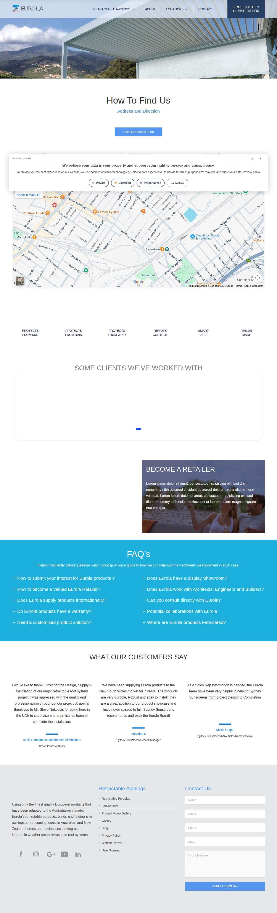

### knoxvilleelectrician.com — dry\_run\_failed (dry run)

| | |
|---|---|
| Attempt ID | `2a955391-b8f0-4cc4-8aa3-cce3f6511172` |
| Form URL | https://knoxvilleelectrician.com/contact-us/ |
| Final URL | https://knoxvilleelectrician.com/contact-us/ |
| Reserved | 2026-11-13 06:01:57 UTC |
| Submit attempted | — |
| Template | standard v2 |
| Confirmation text | none observed |
| Result / error | Mapped field "Name" not found uniquely |

Exact message:

~~~text
Subject: Helping customers find your business in AI search (AEO + GEO)

Hi there,

I'm Arun from Devs Arun. More and more customers now ask ChatGPT, Gemini, Perplexity or Google's AI Overviews questions like "who should I hire for this in my area?" before they call anyone. These tools answer from websites they can clearly understand, and they tend to recommend businesses whose pages answer real customer questions.

That is what AEO + GEO (Answer Engine and Generative Engine Optimization) is for. I improve your existing service pages so they clearly answer the questions your customers ask, add structured data that matches the page, and make the call, quote or enquiry step obvious. The benefit: your business gets a better chance of being mentioned or linked in AI answers, and visitors who arrive find it easy to contact you.

The AEO + GEO Starter is a one-time $199 (about ₹16,999, negotiable) for one website: a basic audit, 10 customer questions, improvements to two existing pages, relevant structured data and an action plan, with one revision round.

You can read the full details, send an enquiry or book online here:
https://devsarun.io/aeo-geo/

If this isn't relevant, just reply and I won't contact you again.

Best,
Arun
Devs Arun
itschool408@gmail.com · +91 7654534323
~~~

Submitted field values:

- \#form-field-1b7221: itschool408@gmail.com
- \#form-field-2fa3ac: +91 7654534323
- \#form-field-96f51f: Arun
- \#form-field-fed9d8: Hi there, I'm Arun from Devs Arun. More and more customers now ask ChatGPT, Gemini, Perplexity or Google's AI Overviews 

**Inspected page** — `run-b7421700_attempt-2a955391_inspection_2026-11-13T06-02-01-156Z.jpg`

### tricityfinishing.com — dry\_run\_failed (dry run)

| | |
|---|---|
| Attempt ID | `b7057be9-fa58-4b1b-87e1-ac332d400d5d` |
| Form URL | https://www.tricityfinishing.com/contact-us.html |
| Final URL | https://www.tricityfinishing.com/contact-us.html |
| Reserved | 2026-11-13 06:02:06 UTC |
| Submit attempted | — |
| Template | standard v2 |
| Confirmation text | none observed |
| Result / error | Reviewed form not found on page (site changed) |

Exact message:

~~~text
Subject: Helping customers find your business in AI search (AEO + GEO)

Hi there,

I'm Arun from Devs Arun. More and more customers now ask ChatGPT, Gemini, Perplexity or Google's AI Overviews questions like "who should I hire for this in my area?" before they call anyone. These tools answer from websites they can clearly understand, and they tend to recommend businesses whose pages answer real customer questions.

That is what AEO + GEO (Answer Engine and Generative Engine Optimization) is for. I improve your existing service pages so they clearly answer the questions your customers ask, add structured data that matches the page, and make the call, quote or enquiry step obvious. The benefit: your business gets a better chance of being mentioned or linked in AI answers, and visitors who arrive find it easy to contact you.

The AEO + GEO Starter is a one-time $199 (about ₹16,999, negotiable) for one website: a basic audit, 10 customer questions, improvements to two existing pages, relevant structured data and an action plan, with one revision round.

You can read the full details, send an enquiry or book online here:
https://devsarun.io/aeo-geo/

If this isn't relevant, just reply and I won't contact you again.

Best,
Arun
Devs Arun
itschool408@gmail.com · +91 7654534323
~~~

Submitted field values:

- \#name-1794547025425: Arun
- \#email-1794547025425: itschool408@gmail.com
- \#phone-1794547025426: +91 7654534323
- \#comments-1794547025426: Hi there, I'm Arun from Devs Arun. More and more customers now ask ChatGPT, Gemini, Perplexity or Google's AI Overviews 

**Inspected page** — `run-b7421700_attempt-b7057be9_inspection_2026-11-13T06-02-07-644Z.jpg`

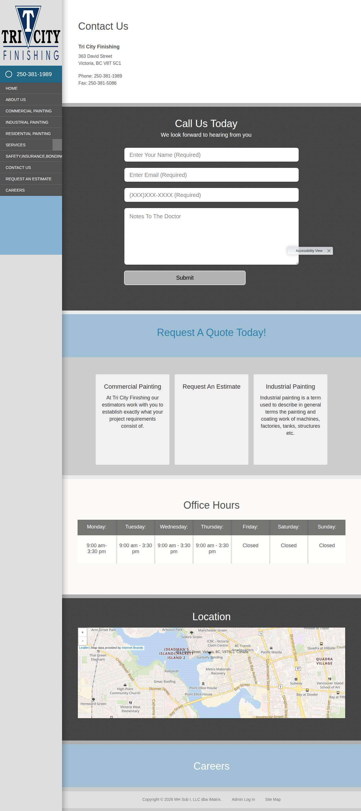

### starproperties.ca — dry\_run\_ok (dry run)

| | |
|---|---|
| Attempt ID | `75f33294-ce68-45cf-8df9-bf3b4e3c00da` |
| Form URL | https://www.starproperties.ca/contact |
| Final URL | https://www.starproperties.ca/contact |
| Reserved | 2026-11-13 06:02:12 UTC |
| Submit attempted | — |
| Template | standard v2 |
| Confirmation text | none observed |
| Result / error | Selectors verified; fields not typed (domain not in dry-run fill list); not submitted |

Exact message:

~~~text
Subject: Helping customers find your business in AI search (AEO + GEO)

Hi there,

I'm Arun from Devs Arun. More and more customers now ask ChatGPT, Gemini, Perplexity or Google's AI Overviews questions like "who should I hire for this in my area?" before they call anyone. These tools answer from websites they can clearly understand, and they tend to recommend businesses whose pages answer real customer questions.

That is what AEO + GEO (Answer Engine and Generative Engine Optimization) is for. I improve your existing service pages so they clearly answer the questions your customers ask, add structured data that matches the page, and make the call, quote or enquiry step obvious. The benefit: your business gets a better chance of being mentioned or linked in AI answers, and visitors who arrive find it easy to contact you.

The AEO + GEO Starter is a one-time $199 (about ₹16,999, negotiable) for one website: a basic audit, 10 customer questions, improvements to two existing pages, relevant structured data and an action plan, with one revision round.

You can read the full details, send an enquiry or book online here:
https://devsarun.io/aeo-geo/

If this isn't relevant, just reply and I won't contact you again.

Best,
Arun
Devs Arun
itschool408@gmail.com · +91 7654534323
~~~

Submitted field values:

- \#input\_comp-kfxn8ul8: Arun
- \#input\_comp-kfxn8ulj: itschool408@gmail.com
- \#input\_comp-kfxn8ulx: +91 7654534323
- \#input\_comp-kfxn8um6: Helping customers find your business in AI search (AEO + GEO)
- \#textarea\_comp-kfxn8umg: Hi there, I'm Arun from Devs Arun. More and more customers now ask ChatGPT, Gemini, Perplexity or Google's AI Overviews 

**Inspected page** — `run-b7421700_attempt-75f33294_inspection_2026-11-13T06-02-16-415Z.jpg`

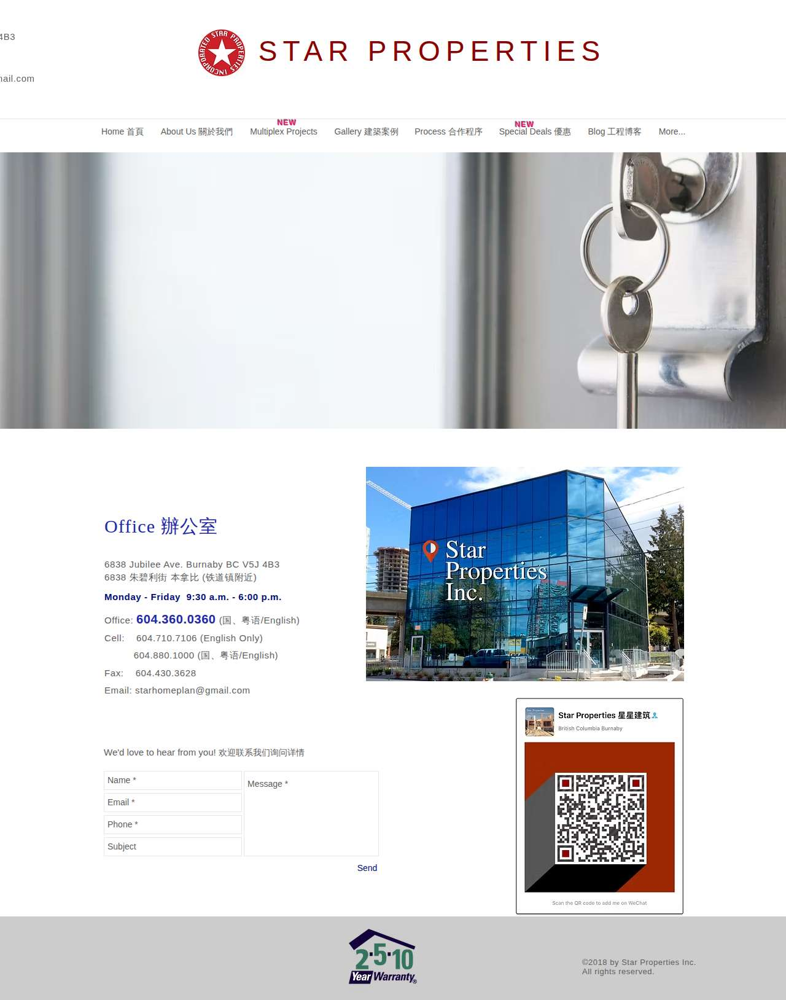

### constructionbelanger.com — dry\_run\_ok (dry run)

| | |
|---|---|
| Attempt ID | `cddcb72e-b765-4c25-9a20-c28ecf99d6a6` |
| Form URL | https://www.constructionbelanger.com/contact/ |
| Final URL | https://www.constructionbelanger.com/contact/ |
| Reserved | 2026-11-13 06:02:21 UTC |
| Submit attempted | — |
| Template | standard v2 |
| Confirmation text | none observed |
| Result / error | Selectors verified; fields not typed (domain not in dry-run fill list); not submitted |

Exact message:

~~~text
Subject: Helping customers find your business in AI search (AEO + GEO)

Hi there,

I'm Arun from Devs Arun. More and more customers now ask ChatGPT, Gemini, Perplexity or Google's AI Overviews questions like "who should I hire for this in my area?" before they call anyone. These tools answer from websites they can clearly understand, and they tend to recommend businesses whose pages answer real customer questions.

That is what AEO + GEO (Answer Engine and Generative Engine Optimization) is for. I improve your existing service pages so they clearly answer the questions your customers ask, add structured data that matches the page, and make the call, quote or enquiry step obvious. The benefit: your business gets a better chance of being mentioned or linked in AI answers, and visitors who arrive find it easy to contact you.

The AEO + GEO Starter is a one-time $199 (about ₹16,999, negotiable) for one website: a basic audit, 10 customer questions, improvements to two existing pages, relevant structured data and an action plan, with one revision round.

You can read the full details, send an enquiry or book online here:
https://devsarun.io/aeo-geo/

If this isn't relevant, just reply and I won't contact you again.

Best,
Arun
Devs Arun
itschool408@gmail.com · +91 7654534323
~~~

Submitted field values:

- \#courriel: itschool408@gmail.com
- \#telephone: +91 7654534323
- \#commentaires: Hi there, I'm Arun from Devs Arun. More and more customers now ask ChatGPT, Gemini, Perplexity or Google's AI Overviews 

**Inspected page** — `run-b7421700_attempt-cddcb72e_inspection_2026-11-13T06-02-23-004Z.jpg`

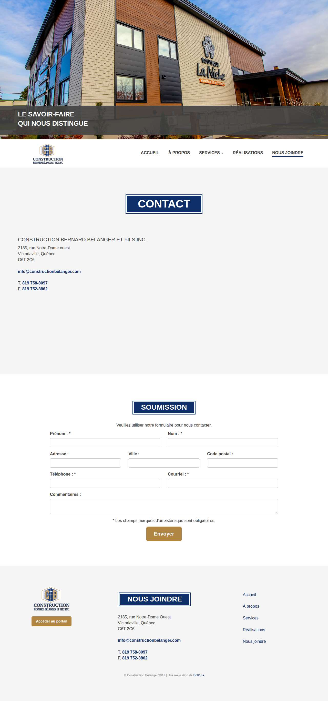

### calgarybathrenos.ca — dry\_run\_ok (dry run)

| | |
|---|---|
| Attempt ID | `48bb1a95-8451-4cc7-885b-965d055c55e9` |
| Form URL | https://calgarybathrenos.ca/contact |
| Final URL | https://calgarybathrenos.ca/contact |
| Reserved | 2026-11-13 06:02:28 UTC |
| Submit attempted | — |
| Template | standard v2 |
| Confirmation text | none observed |
| Result / error | Selectors verified; fields not typed (domain not in dry-run fill list); not submitted |

Exact message:

~~~text
Subject: Helping customers find your business in AI search (AEO + GEO)

Hi there,

I'm Arun from Devs Arun. More and more customers now ask ChatGPT, Gemini, Perplexity or Google's AI Overviews questions like "who should I hire for this in my area?" before they call anyone. These tools answer from websites they can clearly understand, and they tend to recommend businesses whose pages answer real customer questions.

That is what AEO + GEO (Answer Engine and Generative Engine Optimization) is for. I improve your existing service pages so they clearly answer the questions your customers ask, add structured data that matches the page, and make the call, quote or enquiry step obvious. The benefit: your business gets a better chance of being mentioned or linked in AI answers, and visitors who arrive find it easy to contact you.

The AEO + GEO Starter is a one-time $199 (about ₹16,999, negotiable) for one website: a basic audit, 10 customer questions, improvements to two existing pages, relevant structured data and an action plan, with one revision round.

You can read the full details, send an enquiry or book online here:
https://devsarun.io/aeo-geo/

If this isn't relevant, just reply and I won't contact you again.

Best,
Arun
Devs Arun
itschool408@gmail.com · +91 7654534323
~~~

Submitted field values:

- \#name: Arun
- \#email: itschool408@gmail.com
- \#phone: +91 7654534323
- \#message: Hi there, I'm Arun from Devs Arun. More and more customers now ask ChatGPT, Gemini, Perplexity or Google's AI Overviews 
- \#service: Other

**Inspected page** — `run-b7421700_attempt-48bb1a95_inspection_2026-11-13T06-02-29-655Z.jpg`

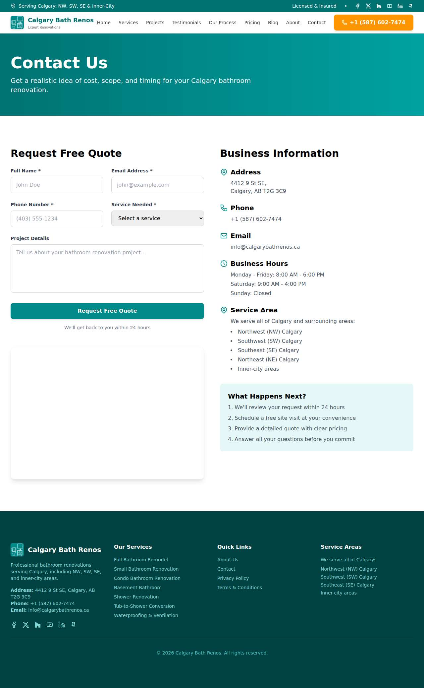

### eurohouse.ca — dry\_run\_ok (dry run)

| | |
|---|---|
| Attempt ID | `9877b9d4-c35f-47c2-84d3-4a4f95a77ae3` |
| Form URL | https://eurohouse.ca/contact.html |
| Final URL | https://eurohouse.ca/contact.html |
| Reserved | 2026-11-13 06:02:34 UTC |
| Submit attempted | — |
| Template | standard v2 |
| Confirmation text | none observed |
| Result / error | Selectors verified; fields not typed (domain not in dry-run fill list); not submitted |

Exact message:

~~~text
Subject: Helping customers find your business in AI search (AEO + GEO)

Hi there,

I'm Arun from Devs Arun. More and more customers now ask ChatGPT, Gemini, Perplexity or Google's AI Overviews questions like "who should I hire for this in my area?" before they call anyone. These tools answer from websites they can clearly understand, and they tend to recommend businesses whose pages answer real customer questions.

That is what AEO + GEO (Answer Engine and Generative Engine Optimization) is for. I improve your existing service pages so they clearly answer the questions your customers ask, add structured data that matches the page, and make the call, quote or enquiry step obvious. The benefit: your business gets a better chance of being mentioned or linked in AI answers, and visitors who arrive find it easy to contact you.

The AEO + GEO Starter is a one-time $199 (about ₹16,999, negotiable) for one website: a basic audit, 10 customer questions, improvements to two existing pages, relevant structured data and an action plan, with one revision round.

You can read the full details, send an enquiry or book online here:
https://devsarun.io/aeo-geo/

If this isn't relevant, just reply and I won't contact you again.

Best,
Arun
Devs Arun
itschool408@gmail.com · +91 7654534323
~~~

Submitted field values:

- \#name: Arun
- \#email: itschool408@gmail.com
- \#phone: +91 7654534323
- \#message: Hi there, I'm Arun from Devs Arun. More and more customers now ask ChatGPT, Gemini, Perplexity or Google's AI Overviews 

**Inspected page** — `run-b7421700_attempt-9877b9d4_inspection_2026-11-13T06-02-35-914Z.jpg`

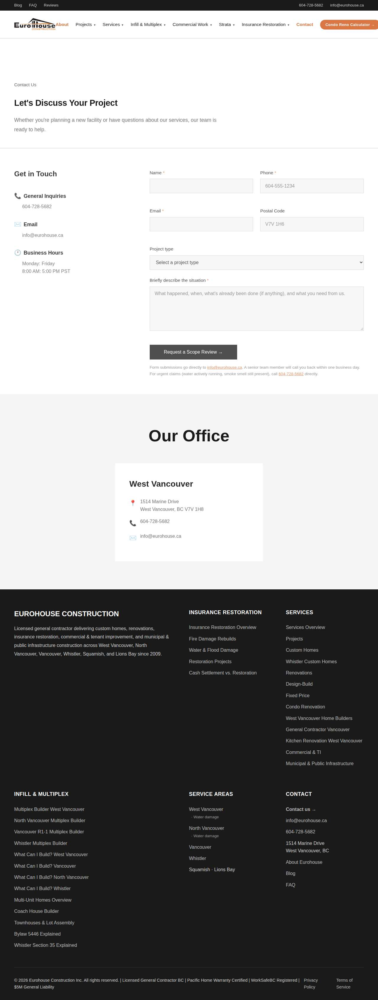

### yfcv.ca — dry\_run\_ok (dry run)

| | |
|---|---|
| Attempt ID | `ec7397a9-b685-49eb-9897-ef1a4e701ec1` |
| Form URL | https://www.yfcv.ca/contact |
| Final URL | https://www.yfcv.ca/contact |
| Reserved | 2026-11-13 06:02:40 UTC |
| Submit attempted | — |
| Template | standard v2 |
| Confirmation text | none observed |
| Result / error | Selectors verified; fields not typed (domain not in dry-run fill list); not submitted |

Exact message:

~~~text
Subject: Helping customers find your business in AI search (AEO + GEO)

Hi there,

I'm Arun from Devs Arun. More and more customers now ask ChatGPT, Gemini, Perplexity or Google's AI Overviews questions like "who should I hire for this in my area?" before they call anyone. These tools answer from websites they can clearly understand, and they tend to recommend businesses whose pages answer real customer questions.

That is what AEO + GEO (Answer Engine and Generative Engine Optimization) is for. I improve your existing service pages so they clearly answer the questions your customers ask, add structured data that matches the page, and make the call, quote or enquiry step obvious. The benefit: your business gets a better chance of being mentioned or linked in AI answers, and visitors who arrive find it easy to contact you.

The AEO + GEO Starter is a one-time $199 (about ₹16,999, negotiable) for one website: a basic audit, 10 customer questions, improvements to two existing pages, relevant structured data and an action plan, with one revision round.

You can read the full details, send an enquiry or book online here:
https://devsarun.io/aeo-geo/

If this isn't relevant, just reply and I won't contact you again.

Best,
Arun
Devs Arun
itschool408@gmail.com · +91 7654534323
~~~

Submitted field values:

- \#input\_comp-kiet6qzf: Arun
- \#input\_comp-kiet6qzt: itschool408@gmail.com
- \#input\_comp-kiet6r01: Helping customers find your business in AI search (AEO + GEO)
- \#textarea\_comp-kiet6r07: Hi there, I'm Arun from Devs Arun. More and more customers now ask ChatGPT, Gemini, Perplexity or Google's AI Overviews 

**Inspected page** — `run-b7421700_attempt-ec7397a9_inspection_2026-11-13T06-02-45-491Z.jpg`

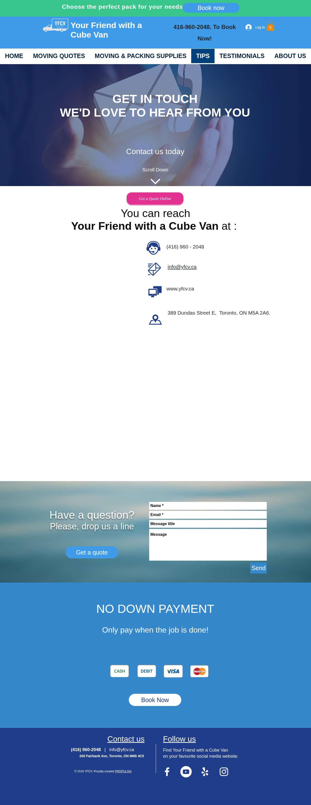

### minute-men.com — dry\_run\_ok (dry run)

| | |
|---|---|
| Attempt ID | `a4306435-7622-4e45-977c-275c606470ca` |
| Form URL | https://www.minute-men.com/contact-us |
| Final URL | https://www.minute-men.com/contact-us |
| Reserved | 2026-11-13 06:02:50 UTC |
| Submit attempted | — |
| Template | standard v2 |
| Confirmation text | none observed |
| Result / error | Selectors verified; fields not typed (domain not in dry-run fill list); not submitted |

Exact message:

~~~text
Subject: Helping customers find your business in AI search (AEO + GEO)

Hi there,

I'm Arun from Devs Arun. More and more customers now ask ChatGPT, Gemini, Perplexity or Google's AI Overviews questions like "who should I hire for this in my area?" before they call anyone. These tools answer from websites they can clearly understand, and they tend to recommend businesses whose pages answer real customer questions.

That is what AEO + GEO (Answer Engine and Generative Engine Optimization) is for. I improve your existing service pages so they clearly answer the questions your customers ask, add structured data that matches the page, and make the call, quote or enquiry step obvious. The benefit: your business gets a better chance of being mentioned or linked in AI answers, and visitors who arrive find it easy to contact you.

The AEO + GEO Starter is a one-time $199 (about ₹16,999, negotiable) for one website: a basic audit, 10 customer questions, improvements to two existing pages, relevant structured data and an action plan, with one revision round.

You can read the full details, send an enquiry or book online here:
https://devsarun.io/aeo-geo/

If this isn't relevant, just reply and I won't contact you again.

Best,
Arun
Devs Arun
itschool408@gmail.com · +91 7654534323
~~~

Submitted field values:

- \#input\_comp-lm0i64bn: +91 7654534323
- \#input\_comp-lm0i0eyo2: Arun
- \#input\_comp-lm0i0eyx1: itschool408@gmail.com
- \#textarea\_comp-lm0i0ezj: Hi there, I'm Arun from Devs Arun. More and more customers now ask ChatGPT, Gemini, Perplexity or Google's AI Overviews 

**Inspected page** — `run-b7421700_attempt-a4306435_inspection_2026-11-13T06-02-53-679Z.jpg`

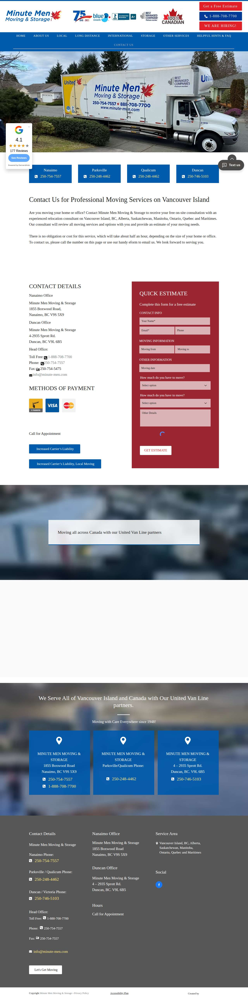

### phillipsmoving.com — dry\_run\_ok (dry run)

| | |
|---|---|
| Attempt ID | `df958c1c-1677-4e9c-b55b-671f79d5b3a5` |
| Form URL | https://phillipsmoving.com/contact/ |
| Final URL | https://phillipsmoving.com/contact/ |
| Reserved | 2026-11-13 06:02:58 UTC |
| Submit attempted | — |
| Template | standard v2 |
| Confirmation text | none observed |
| Result / error | Selectors verified; fields not typed (domain not in dry-run fill list); not submitted |

Exact message:

~~~text
Subject: Helping customers find your business in AI search (AEO + GEO)

Hi there,

I'm Arun from Devs Arun. More and more customers now ask ChatGPT, Gemini, Perplexity or Google's AI Overviews questions like "who should I hire for this in my area?" before they call anyone. These tools answer from websites they can clearly understand, and they tend to recommend businesses whose pages answer real customer questions.

That is what AEO + GEO (Answer Engine and Generative Engine Optimization) is for. I improve your existing service pages so they clearly answer the questions your customers ask, add structured data that matches the page, and make the call, quote or enquiry step obvious. The benefit: your business gets a better chance of being mentioned or linked in AI answers, and visitors who arrive find it easy to contact you.

The AEO + GEO Starter is a one-time $199 (about ₹16,999, negotiable) for one website: a basic audit, 10 customer questions, improvements to two existing pages, relevant structured data and an action plan, with one revision round.

You can read the full details, send an enquiry or book online here:
https://devsarun.io/aeo-geo/

If this isn't relevant, just reply and I won't contact you again.

Best,
Arun
Devs Arun
itschool408@gmail.com · +91 7654534323
~~~

Submitted field values:

- section:nth-of-type(2) \> div \> div \> div:nth-of-type(1) \> div \> div \> form \> div:nth-of-type(1) \> div \> div:nth-of-type(1) \> div \> input: Arun
- section:nth-of-type(2) \> div \> div \> div:nth-of-type(1) \> div \> div \> form \> div:nth-of-type(1) \> div \> div:nth-of-type(2) \> div \> input: +91 7654534323
- section:nth-of-type(2) \> div \> div \> div:nth-of-type(1) \> div \> div \> form \> div:nth-of-type(1) \> div \> div:nth-of-type(3) \> div \> input: itschool408@gmail.com
- section:nth-of-type(2) \> div \> div \> div:nth-of-type(1) \> div \> div \> form \> div:nth-of-type(1) \> div \> div:nth-of-type(4) \> div \> textarea: Hi there, I'm Arun from Devs Arun. More and more customers now ask ChatGPT, Gemini, Perplexity or Google's AI Overviews 

**Inspected page** — `run-b7421700_attempt-df958c1c_inspection_2026-11-13T06-02-59-745Z.jpg`

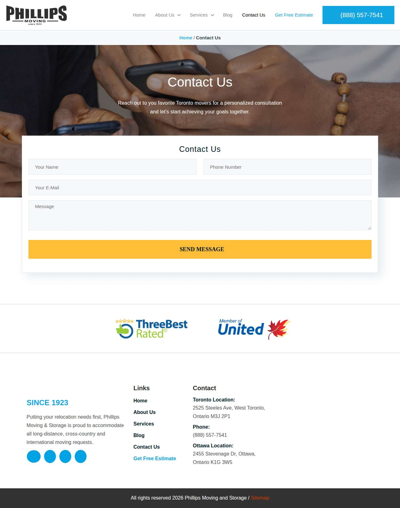

### galaxymoverscalgary.ca — dry\_run\_ok (dry run)

| | |
|---|---|
| Attempt ID | `19cf3bca-ceb2-481a-9fe9-a2aafa32400e` |
| Form URL | https://galaxymoverscalgary.ca/contact-us/ |
| Final URL | https://galaxymoverscalgary.ca/contact-us/ |
| Reserved | 2026-11-13 06:03:04 UTC |
| Submit attempted | — |
| Template | standard v2 |
| Confirmation text | none observed |
| Result / error | Selectors verified; fields not typed (domain not in dry-run fill list); not submitted |

Exact message:

~~~text
Subject: Helping customers find your business in AI search (AEO + GEO)

Hi there,

I'm Arun from Devs Arun. More and more customers now ask ChatGPT, Gemini, Perplexity or Google's AI Overviews questions like "who should I hire for this in my area?" before they call anyone. These tools answer from websites they can clearly understand, and they tend to recommend businesses whose pages answer real customer questions.

That is what AEO + GEO (Answer Engine and Generative Engine Optimization) is for. I improve your existing service pages so they clearly answer the questions your customers ask, add structured data that matches the page, and make the call, quote or enquiry step obvious. The benefit: your business gets a better chance of being mentioned or linked in AI answers, and visitors who arrive find it easy to contact you.

The AEO + GEO Starter is a one-time $199 (about ₹16,999, negotiable) for one website: a basic audit, 10 customer questions, improvements to two existing pages, relevant structured data and an action plan, with one revision round.

You can read the full details, send an enquiry or book online here:
https://devsarun.io/aeo-geo/

If this isn't relevant, just reply and I won't contact you again.

Best,
Arun
Devs Arun
itschool408@gmail.com · +91 7654534323
~~~

Submitted field values:

- input\[name="name"\]: Arun
- input\[name="email"\]: itschool408@gmail.com
- input\[name="phone"\]: +91 7654534323
- input\[name="subject"\]: Helping customers find your business in AI search (AEO + GEO)
- textarea\[name="message"\]: Hi there, I'm Arun from Devs Arun. More and more customers now ask ChatGPT, Gemini, Perplexity or Google's AI Overviews 

**Inspected page** — `run-b7421700_attempt-19cf3bca_inspection_2026-11-13T06-03-07-294Z.jpg`

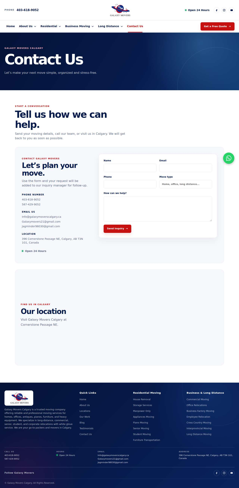

### cardinalmoving.ca — dry\_run\_ok (dry run)

| | |
|---|---|
| Attempt ID | `6497328e-5027-4722-8c2b-cc8a5a6309f5` |
| Form URL | https://cardinalmoving.ca/contact-us/ |
| Final URL | https://cardinalmoving.ca/contact-us/ |
| Reserved | 2026-11-13 06:03:12 UTC |
| Submit attempted | — |
| Template | standard v2 |
| Confirmation text | none observed |
| Result / error | Selectors verified; fields not typed (domain not in dry-run fill list); not submitted |

Exact message:

~~~text
Subject: Helping customers find your business in AI search (AEO + GEO)

Hi there,

I'm Arun from Devs Arun. More and more customers now ask ChatGPT, Gemini, Perplexity or Google's AI Overviews questions like "who should I hire for this in my area?" before they call anyone. These tools answer from websites they can clearly understand, and they tend to recommend businesses whose pages answer real customer questions.

That is what AEO + GEO (Answer Engine and Generative Engine Optimization) is for. I improve your existing service pages so they clearly answer the questions your customers ask, add structured data that matches the page, and make the call, quote or enquiry step obvious. The benefit: your business gets a better chance of being mentioned or linked in AI answers, and visitors who arrive find it easy to contact you.

The AEO + GEO Starter is a one-time $199 (about ₹16,999, negotiable) for one website: a basic audit, 10 customer questions, improvements to two existing pages, relevant structured data and an action plan, with one revision round.

You can read the full details, send an enquiry or book online here:
https://devsarun.io/aeo-geo/

If this isn't relevant, just reply and I won't contact you again.

Best,
Arun
Devs Arun
itschool408@gmail.com · +91 7654534323
~~~

Submitted field values:

- \#form-field-name: Arun
- \#form-field-email: itschool408@gmail.com
- \#form-field-phone: +91 7654534323
- \#form-field-comments: Hi there, I'm Arun from Devs Arun. More and more customers now ask ChatGPT, Gemini, Perplexity or Google's AI Overviews 

**Inspected page** — `run-b7421700_attempt-6497328e_inspection_2026-11-13T06-03-13-951Z.jpg`

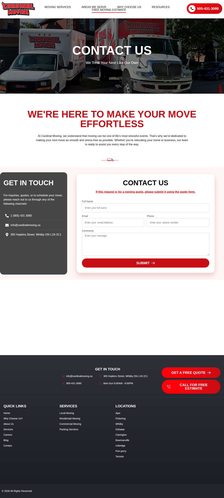

### sblawpartners.com.au — dry\_run\_failed (dry run)

| | |
|---|---|
| Attempt ID | `341db7e0-a854-454a-b845-e657633f620b` |
| Form URL | https://sblawpartners.com.au/contact-us/ |
| Final URL | https://sblawpartners.com.au/contact-us/ |
| Reserved | 2026-11-13 06:03:18 UTC |
| Submit attempted | — |
| Template | standard v2 |
| Confirmation text | none observed |
| Result / error | Mapped field "Name \*" not found uniquely |

Exact message:

~~~text
Subject: Helping customers find your business in AI search (AEO + GEO)

Hi there,

I'm Arun from Devs Arun. More and more customers now ask ChatGPT, Gemini, Perplexity or Google's AI Overviews questions like "who should I hire for this in my area?" before they call anyone. These tools answer from websites they can clearly understand, and they tend to recommend businesses whose pages answer real customer questions.

That is what AEO + GEO (Answer Engine and Generative Engine Optimization) is for. I improve your existing service pages so they clearly answer the questions your customers ask, add structured data that matches the page, and make the call, quote or enquiry step obvious. The benefit: your business gets a better chance of being mentioned or linked in AI answers, and visitors who arrive find it easy to contact you.

The AEO + GEO Starter is a one-time $199 (about ₹16,999, negotiable) for one website: a basic audit, 10 customer questions, improvements to two existing pages, relevant structured data and an action plan, with one revision round.

You can read the full details, send an enquiry or book online here:
https://devsarun.io/aeo-geo/

If this isn't relevant, just reply and I won't contact you again.

Best,
Arun
Devs Arun
itschool408@gmail.com · +91 7654534323
~~~

Submitted field values:

- \#forminator-field-name-1\_6af14060364ef: Arun
- \#forminator-field-email-1\_6af14060364ef: itschool408@gmail.com
- \#forminator-field-phone-1\_6af14060364ef: +91 7654534323
- \#forminator-field-textarea-1\_6af14060364ef: Hi there, I'm Arun from Devs Arun. More and more customers now ask ChatGPT, Gemini, Perplexity or Google's AI Overviews 

**Inspected page** — `run-b7421700_attempt-341db7e0_inspection_2026-11-13T06-03-24-390Z.jpg`

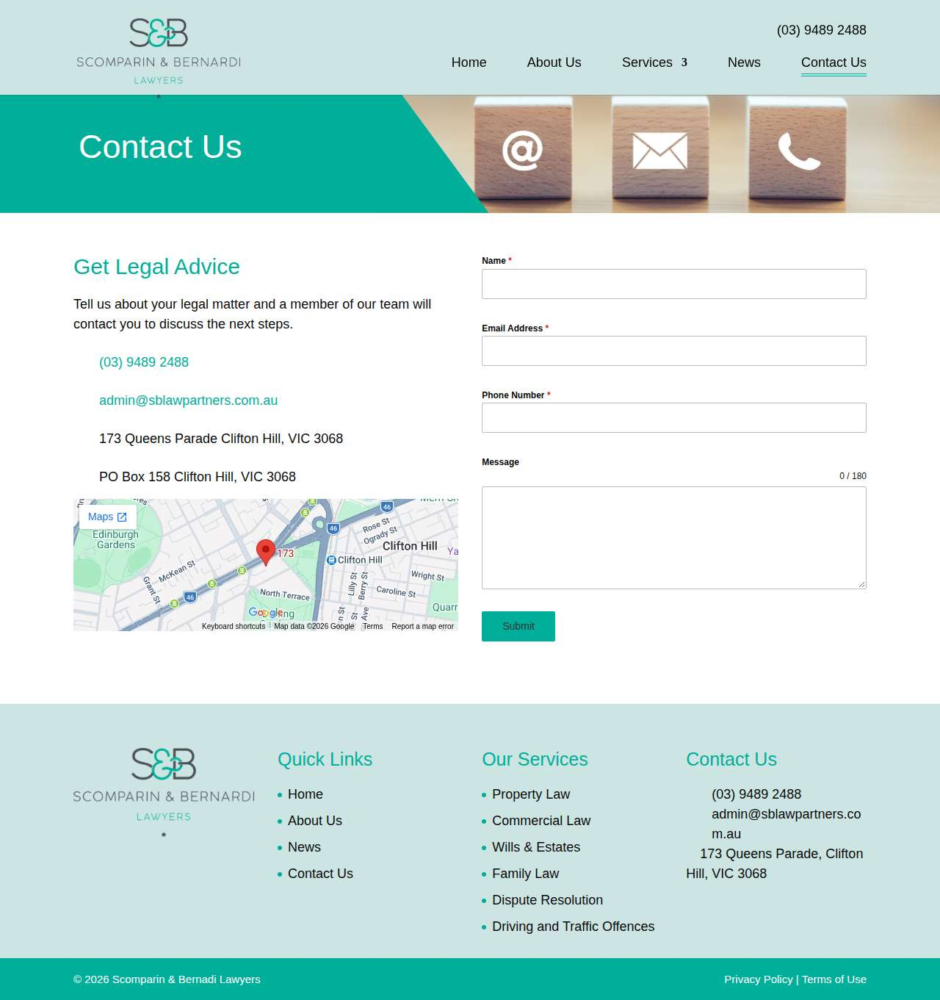

### frhlaw.ca — dry\_run\_ok (dry run)

| | |
|---|---|
| Attempt ID | `6b33b4b1-eac6-4aeb-9a46-e59477a9ec73` |
| Form URL | https://frhlaw.ca/ |
| Final URL | https://frhlaw.ca/ |
| Reserved | 2026-11-13 06:03:29 UTC |
| Submit attempted | — |
| Template | standard v2 |
| Confirmation text | none observed |
| Result / error | Selectors verified; fields not typed (domain not in dry-run fill list); not submitted |

Exact message:

~~~text
Subject: Helping customers find your business in AI search (AEO + GEO)

Hi there,

I'm Arun from Devs Arun. More and more customers now ask ChatGPT, Gemini, Perplexity or Google's AI Overviews questions like "who should I hire for this in my area?" before they call anyone. These tools answer from websites they can clearly understand, and they tend to recommend businesses whose pages answer real customer questions.

That is what AEO + GEO (Answer Engine and Generative Engine Optimization) is for. I improve your existing service pages so they clearly answer the questions your customers ask, add structured data that matches the page, and make the call, quote or enquiry step obvious. The benefit: your business gets a better chance of being mentioned or linked in AI answers, and visitors who arrive find it easy to contact you.

The AEO + GEO Starter is a one-time $199 (about ₹16,999, negotiable) for one website: a basic audit, 10 customer questions, improvements to two existing pages, relevant structured data and an action plan, with one revision round.

You can read the full details, send an enquiry or book online here:
https://devsarun.io/aeo-geo/

If this isn't relevant, just reply and I won't contact you again.

Best,
Arun
Devs Arun
itschool408@gmail.com · +91 7654534323
~~~

Submitted field values:

- \#field1: Arun
- \#field2: itschool408@gmail.com
- \#field3: +91 7654534323
- \#field4: Helping customers find your business in AI search (AEO + GEO)
- \#field5: Hi there, I'm Arun from Devs Arun. More and more customers now ask ChatGPT, Gemini, Perplexity or Google's AI Overviews 

**Inspected page** — `run-b7421700_attempt-6b33b4b1_inspection_2026-11-13T06-03-31-675Z.jpg`

### cbmlawyers.com — dry\_run\_ok (dry run)

| | |
|---|---|
| Attempt ID | `154f432c-7fa3-464e-af06-3909e2844331` |
| Form URL | https://cbmlawyers.com/contact-us/ |
| Final URL | https://cbmlawyers.com/contact-us/ |
| Reserved | 2026-11-13 06:03:36 UTC |
| Submit attempted | — |
| Template | standard v2 |
| Confirmation text | none observed |
| Result / error | Selectors verified; fields not typed (domain not in dry-run fill list); not submitted |

Exact message:

~~~text
Subject: Helping customers find your business in AI search (AEO + GEO)

Hi there,

I'm Arun from Devs Arun. More and more customers now ask ChatGPT, Gemini, Perplexity or Google's AI Overviews questions like "who should I hire for this in my area?" before they call anyone. These tools answer from websites they can clearly understand, and they tend to recommend businesses whose pages answer real customer questions.

That is what AEO + GEO (Answer Engine and Generative Engine Optimization) is for. I improve your existing service pages so they clearly answer the questions your customers ask, add structured data that matches the page, and make the call, quote or enquiry step obvious. The benefit: your business gets a better chance of being mentioned or linked in AI answers, and visitors who arrive find it easy to contact you.

The AEO + GEO Starter is a one-time $199 (about ₹16,999, negotiable) for one website: a basic audit, 10 customer questions, improvements to two existing pages, relevant structured data and an action plan, with one revision round.

You can read the full details, send an enquiry or book online here:
https://devsarun.io/aeo-geo/

If this isn't relevant, just reply and I won't contact you again.

Best,
Arun
Devs Arun
itschool408@gmail.com · +91 7654534323
~~~

Submitted field values:

- input\[name="name"\]: Arun
- input\[name="email"\]: itschool408@gmail.com
- input\[name="phone"\]: +91 7654534323
- textarea\[name="message"\]: Hi there, I'm Arun from Devs Arun. More and more customers now ask ChatGPT, Gemini, Perplexity or Google's AI Overviews 

**Inspected page** — `run-b7421700_attempt-154f432c_inspection_2026-11-13T06-03-38-942Z.jpg`

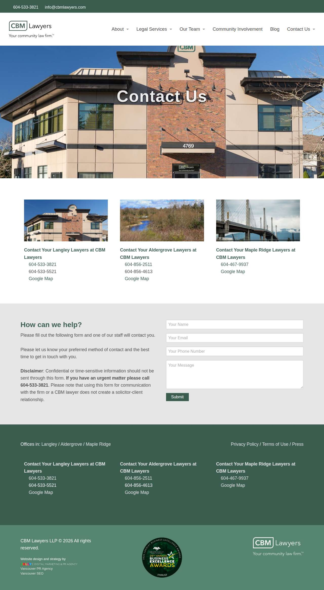

### lajoiepearson.com — dry\_run\_ok (dry run)

| | |
|---|---|
| Attempt ID | `da69f0e4-2029-4c6f-a9d2-beed4472620b` |
| Form URL | https://lajoiepearson.com/contact/ |
| Final URL | https://lajoiepearson.com/contact/ |
| Reserved | 2026-11-13 06:03:43 UTC |
| Submit attempted | — |
| Template | standard v2 |
| Confirmation text | none observed |
| Result / error | Selectors verified; fields not typed (domain not in dry-run fill list); not submitted |

Exact message:

~~~text
Subject: Helping customers find your business in AI search (AEO + GEO)

Hi there,

I'm Arun from Devs Arun. More and more customers now ask ChatGPT, Gemini, Perplexity or Google's AI Overviews questions like "who should I hire for this in my area?" before they call anyone. These tools answer from websites they can clearly understand, and they tend to recommend businesses whose pages answer real customer questions.

That is what AEO + GEO (Answer Engine and Generative Engine Optimization) is for. I improve your existing service pages so they clearly answer the questions your customers ask, add structured data that matches the page, and make the call, quote or enquiry step obvious. The benefit: your business gets a better chance of being mentioned or linked in AI answers, and visitors who arrive find it easy to contact you.

The AEO + GEO Starter is a one-time $199 (about ₹16,999, negotiable) for one website: a basic audit, 10 customer questions, improvements to two existing pages, relevant structured data and an action plan, with one revision round.

You can read the full details, send an enquiry or book online here:
https://devsarun.io/aeo-geo/

If this isn't relevant, just reply and I won't contact you again.

Best,
Arun
Devs Arun
itschool408@gmail.com · +91 7654534323
~~~

Submitted field values:

- \#wpforms-2296-field\_3: itschool408@gmail.com
- \#wpforms-2296-field\_7: Hi there, I'm Arun from Devs Arun. More and more customers now ask ChatGPT, Gemini, Perplexity or Google's AI Overviews 

**Inspected page** — `run-b7421700_attempt-da69f0e4_inspection_2026-11-13T06-03-45-904Z.jpg`

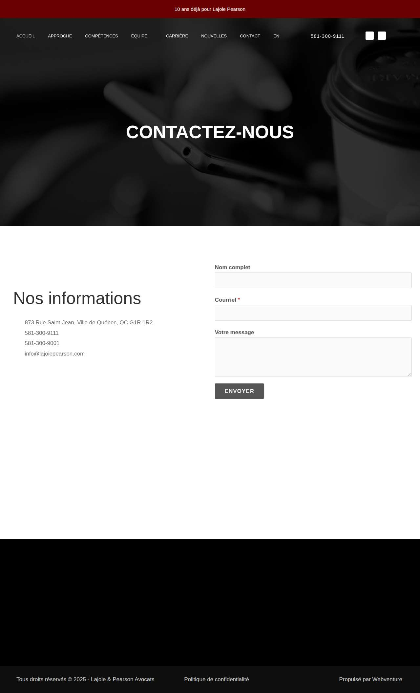

### sok-law.com — dry\_run\_ok (dry run)

| | |
|---|---|
| Attempt ID | `2e02d997-3d67-4815-833b-240add9644b0` |
| Form URL | https://sok-law.com/contact-us/ |
| Final URL | https://sok-law.com/contact-us/ |
| Reserved | 2026-11-13 06:03:50 UTC |
| Submit attempted | — |
| Template | standard v2 |
| Confirmation text | none observed |
| Result / error | Selectors verified; fields not typed (domain not in dry-run fill list); not submitted |

Exact message:

~~~text
Subject: Helping customers find your business in AI search (AEO + GEO)

Hi there,

I'm Arun from Devs Arun. More and more customers now ask ChatGPT, Gemini, Perplexity or Google's AI Overviews questions like "who should I hire for this in my area?" before they call anyone. These tools answer from websites they can clearly understand, and they tend to recommend businesses whose pages answer real customer questions.

That is what AEO + GEO (Answer Engine and Generative Engine Optimization) is for. I improve your existing service pages so they clearly answer the questions your customers ask, add structured data that matches the page, and make the call, quote or enquiry step obvious. The benefit: your business gets a better chance of being mentioned or linked in AI answers, and visitors who arrive find it easy to contact you.

The AEO + GEO Starter is a one-time $199 (about ₹16,999, negotiable) for one website: a basic audit, 10 customer questions, improvements to two existing pages, relevant structured data and an action plan, with one revision round.

You can read the full details, send an enquiry or book online here:
https://devsarun.io/aeo-geo/

If this isn't relevant, just reply and I won't contact you again.

Best,
Arun
Devs Arun
itschool408@gmail.com · +91 7654534323
~~~

Submitted field values:

- input\[name="your-name"\]: Arun
- input\[name="your-email"\]: itschool408@gmail.com
- input\[name="your-subject"\]: Helping customers find your business in AI search (AEO + GEO)
- textarea\[name="your-message"\]: Hi there, I'm Arun from Devs Arun. More and more customers now ask ChatGPT, Gemini, Perplexity or Google's AI Overviews 

**Inspected page** — `run-b7421700_attempt-2e02d997_inspection_2026-11-13T06-03-57-129Z.jpg`

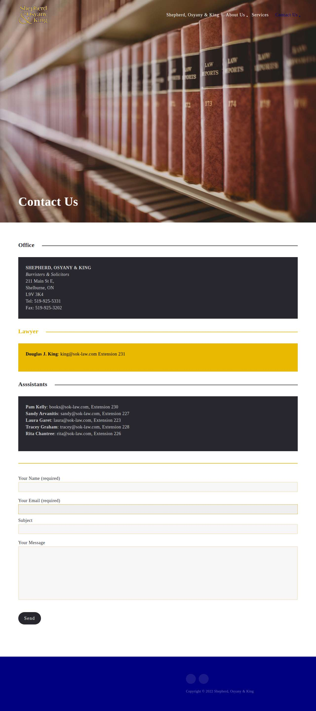

### portcreditlaw.com — dry\_run\_ok (dry run)

| | |
|---|---|
| Attempt ID | `8c4b7f4e-eb7e-43be-ac5c-7f6b30a98582` |
| Form URL | https://www.aaronlewicki.com/contact/ |
| Final URL | https://www.aaronlewicki.com/contact/ |
| Reserved | 2026-11-13 06:04:02 UTC |
| Submit attempted | — |
| Template | standard v2 |
| Confirmation text | none observed |
| Result / error | Selectors verified; fields not typed (domain not in dry-run fill list); not submitted |

Exact message:

~~~text
Subject: Helping customers find your business in AI search (AEO + GEO)

Hi there,

I'm Arun from Devs Arun. More and more customers now ask ChatGPT, Gemini, Perplexity or Google's AI Overviews questions like "who should I hire for this in my area?" before they call anyone. These tools answer from websites they can clearly understand, and they tend to recommend businesses whose pages answer real customer questions.

That is what AEO + GEO (Answer Engine and Generative Engine Optimization) is for. I improve your existing service pages so they clearly answer the questions your customers ask, add structured data that matches the page, and make the call, quote or enquiry step obvious. The benefit: your business gets a better chance of being mentioned or linked in AI answers, and visitors who arrive find it easy to contact you.

The AEO + GEO Starter is a one-time $199 (about ₹16,999, negotiable) for one website: a basic audit, 10 customer questions, improvements to two existing pages, relevant structured data and an action plan, with one revision round.

You can read the full details, send an enquiry or book online here:
https://devsarun.io/aeo-geo/

If this isn't relevant, just reply and I won't contact you again.

Best,
Arun
Devs Arun
itschool408@gmail.com · +91 7654534323
~~~

Submitted field values:

- input\[name="your-name"\]: Arun
- input\[name="your-email"\]: itschool408@gmail.com
- input\[name="your-phone"\]: +91 7654534323
- input\[name="your-subject"\]: Helping customers find your business in AI search (AEO + GEO)
- textarea\[name="your-message"\]: Hi there, I'm Arun from Devs Arun. More and more customers now ask ChatGPT, Gemini, Perplexity or Google's AI Overviews 

**Inspected page** — `run-b7421700_attempt-8c4b7f4e_inspection_2026-11-13T06-04-14-701Z.jpg`

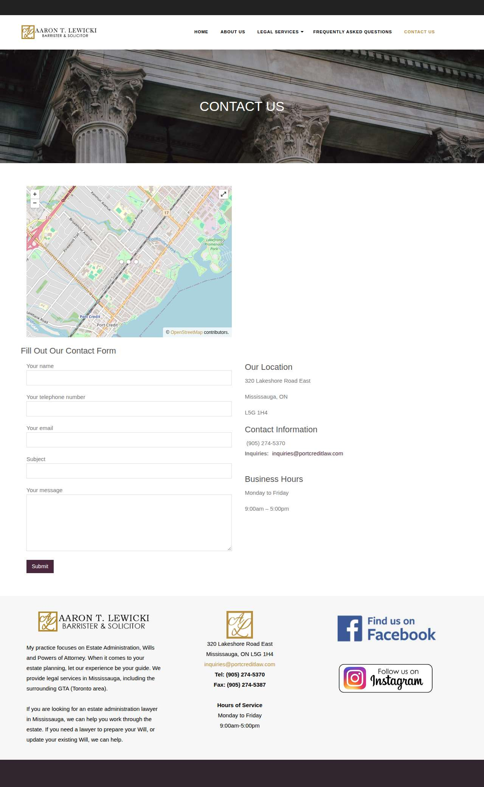

### cascadelaw.com — dry\_run\_ok (dry run)

| | |
|---|---|
| Attempt ID | `9f85e0ba-fe62-4e44-b528-5803e19bf0cb` |
| Form URL | https://cascadelaw.com/contact.html |
| Final URL | https://cascadelaw.com/contact.html |
| Reserved | 2026-11-13 06:04:19 UTC |
| Submit attempted | — |
| Template | standard v2 |
| Confirmation text | none observed |
| Result / error | Selectors verified; fields not typed (domain not in dry-run fill list); not submitted |

Exact message:

~~~text
Subject: Helping customers find your business in AI search (AEO + GEO)

Hi there,

I'm Arun from Devs Arun. More and more customers now ask ChatGPT, Gemini, Perplexity or Google's AI Overviews questions like "who should I hire for this in my area?" before they call anyone. These tools answer from websites they can clearly understand, and they tend to recommend businesses whose pages answer real customer questions.

That is what AEO + GEO (Answer Engine and Generative Engine Optimization) is for. I improve your existing service pages so they clearly answer the questions your customers ask, add structured data that matches the page, and make the call, quote or enquiry step obvious. The benefit: your business gets a better chance of being mentioned or linked in AI answers, and visitors who arrive find it easy to contact you.

The AEO + GEO Starter is a one-time $199 (about ₹16,999, negotiable) for one website: a basic audit, 10 customer questions, improvements to two existing pages, relevant structured data and an action plan, with one revision round.

You can read the full details, send an enquiry or book online here:
https://devsarun.io/aeo-geo/

If this isn't relevant, just reply and I won't contact you again.

Best,
Arun
Devs Arun
itschool408@gmail.com · +91 7654534323
~~~

Submitted field values:

- input\[name="name"\]: Arun
- input\[name="email"\]: itschool408@gmail.com
- textarea\[name="message"\]: Hi there, I'm Arun from Devs Arun. More and more customers now ask ChatGPT, Gemini, Perplexity or Google's AI Overviews 

**Inspected page** — `run-b7421700_attempt-9f85e0ba_inspection_2026-11-13T06-04-21-420Z.jpg`

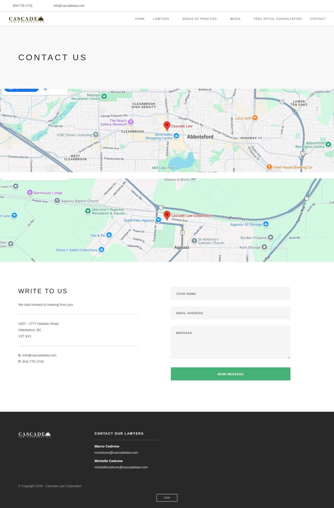

### valleylawgroup.ca — dry\_run\_ok (dry run)

| | |
|---|---|
| Attempt ID | `ab7f76a2-e718-41ec-9e4b-3997b7c3f3a9` |
| Form URL | https://www.valleylawgroup.ca/contact-us |
| Final URL | https://www.valleylawgroup.ca/contact-us |
| Reserved | 2026-11-13 06:04:26 UTC |
| Submit attempted | — |
| Template | standard v2 |
| Confirmation text | none observed |
| Result / error | Selectors verified; fields not typed (domain not in dry-run fill list); not submitted |

Exact message:

~~~text
Subject: Helping customers find your business in AI search (AEO + GEO)

Hi there,

I'm Arun from Devs Arun. More and more customers now ask ChatGPT, Gemini, Perplexity or Google's AI Overviews questions like "who should I hire for this in my area?" before they call anyone. These tools answer from websites they can clearly understand, and they tend to recommend businesses whose pages answer real customer questions.

That is what AEO + GEO (Answer Engine and Generative Engine Optimization) is for. I improve your existing service pages so they clearly answer the questions your customers ask, add structured data that matches the page, and make the call, quote or enquiry step obvious. The benefit: your business gets a better chance of being mentioned or linked in AI answers, and visitors who arrive find it easy to contact you.

The AEO + GEO Starter is a one-time $199 (about ₹16,999, negotiable) for one website: a basic audit, 10 customer questions, improvements to two existing pages, relevant structured data and an action plan, with one revision round.

You can read the full details, send an enquiry or book online here:
https://devsarun.io/aeo-geo/

If this isn't relevant, just reply and I won't contact you again.

Best,
Arun
Devs Arun
itschool408@gmail.com · +91 7654534323
~~~

Submitted field values:

- \#input\_comp-lduxlobr: +91 7654534323
- \#input\_comp-le9xw31k: itschool408@gmail.com
- \#textarea\_comp-lduxlobx: Hi there, I'm Arun from Devs Arun. More and more customers now ask ChatGPT, Gemini, Perplexity or Google's AI Overviews 

**Inspected page** — `run-b7421700_attempt-ab7f76a2_inspection_2026-11-13T06-04-29-161Z.jpg`

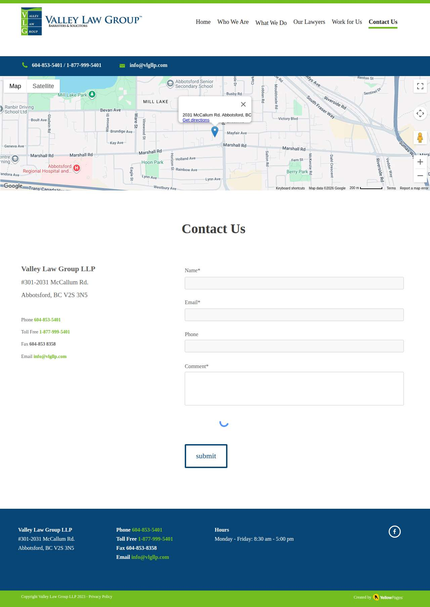

### libertylawcorp.com — dry\_run\_ok (dry run)

| | |
|---|---|
| Attempt ID | `b85e3148-e421-4037-bab4-0865da799ea6` |
| Form URL | https://www.libertylawcorp.com/contact-us/ |
| Final URL | https://www.libertylawcorp.com/contact-us/ |
| Reserved | 2026-11-13 06:04:34 UTC |
| Submit attempted | — |
| Template | standard v2 |
| Confirmation text | none observed |
| Result / error | Selectors verified; fields not typed (domain not in dry-run fill list); not submitted |

Exact message:

~~~text
Subject: Helping customers find your business in AI search (AEO + GEO)

Hi there,

I'm Arun from Devs Arun. More and more customers now ask ChatGPT, Gemini, Perplexity or Google's AI Overviews questions like "who should I hire for this in my area?" before they call anyone. These tools answer from websites they can clearly understand, and they tend to recommend businesses whose pages answer real customer questions.

That is what AEO + GEO (Answer Engine and Generative Engine Optimization) is for. I improve your existing service pages so they clearly answer the questions your customers ask, add structured data that matches the page, and make the call, quote or enquiry step obvious. The benefit: your business gets a better chance of being mentioned or linked in AI answers, and visitors who arrive find it easy to contact you.

The AEO + GEO Starter is a one-time $199 (about ₹16,999, negotiable) for one website: a basic audit, 10 customer questions, improvements to two existing pages, relevant structured data and an action plan, with one revision round.

You can read the full details, send an enquiry or book online here:
https://devsarun.io/aeo-geo/

If this isn't relevant, just reply and I won't contact you again.

Best,
Arun
Devs Arun
itschool408@gmail.com · +91 7654534323
~~~

Submitted field values:

- input\[name="subject"\]: Helping customers find your business in AI search (AEO + GEO)
- input\[name="tel-427"\]: +91 7654534323
- input\[name="your-name"\]: Arun
- input\[name="your-email"\]: itschool408@gmail.com
- textarea\[name="your-message"\]: Hi there, I'm Arun from Devs Arun. More and more customers now ask ChatGPT, Gemini, Perplexity or Google's AI Overviews 

**Inspected page** — `run-b7421700_attempt-b85e3148_inspection_2026-11-13T06-04-35-761Z.jpg`

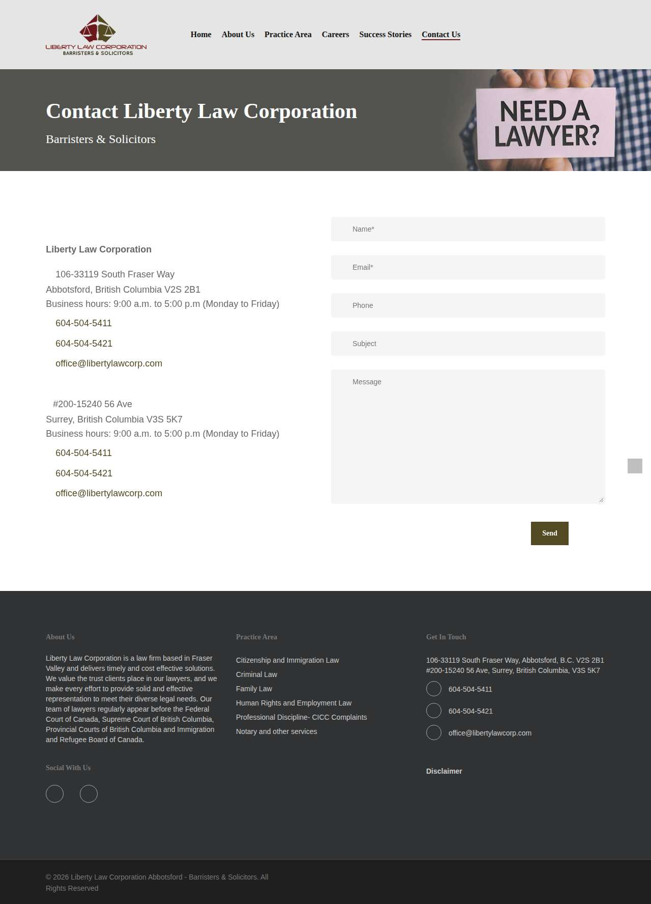

### mspc.cpa — dry\_run\_failed (dry run)

| | |
|---|---|
| Attempt ID | `309cdbcf-818e-49e1-b210-a258fc852c47` |
| Form URL | https://www.mspc.cpa/contact/ |
| Final URL | https://www.mspc.cpa/contact/ |
| Reserved | 2026-11-13 06:04:40 UTC |
| Submit attempted | — |
| Template | standard v2 |
| Confirmation text | none observed |
| Result / error | Mapped field "Full Name \*" not found uniquely |

Exact message:

~~~text
Subject: Helping customers find your business in AI search (AEO + GEO)

Hi there,

I'm Arun from Devs Arun. More and more customers now ask ChatGPT, Gemini, Perplexity or Google's AI Overviews questions like "who should I hire for this in my area?" before they call anyone. These tools answer from websites they can clearly understand, and they tend to recommend businesses whose pages answer real customer questions.

That is what AEO + GEO (Answer Engine and Generative Engine Optimization) is for. I improve your existing service pages so they clearly answer the questions your customers ask, add structured data that matches the page, and make the call, quote or enquiry step obvious. The benefit: your business gets a better chance of being mentioned or linked in AI answers, and visitors who arrive find it easy to contact you.

The AEO + GEO Starter is a one-time $199 (about ₹16,999, negotiable) for one website: a basic audit, 10 customer questions, improvements to two existing pages, relevant structured data and an action plan, with one revision round.

You can read the full details, send an enquiry or book online here:
https://devsarun.io/aeo-geo/

If this isn't relevant, just reply and I won't contact you again.

Best,
Arun
Devs Arun
itschool408@gmail.com · +91 7654534323
~~~

Submitted field values:

- \#forminator-field-name-1\_6aeaca2579f24: Arun
- \#forminator-field-text-1\_6aeaca2579f24: Devs Arun
- \#forminator-field-email-1\_6aeaca2579f24: itschool408@gmail.com
- \#forminator-field-phone-1\_6aeaca2579f24: +91 7654534323
- \#forminator-field-textarea-1\_6aeaca2579f24: Hi there, I'm Arun from Devs Arun. More and more customers now ask ChatGPT, Gemini, Perplexity or Google's AI Overviews 

**Inspected page** — `run-b7421700_attempt-309cdbcf_inspection_2026-11-13T06-04-43-383Z.jpg`

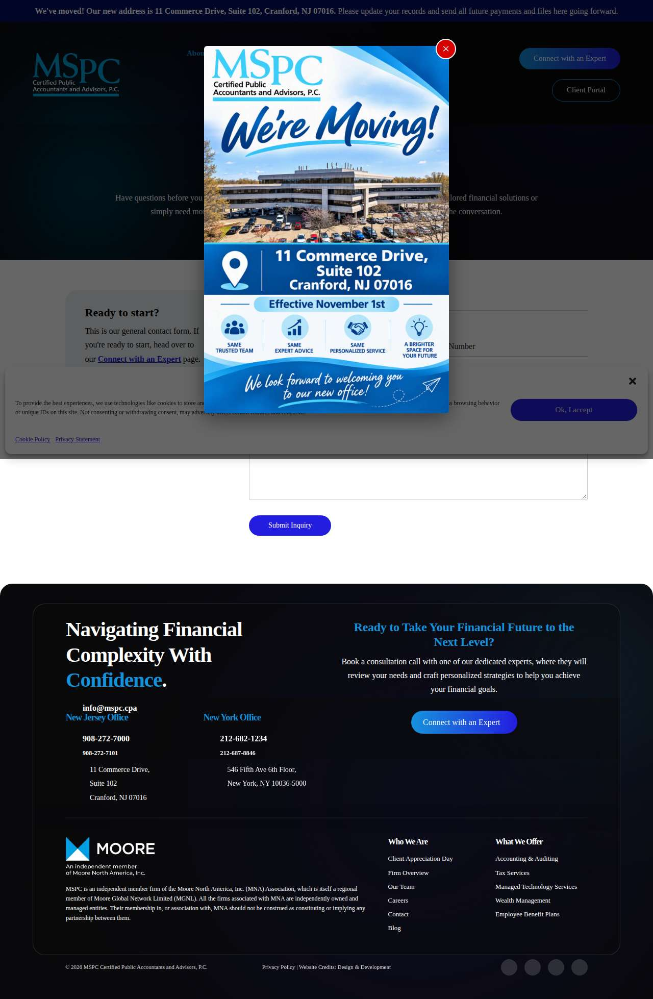

### juicerealestate.com.au — dry\_run\_failed (dry run)

| | |
|---|---|
| Attempt ID | `e13a7e13-21bc-4fe2-a412-87b2b64f1700` |
| Form URL | https://juicerealestate.com.au/contact-us/ |
| Final URL | https://juicerealestate.com.au/contact-us/ |
| Reserved | 2026-11-13 06:04:48 UTC |
| Submit attempted | — |
| Template | standard v2 |
| Confirmation text | none observed |
| Result / error | CAPTCHA/anti-bot now present (recaptcha) |

Exact message:

~~~text
Subject: Helping customers find your business in AI search (AEO + GEO)

Hi there,

I'm Arun from Devs Arun. More and more customers now ask ChatGPT, Gemini, Perplexity or Google's AI Overviews questions like "who should I hire for this in my area?" before they call anyone. These tools answer from websites they can clearly understand, and they tend to recommend businesses whose pages answer real customer questions.

That is what AEO + GEO (Answer Engine and Generative Engine Optimization) is for. I improve your existing service pages so they clearly answer the questions your customers ask, add structured data that matches the page, and make the call, quote or enquiry step obvious. The benefit: your business gets a better chance of being mentioned or linked in AI answers, and visitors who arrive find it easy to contact you.

The AEO + GEO Starter is a one-time $199 (about ₹16,999, negotiable) for one website: a basic audit, 10 customer questions, improvements to two existing pages, relevant structured data and an action plan, with one revision round.

You can read the full details, send an enquiry or book online here:
https://devsarun.io/aeo-geo/

If this isn't relevant, just reply and I won't contact you again.

Best,
Arun
Devs Arun
itschool408@gmail.com · +91 7654534323
~~~

Submitted field values:

- \#ff\_1\_email: itschool408@gmail.com
- \#ff\_1\_phone: +91 7654534323
- \#ff\_1\_message: Hi there, I'm Arun from Devs Arun. More and more customers now ask ChatGPT, Gemini, Perplexity or Google's AI Overviews 
- \#ff\_1\_names\_first\_name\_: Arun

**Inspected page** — `run-b7421700_attempt-e13a7e13_inspection_2026-11-13T06-04-51-862Z.jpg`

### involvedigital.com — dry\_run\_failed (dry run)

| | |
|---|---|
| Attempt ID | `b96db8c9-9afb-45b2-b62c-4a93c3959124` |
| Form URL | https://www.involvedigital.com/talk |
| Final URL | https://www.involvedigital.com/talk |
| Reserved | 2026-11-13 06:04:56 UTC |
| Submit attempted | — |
| Template | standard v2 |
| Confirmation text | none observed |
| Result / error | Form is multi-step |

Exact message:

~~~text
Subject: Helping customers find your business in AI search (AEO + GEO)

Hi there,

I'm Arun from Devs Arun. More and more customers now ask ChatGPT, Gemini, Perplexity or Google's AI Overviews questions like "who should I hire for this in my area?" before they call anyone. These tools answer from websites they can clearly understand, and they tend to recommend businesses whose pages answer real customer questions.

That is what AEO + GEO (Answer Engine and Generative Engine Optimization) is for. I improve your existing service pages so they clearly answer the questions your customers ask, add structured data that matches the page, and make the call, quote or enquiry step obvious. The benefit: your business gets a better chance of being mentioned or linked in AI answers, and visitors who arrive find it easy to contact you.

The AEO + GEO Starter is a one-time $199 (about ₹16,999, negotiable) for one website: a basic audit, 10 customer questions, improvements to two existing pages, relevant structured data and an action plan, with one revision round.

You can read the full details, send an enquiry or book online here:
https://devsarun.io/aeo-geo/

If this isn't relevant, just reply and I won't contact you again.

Best,
Arun
Devs Arun
itschool408@gmail.com · +91 7654534323
~~~

Submitted field values:

- \#capture-name: Arun
- \#capture-email: itschool408@gmail.com
- \#capture-phone: +91 7654534323
- \#capture-message: Hi there, I'm Arun from Devs Arun. More and more customers now ask ChatGPT, Gemini, Perplexity or Google's AI Overviews 
- \#capture-business: Devs Arun

**Inspected page** — `run-b7421700_attempt-b96db8c9_inspection_2026-11-13T06-04-58-747Z.jpg`

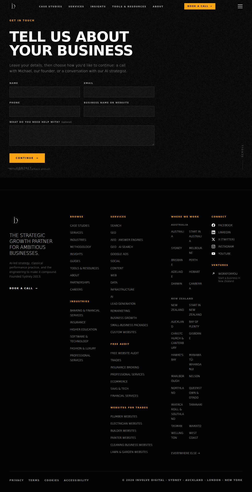

## Events (129)

| Time (UTC) | Event | Website | Details |
|---|---|---|---|
| 06:01:34 | run\_queued | — | dry\_run run requested by github:itsDevsArun |
| 06:01:34 | run\_dispatched | — | dispatch disabled (local test mode) |
| 06:01:39 | run\_started | — | Runner claimed dry\_run run |
| 06:01:39 | website\_selected | helixmechanical.com | Dry-run target helixmechanical.com |
| 06:01:39 | draft\_prepared | helixmechanical.com | Draft prepared with template standard v2 |
| 06:01:41 | page\_opened | helixmechanical.com | Opened form page |
| 06:01:41 | screenshot\_saved | helixmechanical.com | inspection screenshot saved (54 KB) |
| 06:01:41 | review\_required | helixmechanical.com | dry run failed: Mapped field "First Name \*" not found uniquely |
| 06:01:46 | website\_selected | eurola.com.au | Dry-run target eurola.com.au |
| 06:01:46 | draft\_prepared | eurola.com.au | Draft prepared with template standard v2 |
| 06:01:52 | page\_opened | eurola.com.au | Opened form page |
| 06:01:52 | screenshot\_saved | eurola.com.au | inspection screenshot saved (318 KB) |
| 06:01:52 | review\_required | eurola.com.au | dry run failed: Mapped field "field2" not found uniquely |
| 06:01:57 | website\_selected | knoxvilleelectrician.com | Dry-run target knoxvilleelectrician.com |
| 06:01:57 | draft\_prepared | knoxvilleelectrician.com | Draft prepared with template standard v2 |
| 06:02:01 | page\_opened | knoxvilleelectrician.com | Opened form page |
| 06:02:01 | screenshot\_saved | knoxvilleelectrician.com | inspection screenshot saved (137 KB) |
| 06:02:01 | review\_required | knoxvilleelectrician.com | dry run failed: Mapped field "Name" not found uniquely |
| 06:02:06 | website\_selected | tricityfinishing.com | Dry-run target tricityfinishing.com |
| 06:02:06 | draft\_prepared | tricityfinishing.com | Draft prepared with template standard v2 |
| 06:02:07 | page\_opened | tricityfinishing.com | Opened form page |
| 06:02:07 | screenshot\_saved | tricityfinishing.com | inspection screenshot saved (188 KB) |
| 06:02:07 | review\_required | tricityfinishing.com | dry run failed: Reviewed form not found on page (site changed) |
| 06:02:12 | website\_selected | starproperties.ca | Dry-run target starproperties.ca |
| 06:02:12 | draft\_prepared | starproperties.ca | Draft prepared with template standard v2 |
| 06:02:16 | page\_opened | starproperties.ca | Opened form page |
| 06:02:16 | screenshot\_saved | starproperties.ca | inspection screenshot saved (122 KB) |
| 06:02:16 | dry\_run\_checked | starproperties.ca | dry run ok: Selectors verified; fields not typed (domain not in dry-run fill list); not submitted |
| 06:02:21 | website\_selected | constructionbelanger.com | Dry-run target constructionbelanger.com |
| 06:02:21 | draft\_prepared | constructionbelanger.com | Draft prepared with template standard v2 |
| 06:02:22 | page\_opened | constructionbelanger.com | Opened form page |
| 06:02:23 | screenshot\_saved | constructionbelanger.com | inspection screenshot saved (185 KB) |
| 06:02:23 | dry\_run\_checked | constructionbelanger.com | dry run ok: Selectors verified; fields not typed (domain not in dry-run fill list); not submitted |
| 06:02:28 | website\_selected | calgarybathrenos.ca | Dry-run target calgarybathrenos.ca |
| 06:02:28 | draft\_prepared | calgarybathrenos.ca | Draft prepared with template standard v2 |
| 06:02:29 | page\_opened | calgarybathrenos.ca | Opened form page |
| 06:02:29 | screenshot\_saved | calgarybathrenos.ca | inspection screenshot saved (134 KB) |
| 06:02:29 | dry\_run\_checked | calgarybathrenos.ca | dry run ok: Selectors verified; fields not typed (domain not in dry-run fill list); not submitted |
| 06:02:34 | website\_selected | eurohouse.ca | Dry-run target eurohouse.ca |
| 06:02:34 | draft\_prepared | eurohouse.ca | Draft prepared with template standard v2 |
| 06:02:35 | page\_opened | eurohouse.ca | Opened form page |
| 06:02:35 | screenshot\_saved | eurohouse.ca | inspection screenshot saved (158 KB) |
| 06:02:35 | dry\_run\_checked | eurohouse.ca | dry run ok: Selectors verified; fields not typed (domain not in dry-run fill list); not submitted |
| 06:02:40 | website\_selected | yfcv.ca | Dry-run target yfcv.ca |
| 06:02:40 | draft\_prepared | yfcv.ca | Draft prepared with template standard v2 |
| 06:02:45 | page\_opened | yfcv.ca | Opened form page |
| 06:02:45 | screenshot\_saved | yfcv.ca | inspection screenshot saved (153 KB) |
| 06:02:45 | dry\_run\_checked | yfcv.ca | dry run ok: Selectors verified; fields not typed (domain not in dry-run fill list); not submitted |
| 06:02:50 | website\_selected | minute-men.com | Dry-run target minute-men.com |
| 06:02:50 | draft\_prepared | minute-men.com | Draft prepared with template standard v2 |
| 06:02:53 | page\_opened | minute-men.com | Opened form page |
| 06:02:53 | screenshot\_saved | minute-men.com | inspection screenshot saved (393 KB) |
| 06:02:53 | dry\_run\_checked | minute-men.com | dry run ok: Selectors verified; fields not typed (domain not in dry-run fill list); not submitted |
| 06:02:58 | website\_selected | phillipsmoving.com | Dry-run target phillipsmoving.com |
| 06:02:58 | draft\_prepared | phillipsmoving.com | Draft prepared with template standard v2 |
| 06:02:59 | page\_opened | phillipsmoving.com | Opened form page |
| 06:02:59 | screenshot\_saved | phillipsmoving.com | inspection screenshot saved (94 KB) |
| 06:02:59 | dry\_run\_checked | phillipsmoving.com | dry run ok: Selectors verified; fields not typed (domain not in dry-run fill list); not submitted |
| 06:03:04 | website\_selected | galaxymoverscalgary.ca | Dry-run target galaxymoverscalgary.ca |
| 06:03:04 | draft\_prepared | galaxymoverscalgary.ca | Draft prepared with template standard v2 |
| 06:03:07 | page\_opened | galaxymoverscalgary.ca | Opened form page |
| 06:03:07 | screenshot\_saved | galaxymoverscalgary.ca | inspection screenshot saved (141 KB) |
| 06:03:07 | dry\_run\_checked | galaxymoverscalgary.ca | dry run ok: Selectors verified; fields not typed (domain not in dry-run fill list); not submitted |
| 06:03:12 | website\_selected | cardinalmoving.ca | Dry-run target cardinalmoving.ca |
| 06:03:12 | draft\_prepared | cardinalmoving.ca | Draft prepared with template standard v2 |
| 06:03:13 | page\_opened | cardinalmoving.ca | Opened form page |
| 06:03:13 | screenshot\_saved | cardinalmoving.ca | inspection screenshot saved (195 KB) |
| 06:03:13 | dry\_run\_checked | cardinalmoving.ca | dry run ok: Selectors verified; fields not typed (domain not in dry-run fill list); not submitted |
| 06:03:18 | website\_selected | sblawpartners.com.au | Dry-run target sblawpartners.com.au |
| 06:03:18 | draft\_prepared | sblawpartners.com.au | Draft prepared with template standard v2 |
| 06:03:24 | page\_opened | sblawpartners.com.au | Opened form page |
| 06:03:24 | screenshot\_saved | sblawpartners.com.au | inspection screenshot saved (95 KB) |
| 06:03:24 | review\_required | sblawpartners.com.au | dry run failed: Mapped field "Name \*" not found uniquely |
| 06:03:29 | website\_selected | frhlaw.ca | Dry-run target frhlaw.ca |
| 06:03:29 | draft\_prepared | frhlaw.ca | Draft prepared with template standard v2 |
| 06:03:31 | page\_opened | frhlaw.ca | Opened form page |
| 06:03:31 | screenshot\_saved | frhlaw.ca | inspection screenshot saved (215 KB) |
| 06:03:31 | dry\_run\_checked | frhlaw.ca | dry run ok: Selectors verified; fields not typed (domain not in dry-run fill list); not submitted |
| 06:03:36 | website\_selected | cbmlawyers.com | Dry-run target cbmlawyers.com |
| 06:03:36 | draft\_prepared | cbmlawyers.com | Draft prepared with template standard v2 |
| 06:03:38 | page\_opened | cbmlawyers.com | Opened form page |
| 06:03:38 | screenshot\_saved | cbmlawyers.com | inspection screenshot saved (211 KB) |
| 06:03:38 | dry\_run\_checked | cbmlawyers.com | dry run ok: Selectors verified; fields not typed (domain not in dry-run fill list); not submitted |
| 06:03:43 | website\_selected | lajoiepearson.com | Dry-run target lajoiepearson.com |
| 06:03:43 | draft\_prepared | lajoiepearson.com | Draft prepared with template standard v2 |
| 06:03:45 | page\_opened | lajoiepearson.com | Opened form page |
| 06:03:45 | screenshot\_saved | lajoiepearson.com | inspection screenshot saved (63 KB) |
| 06:03:45 | dry\_run\_checked | lajoiepearson.com | dry run ok: Selectors verified; fields not typed (domain not in dry-run fill list); not submitted |
| 06:03:50 | website\_selected | sok-law.com | Dry-run target sok-law.com |
| 06:03:50 | draft\_prepared | sok-law.com | Draft prepared with template standard v2 |
| 06:03:56 | page\_opened | sok-law.com | Opened form page |
| 06:03:57 | screenshot\_saved | sok-law.com | inspection screenshot saved (146 KB) |
| 06:03:57 | dry\_run\_checked | sok-law.com | dry run ok: Selectors verified; fields not typed (domain not in dry-run fill list); not submitted |
| 06:04:02 | website\_selected | portcreditlaw.com | Dry-run target portcreditlaw.com |
| 06:04:02 | draft\_prepared | portcreditlaw.com | Draft prepared with template standard v2 |
| 06:04:14 | page\_opened | portcreditlaw.com | Opened form page |
| 06:04:14 | screenshot\_saved | portcreditlaw.com | inspection screenshot saved (162 KB) |
| 06:04:14 | dry\_run\_checked | portcreditlaw.com | dry run ok: Selectors verified; fields not typed (domain not in dry-run fill list); not submitted |
| 06:04:19 | website\_selected | cascadelaw.com | Dry-run target cascadelaw.com |
| 06:04:19 | draft\_prepared | cascadelaw.com | Draft prepared with template standard v2 |
| 06:04:21 | page\_opened | cascadelaw.com | Opened form page |
| 06:04:21 | screenshot\_saved | cascadelaw.com | inspection screenshot saved (128 KB) |
| 06:04:21 | dry\_run\_checked | cascadelaw.com | dry run ok: Selectors verified; fields not typed (domain not in dry-run fill list); not submitted |
| 06:04:26 | website\_selected | valleylawgroup.ca | Dry-run target valleylawgroup.ca |
| 06:04:26 | draft\_prepared | valleylawgroup.ca | Draft prepared with template standard v2 |
| 06:04:29 | page\_opened | valleylawgroup.ca | Opened form page |
| 06:04:29 | screenshot\_saved | valleylawgroup.ca | inspection screenshot saved (110 KB) |
| 06:04:29 | dry\_run\_checked | valleylawgroup.ca | dry run ok: Selectors verified; fields not typed (domain not in dry-run fill list); not submitted |
| 06:04:34 | website\_selected | libertylawcorp.com | Dry-run target libertylawcorp.com |
| 06:04:34 | draft\_prepared | libertylawcorp.com | Draft prepared with template standard v2 |
| 06:04:35 | page\_opened | libertylawcorp.com | Opened form page |
| 06:04:35 | screenshot\_saved | libertylawcorp.com | inspection screenshot saved (95 KB) |
| 06:04:35 | dry\_run\_checked | libertylawcorp.com | dry run ok: Selectors verified; fields not typed (domain not in dry-run fill list); not submitted |
| 06:04:40 | website\_selected | mspc.cpa | Dry-run target mspc.cpa |
| 06:04:40 | draft\_prepared | mspc.cpa | Draft prepared with template standard v2 |
| 06:04:43 | page\_opened | mspc.cpa | Opened form page |
| 06:04:43 | screenshot\_saved | mspc.cpa | inspection screenshot saved (162 KB) |
| 06:04:43 | review\_required | mspc.cpa | dry run failed: Mapped field "Full Name \*" not found uniquely |
| 06:04:48 | website\_selected | juicerealestate.com.au | Dry-run target juicerealestate.com.au |
| 06:04:48 | draft\_prepared | juicerealestate.com.au | Draft prepared with template standard v2 |
| 06:04:51 | page\_opened | juicerealestate.com.au | Opened form page |
| 06:04:51 | screenshot\_saved | juicerealestate.com.au | inspection screenshot saved (59 KB) |
| 06:04:51 | review\_required | juicerealestate.com.au | dry run failed: CAPTCHA/anti-bot now present (recaptcha) |
| 06:04:56 | website\_selected | involvedigital.com | Dry-run target involvedigital.com |
| 06:04:56 | draft\_prepared | involvedigital.com | Draft prepared with template standard v2 |
| 06:04:58 | page\_opened | involvedigital.com | Opened form page |
| 06:04:58 | screenshot\_saved | involvedigital.com | inspection screenshot saved (204 KB) |
| 06:04:58 | review\_required | involvedigital.com | dry run failed: Form is multi-step |
| 06:05:03 | run\_completed | — | Run completed (queue\_exhausted) |
